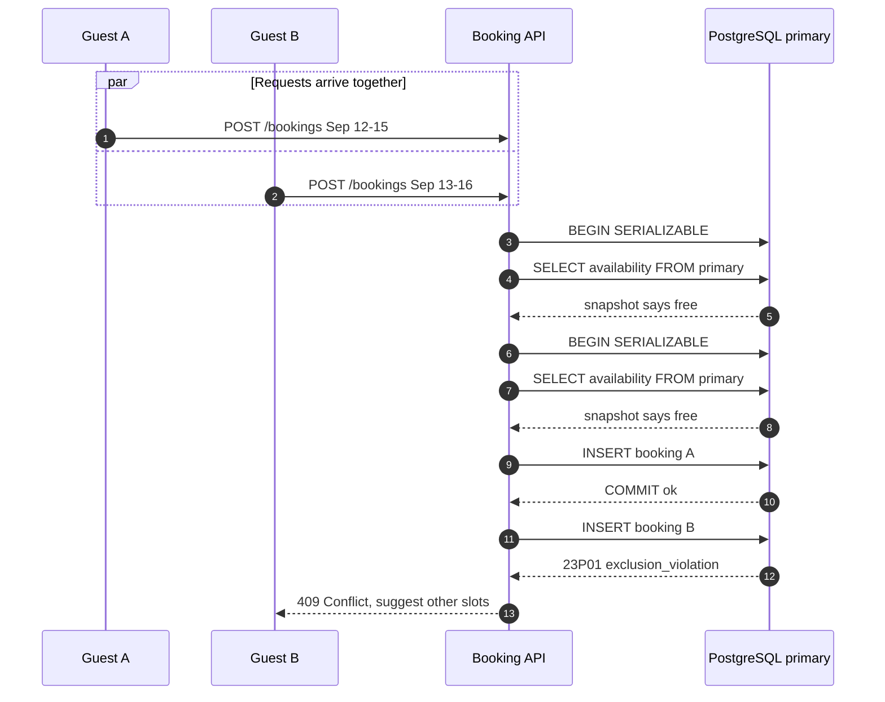

| Difficulty | Channel | Tags |
|---|---|---|
| intermediate | database | acid, isolation-levels, mvcc |

Picture a calendar with one host, one open weekend, and two guests who press Confirm within the same millisecond. Cal.com, the open-source scheduling platform used to book appointments with hosts, hit exactly that scenario: sequential requests were correctly rejected with a 409, but simultaneous overlapping requests both succeeded [1]. The bug looked like a business-rules problem, yet it was a concurrency race hiding behind an idempotency key that only caught exact duplicates [1]. What follows is the journey from that deceptive failure to a transaction design that keeps availability high and double bookings impossible.

---

> ### Real-World Case — Cal.com
>
> Cal.com, the open-source scheduling platform used to book appointments with hosts, accepted two overlapping bookings for the same host when the requests arrived at the same instant. Sequential requests were correctly rejected with a 409, so the bug looked like a business-rules issue rather than a concurrency race.
>
> | | |
> |---|---|
> | **Challenge** | Guarantee that concurrent booking requests for overlapping time windows cannot both commit, even though the system already had an idempotency key guard. |
> | **Solution** | The team traced it to a check-then-act flow: availability was read outside the write transaction, and the insert ran at the default isolation level with no row or advisory lock. The proposed fix is a Postgres exclusion constraint on accepted bookings per host using btree_gist and tsrange overlap (mapping SQLSTATE 23P01 to HTTP 409), or serializing bookings per host with pg_advisory_xact_lock / SELECT ... FOR UPDATE and re-checking overlaps inside the transaction. |
> | **Outcome** | An automated CI concurrency suite firing both requests together reproduced double booking in 165 of 180 trials (91.7%) across multiple runs. The existing idempotency key only blocked exact duplicates; overlapping windows produced different keys, so both inserts succeeded. |
> | **Lesson** | Idempotency keys stop retries of the same request, not two different requests that overlap. If two records must never coexist, enforce that invariant in the database with an exclusion constraint or a serialized transaction — an application-level check-then-act always leaves a race window. |

---

## Hook — One Calendar, Two Confirmations, Zero Warnings

Picture a calendar with one host, one open weekend, and two guests who press Confirm within the same millisecond. Both requests return 201. Both guests receive a confirmation email. The host finds out about the collision only when two people show up for the same slot. Here is the unsettling part: run those same requests a second apart and the second one fails correctly with a 409, so every manual test and every demo says the system is fine. That gap between 'works when tested slowly' and 'breaks under real traffic' is where booking platforms earn or lose their reputation.

## Problem — The Check-Then-Act Trap Hiding in Plain Sight

The core challenge is a check-then-act sequence spread across multiple database round trips. Your code asks the database whether a date range is free, receives a confident yes, and then inserts a booking. Between those two statements, another request can ask the same question and receive the same yes. Database engineers call this a time-of-check to time-of-use race; developers who have shipped calendars call it a Tuesday. It gets harder because availability is not a single row you can flip: a booking spans a range, so correctness depends on the absence of conflicting rows, which is the classic phantom problem in transaction processing [8]. The stakes are not abstract. An overbooking means refunds, support tickets, angry hosts, and a trust deficit that outlives the bug fix. High availability makes the trap worse, because the availability check is often served by a read replica that lags behind the primary by tens or hundreds of milliseconds. The API can be perfectly consistent with a stale snapshot and still be wrong about reality. A 409 is the honest signal that the requested state conflicts with the current one [10], but only if the server actually knows the current state at the moment it writes.

## Real-World Case — Cal.com

This is not a hypothetical classroom exercise. Cal.com, the open-source scheduling platform used to book appointments with hosts, accepted two overlapping bookings for the same host when the requests arrived at the same instant [1]. Sequential requests were correctly rejected with a 409, so the bug looked like a business-rules issue rather than a concurrency race. The team built an automated CI concurrency suite that fired both requests together, and it reproduced the double booking in 165 of 180 trials across multiple runs, a 91.7% failure rate [1]. The plot twist is the idempotency key. It only blocked exact duplicates; two overlapping windows produced different request payloads, therefore different keys, so both inserts succeeded [1]. The safety mechanism was working exactly as designed and still allowed the failure. That distinction matters: idempotency answers 'did this exact request already happen?' It does not answer 'does this new booking overlap an existing one?'

## Deep Dive — Why SERIALIZABLE Is Not a Magic Wand

Understanding the race is only half the battle; the other half is choosing where to enforce the invariant. Isolation levels are the first lever most teams reach for. Read Committed prevents dirty reads but lets two transactions see the same free window. Repeatable Read gives each transaction a stable snapshot, yet two snapshots can still both conclude that a range is free. Serializable, specifically PostgreSQL's Serializable Snapshot Isolation, adds conflict detection that aborts one of the conflicting transactions, but the abort is an expected outcome, not an exception you can ignore [2]. If the application does not retry serialization failures, a correct isolation level simply converts a double booking into a burst of 500 errors. MVCC is what makes this trade-off possible: readers do not block writers and writers do not block readers, because each transaction sees a consistent snapshot [3]. That is excellent for availability and terrible for wishful thinking, since a snapshot is a photograph, not a live feed. Row-level locks are the second lever. SELECT FOR UPDATE locks rows that exist [4], which works beautifully for an inventory row or a queue item, but it cannot lock a row that has not been inserted yet. Two transactions can lock nothing, insert two overlapping bookings, and commit happily. A version column implements optimistic concurrency control [5]: read version 7, update to version 8, and let the loser retry. It works, but on a popular property every booking for that host now contends on the same hot row, which trades correctness for a retry storm. Snapshot isolation and two-phase locking each solve part of the puzzle [6][7], and InnoDB's next-key locking can approximate range protection in MySQL when the indexes and isolation level line up [9]. The cleanest answer, however, is usually to stop treating this as an application-logic problem. PostgreSQL exclusion constraints can reject overlapping ranges atomically at the storage layer [12]. A GiST index over (host_id, tstzrange(starts_at, ends_at, '[)')) with the && operator makes double booking impossible regardless of how many app servers, replicas, or retries exist. The database owns the invariant, and every code path inherits the guarantee. Here is the honest trade-off table:

| Strategy | What it protects | Failure mode | Best fit |
|---|---|---|---|
| SERIALIZABLE transaction | The whole transaction against anomalies | Aborts under contention; needs retries [2] | Mixed reads and writes across tables |
| SELECT FOR UPDATE | Existing rows you explicitly lock | Cannot lock rows that do not exist yet [4] | Queue rows and account balances |
| Version column (optimistic) | Single-row updates | Hot-row retry storms on popular properties [5] | Low-contention edits |
| Exclusion constraint | Range overlaps at the storage layer | PostgreSQL-specific; needs a GiST index [12] | Calendar and booking windows |
| Slot rows plus unique index | Fixed-length reservations | Schema churn when slot length changes | Uniform time slots |
| Advisory lock | Coarse named critical sections | Easy to leak; not row-scoped | Per-host setup or migration tasks |

One more nuance deserves a warning label: read replicas are for browsing, never for the final booking decision. The write path must read and write on the primary inside the same transaction, because a replica that is 200 milliseconds behind will happily approve a slot that was taken while the request was in flight. For genuinely hot properties, add a pressure valve: a per-host queue, lock striping, or a circuit breaker that sheds load before every request piles onto the same row. Measure lock wait time and serialization failure rate; those two numbers tell you whether the design is holding or merely surviving.

## Workflow — From Invariant to Enforced Constraint

With the invariant clear, the implementation becomes a checklist rather than a hope. The sequence diagram below tells the story of two requests that arrive together and leave with different outcomes.

1. Model the unit of contention. Decide whether the system reserves date ranges or fixed slots. Ranges need an exclusion constraint; fixed slots can use a unique index on (host_id, slot_start).
2. Put the invariant in the schema. Add the constraint before writing application logic, so no code path can bypass it [12].
3. Keep the decision and the write in one transaction on the primary. Never split the availability check and the insert across services or replicas.
4. Make retries safe. Scope idempotency keys to the guest plus a hash of the requested window, and store the key in the same table as the booking.
5. Translate violations into honest responses. An exclusion violation is a 409, not a 500 [10]; include the next available windows so the client can recover.
6. Cache for reads, invalidate on commit. Availability caches are fine for search results, as long as a successful booking evicts or versions the affected keys.
7. Observe contention. Track retry rate, lock wait time, and 409 rate per host. A rising retry rate is the early warning that a hot property needs a queue or a coarser lock.

The diagram makes the asymmetry visible: both requests can read the same free snapshot, but only one insert can satisfy the constraint.

## Code Example — The Write Path That Cannot Double Book

The TypeScript below implements the write path with node-postgres, assuming the exclusion constraint from the workflow already exists. The important detail is not the syntax; it is the division of responsibility. The database enforces the invariant, and the application handles the two legitimate failure modes: a slot that was taken and a transaction that lost a serialization race.

The code first opens a serializable transaction so the availability snapshot and the insert share one consistent view. It then checks the idempotency key, which makes retries safe when the client resends the same request after a timeout. The insert itself is intentionally boring: the exclusion constraint does the hard work, rejecting any range that overlaps an existing booking for that host. The catch block distinguishes between a business conflict (23P01) and a transient serialization failure (40001 or deadlock 40P01), retrying only the latter with jittered exponential backoff [11]. That separation is what keeps a correctness guarantee from turning into an availability outage. Finally, the client is always released, even on failure, because connection leaks are the quiet cousin of concurrency bugs.

## Lessons Learned — What Survives Contact With Production

The journey from a 91.7% reproduction rate to a system that cannot double book is mostly a journey of misplaced trust. Here is what survives contact with production.

- Idempotency is not overlap detection. It protects against duplicate delivery of the same request, not against two different requests that conflict [1]. Many teams discover this only after the concurrency suite turns red.
- SERIALIZABLE without retries is an outage generator. Conflict detection is supposed to abort transactions; an application that treats those aborts as fatal has simply moved the failure [2].
- The database should own the invariant. Application checks are advisory because they run at a different time than the write. A constraint runs at commit time, which is the only moment that matters [12].
- Read replicas are for browsing, not booking. Stale reads are acceptable for search results and unacceptable for the final yes.
- Hot rows need a pressure valve. Even a correct design can melt under concentrated load; queue, stripe, or shed before the database becomes the bottleneck.
- Test concurrency, not just sequence. A suite that sends requests one after another will certify a broken system with confidence.

When choosing an approach, match the mechanism to the shape of the data: exclusion constraints for arbitrary ranges, unique indexes for fixed slots, row locks for existing mutable rows, and optimistic versions for low-contention edits. The common thread is that the guarantee lives where the write happens. Everything else is coordination around it.

---

## Concurrent Booking Race

<strong>Original Interview Question</strong>

**Q:** You're building a booking system for Airbnb where multiple users can reserve the same property simultaneously. How would you design the transaction handling to prevent double bookings while maintaining high availability?

**A:** Use SERIALIZABLE isolation with optimistic concurrency control. Implement row-level locks on property availability tables, use MVCC snapshot reads for checking availability, and apply application-level validation to ensure atomic booking operations.

## Conclusion

Cal.com's concurrency suite did not just find a bug; it exposed a category error. The system had a duplicate detector where it needed a conflict detector, and the difference only appeared when two requests arrived together [1]. The lesson transfers directly to any booking, reservation, inventory, or scheduling system: put the invariant in the database, keep the check and the write in one transaction on the primary, treat serialization failures as retryable weather rather than disasters, and test with the concurrency your users will actually create. Do that, and the scariest race in your calendar becomes a constraint violation you can explain in a single sentence.

---

## References

1. [Cal.com incident report](https://github.com/calcom/cal.diy/issues/30374) — article
2. [PostgreSQL Documentation: Transaction Isolation](https://www.postgresql.org/docs/current/transaction-iso.html) — documentation
3. [PostgreSQL Documentation: Introduction to MVCC](https://www.postgresql.org/docs/current/mvcc-intro.html) — documentation
4. [PostgreSQL Documentation: SELECT and Locking Clauses](https://www.postgresql.org/docs/current/sql-select.html) — documentation
5. [Optimistic Concurrency Control](https://en.wikipedia.org/wiki/Optimistic_concurrency_control) — article
6. [Snapshot Isolation](https://en.wikipedia.org/wiki/Snapshot_isolation) — article
7. [Two-Phase Locking](https://en.wikipedia.org/wiki/Two-phase_locking) — article
8. [ACID](https://en.wikipedia.org/wiki/ACID) — article
9. [MySQL Documentation: InnoDB Locking](https://dev.mysql.com/doc/refman/8.0/en/innodb-locking.html) — documentation
10. [RFC 9110: HTTP Semantics](https://datatracker.ietf.org/doc/html/rfc9110) — documentation
11. [Exponential Backoff](https://en.wikipedia.org/wiki/Exponential_backoff) — article
12. [PostgreSQL Documentation: CREATE TABLE and Exclusion Constraints](https://www.postgresql.org/docs/current/sql-createtable.html) — documentation

---

**Author:** Satishkumar Dhule — [GitHub](https://github.com/satishkumar-dhule) · [LinkedIn](https://linkedin.com/in/satishkumar-dhule) · [Website](https://satishkumar-dhule.github.io)
