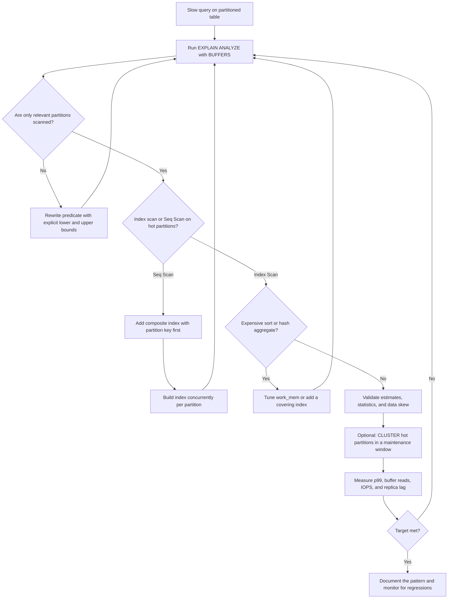

| Difficulty | Channel | Tags |
|---|---|---|
| intermediate | database | explain, query-plan, partitioning |

CoinGecko's hourly cryptocurrency price table had quietly grown past 1TB over eight years, and queries that once felt instant were averaging more than 30 seconds [1]. Raising provisioned IOPS to 24K did not stop the request queues, the falling Apdex, the replica lag, or the daily alerts [1]. The real culprit was not a tired disk—it was a query plan that ignored partitions and indexes at exactly the wrong moments. What follows is the detective story behind that slowdown, and the checklist any developer can use to spot the same trap before it finds them.

---

> ### Real-World Case — CoinGecko
>
> CoinGecko's hourly cryptocurrency price table grew past 1TB over 8 years, and queries were taking over 30 seconds on average. Rising IOPS from price-endpoint traffic caused request queues, declining Apdex, replica lag, and daily alerts even after they raised provisioned IOPS to 24K.
>
> | | |
> |---|---|
> | **Challenge** | The team needed to make date-range queries on the massive prices table fast without a risky downtime migration. Adding indexes was not enough because the queries relied on a JSONB column keyed by supported currencies, and indexing every application's keys was impractical, so they chose monthly range partitioning on the timestamp column. |
> | **Solution** | They migrated to a declaratively partitioned table using RANGE partitioning by month so that typical queries touching a few months would prune to at most about four partitions. They warmed partitions with pg_prewarm, used triggers and a foreign data wrapper to copy data with minimal production impact, and later fixed regressions by rewriting queries to include both lower and upper date bounds and by removing pre-created empty future partitions. |
> | **Outcome** | p99 response time dropped from 4.13s to 578ms, roughly an 86% reduction, while IOPS fell about 20% with savings multiplied across replicas. Dry runs showed 6-8x improvement on the same queries, and replica lag disappeared after the cutover. Critically, one query initially got worse after partitioning because it lacked a lower date bound, causing PostgreSQL to scan every partition. |
> | **Lesson** | Partitioning only helps when EXPLAIN confirms pruning. A missing lower bound, an upper-bound-only predicate, or a large set of empty future partitions can force a scan across every partition and make the partitioned table slower than the original unpartitioned table, so verify both the plan and the query's date predicates. |

---

## Hook — When 24K IOPS Still Isn't Enough

The pager fires at 3 a.m. because a price-history endpoint is timing out again. Dashboards show request queues stacking up, Apdex sliding, and read replicas drifting further behind primary. The instinct is almost always the same: add IOPS, add replicas, add hardware. CoinGecko tried that, pushing provisioned IOPS to 24K, and the alerts kept coming [1].

Here is the uncomfortable truth: PostgreSQL was not short on horsepower. It was being asked to do the wrong work. A query that should have touched one month of data was reading far more than that, and the query plan was happy to explain why—if anyone knew where to look [1].

So what happens when a partitioned table quietly stops pruning, and every partition becomes fair game? That question sits at the center of this story.

## Problem — Partitioning Is a Promise, Not a Guarantee

Table partitioning is sold as a simple bargain: split a giant table into smaller, date-based chunks, and PostgreSQL will only read the chunks that matter [2]. That behavior is called partition pruning, and when it works, a 100-million-row table behaves like a handful of small tables.

However, pruning is not automatic magic. The planner must prove that a predicate excludes entire partitions at plan time [2]. That proof breaks in predictable ways:

- **No lower bound.** `WHERE event_date <= '2024-01-31'` gives the planner no starting point, so it may scan every partition from the beginning of time [2].
- **Functions or casts on the partition key.** `WHERE date_trunc('day', event_date) = '2024-01-01'` hides the raw column from the planner's pruning logic [2].
- **Wrong index for the filter.** A partition can be pruned correctly and still scan sequentially because no index matches the remaining predicates [6].
- **Sorts that spill to disk.** Even a small result set can become slow when PostgreSQL must sort millions of rows with insufficient `work_mem` [3].
- **Stale statistics.** Bad row estimates lead to bad plan choices, especially as data skews toward recent partitions [3].

The stakes are easy to underestimate. A slow price endpoint does not just annoy one user; it occupies connections, drives up IOPS, delays replication, and pushes p99 latency into the red. Teams often respond by scaling vertically, which raises cost without fixing the underlying access path. The query plan is the crime scene, and most teams never read it closely enough.

## Real-World Case — CoinGecko's 1TB Price Table

CoinGecko's hourly cryptocurrency price table grew past 1TB over eight years, and queries were averaging more than 30 seconds [1]. The workload was not exotic: price endpoints filtered by date and status, the kind of query pattern that partitioning is supposed to make boring.

Instead, rising IOPS from price-endpoint traffic created request queues, declining Apdex, replica lag, and daily alerts—even after the team raised provisioned IOPS to 24K [1]. More hardware bought headroom, but not a cure.

The breakthrough came from treating partitioning as a query-plan problem, not a storage problem. After the cutover, p99 response time dropped from 4.13 seconds to 578 milliseconds, roughly an 86% reduction, while IOPS fell about 20%; the savings multiplied across replicas [1]. Dry runs showed 6-8x improvement on the same queries, and replica lag disappeared after the cutover [1].

Then came the plot twist. One query initially got worse after partitioning because it lacked a lower date bound, causing PostgreSQL to scan every partition [1]. The lesson is sharp: partitioning changes where PostgreSQL looks, but it does not guarantee that your predicates give it enough information to look away. A single missing boundary can turn a win into a regression.

## Deep Dive — Reading the Query Plan Like a Detective

Start with `EXPLAIN (ANALYZE, BUFFERS)`, not plain `EXPLAIN`, because estimates alone can lie [3]. The `ANALYZE` option executes the query and shows actual rows and timing; `BUFFERS` shows how many pages came from cache versus disk [3]. Those two additions turn a vague suspicion into evidence.

**1. Verify partition pruning first.** Look for an `Append` node and count the partitions underneath it. If the plan touches every partition, the predicate is not prune-friendly. The fix is usually to write an explicit lower and upper bound on the partition key and to keep functions off that column [2].

**2. Then inspect scan types.** A `Seq Scan` on a hot partition means PostgreSQL is walking the whole chunk. An `Index Scan` or `Bitmap Heap Scan` means it found a usable path [6]. Pruning and indexing are separate wins; teams often fix one and assume the other followed.

**3. Check for expensive sorts and aggregates.** `Sort Method: external merge Disk: ...` is a red flag that the sort spilled to disk [3]. If the query orders by a column that is not indexed, or aggregates a large slice, consider a covering index or a temporary `work_mem` increase for that workload [6].

**4. Design the composite index deliberately.** For a query filtering on `event_date` and `status`, the index order matters: put the partition key first, then the equality filter that narrows the most [4]. A covering index with `INCLUDE` columns can also enable index-only scans, but every included column adds write amplification [4].

🔥 **Hot take:** More indexes are not automatically better. Every index is a tax on writes, vacuum, and cache. The goal is the smallest set of indexes that makes the top query patterns cheap.

**5. Treat clustering as a maintenance decision.** `CLUSTER` rewrites a table in index order, which can dramatically improve range scans, but it takes an exclusive lock and is not a one-time fix [5]. For partitioned tables, cluster the hottest partitions during a maintenance window and let newer data arrive naturally [5].

| Symptom in EXPLAIN | What it usually means | First move |
| --- | --- | --- |
| `Append` over every partition | Pruning failed | Add explicit lower and upper bounds; remove casts |
| `Seq Scan` on recent partitions | No usable index | Composite index with the partition key first |
| `Sort Method: external merge Disk` | Sort spilled to disk | Increase `work_mem` or index the sort order |
| `rows=1` estimated, `actual rows=500000` | Stale statistics | Run `ANALYZE`; tune autovacuum |
| Huge `Buffers: shared read` | Reading too many pages | Review selectivity and clustering |

💡 **Insight:** A query plan is a story about assumptions. Estimates, statistics, predicates, and indexes are the plot points; when the story goes wrong, one of those assumptions is false.

⚠️ **Watch Out:** Testing only on a small staging table hides these failures. The planner's choices change with data volume and distribution, so validate against production-sized samples whenever possible [3].

## Workflow — From Slow Query to Verified Fix

The flowchart below captures the decision path: capture evidence, check pruning, check scan types, check sorts, then change one thing at a time and re-measure.

1. **Reproduce and baseline.** Record p50, p95, and p99 latency, rows returned, and buffer reads for the exact query pattern. Without a baseline, every optimization is a guess.
2. **Run `EXPLAIN (ANALYZE, BUFFERS)`.** Capture the plan on a replica or staging copy with production-like data [3].
3. **Count the partitions scanned.** If the plan includes partitions outside the requested range, fix the predicate before touching indexes [2].
4. **Inspect scans inside each partition.** Replace sequential scans on hot partitions with a deliberate composite index [4].
5. **Look for external sorts and hash aggregates.** Tune `work_mem` carefully, or redesign the index to support the ordering and grouping [3].
6. **Add indexes without blocking writes.** Build per-partition indexes with `CREATE INDEX CONCURRENTLY`, then attach them to a parent partitioned index [4].
7. **Re-run the same query with the same parameters.** Compare actual time, rows, and buffers, not just the total runtime.
8. **Monitor the system, not just the query.** Track IOPS, replica lag, cache hit ratio, and p99 after the change; the query may improve while the system worsens [9].

🎯 **Key Point:** Change one variable at a time. If you add an index, rewrite a predicate, and bump `work_mem` in the same deploy, you will never know which change actually helped.

## Code Example — A Repeatable PostgreSQL Investigation

The script below turns the investigation into a repeatable sequence: capture the plan, count touched partitions, build an index without blocking writes, and compare the before-and-after evidence. It is deliberately conservative—no `CLUSTER`, no destructive changes, and no guessing.

The key detail is the predicate: an explicit `>=` and `<` range on `event_date` gives the planner a chance to prune. The composite index then puts the partition key first, followed by the equality filter, so each surviving partition has a cheap access path [4]. Finally, the re-check measures buffers and timing rather than relying on a stopwatch.

Adapt the table and column names to your schema, run it against a replica first, and keep the output from both plans so the improvement is provable.

## Lessons Learned — What to Check Before Adding Another IOPS

- **Prove pruning before praising partitioning.** `EXPLAIN` should show only the partitions in your date range; if not, the predicate is the problem [2].
- **Always bound the partition key on both sides.** A missing lower bound can turn a partition-wise query into a full-table tour [1].
- **Keep functions and casts off the partition column.** They can silently disable pruning [2].
- **Read `BUFFERS`, not just timing.** Buffer reads reveal whether the query is touching too many pages, which timing alone can hide [3].
- **Let column order follow the query.** Partition key first, then the most selective equality predicate; use `INCLUDE` only when index-only scans justify the write cost [4].
- **Cluster with a maintenance plan, not hope.** `CLUSTER` is a rewrite with locking implications, not a permanent state [5].
- **Test the query that got worse.** After any partitioning change, re-run every top query, especially the ones without tight date bounds [1].

Battle scars are predictable. Teams add an index but forget to analyze the table. They fix one endpoint and break the nightly report. They raise IOPS and celebrate a graph that only moved because traffic dipped. The reliable path is less glamorous: measure, inspect the plan, change one thing, and measure again.

Many developers think partitioning is a hardware optimization. It is really a contract between your schema, your predicates, and the planner. When any party breaks the contract, PostgreSQL falls back to brute force. The teams that internalize this stop paying for IOPS they do not need and start designing queries the planner can execute efficiently.

---

## Query Optimization Workflow

<strong>Original Interview Question</strong>

**Q:** You have a PostgreSQL table with 100M rows partitioned by date. A query filtering on a specific date range is still slow. What would you check in the EXPLAIN plan and how would you optimize it?

**A:** Check partition pruning effectiveness, index utilization patterns, and expensive sort operations. Create composite indexes on (date, filtered_columns) and evaluate clustering strategies for optimal data access.

## Conclusion

CoinGecko's 1TB table is not a story about buying faster disks. It is a story about giving PostgreSQL enough information to avoid work: a lower date bound, a prune-friendly predicate, and an index that matches the filter [1]. The same pattern shows up in tables one-hundredth the size, which is why this lesson scales down as well as up.

Tomorrow, before adding another IOPS or another replica, run `EXPLAIN (ANALYZE, BUFFERS)` on your slowest date-range query. Count the partitions. Check the scan types. Look for sorts that spill to disk. Then make one change, re-measure, and write down the numbers. The memorable insight is simple: partitioning limits where PostgreSQL looks, but indexes and predicates decide what it actually reads.

---

## References

1. [CoinGecko incident report](https://dev.to/coingecko/scaling-postgresql-performance-with-table-partitioning-136o) — article
2. [PostgreSQL Documentation: Table Partitioning](https://www.postgresql.org/docs/current/ddl-partitioning.html) — documentation
3. [PostgreSQL Documentation: EXPLAIN](https://www.postgresql.org/docs/current/sql-explain.html) — documentation
4. [PostgreSQL Documentation: CREATE INDEX](https://www.postgresql.org/docs/current/sql-createindex.html) — documentation
5. [PostgreSQL Documentation: CLUSTER](https://www.postgresql.org/docs/current/sql-cluster.html) — documentation
6. [PostgreSQL Documentation: Indexes](https://www.postgresql.org/docs/current/indexes.html) — documentation
7. [Wikipedia: Database Index](https://en.wikipedia.org/wiki/Database_index) — documentation
8. [Wikipedia: Query Plan](https://en.wikipedia.org/wiki/Query_plan) — documentation
9. [Amazon RDS for PostgreSQL Documentation](https://docs.aws.amazon.com/AmazonRDS/latest/UserGuide/CHAP_PostgreSQL.html) — documentation

---

**Author:** Satishkumar Dhule — [GitHub](https://github.com/satishkumar-dhule) · [LinkedIn](https://linkedin.com/in/satishkumar-dhule) · [Website](https://satishkumar-dhule.github.io)
