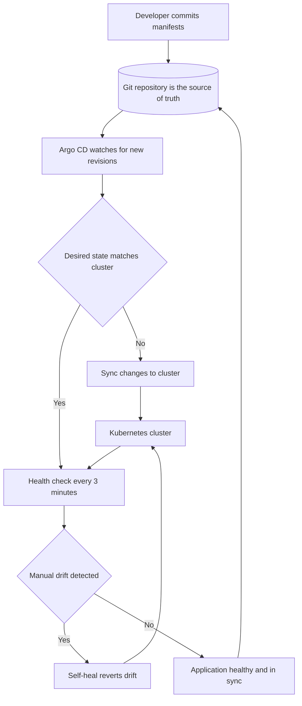

| Difficulty | Channel | Tags |
|---|---|---|
| beginner | devops | argocd, flux, declarative |

In 2018, Intuit was pushing thousands of services onto Kubernetes and needed every deployment to be boring, repeatable, and reversible [1]. Rather than buy a tool, the company acquired Applatix, the startup behind Argo, and built Argo CD into an internal declarative GitOps platform [1]. The payoff was not subtle: deployment time fell 80%, rollbacks finished in under 10 minutes, and mean time to recovery dropped from 45 minutes to under 5 [1]. By 2021 the platform was running 11,000+ applications across 375+ clusters for 5,000 developers — proof that the biggest win in GitOps is not automation, but a change in who owns the truth [1].

---

> ### Real-World Case — Intuit
>
> In 2018 Intuit was migrating thousands of services to Kubernetes and needed a way to deploy them consistently. Rather than buy a tool, Intuit acquired Applatix, the startup behind Argo, and built Argo CD as an internal declarative GitOps platform for its own engineering organization.
>
> | | |
> |---|---|
> | **Challenge** | Intuit had to move from manual, imperative deployment scripts to a model where Git is the single source of truth across hundreds of clusters, while keeping deployments auditable, reversible, and fast enough for teams shipping to production many times a day. |
> | **Solution** | Intuit defined applications declaratively in Git—Kubernetes manifests, Helm charts, and Kustomize overlays—and used Argo CD Application CRDs with automated sync and self-healing to continuously reconcile live cluster state with the desired state in Git. Environment promotion became a Git write plus an Argo CD sync, and emergency fixes had to flow through Git rather than kubectl. |
> | **Outcome** | Intuit reported deployment time down 80%, rollbacks under 10 minutes, MTTR falling from 45 minutes to under 5 minutes, and roughly 500,000 developer hours saved annually (about 57 years of work). By 2021 the platform ran 11,000+ applications across 375+ clusters for 5,000 developers, and by 2025 it exceeded 20,000 applications. |
> | **Lesson** | The plot twist: at massive scale, Intuit found that environment promotion often forced teams to turn autosync off and fall back on imperative pipelines—breaking the GitOps promise. Self-healing is powerful but blind: it will faithfully re-apply a broken Git state during an incident, so break-glass procedures and promotion-aware tooling matter as much as enabling auto-sync. |

---

## Hook — The Deploy That Nobody Has to Run

What if the safest deployment was the one nobody had to run?

Imagine a release night with no heroics. No engineer hunched over a terminal at 3 a.m., no frantic sequence of kubectl apply commands, no Slack thread asking who changed the replica count. A commit lands, a controller notices, and the cluster quietly becomes what the repository says it should be.

That calm is the promise of GitOps, and it is easy to mistake for passivity. The teams that get there usually arrive from a noisier place: production drifts away from staging, a hotfix lives only in one engineer's shell history, and the rollback plan is a screenshot of yesterday's deployment. Intuit hit that wall at enormous scale, with thousands of services and a Kubernetes migration that could not afford guesswork [1].

The gap between those two worlds is not a tool you install. It is a decision about where truth lives — and that decision changes everything that follows.

## Problem — When the Cluster Becomes a Snowflake

Here is the thing about Kubernetes: it is brilliant at making a cluster match a specification, and terrible at remembering who changed the specification last. A single kubectl edit can add a sidecar, raise a memory limit, or quietly disable a readiness probe. The cluster stays up, so nobody notices — until the next deploy wipes the change, or the next incident reveals that production has been a snowflake for months [4].

Imperative workflows make this worse as teams grow. Commands are fast and familiar, but they leave no durable record of intent. The cluster becomes the only source of truth, and the cluster is mutable by anyone with credentials [5]. Multiply that by dozens of microservices, several environments, and a rotating on-call schedule, and configuration drift stops being an annoyance and becomes a reliability tax.

The stakes are easy to underestimate because the failure is rarely dramatic. Nothing explodes when a limit is bumped by hand. Instead, staging and production diverge, an audit takes three days instead of three minutes, and a rollback turns into archaeology. Sound familiar? That is the moment teams start looking for a different model.

## Real-World Case — Intuit's 11,000-Application Bet

In 2018, Intuit was migrating thousands of services to Kubernetes and needed a way to deploy them consistently across a large engineering organization. Rather than buy a deployment tool, the company acquired Applatix, the startup behind Argo, and built Argo CD as an internal declarative GitOps platform [1]. The strategic bet was simple: Git became the control plane, and every cluster became a follower.

The results were not incremental. Intuit reported deployment time down 80%, rollbacks completed in under 10 minutes, and mean time to recovery falling from 45 minutes to under 5 minutes [1]. Roughly 500,000 developer hours were saved annually — about 57 years of work returned to product teams [1]. By 2021, the platform ran more than 11,000 applications across 375+ clusters for 5,000 developers, and by 2025 it had exceeded 20,000 applications [1].

🔥 Hot take: the headline number is not the 80% faster deploys. It is the 57 years. Speed is a vanity metric until it compounds into time that teams can spend on customers instead of cluster archaeology [1].

What makes the Intuit story useful is that it started as an internal platform, not a vendor pitch. The same loop that saved those hours is available to any team with a Git repository and a Kubernetes cluster [10].

## Deep Dive — Declarative vs. Imperative and the Reconciliation Loop

Building on Intuit's experience, the technical distinction between declarative and imperative delivery comes down to one question: what is allowed to be the source of truth?

In the declarative model, you describe the desired end state in version control — YAML manifests, Helm charts, or Kustomize overlays — and a controller continuously reconciles the real cluster against that description [4][11][12]. Argo CD stores each deployment target as an Application custom resource, points it at a repository and path, and then compares the rendered manifests with live resources [2][7]. If the two diverge, the controller can sync automatically, prune resources that no longer exist in Git, and self-heal by reverting manual edits [3].

In the imperative model, you issue commands such as kubectl create, edit, scale, or delete. Each command is an event, not a declaration, so the only record of intent is whatever your shell history captured [5]. That is perfectly reasonable for debugging or a one-off inspection. It is a poor foundation for a fleet of microservices, because the cluster slowly becomes a museum of undocumented decisions.

| Dimension | Declarative GitOps | Imperative kubectl |
|---|---|---|
| Source of truth | Git repository [6] | Terminal and live cluster [5] |
| Change record | Commit history with review and blame | Shell history, if you are lucky |
| Drift | Detected and reverted by a controller [3] | Accumulates silently |
| Rollback | Revert a commit | Re-run an old command and hope |
| Auditability | Built in | Reconstructed after the fact |
| Best fit | Repeatable multi-environment delivery | Debugging and one-off inspection |

💡 Insight: auto-sync is not the same as deploy-on-every-commit. It is a reconciliation deadline. Argo CD checks the repository on an interval — three minutes is a common default — and the health check tells you whether the rollout actually worked [3]. A sync can succeed while the application is still degraded, which is why health status matters as much as sync status.

This is also where the tooling debate gets interesting. Argo CD and Flux solve the same core problem with different ergonomics [8]. Helm gives you packaging and templating [11], while Kustomize gives you overlay-based customization without templates [12]. None of those choices changes the philosophy. The repository is still the source of truth; the controller is still the reconciler; the cluster is still disposable.

## Workflow — From Git Commit to Running Pod

Here is how the loop actually runs in production. The diagram tells the visual story: a commit enters Git, Argo CD detects a new revision, compares desired and actual state, syncs when needed, and keeps checking health so drift cannot hide.

1. Commit the desired state. A developer opens a pull request that changes a manifest, a Helm value, or a Kustomize overlay. Review happens before anything touches a cluster.
2. Let the controller detect the revision. Argo CD polls the repository and watches for changes, then renders the manifests for the target environment [2].
3. Diff desired against actual. The controller compares rendered output with live resources. This is the step that turns drift into a visible, actionable signal [3].
4. Sync only what changed. With automated sync enabled, Argo CD applies the diff. Prune removes resources that disappeared from Git, which is powerful and slightly terrifying the first time it runs [3].
5. Check health on an interval. A three-minute reconciliation window is typical. Readiness probes and rollout status determine whether the application is actually healthy, not just applied [3].
6. Revert unauthorized drift. Self-heal detects manual edits and restores the declared state. Combined with retry and backoff settings, this turns transient API errors into a non-event [7].

🎯 Key Point: the diagram is a loop, not a pipeline. A pipeline ends when the deploy finishes; a reconciliation loop never finishes, because drift is a permanent possibility.

⚠️ Watch Out: enabling self-heal without a break-glass process can turn a legitimate hotfix into a tug-of-war between an engineer and the controller. Define how emergency changes get committed back to Git, and make that path fast enough that nobody is tempted to bypass it.

## Code Example — Wiring Auto-Sync and Self-Healing

The Application manifest is where the philosophy becomes concrete. The bash script below applies an Argo CD Application, waits for the CRD to be ready, and fails the pipeline if the application is not healthy.

A few details matter more than they look. First, the source block points at a Git path, not a rendered artifact, so the repository stays the single source of truth [7]. Second, prune and selfHeal are both enabled: prune keeps the cluster from accumulating orphaned resources, and selfHeal reverts manual edits [3]. Third, the retry policy prevents a transient API hiccup from leaving a deployment half-applied. Finally, the health check turns Argo CD's status into a CI signal, which is how you stop a bad rollout from being promoted to the next environment [2].

If the script feels like a lot of ceremony for one application, that is the point. Multiply it by 11,000, and the ceremony becomes a platform.

## Lessons Learned — What to Steal From Intuit's Playbook

Intuit's numbers are impressive, but the transferable lessons are simpler than the platform [1].

- Make Git the only door to production. If a change cannot be reviewed, diffed, and reverted as a commit, it should not reach the cluster [6].
- Turn on self-heal deliberately. Start in observe-only mode, watch the drift reports, then enable remediation once the team trusts the desired state [3].
- Treat prune as a loaded weapon. It cleans up orphans and deletes anything a typo removed from Git. Use it with review, namespaces, and a rollback plan.
- Invest in readiness probes. Argo CD can only report the health you expose. Weak probes produce a green dashboard and a broken product [2].
- Make sync status a CI gate. A deployment is not done when the manifest applies; it is done when the application is Synced and Healthy [7].
- Design the emergency path before you need it. Every self-healing system needs a documented way to pause automation, ship a hotfix, and commit the fix back to Git.

⚠️ Watch Out: the most common failure mode is not a broken controller. It is a repository that slowly becomes a junk drawer of environment-specific patches. Keep overlays small, keep secrets out of plain YAML, and treat the manifests like application code [11][12].

🔥 Hot Take: teams often adopt GitOps to satisfy an audit requirement, then discover the real benefit is psychological. When the repository is the source of truth, nobody has to ask what production looks like. They can read it.

---

## GitOps Reconciliation Loop

<strong>Original Interview Question</strong>

**Q:** You're setting up GitOps for a microservices deployment. How would you configure ArgoCD to automatically sync changes from your Git repository to Kubernetes, and what's the difference between declarative and imperative approaches in this context?

**A:** I'd configure ArgoCD by setting up a Git repository containing Kubernetes manifests or Helm charts, creating an Application CRD that points to the Git repository, enabling auto-sync with a health check interval of 3 minutes, and implementing self-healing to automatically revert any manual changes. The declarative approach involves defining the desired state in Git through YAML manifests, Helm charts, or Kustomize configurations, where ArgoCD continuously reconciles the actual state with the desired state. In contrast, the imperative approach uses kubectl commands to make direct changes to the cluster, bypassing the Git repository as the single source of truth.

## Conclusion

Intuit's journey started with a migration problem and ended with a platform that runs tens of thousands of applications [1]. The lesson is not that every team needs Argo CD at that scale. It is that the moment Git becomes the source of truth, deployment stops being an act of courage and becomes an ordinary, reversible engineering operation [6].

Start smaller than you think you need to. Put one service's manifests in Git, create an Application, enable auto-sync in observe-only mode, and watch what the controller notices. Then turn on self-heal for a non-critical namespace and practice the rollback. The first time a bad commit is reverted by a controller instead of a tired human, the philosophy stops being abstract.

The memorable takeaway: declarative delivery does not remove commands from your toolbox. It removes commands from your source of truth.

---

## References

1. [Intuit incident report](https://www.cncf.io/case-studies/intuit/) — article
2. [Argo CD documentation](https://argo-cd.readthedocs.io/en/stable/) — documentation
3. [Argo CD automated sync policy](https://argo-cd.readthedocs.io/en/stable/user-guide/auto_sync/) — documentation
4. [Kubernetes: Managing resources with declarative configuration](https://kubernetes.io/docs/tasks/manage-kubernetes-objects/declarative-config/) — documentation
5. [Kubernetes: Managing resources with imperative commands](https://kubernetes.io/docs/tasks/manage-kubernetes-objects/imperative-command/) — documentation
6. [OpenGitOps principles](https://opengitops.dev/) — documentation
7. [Argo CD declarative setup](https://argo-cd.readthedocs.io/en/stable/operator-manual/declarative-setup/) — documentation
8. [Flux documentation](https://fluxcd.io/flux/) — documentation
9. [GitOps - Wikipedia](https://en.wikipedia.org/wiki/GitOps) — documentation
10. [Argo CD GitHub repository](https://github.com/argoproj/argo-cd) — documentation
11. [Helm documentation](https://helm.sh/docs/) — documentation
12. [Kustomize reference](https://kubectl.docs.kubernetes.io/references/kustomize/) — documentation

---

**Author:** Satishkumar Dhule — [GitHub](https://github.com/satishkumar-dhule) · [LinkedIn](https://linkedin.com/in/satishkumar-dhule) · [Website](https://satishkumar-dhule.github.io)
