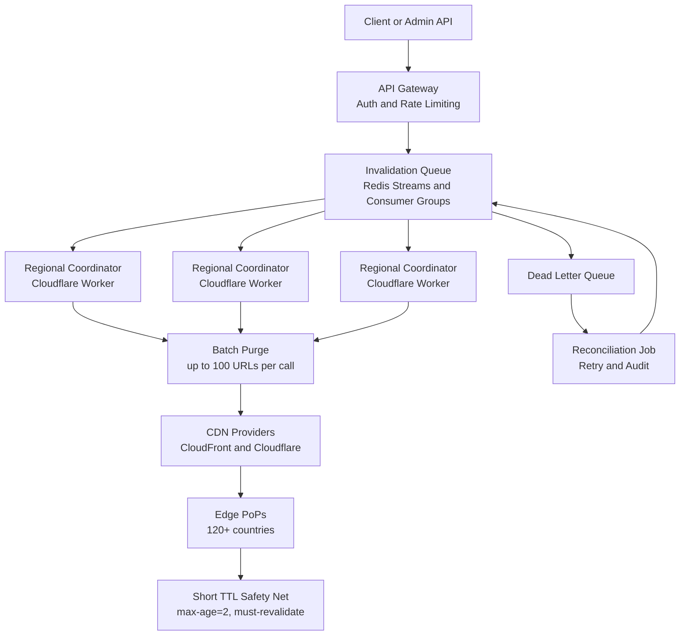

| Difficulty | Channel | Tags |
|---|---|---|
| intermediate | system-design | edge, caching, purging |

By 2022, Cloudflare's cache purge system, designed more than a decade earlier, could no longer keep up with a network spanning 270+ cities and trillions of cached files [1]. Every purge request still traveled to a central core data center and fanned out through Quicksilver, the company's hub-and-spoke configuration system, so customers in Australia paid a painful round-trip penalty [1]. What followed was a redesign that cut global P50 purge latency from 1,570ms to 149ms, a 90.5% improvement, while tripling throughput [1]. Here is what that story teaches about building a multi-region invalidation system that guarantees propagation in under five seconds while absorbing 10,000 concurrent invalidations per second.

---

> ### Real-World Case — Cloudflare
>
> By 2022, Cloudflare's cache purge system designed over a decade earlier could no longer keep up with its network of data centers in 270+ cities and trillions of cached files. Every purge request had to be routed to a central core data center and fanned out globally through Quicksilver, the company's hub-and-spoke config distribution system. Customers far from the core, such as those in Australia, paid the round-trip penalty, and growing purge volume was hitting Quicksilver's write-throughput and per-machine storage limits.
>
> | | |
> |---|---|
> | **Challenge** | Guarantee fast, consistent global cache invalidation across a massive multi-region CDN. The old design had three compounding problems: latency proportional to distance from the centralized ingest point, a write-throughput bottleneck at that central point, and storage requirements in every data center that scaled with total purge throughput. Flexible purges (by tag, hostname, prefix, or everything) were especially hard because there was no way to derive cache keys from response properties -- finding matching files would require scanning every disk on every machine. |
> | **Solution** | Cloudflare rebuilt the pipeline as 'Coreless Purge' over roughly two years. Instead of backhauling every request to a core, a purge lands in the nearest data center and is handled by Cloudflare Workers for auth and filtering, then queued in regional Durable Objects that broadcast peer-to-peer and fan out to other regions. For the hard flexible-purge case, Cloudflare built CacheDB -- a Rust service on RocksDB running beside each cache proxy that maintains a per-machine index of URLs, hostnames, and cache-tags plus a local purge queue. On a cache HIT the proxy quickly checks CacheDB for a matching pending purge before serving. Consul handles last-mile machine-to-machine fan-out inside each data center. They also replaced lazy purge (marking content stale) with active deletion. |
> | **Outcome** | Global P50 purge latency for tag/hostname/prefix purges dropped from 1,570ms in May 2022 to 149ms in August 2024 -- a 90.5% improvement, with all 330 cities and 120+ countries covered. Regional P50s ranged from 115ms (Western North America) to 303ms (Africa), and the redesign cut end-to-end latency by 50% while tripling throughput. Active deletion saved 10x storage, freeing disk for cache retention and improving cache HIT ratios and origin egress. |
> | **Lesson** | The counterintuitive twist: the team had to abandon its own well-loved centralized distribution system (Quicksilver) because a tool optimized for one-way hub-and-spoke replication could not absorb high-volume writes from the edge. Making purge fast meant moving authorization and queuing to every region, pushing indexing all the way down to each machine, and revisiting an old conclusion that active deletion was too expensive. The 5-second target wasn't just met -- it was beaten by more than an order of magnitude -- by removing the central chokepoint rather than optimizing around it. |

---

## Hook — The 2:47 A.M. Question Every Edge Team Eventually Faces

Your phone buzzes at 2:47 a.m. A support ticket from Melbourne says the checkout page still shows the old price. The database has the fix. The origin server has the fix. The deploy pipeline is green. Yet somewhere between your origin and a customer 9,000 miles away, a cached copy is still serving the broken version.

Now multiply that scene by 10,000. That is the reality of modern edge infrastructure: every product update becomes a global write, every global write has a deadline, and the deadline is measured in seconds. Your boss does not care that cache invalidation is one of the two hard problems in computer science. Your customers care that the wrong price is still on screen.

The uncomfortable truth is that deleting content is harder than serving it. A cache read can be served from anywhere. A purge has to reach everywhere, in order, without dropping a request, while thousands of other teams are doing the same thing at the same moment. So how do you guarantee that a purge lands in under five seconds when the network spans hundreds of cities?

That question is not theoretical. A company with one of the largest edge networks on Earth had to answer it the hard way, and the answer changed how its entire control plane works.

💡 Insight: A CDN is optimized for reads. A purge is a write, and writes are where globally distributed systems go to cry.

## Problem — When 'Just Purge It' Becomes a Global Coordination Nightmare

Before you design anything, name the constraints. The interview prompt is deceptively simple: propagate content globally in under five seconds, handle 10,000 concurrent invalidations per second, stay available, and keep consistency strong. Each requirement sounds reasonable in isolation. Together, they pull the architecture in different directions.

| Requirement | Target | Why it hurts |
|---|---|---|
| Latency | <5s worldwide | Every region must be reachable without a central round trip |
| Throughput | 10K invalidations/sec | Fan-out multiplies work by the number of edge locations |
| Availability | 99.99% uptime | The purge path cannot depend on a single control plane |
| Consistency | Strong across regions | Coordination costs latency and complexity |

The first trap is fan-out. At 10,000 invalidations per second, a naive design that sends one API call per URL per region becomes a fan-out bomb: 10,000 requests multiplied by 300 edge locations is three million operations per second. No API budget survives that, and no queue drains fast enough. The second trap is wildcard purging. A pattern like `/api/feed/*` can match millions of objects, so the purge layer must decide whether to expand the pattern, invalidate a prefix index, or lean on a short TTL [2].

The third trap is consistency. Strong consistency across every region sounds ideal until you price the coordination. Every purge would need a global agreement, and global agreement is another name for a round trip to a distant leader [9]. That is exactly the trade-off that turns a five-second SLA into a fifty-second incident.

A central control plane is the obvious first design. It is also the first bottleneck. That is precisely the trap Cloudflare fell into.

## Real-World Case — Cloudflare's Decade-Old Purge Architecture Hits a Wall

Cloudflare's purge system was designed over a decade before 2022, when the network looked very different. Every purge request had to be routed to a central core data center and then fanned out globally through Quicksilver, the company's hub-and-spoke configuration distribution system [1]. The design was elegant for a smaller network. At 270+ cities and trillions of cached files, it became a liability.

Customers far from the core paid the round-trip penalty. A team in Australia could issue a purge and wait far longer than a team near the core for the same logical operation. Meanwhile, growing purge volume was hitting Quicksilver's write-throughput and per-machine storage limits [1]. The system was not failing loudly. It was failing slowly, which is often worse.

The redesign delivered hard numbers:

| Metric | Before (May 2022) | After (August 2024) |
|---|---|---|
| Global P50 purge latency | 1,570ms | 149ms |
| Improvement | — | 90.5% |
| Coverage | 270+ cities | 330 cities, 120+ countries |
| Regional P50 range | Wide variance | 115ms to 303ms |
| End-to-end latency | Baseline | 50% lower |
| Throughput | Baseline | 3x higher |
| Storage efficiency | Baseline | 10x saved via active deletion |

Regional P50 latencies ranged from 115ms in Western North America to 303ms in Africa, and all 330 cities across 120+ countries were covered [1]. The active deletion work also saved 10x storage, freeing disk for cache retention and improving cache HIT ratios and origin egress [1].

🔥 Hot Take: The winning move was not a bigger central pipe. It was moving coordination closer to the edge. That is the plot twist most teams miss when they scale a purge system.

The lesson is clear: when a global write has a tight deadline, the control plane has to become regional. But what exactly should be regional, and what should stay centralized?

## Deep Dive — The Three Forces You Are Actually Balancing

Building on Cloudflare's experience, every purge design comes down to three forces: latency, consistency, and cost. You can optimize any two aggressively, but the third will send you a bill. The CAP theorem is the formal version of this tension: during a network partition, a distributed system must choose between consistency and availability [9]. A purge system usually chooses availability and compensates with bounded staleness.

That compensation is where TTLs earn their keep. A `Cache-Control: max-age=2, must-revalidate` header is not a hack; it is a bounded staleness contract [4]. It means that even if a purge message is delayed, no object can be stale for longer than two seconds. The purge API becomes the fast path, and the TTL becomes the seatbelt. RFC 9111 defines how HTTP caches must respect these directives, which is why the header is portable across CDNs and reverse proxies [3].

| Strategy | Strength | Weakness | Use when |
|---|---|---|---|
| Central fan-out | Simple, one source of truth | Round-trip penalty for distant regions | Small footprint or lax SLA |
| Regional coordinators | Low latency, local ownership | More moving parts | Global five-second SLA |
| Pure short TTL | No purge API dependency | Higher origin load and cost | Non-critical content |
| Hybrid purge plus TTL | Fast and safe | Requires tuning and observability | Most production systems |

The queue is the second force. Redis Streams with consumer groups let multiple regional workers share the load without stepping on each other, and they preserve ordering per shard [10]. A consistent hashing ring can assign invalidation keys to workers so that the same cache key always lands on the same coordinator, which reduces duplicate work and makes retries safer [8].

Failure handling is the third force. Exponential backoff prevents a struggling CDN API from being hammered by retries, and jitter prevents thousands of workers from retrying in lockstep [6]. A circuit breaker stops the bleeding after repeated failures so that one bad region does not consume the entire retry budget [7]. AWS CloudFront's invalidation API, for example, has quotas and costs that make batching mandatory rather than optional [5].

Many developers think the purge API call is the hard part. The queue, the batching, and the regional coordination are the hard part. The API call is just the last mile.

💡 Insight: Strong consistency is a budget, not a virtue [9]. Spend it only where the product truly cannot tolerate a two-second window of staleness.

## Workflow — From API Call to Purged Bytes in Under Five Seconds

Here is the workflow that turns those forces into a repeatable pipeline. The System Flow diagram below shows the path from an admin request to a purged object in every region.

1. **Ingest and authenticate.** The API gateway validates the caller, applies rate limits, and rejects malformed patterns before they enter the queue.
2. **Normalize the request.** Paths are canonicalized, query strings are stripped where appropriate, and wildcard patterns are converted into a predictable cache-key format.
3. **Deduplicate.** Identical invalidations within a short window are collapsed. A deploy that purges the same asset 400 times should become one queue entry.
4. **Append to the stream.** Redis Streams with consumer groups provide durable, replayable delivery and let regional coordinators claim work independently [10].
5. **Assign regional ownership.** Each coordinator claims the shard it owns. Consistent hashing keeps the same keys on the same workers, which reduces duplicate purges [8].
6. **Batch aggressively.** The coordinator groups up to 100 paths per provider call. CloudFront and Cloudflare both benefit from fewer, larger invalidation requests [5].
7. **Purge with a timeout.** Each provider call gets a hard deadline, typically 1.5 seconds, so one slow region cannot blow the global SLA.
8. **Acknowledge or retry.** Successful batches are acknowledged. Failures retry with exponential backoff and jitter, up to three attempts, then land in a dead letter queue [6].
9. **Reconcile.** A background job replays dead letter entries and compares edge behavior against the expected TTL, closing the loop on silent failures.
10. **Let the TTL cover the gap.** The two-second TTL is the final guarantee. Even a missed purge cannot serve stale content beyond that window [4].

A reasonable five-second budget looks like this: 300ms for ingest and validation, 700ms for queueing and batching, 1.5s for the provider call, 1s of retry headroom, and 1.5s of safety margin. Notice that the budget is designed around failure, not the happy path. The happy path is easy. The SLA is won in the retry headroom.

⚠️ Watch Out: If your queue depth grows faster than your consumers can drain it, batching will hide the problem for a few minutes and then amplify it. Monitor purge age, not just queue length.

## Code Example — A Production-Shaped Batch Purge Worker

Time to make it concrete. The JavaScript worker below consumes invalidation events, batches paths, keeps a circuit breaker per region, and retries with full jitter. It is intentionally small enough to read, but shaped like production code.

The important design decisions are worth calling out. Batching reduces provider API calls and cost. Per-region circuit breakers isolate failures so a single bad region does not poison the whole pipeline. Full jitter prevents synchronized retry storms. `AbortSignal.timeout` enforces the hard deadline that protects the five-second SLA. `Promise.allSettled` lets one region fail without cancelling the others. And because the paths are deterministic and idempotent, retries are safe.

What the code does not do is fan out one request per URL. That single decision is often the difference between a manageable purge system and a surprise five-figure CDN bill. The explanation after the code walks through each section step by step.

## Lessons Learned — What Survives Contact With Production

After enough production incidents, patterns emerge. These are the lessons that matter when the pager goes off.

- **Treat purge as a write, not a cache read.** It needs durability, ordering, retries, and observability. A fire-and-forget HTTP call is not a purge system.
- **Move coordination near the edge.** Cloudflare's redesign proved that regional ownership beats a central fan-out for latency and throughput [1].
- **Batch aggressively, but measure queue delay.** Batching saves cost, yet it adds latency. Track the time an invalidation spends waiting, not just the time the API call takes.
- **Use TTL as a seatbelt, not a brake.** A two-second TTL bounds staleness when a purge fails, but it should not be your primary strategy for critical content [4].
- **Scope wildcards carefully.** A broad pattern can expand into millions of objects. Prefer prefix indexes or explicit key lists when the blast radius is large [2].
- **Build for partial failure.** Regional rollback, dead letter queues, and reconciliation jobs are not optional at global scale.
- **Instrument purge age per region.** P50 hides the pain. Watch P95 and P99 by region, and alert on the oldest unacknowledged invalidation.

| Common Mistake | What Happens | The Fix |
|---|---|---|
| One request per URL | Rate limits and runaway cost | Batch up to 100 paths per call |
| Immediate retries | Thundering herd against a struggling API | Exponential backoff with jitter [6] |
| Global lock for consistency | Five-second SLA becomes fifty seconds | Regional ownership plus bounded TTL |
| Ignoring wildcard cost | CPU spikes and accidental mass purges | Prefix indexing and scoped patterns |
| No dead letter queue | Silent staleness for hours | Reconciliation and replay jobs |

🎯 Key Point: A five-second SLA is an observability problem before it is an architecture problem. If you cannot measure purge age by region, you cannot guarantee anything.

The thread from Cloudflare's story to your system is simple: the fastest purge is the one that does not have to cross an ocean. Put the decision where the content lives, keep a short TTL as your safety net, and design the retry budget before the happy path.

---

## System Flow

<strong>Original Interview Question</strong>

**Q:** How would you design a multi-region CDN cache purging system that guarantees content propagation within 5 seconds while handling 10,000 concurrent invalidations per second?

**A:** Implement Cloudflare API + AWS CloudFront with distributed invalidation queue, edge compute coordination, and 2-second TTL. Use batch invalidation, exponential backoff, and regional cache headers for 5-second SLA.

## Conclusion

The moral of Cloudflare's story is that a global purge system is not a bigger version of a local one. It is a different animal. The central hub that worked at 30 cities became the bottleneck at 270, and the fix was not a faster hub, it was regional ownership plus a short TTL safety net [1]. Tomorrow, you can apply the same lesson: instrument purge age by region, add a two-second TTL to critical dynamic content, batch provider calls, and build a dead letter queue before you need one. The memorable insight to share with your team is this: the fastest purge is the one that never has to cross an ocean.

---

## References

1. [Cloudflare incident report](https://blog.cloudflare.com/instant-purge) — article
2. [Cache invalidation](https://en.wikipedia.org/wiki/Cache_invalidation) — documentation
3. [RFC 9111: HTTP Caching](https://datatracker.ietf.org/doc/html/rfc9111) — documentation
4. [MDN: HTTP caching](https://developer.mozilla.org/en-US/docs/Web/HTTP/Guides/Caching) — documentation
5. [Amazon CloudFront: Invalidating files](https://docs.aws.amazon.com/AmazonCloudFront/latest/DeveloperGuide/Invalidation.html) — documentation
6. [Exponential backoff](https://en.wikipedia.org/wiki/Exponential_backoff) — documentation
7. [Circuit breaker design pattern](https://en.wikipedia.org/wiki/Circuit_breaker_design_pattern) — documentation
8. [Consistent hashing](https://en.wikipedia.org/wiki/Consistent_hashing) — documentation
9. [CAP theorem](https://en.wikipedia.org/wiki/CAP_theorem) — documentation
10. [Redis source repository](https://github.com/redis/redis) — documentation
11. [Edge computing](https://en.wikipedia.org/wiki/Edge_computing) — documentation

---

**Author:** Satishkumar Dhule — [GitHub](https://github.com/satishkumar-dhule) · [LinkedIn](https://linkedin.com/in/satishkumar-dhule) · [Website](https://satishkumar-dhule.github.io)
