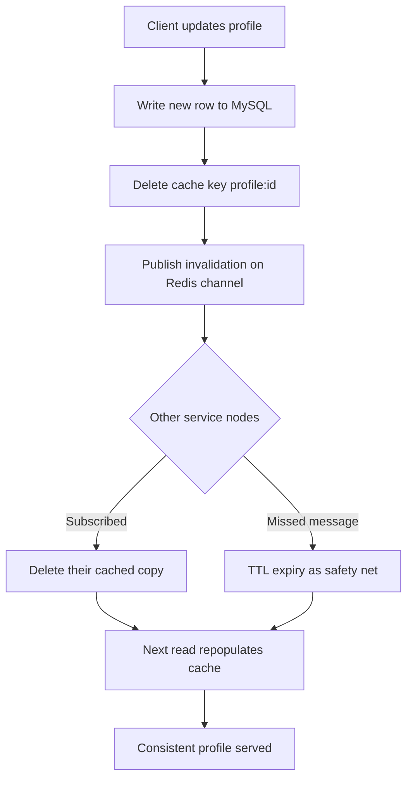

| Difficulty | Channel | Tags |
|---|---|---|
| beginner | backend | redis, memcached, cache-invalidation |

Meta's social graph needed profile and feed data delivered with brutal low latency to billions of users, so engineers placed Memcached in front of MySQL as a distributed lookaside cache [1]. The fleet eventually handled billions of requests per second and stored trillions of items across thousands of servers [1]. But at that scale, deleting a key on write stopped being a one-line fix and became a distributed-systems problem. Here is what that journey reveals about building a profile cache that tells the truth.

---

> ### Real-World Case — Meta (Facebook)
>
> As Facebook's social graph grew, profile and feed data needed to be served with extremely low latency to billions of users worldwide. They relied on Memcached as a distributed lookaside cache in front of MySQL, but at massive scale simple key deletion on writes was not enough to keep cached data consistent under concurrent reads, writes, and failures.
>
> | | |
> |---|---|
> | **Challenge** | How to implement reliable cache invalidation and consistency for frequently accessed, frequently updated data (like user profiles and social content) across thousands of Memcached servers and multiple regions, while avoiding stale reads, thundering herds, and excessive database load. |
> | **Solution** | Facebook extended Memcached with a lookaside caching pattern plus custom invalidation and consistency mechanisms: clients delete cache keys after database writes, MySQL triggers daemons (mcsqueal) to send invalidations, and they introduced leases to prevent stale sets and throttle concurrent cache refills. They also built mcrouter for routing, connection pooling, and regional replication, effectively adding distributed coordination that plain Memcached lacks natively (capabilities often compared to Redis's built-in pub/sub and richer primitives). |
> | **Outcome** | The system scaled to handle billions of requests per second and store trillions of items across thousands of servers in multiple geographic regions, delivering low-latency reads while maintaining cache consistency for one of the world's largest user-profile and social-data workloads. |
> | **Lesson** | At very large scale, cache invalidation is a distributed systems problem, not just a key delete: simple caches like Memcached can be extremely fast and memory-efficient, but require significant surrounding infrastructure for invalidation and consistency, whereas systems like Redis trade some simplicity for richer built-in primitives that can ease certain coordination patterns. |

---

## Hook — The 8ms Read That Served a Three-Day-Old Lie

Picture a profile page that loads in 8 milliseconds for a billion people — and then confidently serves a name the user changed three days ago. That is the strange failure mode of caching: the faster the read, the more embarrassing the stale write. You added a cache to escape the 180 ms database round trip, and for a while it looked like pure victory. Then the support tickets arrived. A customer updated their email, but the confirmation link went to the old address because a node in another region still held yesterday's row. The truth is that cache invalidation is not a checkbox you tick after installing Redis. It is the contract between your database and every scattered copy of reality sitting in memory. Get it right and users never notice. Get it wrong and they notice everything. 🔥

## Problem — When Every Node Has Its Own Version of the Truth

You are building a user profile service. Reads outnumber writes roughly a hundred to one, so a cache is not optional — it is survival. Add one and p99 latency collapses, database CPU drops, and everyone feels like a hero. The trouble starts at the second node. A single process can delete its own key on write, but a fleet behind a load balancer cannot. Node A handles the update and evicts its copy; Node B, Node C, and the cache tier in another region still hold the old profile and keep serving it.

Many developers assume that a write-through or cache-aside pattern automatically solves this. It does not. The pattern only describes what one process does; it says nothing about how thousands of processes agree. This is the gap between caching and cache coherence [4], and it is where teams get burned. You also inherit a set of nastier questions: Do you delete the key or overwrite it? How long should the TTL be before stale data becomes unacceptable? What happens when a read repopulates the cache with an old value between the database write and the delete? Those questions are the real interview, and the real production incident.

## Real-World Case — Meta (Facebook) and the Memcached Fleet

As Facebook's social graph grew, profile and feed data had to be served with extremely low latency to billions of users worldwide. Engineers relied on Memcached as a distributed lookaside cache in front of MySQL, but at massive scale simple key deletion on writes was not enough to keep cached data consistent under concurrent reads, writes, and failures [1][2]. The naive approach — let each application server manage its own keys — buckles when the same data is fanned out across thousands of machines and multiple geographic regions.

Meta's answer was to treat invalidation as a first-class distributed pipeline rather than a side effect of a write. The resulting system scaled to billions of requests per second and trillions of items across thousands of servers, delivering low-latency reads while maintaining cache consistency for one of the largest user-profile and social-data workloads in the world [1]. The lesson is blunt: at scale, invalidation is an architecture, not an API call. If your design only works when every actor sees every write instantly, it does not work at all. ⚠️

## Deep Dive — Redis, Memcached, and the Trade-offs Nobody Warns You About

The first fork in the road is the cache pattern itself. Cache-aside (also called lookaside) lets the application read from the cache, fall back to the database on a miss, and populate the cache — Memcached's sweet spot and the pattern Meta scaled [2]. Write-through writes to the database and the cache together, which keeps reads warm but doubles the write path and risks storing values that were never read. Write-behind defers database writes for throughput, but it trades durability for speed and is rarely worth it for user profiles.

The second fork is what you do to the cache on update. Overwriting the cache with the new value looks tidy, but it loses races: two concurrent updates can land out of order and leave the cache holding the older one. Deleting the key instead lets the next read repopulate from the database, which is why delete-on-write is the safer default. The catch is a read that races the delete — a classic thundering-herd and cache-stampede risk [9]. Short, jittered TTLs and single-flight coalescing are the usual defenses.

The third fork is Redis versus Memcached, and it is where marketing copy does the most damage. Redis is not simply a faster Memcached; it is a different product with persistence, richer data structures, and pub/sub that can carry invalidation messages across nodes [3]. Memcached is leaner and simpler, with lower per-key memory overhead and famously easy horizontal scaling [2]. Here is the honest comparison:

| Dimension | Redis | Memcached |
|---|---|---|
| Invalidation | Pub/sub plus keyspace events for fan-out | Manual coordination across nodes |
| Persistence | Optional RDB and AOF | None — memory only |
| Data structures | Strings, hashes, sets, sorted sets, streams | Strings and opaque blobs |
| Memory overhead | Higher per key | Lower per key |
| Best fit | Complex invalidation, durability, leaderboards | Pure high-throughput object caching |

💡 Insight: the question is not which cache is faster. It is which failure mode you can tolerate. A stale profile for 30 seconds may be fine; a stale permissions flag may not be.

The final piece is the safety net. TTL is not a strategy — it is a deadline. Set it too long and stale data lingers after a missed invalidation; set it too short and you create a synchronized expiry wave that hammers the database [9]. For profiles, a common range is 5 to 30 minutes with random jitter. HTTP caching layers add another copy, governed by freshness rules like those in RFC 9111 and the Cache-Control semantics documented by MDN [5][7]. Every layer you add is another place the truth can go stale, so the design must assume messages get lost and make TTL the backstop. 🎯

## Workflow — A Step-by-Step Invalidation Pipeline

Building on the trade-offs above, the write path needs a fixed order so races resolve predictably. The diagram below traces a single profile update from client to every cache node.

1. The client submits an update to any application node.
2. The node writes the new row to the database first, making it the source of truth.
3. It deletes the profile key from its local cache connection rather than overwriting it.
4. It publishes an invalidation message on a Redis channel so every other node can evict its copy [3].
5. Each subscriber deletes the key it may be holding; any node that misses the message still expires the key at its TTL.
6. The next read misses, reloads from the database, and repopulates the cache with fresh data.

The flow is intentionally boring, and that is the point. Deleting before publishing, or publishing before the database commits, reopens the very race the pipeline exists to close. Many teams also add a short retry queue for invalidation messages so a transient pub/sub failure does not silently leave stale data behind.

## Code Example — A Production-Ready Profile Cache in TypeScript

Here is how the pipeline looks in practice, using Node's redis client with cache-aside reads, delete-on-write updates, and pub/sub invalidation across nodes. The code is deliberately small enough to read in one sitting but structured the way a real service would wire it.

## Lessons Learned — What to Do Differently Tomorrow

The journey from a single cache key to a consistent distributed cache ends with a handful of uncomfortable truths. First, invalidation is a systems problem: the moment you have more than one node, you need a fan-out mechanism, not just a delete call [1][3]. Second, delete beats overwrite far more often than teams expect, because deletion defers the value decision to the next read and avoids out-of-order writes. Third, TTL is a safety net with a time bomb — always jitter it, and never treat it as your primary consistency guarantee [9].

Beyond that, match the cache to the failure you can live with. Choose Memcached for pure, simple, high-throughput object caching with low memory overhead [2]; choose Redis when you need pub/sub invalidation, persistence, or richer structures [3]. Instrument hit rate, miss rate, eviction rate, and invalidation latency, because a cache that is silently failing looks exactly like a cache that is working until the tickets arrive. And assume every message can be lost: design for the read that repopulates from the source, not the write that hopes everyone listened. 🛠️

---

## Write-Through Invalidation Flow

<strong>Original Interview Question</strong>

**Q:** You're building a user profile service that caches frequently accessed profiles. How would you implement cache invalidation when a user updates their profile, and what trade-offs would you consider between Redis and Memcached?

**A:** Implement write-through caching with TTL-based expiration. On profile update, invalidate the cache by deleting the key and writing new data to both the database and cache. Redis offers pub/sub for automatic distributed invalidation, while Memcached requires manual coordination across nodes.

## Conclusion

The moral of Meta's trillion-item cache is simple and slightly uncomfortable: fast reads are easy, agreeing on the truth is hard [1]. The next time you add a cache to a profile service, design the invalidation path first — delete on write, fan out the invalidation, jitter the TTL, and assume every message can be lost. Then pick Redis or Memcached based on the failure you can tolerate, not the benchmark you can screenshot [2][3]. The one insight worth repeating to your team: a cache is not a faster database, it is a distributed copy of your data that you are now responsible for keeping honest.

---

## References

1. [Meta (Facebook) incident report](https://engineering.fb.com/2013/06/25/core-infra/scaling-memcache-at-facebook/) — article
2. [Memcached — Wikipedia](https://en.wikipedia.org/wiki/Memcached) — documentation
3. [Redis — Wikipedia](https://en.wikipedia.org/wiki/Redis) — documentation
4. [Cache coherence — Wikipedia](https://en.wikipedia.org/wiki/Cache_coherence) — documentation
5. [RFC 9111: HTTP Caching](https://datatracker.ietf.org/doc/html/rfc9111) — documentation
6. [Caching strategies for Amazon ElastiCache for Memcached](https://docs.aws.amazon.com/AmazonElastiCache/latest/mem-ug/Strategies.html) — documentation
7. [HTTP caching — MDN Web Docs](https://developer.mozilla.org/en-US/docs/Web/HTTP/Caching) — documentation
8. [facebook/memcached — GitHub](https://github.com/facebook/memcached) — documentation
9. [Cache stampede — Wikipedia](https://en.wikipedia.org/wiki/Cache_stampede) — documentation

---

**Author:** Satishkumar Dhule — [GitHub](https://github.com/satishkumar-dhule) · [LinkedIn](https://linkedin.com/in/satishkumar-dhule) · [Website](https://satishkumar-dhule.github.io)
