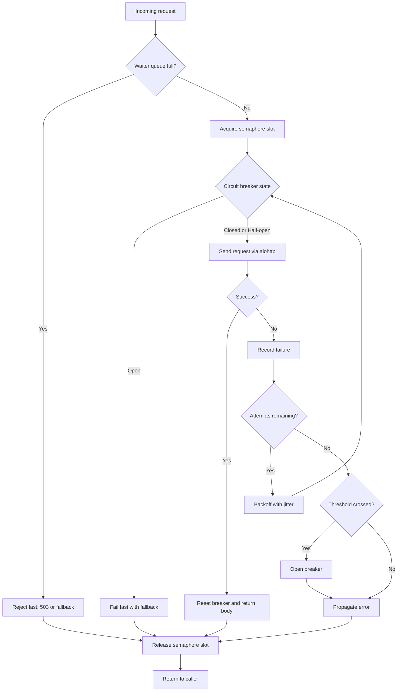

| Difficulty | Channel | Tags |
|---|---|---|
| advanced | backend | asyncio, aiohttp, concurrency |

By 2012, Netflix's API was swallowing more than 1 billion incoming calls a day and fanning each one into dozens of dependency calls, peaking above 100,000 requests per second [1]. The availability math was brutal: even at 99.99% per dependency, 30 dependencies compounded to about 99.7% overall, or more than two hours of downtime per month [1]. That single insight pushed Netflix toward client-side fault tolerance, and it is the same insight your aiohttp service needs today. This is the story of how connection pools fail, why graceful degradation is an architecture decision rather than a retry setting, and how to build one that survives the bad night.

---

> ### Real-World Case — Netflix
>
> By 2012, the Netflix API received more than 1 billion incoming calls per day and fanned each request out to dozens of backend systems, producing several billion outgoing dependency calls per day with peaks above 100,000 dependency requests per second across thousands of EC2 instances. Even if every dependency had 99.99% availability, 30 dependencies compounded to only 99.7% overall availability — roughly 2+ hours of downtime per month.
>
> | | |
> |---|---|
> | **Challenge** | A single slow or failing dependency could block request threads and rapidly saturate the entire API's thread and connection pools in seconds or sub-seconds. Netflix needed to prevent one latent service from cascading into a full outage, while still serving a degraded but usable experience to members. |
> | **Solution** | Netflix built Hystrix around a DependencyCommand that combined network timeouts, per-dependency thread pools with bounded queues, non-blocking semaphore acquisition, and circuit breakers that tripped at roughly a 50% error rate over a 10-second rolling window. Fallbacks were classified as custom, fail-silent, or fail-fast so the system could shed load instead of piling requests onto a sick dependency. Crucially, Netflix documented that simply increasing connection pool sizes during latency makes the problem worse: if 10 connections per host saturate, raising them to 20 usually just holds 2,000 doomed connections open and delays recovery. |
> | **Outcome** | Netflix sustained over 1 billion API calls per day and several billion dependency calls at peaks above 100k requests/second while isolating failures to individual circuits. When a dependency degraded, the breaker served fallbacks and fail-fast responses rather than exhausting Tomcat threads, keeping the rest of the API healthy. The availability math made the stakes explicit: without client-side fault tolerance, 30 dependencies at 99.99% each would still mean 2+ hours of downtime per month. |
> | **Lesson** | A connection pool is a failure-isolation boundary, not a tuning knob. When an upstream becomes latent, adding more connections or retries amplifies the outage; the correct move is to bound concurrency, enforce hard timeouts, fail fast, and shed load so the dependency can recover. This is exactly why aiohttp designs need semaphores, exponential backoff with jitter, and circuit breakers rather than ever-larger TCPConnector limits. |

---

## Hook — A Pager, a Slow API, and a Math Problem That Should Terrify You

Your pager goes off at 2:47 a.m. One upstream service is responding in 9 seconds instead of 90 milliseconds, and every request coroutine in your Python service is parked, waiting on a socket. The pool is full. New requests queue. Health checks time out. The load balancer marks the instance unhealthy, so traffic shifts to its neighbors, which now absorb double the load with the same saturated pool. Ten minutes later, a single slow dependency has taken down your entire edge.

That is not a hypothetical. It is a math problem. Netflix documented the same dynamic in 2012, when its API handled more than 1 billion calls per day and fanned each one out to dozens of backends [1]. The lesson is uncomfortable: availability multiplies. Thirty dependencies at 99.99% each compound to roughly 99.7% overall, which works out to more than two hours of downtime every month [1]. Your elegant retry logic will not save you if the pool, the timeout, and the failure mode are not designed together.

So how do you build an aiohttp connection pool that bends under pressure instead of snapping? The answer lives in four small mechanisms that most tutorials skip: bounded concurrency, honest timeouts, jittered retries, and a circuit breaker that knows when to stop trying.

## Problem — When Your Connection Pool Becomes a Liability

A connection pool is supposed to protect a downstream service from too many concurrent requests. In practice, it often becomes the place where latency hides and then explodes. Here is the chain reaction that catches most teams off guard.

First, requests arrive faster than the pool can serve them. Without a bound on the wait queue, memory grows as every pending request holds a coroutine, a timeout handle, and a response buffer. Second, each request has a timeout budget, but those budgets stack. If the socket timeout is 30 seconds and the caller has already spent 10 seconds waiting for a semaphore slot, the request can burn 40 seconds before failing. Third, retries make everything worse: a 3x retry policy during an outage turns 1,000 requests per second into 3,000 requests per second aimed at a service that is already struggling [5].

Many developers assume aiohttp's connector limit is enough. It is not. The connector limits sockets, but it does not decide what happens when the limit is reached, how long a caller should wait, or whether a failing dependency deserves any traffic at all [2]. Those are policy decisions, and policy is your job.

| Failure mode | What it looks like | What it costs |
|---|---|---|
| Unbounded queue | Memory climbs, latency cliffs | OOM kills, cascading restarts |
| Timeout stacking | Requests live far longer than expected | Thread and connection exhaustion |
| Naive retries | Traffic multiplies during incidents | Downstream stays down longer |
| Shared pool for all hosts | One bad host starves the rest | Blast radius equals your whole service |

The uncomfortable truth is that a pool without load shedding is not a safety mechanism. It is a delay mechanism. It postpones the failure until the moment when you have the least capacity to handle it.

## Real-World Case — Netflix and the Tyranny of Compound Availability

Netflix did not arrive at circuit breakers because they looked elegant in a diagram. The company arrived there because the arithmetic of a high-fanout system left no other choice. By 2012, the Netflix API received more than 1 billion incoming calls per day and fanned each request out to dozens of backend systems, producing several billion outgoing dependency calls per day with peaks above 100,000 dependency requests per second across thousands of EC2 instances [1].

Here is the part that should make you sit up: even if every dependency delivered 99.99% availability, 30 dependencies compounded to only about 99.7% overall availability, which is roughly two or more hours of downtime per month [1]. No amount of careful server-side engineering fixes that math. The only way out is client-side fault tolerance: isolate each dependency, detect failure locally, and degrade the experience instead of exhausting the request threads that keep the rest of the API alive.

When a dependency degraded, Netflix's circuit breakers served fallbacks and fail-fast responses rather than letting threads pile up behind a dying service. The rest of the API stayed healthy. That is the plot twist most teams miss. The goal is not to make every request succeed. The goal is to keep the system responsive while a subset of requests fail quickly and predictably.

🎯 Key Point: Resilience is a property of the whole call graph, not of any single service. If your pool waits indefinitely for a degraded dependency, your availability is that dependency's availability, minus your own mistakes.

## Deep Dive — Semaphores, Timeouts, and the Circuit Breaker That Saves You

Building on Netflix's lesson, the solution decomposes into four mechanisms that reinforce each other. None of them is complicated on its own. The trick is making them cooperate.

**1. Bounded concurrency with a semaphore.** An asyncio semaphore caps how many coroutines can hold a connection slot at once [3]. This is your first bulkhead. But a semaphore alone is incomplete, because callers can wait forever for a slot. You need a second bound: the maximum number of waiters. When that queue fills, shed load immediately instead of accepting work you cannot finish.

**2. Timeouts that respect the whole budget.** aiohttp lets you set total, connect, and socket-read timeouts separately [2]. Use them. A connect timeout of 3 seconds and a total timeout of 10 seconds is a very different system from a single 30-second blanket timeout [7]. The timeout should cover the entire operation, including retries, not each individual attempt. Otherwise your worst-case latency is a multiplication problem.

**3. Retries with exponential backoff and jitter.** Retrying a failed connection is reasonable. Retrying immediately, in lockstep with every other client, is a distributed denial-of-service attack you launched against yourself. Exponential backoff spaces attempts out, and jitter spreads them across clients so they do not synchronize [5][6]. A common pattern is a base delay of 200 milliseconds, doubling per attempt, capped at 2 seconds, multiplied by a random factor between 0.5 and 1.5.

**4. A circuit breaker with three states.** The breaker tracks failures per dependency. In the closed state, traffic flows normally. When failures cross a threshold, the breaker opens and fails fast without touching the network [4]. After a recovery window, it moves to half-open and allows a limited number of probe requests. Success closes the breaker; failure reopens it [10]. This is the mechanism that stops a retry storm from becoming a permanent outage.

| Approach | Protects downstream? | Protects your latency? | Best for |
|---|---|---|---|
| Semaphore only | Partially | No | Simple fan-out with healthy dependencies |
| Timeout only | No | Partially | Fast-fail APIs with predictable latency |
| Retries only | No, it amplifies load | No | Transient network blips, used sparingly |
| Semaphore + timeout + breaker | Yes | Yes | Production systems with real dependency risk |

💡 Insight: The circuit breaker is not an optimization. It is a load-shedding device. It converts a slow failure into a fast failure, which is the only kind of failure a high-volume system can afford.

## Workflow — The Request Lifecycle, Step by Step

With the concepts in place, the request lifecycle becomes a sequence of gates. Each gate answers one question and either lets the request through or rejects it cheaply. The flowchart below tells the visual story; follow it from top to bottom.

1. **Admission check.** Is the waiter queue already full? If yes, reject immediately with a 503 or a fallback. Do not accept work that will only time out later.
2. **Acquire a slot.** Take the semaphore. If a slot is free, proceed. If not, wait, but the wait is bounded by the admission check above.
3. **Consult the breaker.** If the breaker is open for this dependency, fail fast and serve a fallback. If it is half-open, allow only the limited probe traffic.
4. **Send the request.** Use a shared aiohttp session with a tuned connector: connection limits, per-host limits, DNS caching, and keepalive [8].
5. **Classify the outcome.** A 2xx is success. A timeout, connection error, or 5xx is a failure that the breaker should see. A 4xx is usually a caller problem and should not trip the breaker.
6. **Retry or return.** If attempts remain, sleep for a jittered backoff interval and loop. If not, propagate the error or return the fallback.
7. **Release and reset.** Always release the semaphore in a finally block. On success, reset the breaker failure count. On shutdown, close the session cleanly so connections are not leaked.

The order matters. If you consult the breaker before acquiring a slot, open-circuit requests never consume pool capacity. If you check the queue before waiting on the semaphore, you avoid building an unbounded backlog. Small ordering decisions are the difference between graceful degradation and a slow-motion collapse.

## Code Example — A Production-Shaped ConnectionPoolManager

The implementation below combines all four mechanisms in a single class. It is deliberately compact, but every line exists for a reason. The semaphore caps concurrency, the waiter counter provides load shedding, the breaker prevents retry storms, and the session lifecycle prevents connection leaks.

⚠️ Watch Out: The `_waiting` counter is safe here because asyncio runs on a single thread and increments between awaits are atomic. If you adapt this to a threaded runtime, replace it with an explicit lock or a bounded queue.

🔥 Hot Take: Most connection pool bugs are lifecycle bugs, not concurrency bugs. If you remember one thing, remember to release the semaphore in a finally block and close the session in `__aexit__`.

## Lessons Learned — Battle Scars, Guardrails, and What to Do Tomorrow

The journey from a naive `session.get()` loop to the manager above is mostly a journey through failure modes. Here are the lessons that tend to stick after the first real incident.

- **Bound both concurrency and the queue.** A semaphore without a waiter limit is a memory leak with extra steps. Load shedding is not rude; it is how you protect the requests you can still serve.
- **Make timeouts end-to-end.** Set connect, read, and total budgets, and count retries inside the total. The retransmission timer work behind RFC 6298 exists because networks lie about timeliness; your application should not bet on them [9].
- **Retry with jitter, not enthusiasm.** Exponential backoff with jitter is the difference between a gentle recovery and a synchronized stampede [5][6]. Retry only idempotent operations, and cap the total attempts.
- **Trip the breaker on dependency failures, not client mistakes.** A 400 is not a reason to stop sending traffic. A timeout or a 503 is. Keep the classification explicit.
- **Isolate pools per dependency.** A shared pool lets one slow service starve every other call in the process. Bulkheads are cheap; outages are not [4].
- **Close sessions and release slots deterministically.** Use async context managers and finally blocks. Connection leaks are boring, invisible, and eventually fatal.
- **Watch queue depth, breaker state, and retry rate.** These three metrics tell you more about impending failure than average latency ever will.

🎯 Key Point: Graceful degradation is a budget, not a binary. You decide in advance how much latency, how many retries, and how much queueing the system can afford, and then you enforce those limits mechanically.

If this feels like a lot to wire up by hand, that is normal. Many teams start with a semaphore and a timeout, add the breaker after their first retry storm, and add load shedding after their first out-of-memory kill. The goal is to skip a few of those painful steps by designing all four gates from the beginning.

---

## Request Lifecycle and Failure Isolation

<strong>Original Interview Question</strong>

**Q:** How would you implement a connection pool manager for aiohttp that handles graceful degradation under high load and connection timeouts?

**A:** Implement a connection pool manager for aiohttp using a semaphore to limit concurrent connections, exponential backoff for retrying failed requests, and circuit breaker pattern to gracefully degrade under high load and connection timeouts.

## Conclusion

Netflix's numbers are not a curiosity from 2012. They are a preview of what happens to any service that fans out to enough dependencies without client-side fault tolerance [1]. The two hours of monthly downtime implied by compound availability do not care how clean your code is; they only care whether failure is contained. Tomorrow, audit your pool for four things: a hard concurrency limit, a bounded wait queue, end-to-end timeouts, and a breaker that fails fast per dependency. Then measure queue depth, retry rate, and breaker state, because those are the early-warning signals of the next 2:47 a.m. page. The memorable insight to share with your team is simple: the goal is not to make every request succeed, it is to make every failure cheap.

---

## References

1. [Netflix incident report](https://netflixtechblog.com/fault-tolerance-in-a-high-volume-distributed-system-91ab4faae74a) — article
2. [aiohttp Client Quickstart](https://docs.aiohttp.org/en/stable/client_quickstart.html) — documentation
3. [asyncio Synchronization Primitives](https://docs.python.org/3/library/asyncio-sync.html) — documentation
4. [CircuitBreaker by Martin Fowler](https://martinfowler.com/bliki/CircuitBreaker.html) — blog
5. [Timeouts, retries, and backoff with jitter](https://aws.amazon.com/builders-library/timeouts-retries-and-backoff-with-jitter/) — blog
6. [Exponential backoff](https://en.wikipedia.org/wiki/Exponential_backoff) — documentation
7. [Python asyncio Task Timeouts](https://docs.python.org/3/library/asyncio-task.html#timeouts) — documentation
8. [aio-libs/aiohttp on GitHub](https://github.com/aio-libs/aiohttp) — documentation
9. [RFC 6298: Computing TCP's Retransmission Timer](https://datatracker.ietf.org/doc/html/rfc6298) — documentation
10. [Circuit breaker design pattern](https://en.wikipedia.org/wiki/Circuit_breaker_design_pattern) — documentation

---

**Author:** Satishkumar Dhule — [GitHub](https://github.com/satishkumar-dhule) · [LinkedIn](https://linkedin.com/in/satishkumar-dhule) · [Website](https://satishkumar-dhule.github.io)
