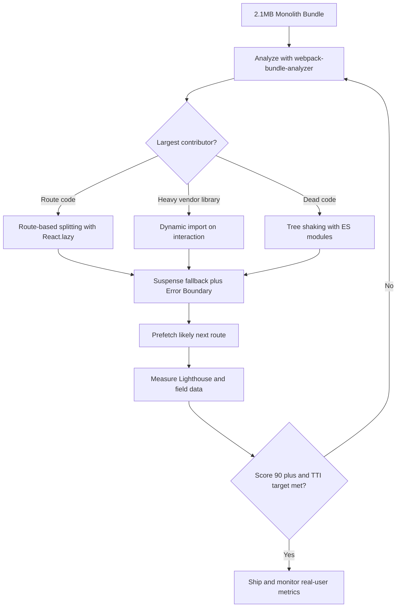

| Difficulty | Channel | Tags |
|---|---|---|
| intermediate | frontend | lighthouse, bundle, lazy-loading |

In 2017, Pinterest rebuilt its mobile web experience from scratch, and the before-and-after reads like a fable for every React team [1]. The old monolith shipped over 2.5MB of JavaScript and left users on average Android hardware waiting up to 23 seconds before the page responded to a tap [1]. The rebuild eventually cut the core bundle from 650KB to 150KB, dropped First Meaningful Paint from 4.2s to 1.8s, and brought Time to Interactive down to 5.6s — then 3.9s on repeat visits thanks to service worker caching [1]. Now picture your own dashboard: 2.1MB on the wire, 4.2s to interactive, a Lighthouse score of 65, and a product manager asking why the app feels slow. The fix is not one clever trick; it is a disciplined journey through bundle analysis, code splitting, and lazy loading.

---

> ### Real-World Case — Pinterest
>
> In 2017 Pinterest rebuilt its mobile web experience from scratch as a React, Redux, and webpack PWA. The old site was a monolith that shipped over 2.5MB of CPU-heavy JavaScript, forcing users on average Android hardware and slow 3G to wait up to 23 seconds before the page was interactive.
>
> | | |
> |---|---|
> | **Challenge** | The legacy mobile web app sent down a huge monolithic JavaScript bundle (~650KB core bundle plus ~1MB lazily loaded), which took multiple seconds to parse and compile before the main thread could settle. Pinterest needed to cut both bundle size and Time to Interactive without sacrificing the rich, app-like experience. |
> | **Solution** | The team split the multi-megabyte bundle into three webpack chunk categories: a vendor chunk (~73KB for React, Redux, React Router), an entry chunk (~72KB for the app shell and shared code), and async route chunks (13–18KB each). They used React Router for route-level code splitting by default, encouraged component-level code splitting, built a route-preloading system, added chunk-specific filename hashes for long-term caching, and used webpack-bundle-analyzer to find duplicate code—moving shared code into the main chunk, which grew the entry chunk by 20% but shrank every lazy chunk by up to 90%. |
> | **Outcome** | The core bundle dropped from 650KB to 150KB, First Meaningful Paint fell from 4.2s to 1.8s, and Time to Interactive dropped from 23s to 5.6s (3.9s on repeat visits with service worker caching). Business metrics followed: core engagements rose 60%, user-generated ad revenue rose 44%, time spent rose 40%, and weekly active mobile web users grew 103% year over year, with new signups up 843%. |
> | **Lesson** | Code splitting alone is not enough—you must measure where bytes actually go. Moving duplicated code into the shared entry chunk can increase one bundle yet dramatically shrink all lazy-loaded chunks, and route-based splitting only pays off when paired with preloading so navigation still feels instant. Pinterest also learned that performance requires ongoing guardrails: bundle-size alerts and custom ESLint rules to prevent one careless import from re-bloating the app. |

---

## Hook — The 23-Second Tap That Wouldn't Register

Picture the scene: a commuter opens Pinterest on a mid-range Android phone at 8:47 a.m., the train goes underground, and the signal flickers between 3G and nothing. The shell of the page paints, so the site looks alive. Then the tap does nothing. One second. Five. Ten. By the time the app is interactive, the commute has moved on. In 2017 that wait could stretch to 23 seconds on Pinterest's mobile web, because the page shipped more than 2.5MB of JavaScript that had to be downloaded, parsed, compiled, and executed before the first interaction could be handled [1].

That number should feel personal. Your app may not be Pinterest, but the physics are identical. A 2.1MB bundle is not just a download; it is a queue of work handed to a CPU that is often far slower than the laptop on your desk. Every kilobyte of JavaScript is a tax paid by the user, and on mobile that tax compounds through slow networks, memory pressure, and thermal throttling.

The uncomfortable truth is that performance rarely collapses in one dramatic moment. It erodes quietly — one dependency, one charting library, one accidental barrel import at a time. Then a Lighthouse audit prints 65, a stakeholder asks why the app feels sluggish, and the team has to reverse-engineer months of accumulated weight.

So how did a company at Pinterest's scale turn a 23-second wait into a 5.6-second one — and what does that playbook look like for a 2.1MB React app stuck at 65?

## Problem — When 2.1MB Becomes a User Experience Problem

Before touching a single import, name the enemy precisely. Bundle size, Time to Interactive (TTI), and Lighthouse score are related, but they are not the same measurement. Bundle size is the bytes shipped over the wire; TTI is when the main thread is quiet enough to respond to input; Lighthouse is a lab simulation that approximates field conditions [7]. A team can gzip a bundle down to a respectable transfer size and still ship a terrible TTI, because compression does not reduce parse, compile, or execution cost.

That is the first trap: optimizing for the network while ignoring the CPU. JavaScript is the most expensive resource on the page because the browser must do four jobs with it:

- **Download it** over a network the user may not control.
- **Parse and compile it** before any of it can run.
- **Execute it** on the main thread, competing with rendering.
- **Keep it in memory**, which matters on low-end devices.

Many developers assume a large bundle only hurts users on slow connections. In practice, the opposite is often true: a fast connection delivers the JavaScript quickly, and then the CPU still has to chew through it. That is why a page can load in two seconds on office Wi-Fi and feel broken on a three-year-old phone.

The usual culprits are predictable. Full-library imports such as `import _ from 'lodash'`, moment.js locales, icon packs that ship every glyph, duplicated dependencies hidden in the lockfile, and barrel files that re-export an entire directory so one component drags in fifty others. Each looks harmless in review. Together they turn a lean app into a payload.

💡 **Insight:** Lighthouse 65 with a 4.2s TTI is not a score problem. It is a symptom of too much code arriving too early and executing on the critical path.

⚠️ **Watch Out:** Chasing the Lighthouse number without understanding what it measures leads to fragile wins. A score can improve in a lab while real users on real devices still wait.

Pinterest ran headfirst into this wall, and the numbers they published are a useful map for anyone facing the same wall today.

## Real-World Case — Pinterest's 23-Second Mobile Web

In 2017, Pinterest rebuilt its mobile web experience from scratch as a React, Redux, and webpack progressive web app [1]. The old site was a monolith that shipped more than 2.5MB of CPU-heavy JavaScript, and on average Android hardware with slow 3G, users could wait up to 23 seconds before the page became interactive [1]. That is not a slow page; that is a page users abandon.

The rebuild was not a cosmetic redesign. It changed what the browser had to do before the first tap. The team split the application so that the initial route shipped only what it needed, deferred non-critical code, and used a service worker to cache assets for repeat visits [1][11]. Crucially, they measured the result instead of assuming it worked.

The published numbers are striking. The core bundle dropped from 650KB to 150KB, First Meaningful Paint fell from 4.2s to 1.8s, and TTI dropped from 23s to 5.6s, then 3.9s on repeat visits with service worker caching [1]. Those seconds translated directly into business outcomes: core engagements rose 60%, user-generated ad revenue rose 44%, time spent rose 40%, weekly active mobile web users grew 103% year over year, and new signups jumped 843% [1].

Notice what Pinterest did not do. They did not ask users to upgrade their phones. They did not blame the network. They reduced the amount of JavaScript required to render and interact, then let caching handle the second visit [1][11]. Performance was not a vanity metric; it was a growth lever.

🎯 **Key Point:** The biggest performance win is usually subtraction, not addition. Ship less code, ship it later, and cache what does not change.

That leads directly to the mechanics — because "ship less code" is easy to say and surprisingly hard to implement without breaking the user experience.

## Deep Dive — Code Splitting, Chunks, and the JavaScript Tax

Code splitting is the practice of turning one large bundle into several smaller chunks that load on demand [8]. In React, the gateway is `React.lazy()` and `Suspense` [3][4]. `React.lazy` accepts a function that returns a dynamic `import()`, which webpack, Vite, or Rollup turns into a separate chunk. `Suspense` provides the fallback UI while that chunk is fetched and evaluated.

The magic is not in the syntax; it is in the chunk graph. A dynamic import creates a boundary, and everything reachable only from that boundary can be moved out of the initial payload. If the analytics page imports a charting library that the dashboard never uses, route-based splitting keeps that library out of the dashboard chunk. That is the difference between a 2.1MB monolith and a 300KB entry plus a handful of focused chunks.

There are several splitting strategies, and the trade-offs are real:

| Strategy | Best for | Real trade-off |
| --- | --- | --- |
| Route-based splitting | Page-level navigation | The chunk arrives only after navigation, so a slow network can cause a visible waterfall |
| Component-based splitting | Heavy widgets, modals, editors | More chunks and requests, which demands a deliberate prefetch strategy |
| Vendor splitting | Stable third-party libraries | Great long-term caching, but a giant vendor chunk can still block the main thread |
| Tree shaking | Dead code in ES modules | Requires side-effect-free modules and correct `sideEffects` flags [5] |

Tree shaking is the other half of the story. Modern bundlers can remove unused exports from ES modules because the syntax is statically analyzable [2][5]. But tree shaking is a contract, not a button. CommonJS modules, top-level side effects, and barrel files all defeat it. A single `import './polyfills'` with side effects can keep code alive that no screen ever uses. This is why bundle analysis matters: it shows what actually survived, not what the team intended.

🔥 **Hot Take:** The fastest chunk is the one you never ship. Before splitting a dependency, ask whether it belongs in the bundle at all.

Lazy loading applies beyond JavaScript too. Images below the fold can use native `loading="lazy"` or an `IntersectionObserver` to defer fetching until they approach the viewport [9][10]. The same principle applies to fonts, videos, and third-party scripts: if the user cannot see or interact with it yet, it does not need to block the first paint.

However, lazy loading is not free. Every dynamic import introduces a potential waterfall, and every fallback introduces a moment of visual uncertainty. Split too aggressively and you trade one large delay for twenty small ones. The goal is not the most chunks; it is the shortest path to a useful, interactive screen.

This is exactly why the workflow needs to be a repeatable loop rather than a heroic one-off cleanup.

## Workflow — From Audit to 90+ in Eight Steps

Treat optimization as a loop, not a checklist. The **Bundle Optimization Flow** diagram shows the path from a 2.1MB monolith to a measured, monitored release — and the feedback arrow is the most important part.

1. **Establish a baseline.** Record bundle size, TTI, First Contentful Paint, and the Lighthouse score on a throttled mobile profile [7]. Save the report. Without a baseline, every later claim is a guess.
2. **Analyze composition.** Run `webpack-bundle-analyzer` and read the treemap like a detective [6]. Identify the three largest chunks, the largest single dependency, and any duplicate packages. Most teams find one or two obvious offenders.
3. **Set a performance budget.** Decide the maximum initial JavaScript, for example 200KB gzipped for the entry route. A budget turns performance into a build-time constraint instead of a retrospective complaint.
4. **Split by route first.** Wrap top-level routes in `React.lazy()` with a shared `Suspense` fallback [3][4]. Route boundaries are natural, stable, and easy to reason about.
5. **Dynamically import heavy, non-critical components.** Charts, rich text editors, map widgets, and modals rarely need to be in the first payload. Load them on interaction or when they enter the viewport [9][10].
6. **Audit dependencies and enable tree shaking.** Replace full-library imports with specific paths, remove unused packages, and confirm the bundler is in production mode with ES module output so dead code can be dropped [2][5].
7. **Add prefetching and error boundaries.** Prefetch likely next routes on hover or idle time, and wrap every lazy boundary in an error boundary so a failed chunk does not blank the page.
8. **Measure, ship, and monitor field data.** Re-run Lighthouse in CI, compare against the budget, then watch real-user metrics after release [7]. Lab scores are the map; field data is the territory.

💡 **Insight:** The order matters. Analysis before splitting prevents random surgery, and budgets before release prevent the bundle from quietly growing back.

A useful rule of thumb is to keep the initial route focused on the first meaningful screen and defer everything the user has not asked for yet. The next section puts that rule into practice with the two highest-leverage changes: route splitting and deferred loading of a heavy component.

## Code Example — Route Splitting with Prefetch and Suspense

The code below implements the two highest-leverage moves in the workflow: route-based splitting and deferred loading of a heavy chart, plus a hover prefetch so the network request starts before the click lands.

Three details deserve attention. First, each `lazy()` call uses a dynamic `import()` with a `webpackChunkName` comment, which gives the chunk a readable name in the build output and in the analyzer [3][6]. Second, the chart is not loaded until the user requests it, keeping the analytics route lean. Third, the prefetch function warms the analytics chunk on hover or focus without rendering it, which hides the network latency behind human intent.

In production, wrap each lazy boundary in an error boundary and provide a retry path. A failed chunk request should never leave the user staring at a blank screen. Also confirm that fallbacks match the final layout — a skeleton that shifts the page after loading can hurt perceived performance even when the bytes arrive quickly.

Once these patterns are in place, the remaining work is discipline: keeping the budget honest, watching field data, and resisting the next convenient full-library import.

## Lessons Learned — What Actually Moves the Needle

The journey from 65 to 90+ is less about secret APIs and more about consistent judgment. Here is what consistently works, and what bites teams that skip the fundamentals.

- **Measure before you cut.** Teams often optimize the dependency they suspect instead of the one the treemap proves is largest [6]. Start with evidence.
- **Split by route first, then by interaction.** Route boundaries are stable and map to user intent. Component splitting should follow real usage patterns, not guesses.
- **Kill the biggest dependency before splitting it.** A lazy-loaded 400KB library is still 400KB of parse and execution cost when it arrives. Sometimes the right answer is a smaller library or no library at all.
- **Treat tree shaking as a build contract.** Verify ES module output, check `sideEffects`, and avoid barrel files that pull in entire directories [2][5].
- **Lazy load below the fold, never the hero.** Deferring the first meaningful screen is a classic own goal. The initial route should render something useful immediately.
- **Prefetch what users are likely to do next.** Hover prefetch and idle prefetch make code splitting feel invisible when used with restraint.
- **Guard every lazy boundary.** Error boundaries and retry logic prevent a chunk failure from becoming a blank page.
- **Track field data, not just lab scores.** Lighthouse is a valuable proxy, but real-user metrics reveal devices and networks the lab never simulates [7].

⚠️ **Battle scar:** Over-splitting into dozens of tiny chunks can create a request waterfall that feels slower than the original monolith. Split at meaningful boundaries and measure the result.

⚠️ **Battle scar:** Assuming gzip solved the problem. Compression reduces transfer size, not the main-thread cost of parsing and executing JavaScript.

The moral is the one Pinterest demonstrated at scale: performance is a product feature, and the fastest code is the code users never have to download [1]. A bundle is a promise to every user's CPU — keep it small, keep it intentional, and verify that promise with data.

---

## Bundle Optimization Flow

<strong>Original Interview Question</strong>

**Q:** You're tasked with improving a React app's Lighthouse performance score from 65 to 90+. The bundle size is 2.1MB and Time to Interactive is 4.2s. What specific steps would you take to optimize the bundle and implement lazy loading?

**A:** Implement code splitting with React.lazy() and Suspense, analyze bundle composition with webpack-bundle-analyzer to identify largest chunks, remove unused dependencies and optimize imports, add dynamic imports for heavy components and third-party libraries, implement route-based splitting for better initial load times, and utilize tree shaking with proper ES module configuration.

## Conclusion

Pinterest's rebuild is the reminder every React team needs: the gap between a sluggish app and a fast one is often measured in megabytes that users should never have downloaded [1]. Start tomorrow with the unglamorous step — run a bundle analysis, name the three largest chunks, and set an initial JavaScript budget. Then split by route, defer heavy components, verify tree shaking, and measure both the lab score and real-user data. The one insight worth sharing with your team: a bundle is a promise to every user's CPU, so keep it small, keep it intentional, and prove the result with numbers.

---

## References

1. [Pinterest incident report](https://medium.com/dev-channel/a-pinterest-progressive-web-app-performance-case-study-3bd6ed2e6154) — article
2. [MDN: JavaScript modules](https://developer.mozilla.org/en-US/docs/Web/JavaScript/Guide/Modules) — documentation
3. [React: lazy](https://react.dev/reference/react/lazy) — documentation
4. [React: Suspense](https://react.dev/reference/react/Suspense) — documentation
5. [webpack: Tree Shaking](https://webpack.js.org/guides/tree-shaking/) — documentation
6. [webpack-bundle-analyzer](https://github.com/webpack-contrib/webpack-bundle-analyzer) — documentation
7. [GoogleChrome/lighthouse](https://github.com/GoogleChrome/lighthouse) — documentation
8. [web.dev: Reduce JavaScript payloads with code splitting](https://web.dev/articles/reduce-javascript-payloads-with-code-splitting) — blog
9. [MDN: Intersection Observer API](https://developer.mozilla.org/en-US/docs/Web/API/Intersection_Observer_API) — documentation
10. [MDN: Lazy loading](https://developer.mozilla.org/en-US/docs/Web/Performance/Lazy_loading) — documentation
11. [MDN: Service Worker API](https://developer.mozilla.org/en-US/docs/Web/API/Service_Worker_API) — documentation

---

**Author:** Satishkumar Dhule — [GitHub](https://github.com/satishkumar-dhule) · [LinkedIn](https://linkedin.com/in/satishkumar-dhule) · [Website](https://satishkumar-dhule.github.io)
