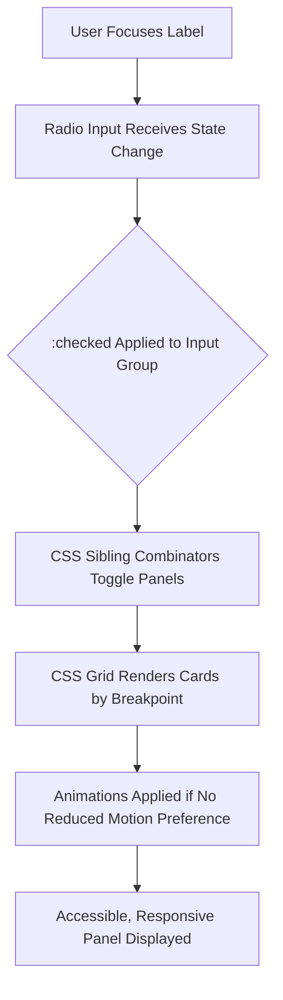

| Difficulty | Channel | Tags |
|---|---|---|
| beginner | frontend | css, flexbox, grid, animations |

Every millisecond counts. For a product that serves millions of hotel searches a day, a sluggish sidebar can mean lost bookings, frustrated users, and an accessibility barrier for those relying on a keyboard to navigate the web. This is precisely the challenge that faced trivago, whose hotel filter sidebar was built on a legacy internal JavaScript framework. The result? Over 120ms of script evaluation time, a 176KB bundle, and a component that was not fully keyboard accessible [1]. What seems like a minor UI element holds far more weight than most developers realize, and the solution may not require more JavaScript, but less of it.

---

> ### Real-World Case — trivago
>
> trivago's hotel filter sidebar was one of the most important parts of its search experience, but it was built on a legacy internal JavaScript framework and had poor keyboard accessibility. On mobile, the component's initial script evaluation and rendering took over 120ms, and some visitors could not use the filters at all.
>
> | | |
> |---|---|
> | **Challenge** | Rebuild the filter UI—including its tabs and accordions—to be fully keyboard accessible while reducing the heavy JavaScript and animation overhead, without a major visual redesign. |
> | **Solution** | The team rewrote the filters on its lighter Melody JS framework, dropped IE8 support, removed the Velocity animation library and relied solely on CSS for animation, loaded the “More filters” tab on demand, and applied accessibility research for combined tab/accordion interfaces. |
> | **Outcome** | The bundle dropped from 176KB to 53KB—a 70% reduction, or 13KB gzipped—and script evaluation/rendering time fell from over 120ms to 16ms, an 88% reduction. The filters also became completely keyboard accessible. |
> | **Lesson** | Removing legacy JavaScript and moving animation to CSS can improve performance and accessibility at the same time; accessible tabs and accordions require deliberate semantics and keyboard behavior, not just visually styled panels. |

---

## Hook — The Hidden Cost Of A Dropdown

Picture this: a user on a slow, throttled connection is trying to filter hotels for an upcoming trip. With each tap or keypress, the filter sidebar hesitates. For a mouse user, a delay may be a nuisance. For a keyboard-only user, or a user relying on assistive technology, an inaccessible or slow component can be a complete blocker. 

The stakes are quantifiable. Web performance has a direct correlation with user retention, and accessibility is not an optional add-on, but a requirement for an inclusive web [2]. For large-scale products, UI patterns that seem innocuous at a small scale can compound into a product-wide performance and accessibility debt. The question, therefore, becomes a simple one: can interactivity exist without the overhead of JavaScript?

## Problem — When Interactivity Becomes Bloat

Many developers reach for JavaScript as a default when building interactive components such as tabs, accordions, or filter panels. While powerful, this default comes with tradeoffs. Every kilobyte added to a bundle increases parse and evaluation time [3], a cost that is only exacerbated on low-powered devices or congested networks. 

Moreover, layering JavaScript on top of a UI introduces another class of risk: accessibility. Without diligent management of focus states, keyboard events, and ARIA roles, interactive elements built with JavaScript can quickly become unusable for keyboard or assistive technology users [2]. 

Specifically, the issue isn't interactivity itself, it's coupling interactivity to a heavy runtime. Before adding a script to the page, it is worth asking a contrarian question: is there a native, declarative feature of CSS or HTML that can do the job first? For tabbed interfaces, the answer is a resounding yes.

## Real-World Case — trivago

This exact problem became a priority for trivago. Its hotel filter sidebar, one of the most used components within its search experience, was built on a legacy internal JavaScript framework. On mobile, initial script evaluation and rendering took over 120ms, the component had poor keyboard accessibility, and some visitors could not use the filters at all [1]. 

The turning point came with a refactor to a CSS-driven approach, affectionately dubbed the 'Melodic Filters' initiative. The impact was drastic. The bundle dropped from 176KB to 53KB—a 70% reduction, or 13KB gzipped. Script evaluation and rendering time fell from over 120ms to 16ms, an 88% reduction. Most importantly, the filters became completely keyboard accessible [1]. 

This case serves as proof that performance and accessibility are not competing priorities. With the right HTML and CSS patterns, teams can achieve both, often with fewer resources than a JavaScript-heavy alternative would require.

## Deep Dive — The Native Tools For A CSS-Only Solution

Building on trivago's success, the underlying mechanics are simpler than they may seem. HTML provides a surprisingly robust state machine in the form of radio inputs. When a group of inputs shares the same `name` attribute, only one can be checked at a time, creating mutually exclusive state with no JavaScript required [4]. By pairing each input with a ``, that state becomes operable via both mouse and keyboard. 

From there, CSS does the heavy lifting. The `:checked` pseudo-class, combined with sibling combinators, can toggle the visibility of content panels based on which tab is active [4]. For layout, CSS Grid allows for a 2x2 card layout on desktop with `repeat(2, 1fr)`, collapsing down to a single column through a simple media query [5]. 

However, a production-ready component requires more than visibility toggles. Fixed media areas are best handled with `aspect-ratio: 16 / 9`, a property that preserves dimensions without the layout shift that comes from padding hacks [6]. For accessibility, `:focus-visible` provides clear outlines for keyboard users without distracting mouse users [7]. Finally, for motion sensitivity, the `prefers-reduced-motion` media query ensures that animations are disabled for users who opt out of them, an important consideration for vestibular disorders [8]. 

These aren't new features, but together, they form a battle-tested pattern. The tradeoff is minimal: more reliance on markup structure, and less programmatic flexibility. For a tab panel, that tradeoff is more than worth it.

## Workflow — From Markup To A Responsive, Accessible Panel

So how can this come together in practice? The flow is more architectural than algorithmic. The diagram below illustrates how declarative state flows from user input to a rendered layout without a JavaScript event loop in the middle. 

**Workflow breakdown:**

- **Establish state:** Create a group of visually hidden or accessible radio inputs, each representing a tab. Assign them a shared `name` to create mutually exclusive state [4].
- **Create controls:** Pair each input with a ``, ensuring labels are focusable and descriptive for screen readers.
- **Structure content:** For each tab, create an associated panel containing a grid of cards. Use semantic elements where possible to aid in document structure.
- **Toggle with CSS:** Use `input:checked + label` for active styles, and `input:not(:checked) ~ .panel` (or targeted combinators) to hide inactive panels [4].
- **Make it responsive:** Apply CSS Grid with two columns by default, and switch to `grid-template-columns: 1fr` under a mobile breakpoint [5].
- **Harden for accessibility and motion:** Add `:focus-visible` outlines [7], enforce `aspect-ratio` for media [6], and wrap animations in `@media (prefers-reduced-motion: no-preference)` [8].

## Code Example — A Runnable, Production-Minded Implementation

The theory holds up in practice. The following example implements a CSS-only tab panel that meets the requirements: keyboard-operable tabs, a 2x2 grid on desktop, a single column on mobile, fixed 16:9 media areas, staggered entrance animations, `focus-visible` outlines, and respect for `prefers-reduced-motion`. Note how the entire interactive behavior is driven by markup and CSS alone.

## Lessons Learned — Less Can Be More

The journey from JavaScript-heavy widgets to declarative patterns yields a few hard-earned takeaways: 

- **Performance is a feature:** As trivago's results show, removing JavaScript from a critical path can yield double-digit percentage gains in load and evaluation times [1]. 
- **Accessibility starts at the primitive:** Using native HTML controls, such as radio inputs and labels, provides keyboard and assistive technology support for free if implemented correctly [2][4].
- **CSS is more powerful than it's given credit for:** Between `:checked`, Grid, `aspect-ratio`, and media queries for motion preferences, modern CSS covers a wide array of interactive UI patterns [5][6][7][8].
- **Simplicity has a cost:** CSS-only patterns are less flexible for complex state (such as deep linking, history, or dynamically added tabs). For those cases, JavaScript may still be the right tool. Knowing when *not* to use it is the skill. 

The so what? Before reaching for a JavaScript dependency for a common pattern, try a native-first approach. The result could be faster, more accessible, and leaner for every user that interacts with it.

---

## CSS-Only Tab State Flow

<strong>Original Interview Question</strong>

**Q:** Build a CSS-only tab panel for a design-system docs page. Use radio inputs to switch tabs (no JavaScript). Desktop: a 2x2 grid of cards under each tab; mobile: single column. Each card has a fixed 16:9 image area, a title, and a short meta line. Add a subtle entrance animation with a stagger and keep focus-visible outlines; ensure prefers-reduced-motion is respected?

**A:** Use a set of radio inputs with a shared `name` attribute and corresponding `` elements for each tab section. The `:checked` state of each radio controls visibility of its associated panel via adjacent sibling selectors. Each panel renders a 2×2 card grid on desktop and collapses to a single column on mobile. Cards use `aspect-ratio: 16/9` for fixed image containers, with a title and meta line below.

## Conclusion

The lesson from trivago is not that JavaScript is the enemy, but that it should be a tool of last resort for common UI patterns. By defaulting to native HTML and modern CSS, teams can ship components that are faster, more accessible, and cheaper to maintain. Tomorrow, before adding an event listener to a tab panel, try a radio input first. It may be the simplest performance and accessibility win available.

---

## References

1. [trivago incident report - Melodic Filters](https://tech.trivago.com/post/melodic-filters-article) — blog
2. [MDN - Accessibility](https://developer.mozilla.org/en-US/docs/Web/Accessibility) — documentation
3. [MDN - Performance: How browsers work](https://developer.mozilla.org/en-US/docs/Web/Performance/How_browsers_work) — documentation
4. [MDN - :checked pseudo-class](https://developer.mozilla.org/en-US/docs/Web/CSS/:checked) — documentation
5. [MDN - CSS Grid Layout](https://developer.mozilla.org/en-US/docs/Web/CSS/CSS_grid_layout) — documentation
6. [MDN - aspect-ratio](https://developer.mozilla.org/en-US/docs/Web/CSS/aspect-ratio) — documentation
7. [MDN - :focus-visible](https://developer.mozilla.org/en-US/docs/Web/CSS/:focus-visible) — documentation
8. [MDN - prefers-reduced-motion](https://developer.mozilla.org/en-US/docs/Web/CSS/@media/prefers-reduced-motion) — documentation

---

**Author:** Satishkumar Dhule — [GitHub](https://github.com/satishkumar-dhule) · [LinkedIn](https://linkedin.com/in/satishkumar-dhule) · [Website](https://satishkumar-dhule.github.io)
