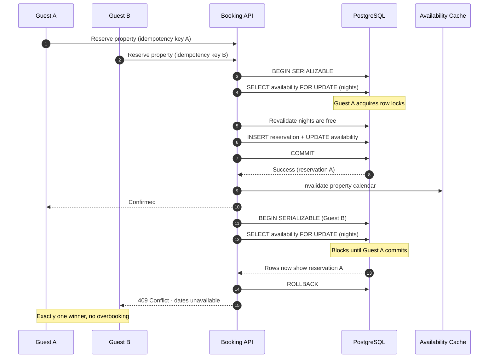

| Difficulty | Channel | Tags |
|---|---|---|
| intermediate | database | acid, isolation-levels, mvcc |

It was the kind of traffic Shopify plans for all year: Black Friday 2025, when merchants hit a record $5.1 million in sales per minute at peak [1]. Behind that number sat a deceptively simple question — can this last unit be reserved for exactly one buyer? The answer is easy in a single database and terrifyingly hard once reservations, payments, and inventory live in different systems. This is the story of how that question breaks booking systems, and how to design transactions that survive the answer.

---

> ### Real-World Case — Shopify
>
> Every Shopify checkout must reserve inventory so two buyers can't claim the same last unit. Reservations originally ran on Redis with DECR/INCR counters, but reservations and the inventory ledger lived in separate systems, so the payment 'claim' step could not be atomic with the ledger update.
>
> | | |
> |---|---|
> | **Challenge** | Prevent overselling (two buyers purchasing the same unit) and underselling (rejecting a sale when stock exists) under Black Friday-scale bursts, while also supporting multi-location inventory and keeping ACID guarantees between reservations and the inventory ledger. |
> | **Solution** | Shopify moved reservations from Redis into MySQL alongside the ledger, using one row per sellable unit instead of a single quantity row, with SELECT ... FOR UPDATE SKIP LOCKED to grab free units without blocking on locked rows. They capped the available-unit pool at 1,000 rows per item/location to keep scans fast, used a composite primary key (shop_id, inventory_item_id, inventory_group_id, id) to cut InnoDB from two row locks to one, switched transactions from MySQL's default REPEATABLE READ to READ COMMITTED to avoid gap/supremum locks during replenishment, enforced consistent lock ordering to eliminate deadlocks, and batched cart lookups with UNION ALL. They also discovered that tagging SQL by business process and measuring connection hold time at the ProxySQL layer revealed the real bottleneck. |
> | **Outcome** | The system handled Black Friday 2025 traffic, when Shopify merchants hit a record $5.1 million in sales per minute at peak — an 11% increase over the prior year. During high-volume flash sales, writer CPU stayed under 50% and reader CPU under 16%. Cleanup of the broader checkout path removed 50% of reads and 33% of transactions on the primary database, and the Redis-to-MySQL cutover ran in shadow mode with a kill switch before MySQL became the source of truth. |
> | **Lesson** | The bottleneck wasn't where anyone expected: after weeks optimizing queries and locks, the throughput ceiling came from other checkout code holding database connections too long, not from CPU or reservation queries. Also, a modern relational database with SKIP LOCKED can replace Redis for high-throughput mutual exclusion — and revisiting old assumptions (including the default isolation level) matters more than reaching for specialized infrastructure. |

---

## Hook — The 499th Guest and the Last Available Night

Picture a sold-out holiday weekend. A property has exactly one night left, and two guests tap "Reserve" within 40 milliseconds of each other. Both see a green calendar. Both get a confirmation email. Both show up. That is not a UX bug — it is a transaction boundary bug, and it is waiting in every booking system that checks availability before it writes the reservation. The fix sounds simple until you ask the uncomfortable question: atomic with respect to what? A single row? A date range? A payment claim in another service? The answer determines whether your architecture holds under load or quietly doubles-book your most valuable inventory.

## Problem — When Two Clicks Become One Overbooking

The classic failure is a check-then-act race condition [8]. Request A reads the calendar, sees the night is free, and pauses. Request B reads the same calendar, sees the same free night, and writes a reservation. Request A wakes up and writes its own reservation. Two transactions, one night, zero errors — until a human notices.

The subtlety is that this is not just a duplicate-row problem. Availability is a range: a booking spans check-in through check-out, and overlapping ranges can be inserted at different boundaries. A unique index on a single date helps only if your schema stores one row per property per night and enforces uniqueness there. If availability is derived from a reservations table with BETWEEN queries, the database has no constraint to protect you.

There is also a business tension. The safest design — one global lock around all bookings — destroys availability and turns hot properties into a queue. The fastest design — eventual consistency and in-memory counters — invites overselling. The real challenge is finding the narrowest lock that still makes the booking atomic, then keeping that lock off the read path so browsing stays fast.

💡 Insight: Most teams optimize the availability read and forget the reservation write. The read can be stale; the write cannot.

## Real-World Case — Shopify's Inventory Reservation Rebuild

Shopify ran into the same shape of problem at a much larger scale. Every checkout must reserve inventory so two buyers cannot claim the same last unit. Reservations originally ran on Redis using DECR and INCR counters, which were fast and worked well for simple decrements [1]. However, the reservation counters and the inventory ledger lived in separate systems. That separation meant the payment "claim" step could not be atomic with the ledger update — a dangerous gap when money and stock must agree.

The stakes were visible during Black Friday 2025, when Shopify merchants hit a record $5.1 million in sales per minute at peak, an 11% increase over the prior year [1]. Under that pressure, the team migrated reservations from Redis to MySQL, making MySQL the source of truth so the claim and ledger update could share a transaction boundary. The cutover ran in shadow mode with a kill switch before the switch was trusted. The results were not just correctness wins: during high-volume flash sales, writer CPU stayed under 50% and reader CPU under 16%, while cleanup of the broader checkout path removed 50% of reads and 33% of transactions on the primary database [1].

The plot twist is that Redis was never the villain. Speed was fine. The missing piece was a transactional boundary that could span the reservation and the ledger — and that is a data-model decision, not a caching decision.

## Deep Dive — Isolation Levels, Locks, and the MVCC Illusion

Relational databases give you several isolation levels, and the differences matter more for booking than for most CRUD apps [2][3].

| Isolation level | What it prevents | What it still allows | Booking suitability |
|---|---|---|---|
| READ COMMITTED | Dirty reads | Non-repeatable reads, phantoms | Unsafe for availability checks |
| REPEATABLE READ | Non-repeatable reads via snapshots | Some write-skew and phantom patterns | Good for read-mostly, not enough alone |
| SERIALIZABLE | Serialization anomalies via SSI | Nothing dangerous, but transactions may abort | Safe, requires retry logic |

Here is the counterintuitive part: MVCC snapshot reads are excellent for browsing availability, but they are not ownership [4]. A snapshot gives a transaction a consistent view of the past; it does not stop another transaction from inserting a conflicting reservation. Many developers assume that wrapping the check in a REPEATABLE READ transaction makes it safe. It does not, because the conflict is a phantom — a new row or an updated date range that did not exist in the snapshot.

SERIALIZABLE isolation in PostgreSQL uses Serializable Snapshot Isolation, which detects dangerous read-write dependencies and aborts one of the conflicting transactions with a serialization failure [6]. That abort is not a bug; it is the database enforcing correctness. The application must retry.

For explicit control, SELECT FOR UPDATE locks the selected rows until the transaction commits [7]. Locking the availability calendar rows for the requested date range turns overlapping bookings into a queue at exactly the right granularity: different properties and non-overlapping dates proceed in parallel, while the same property and overlapping dates serialize.

Optimistic concurrency control takes a different route: add a version column, read it, and update with a WHERE version = expected clause [5]. If zero rows are updated, another writer won the race and the request retries. This works beautifully for low-contention records and poorly for hot properties where retries pile up.

⚠️ Watch Out: SERIALIZABLE does not make a distributed system atomic. If reservations live in MySQL and the inventory ledger lives in Redis, no isolation level can cover both. You need one source of truth, or a saga with compensating actions.

## Workflow — From Availability Check to Confirmed Booking

The sequence diagram below tells the story of two guests racing for the same property. Notice where the lock is taken, where the loser backs off, and why the cache is invalidated only after commit.

1. Accept the request with an idempotency key so a network retry cannot create a second reservation.
2. Open a transaction at SERIALIZABLE isolation and insert or check the idempotency record first.
3. Lock every availability row for the requested property and date range with SELECT FOR UPDATE, ordered consistently to avoid deadlocks.
4. Revalidate inside the lock: the calendar must be complete, and every night must be free.
5. Insert the reservation and stamp the locked availability rows with the reservation ID.
6. Commit. Only after a successful commit should the cache be invalidated or updated.
7. If the database returns a serialization failure or deadlock, retry with exponential backoff and jitter.

For high-demand properties, add a short-lived hold with a TTL between selection and payment. The hold is just another reservation state, but it prevents a guest from sitting on inventory for 30 minutes while everyone else sees a false "sold out." A background sweeper expires abandoned holds and releases the rows.

🎯 Key Point: The lock protects the write. The cache protects the read. Never confuse the two.

## Code Example — A Safer Reservation Transaction in Python

The following example uses psycopg 3 with PostgreSQL. It combines idempotency, row-level locks, SERIALIZABLE isolation, and bounded retries. The important detail is that the availability rows are locked before they are trusted, and the transaction boundary includes both the reservation insert and the calendar update.

## Lessons Learned — What to Carry Into Your Next Booking System

The Shopify migration is a reminder that correctness is an architecture property, not a database setting [1]. Here is what to carry forward.

- **Put the reservation and the ledger in one transactional boundary.** If they must live apart, use a saga with explicit compensation and idempotent steps. Do not pretend a cache update is a commit.
- **Lock the smallest range that preserves correctness.** Locking all availability for a property is simple but creates contention. Locking only the requested nights keeps unrelated dates moving.
- **Treat serialization failures as normal traffic.** Monitor the rate of 40001 errors. A sudden spike means contention is rising, not that the database is broken [6].
- **Make every write idempotent.** Clients retry, load balancers retry, and queues retry. An idempotency key turns duplicate requests into the same result.
- **Order locks consistently.** Two transactions locking date ranges in different orders will deadlock. Always lock by property then ascending date.
- **Invalidate caches after commit, never before.** A cache write before commit can advertise availability that never became real.
- **Add holds with TTLs for hot inventory.** Holds convert a thundering herd into a fair queue and protect the payment window.

🔥 Hot Take: If your availability check and your reservation write are in different services without a shared transaction or a saga, you do not have a booking system. You have a suggestion box.

Many teams discover this only after a flash sale. The ones that recover fastest have already built a concurrency test harness that fires hundreds of overlapping requests at the same property and asserts exactly one winner.

---

## Booking Reservation Sequence

<strong>Original Interview Question</strong>

**Q:** You're building a booking system for Airbnb where multiple users can reserve the same property simultaneously. How would you design the transaction handling to prevent double bookings while maintaining high availability?

**A:** Use SERIALIZABLE isolation with optimistic concurrency control. Implement row-level locks on property availability tables, use MVCC snapshot reads for checking availability, and apply application-level validation to ensure atomic booking operations.

## Conclusion

The moral is simple: a booking is a transaction, not a form submission. Shopify's migration shows that the hard part is not making the counter fast — it is making the reservation and the ledger agree at the same instant [1]. Start tomorrow by auditing where your availability read and your reservation write diverge. If they are in separate systems without a shared transaction or a compensating saga, fix that boundary before the next flash sale finds it for you. Then lock the smallest date range that preserves correctness, retry serialization failures with jitter, and make every write idempotent. The one insight worth sharing with your team: MVCC gives you a consistent view of the past, but only a lock or a serialization guarantee gives you ownership of the future.

---

## References

1. [Shopify incident report](https://shopify.engineering/scaling-inventory-reservations) — article
2. [ACID](https://en.wikipedia.org/wiki/ACID) — documentation
3. [Isolation (database systems)](https://en.wikipedia.org/wiki/Isolation_(database_systems)) — documentation
4. [Multiversion concurrency control](https://en.wikipedia.org/wiki/Multiversion_concurrency_control) — documentation
5. [Optimistic concurrency control](https://en.wikipedia.org/wiki/Optimistic_concurrency_control) — documentation
6. [PostgreSQL transaction isolation](https://www.postgresql.org/docs/current/transaction-iso.html) — documentation
7. [PostgreSQL explicit locking](https://www.postgresql.org/docs/current/explicit-locking.html) — documentation
8. [Race condition](https://en.wikipedia.org/wiki/Race_condition) — documentation
9. [Exponential backoff](https://en.wikipedia.org/wiki/Exponential_backoff) — documentation
10. [psycopg 3 transaction management](https://www.psycopg.org/psycopg3/docs/basic/transactions.html) — documentation

---

**Author:** Satishkumar Dhule — [GitHub](https://github.com/satishkumar-dhule) · [LinkedIn](https://linkedin.com/in/satishkumar-dhule) · [Website](https://satishkumar-dhule.github.io)
