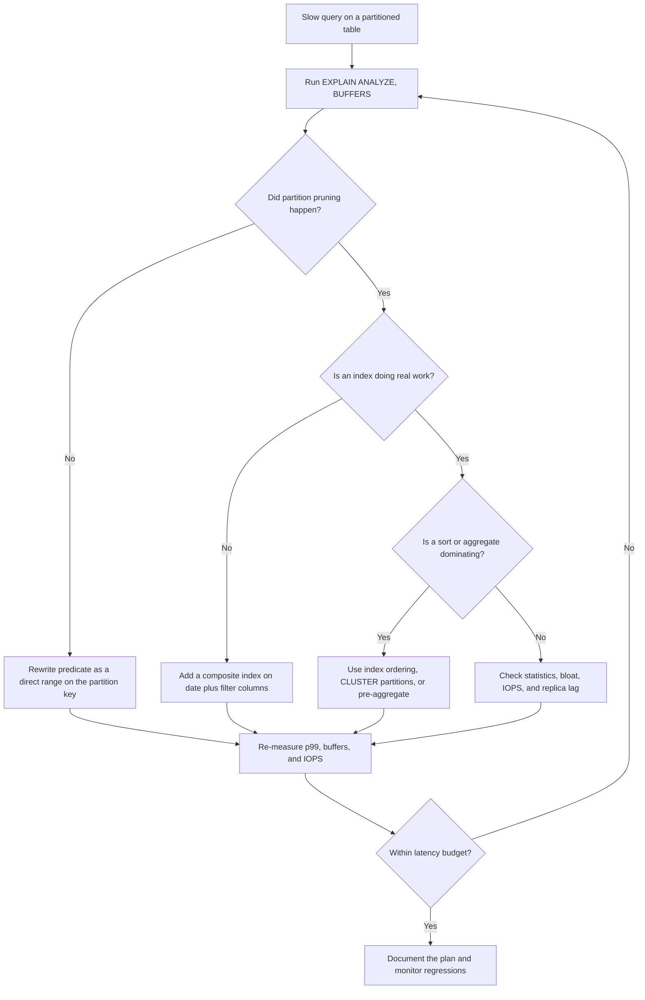

| Difficulty | Channel | Tags |
|---|---|---|
| intermediate | database | explain, query-plan, partitioning |

It started with a dashboard that would not load. CoinGecko had pushed more than eight years of hourly crypto prices into a single PostgreSQL RDS table that crossed 1TB, and queries that once felt instant were taking more than 30 seconds [1]. IOPS alarms fired daily, request queues stretched, p99 latency climbed to 4.13 seconds, and replicas fell further behind with every spike [1]. Throwing more IOPS at the problem did not fix it — which is the moment every developer should pay attention to. This is the story of how a partitioned table can still betray you, and how to read an EXPLAIN plan well enough to catch it.

---

> ### Real-World Case — CoinGecko
>
> CoinGecko stored over 8 years of hourly crypto price data in a single PostgreSQL RDS table that grew past 1TB. Queries against it took more than 30 seconds on average, IOPS alerts fired daily, request queues grew, Apdex and replica lag worsened, and raising IOPS to 24K did not stop the bleeding.
>
> | | |
> |---|---|
> | **Challenge** | The obvious fix—adding indexes—failed because the hot queries filtered on JSONB keys for arbitrary supported currencies, making per-key indexing impractical. The team needed to make timestamp-range queries fast without rewriting the data model, while avoiding downtime for a customer base highly sensitive to SLO/SLA violations. |
> | **Solution** | They chose RANGE partitioning by month on the timestamp column because nearly every query contained a timestamp range and typically touched at most four months of data. They built a partitioned copy, used pg_prewarm to avoid cold-cache regressions, copied 1.2TB of data, used a foreign data wrapper to copy from a separate warmed host when production couldn't sustain the IOPS, kept old and new tables in sync with triggers, and swapped tables in a transaction. Crucially, they had to fix queries that lacked a lower or upper date bound—those scanned every partition, including empty future ones—and removed pre-created future partitions. |
> | **Outcome** | p99 response time dropped 86%, from 4.13s to 578ms; IOPS fell 20% (multiplied across replicas); replica lag disappeared immediately after the switch; and equivalent queries ran 6–8x faster. Partition prewarming took 3 hours versus 10 hours for the original table. |
> | **Lesson** | Partitioning only helps when the planner can prune, and pruning depends on the query containing bounded predicates on the partition key. The same query that performed acceptably on the monolithic table can regress badly after partitioning if it omits a date lower bound or hits empty future partitions—so verify pruning in EXPLAIN and audit every production query, not just the schema, before switching. |

---

## Hook — The 30-Second Query That Refused to Die

The pager does not care that the table is partitioned. At CoinGecko, a single PostgreSQL RDS table held more than eight years of hourly crypto prices and had grown past 1TB [1]. Queries that powered price history pages averaged more than 30 seconds, IOPS alerts fired daily, request queues grew, and replica lag kept climbing [1].

The team tried the obvious lever — raising provisioned IOPS to 24K — and the bleeding continued [1]. That is the uncomfortable moment every developer should study: the infrastructure looked bigger, but the query plan had not changed.

If a partitioned table is still slow, the answer is rarely more hardware. It is usually hiding in the EXPLAIN output, waiting for someone to read it closely.

## Problem — Partitioning Is Not a Performance Switch

Partitioning feels like a promise: split a giant table into smaller pieces, and queries will magically touch less data. In practice, PostgreSQL only delivers that benefit when partition pruning actually eliminates partitions before execution [3]. A filter on event_date looks harmless, but a cast, a function, or a mismatched boundary can force the planner to scan every partition [3].

Similarly, an index on the partition key alone may not help a query that also filters on status, tenant_id, or another high-selectivity column [4]. Then come the expensive sorts: a query can prune perfectly, use an index, and still spend most of its time sorting or spilling to disk [2].

The result is a plan that looks plausible at a glance and terrible under production load. Many developers learn this the hard way: the table is partitioned, the query is still slow, and the dashboard does not explain why. ⚠️ Watch out for the assumption that partitioning alone is an optimization — it is only an opportunity.

## Real-World Case — CoinGecko

CoinGecko's incident is a textbook example of partitioning as a journey, not a checkbox. The company stored over eight years of hourly crypto price data in a single PostgreSQL RDS table that grew past 1TB [1]. Average query time exceeded 30 seconds, IOPS alerts fired daily, request queues lengthened, Apdex dropped, and replica lag worsened [1].

Raising IOPS to 24K did not stop the bleeding, which is the plot twist: the database was not short on raw throughput so much as it was drowning in work it should never have done [1]. Amazon RDS gives teams powerful knobs, but no knob can fix a query that scans more data than necessary [7].

After moving to a partitioned design and tuning access paths, p99 response time fell 86%, from 4.13s to 578ms; IOPS dropped 20% across replicas; replica lag disappeared; and equivalent queries ran 6–8x faster [1]. Partition prewarming took about 3 hours versus 10 hours for the original table [1]. The fix was not a bigger instance. It was a better plan.

## Deep Dive — Reading the Plan Like a Detective

Start with three questions, in order. First: did partition pruning happen? In EXPLAIN output, look for the number of partitions scanned, the partitions removed, and whether the plan shows a sequential scan across many children [2][3]. If pruning failed, no index or hardware upgrade will save you. Second: is the index doing real work? A Seq Scan on one partition can be fine; a Seq Scan across 96 partitions is a red flag [4]. Third: where is the time going? Sort nodes, hash aggregates, and external merge spills often dominate execution time even when the scan looks healthy [2].

Partition pruning has a subtle failure mode. Plan-time pruning works when the predicate is a constant or a stable expression; runtime pruning kicks in for parameterized queries, but generic prepared plans can still choose a broad plan [3]. Casts and functions on the partition key are classic pruning killers. For example, WHERE created_at::date = '2024-01-15' may prevent pruning because the expression no longer matches the partition key directly [3]. Rewrite it as a range: created_at >= '2024-01-15' AND created_at < '2024-01-16'. That small rewrite can turn a 100-partition scan into a one-partition lookup.

Index utilization is the next layer. A composite index on (event_date, status) helps queries that filter on both columns, with event_date first because it matches the partition key and the range predicate [4]. If most queries filter by status only, that index will not be chosen; a separate index on status may be better, but every additional index adds write overhead and vacuum work [4][8]. Column order matters: equality columns before range columns is a useful default, but the real test is the actual query mix. Use EXPLAIN (ANALYZE, BUFFERS) and check 'Rows Removed by Filter' — a low row count after a giant scan means the index is not selective enough or the statistics are stale [2].

Expensive sorts are the third suspect. A Sort node with 'Sort Method: external merge Disk' means work_mem was too small for the row set, and the query paid for temporary files [2]. An index that returns rows in the required order can eliminate the sort entirely, especially for ORDER BY event_date DESC LIMIT 50 patterns [4]. Clustering physically reorders a table to match an index, which can dramatically reduce I/O for range scans, but it is a one-time rewrite, it takes an exclusive lock, and it does not stay clustered forever as new rows arrive [5]. That is why teams often schedule CLUSTER or pg_repack as maintenance, not as a one-off magic trick.

| Symptom in EXPLAIN | What it usually means | First fix |
|---|---|---|
| Many partitions scanned | Pruning failed or predicate is not sargable | Rewrite predicate as a direct range on the partition key [3] |
| Seq Scan across every partition | Missing or unusable index | Add a composite index aligned with the filter [4] |
| High 'Rows Removed by Filter' | Index is not selective or stats are stale | ANALYZE, rethink column order, or add a covering index [2][4] |
| External merge Sort | Sort spills to disk | Increase work_mem carefully or use an index-ordered path [2] |
| High shared read buffers | Too much data touched per query | Prune earlier, cluster, or pre-aggregate [2][5] |

🔥 Hot Take: More indexes can make the system slower. Every index consumes cache, adds write amplification, and gives the planner more ways to choose a bad plan. CoinGecko's win came from reducing unnecessary work, not from adding every possible index [1]. PostgreSQL's performance guidance is blunt for a reason: the biggest wins usually come from reducing the amount of data and the number of rows touched [10].

The counterintuitive part? Partitioning is simple in concept — divide a logical table into physical pieces — but the execution details decide whether the planner can skip those pieces [9]. A good optimization session ends with fewer bytes read, fewer partitions touched, and a plan you can explain to a teammate in one sentence.

## Workflow — A Repeatable Query Triage Loop

Here is the loop that turns EXPLAIN from a wall of text into a decision tool. The Mermaid diagram below maps the same flow visually, from the first slow query to a verified fix.

1. Reproduce with real parameters. Use the actual date range and filters from production; a synthetic range can hide the problem.
2. Capture the full picture. Run EXPLAIN (ANALYZE, BUFFERS, FORMAT JSON) and keep the output as an artifact for comparison [2].
3. Check pruning first. Count the partitions scanned and look for 'Partitions Removed'; if pruning is weak, fix the predicate before touching indexes [3].
4. Inspect scan types. A Seq Scan on a small partition is acceptable; a Seq Scan on every partition is not [4].
5. Inspect sorts and aggregates. Look for external merge sorts, high buffer reads, and hash batches that spill to disk [2].
6. Change one thing at a time. Add the composite index, run ANALYZE, or cluster the relevant partitions, then re-run the same query [4][5].
7. Measure the outcome. Compare p99 latency, buffers read, IOPS, and replica lag — not just the single query time [1].

The diagram traces this loop: pruning check, index check, sort check, then a feedback edge that sends you back to measurement when the latency budget is still missed. 💡 Insight: The plan is a hypothesis. Production metrics are the verdict. A query that drops from 4s to 500ms but doubles write latency is not a win.

## Code Example — Automating the First Pass

The Python script below turns the first three checks into a repeatable diagnostic. It runs EXPLAIN (ANALYZE, BUFFERS, FORMAT JSON), flattens the plan tree, reports sequential scans and sort nodes, then applies the two structural fixes from the CoinGecko playbook: a composite index built concurrently and a per-partition CLUSTER [1][2][4][5]. It is intentionally conservative — it prints before it changes anything, and it uses autocommit because CREATE INDEX CONCURRENTLY and CLUSTER cannot run inside a transaction block.

The code is a starting point, not a replacement for judgment. A production rollout should also capture before-and-after baselines, run during a controlled window, and verify write throughput and replica health after each change [1][7].

## Lessons Learned — What to Do Differently Tomorrow

- Read the plan before buying IOPS. CoinGecko raised IOPS to 24K and still hurt; the query was doing unnecessary work [1].
- Pruning is the first domino. If partitions are not eliminated, indexes and sorting advice are noise [3].
- Design composite indexes around the real filter order. (event_date, status) is not the same as (status, event_date) [4].
- Treat CLUSTER as maintenance, not a permanent state. New rows arrive out of order, and bloat returns [5][8].
- Watch the sort. External merge sorts are a silent tax on latency and disk [2].
- Measure end-to-end. p99, IOPS, replica lag, and Apdex tell you whether the fix actually helped [1].

The battle scars are predictable. A developer adds an index on the partition key, reruns one query, sees a faster plan, and ships it — only to discover that write throughput collapsed and autovacuum is now behind [8]. Another rewrites a predicate with a cast and accidentally disables pruning [3]. A third clusters a hot table during peak traffic and blocks writes for minutes [5]. The antidote is boring: reproduce, measure, change one variable, and verify with production metrics.

🎯 Key Point: The most valuable optimization skill is not memorizing index types. It is learning to ask, 'Is this query touching data it does not need?'

---

## Query Triage Flow

<strong>Original Interview Question</strong>

**Q:** You have a PostgreSQL table with 100M rows partitioned by date. A query filtering on a specific date range is still slow. What would you check in the EXPLAIN plan and how would you optimize it?

**A:** Check partition pruning effectiveness, index utilization patterns, and expensive sort operations. Create composite indexes on (date, filtered_columns) and evaluate clustering strategies for optimal data access.

## Conclusion

CoinGecko's story does not end with a bigger database. It ends with a better question: what work is this query doing that it does not need to do? A partitioned table with 100M rows can feel fast or hopeless depending on whether pruning, index access, and sort avoidance line up with the query pattern [1][3]. Tomorrow, before reaching for more IOPS, run EXPLAIN (ANALYZE, BUFFERS) on the slow query, count the partitions scanned, check the rows removed by filters, and look for the sort that should not exist [2]. Then fix the smallest thing that removes the most work. That habit scales better than any instance size — and it is the difference between owning a partitioned table and being owned by one.

---

## References

1. [CoinGecko incident report](https://dev.to/coingecko/scaling-postgresql-performance-with-table-partitioning-136o) — article
2. [PostgreSQL Documentation: EXPLAIN](https://www.postgresql.org/docs/current/sql-explain.html) — documentation
3. [PostgreSQL Documentation: Table Partitioning](https://www.postgresql.org/docs/current/ddl-partitioning.html) — documentation
4. [PostgreSQL Documentation: Indexes](https://www.postgresql.org/docs/current/indexes.html) — documentation
5. [PostgreSQL Documentation: CLUSTER](https://www.postgresql.org/docs/current/sql-cluster.html) — documentation
6. [Wikipedia: Database index](https://en.wikipedia.org/wiki/Database_index) — documentation
7. [Amazon RDS for PostgreSQL](https://docs.aws.amazon.com/AmazonRDS/latest/UserGuide/CHAP_PostgreSQL.html) — documentation
8. [PostgreSQL Documentation: Routine Vacuuming](https://www.postgresql.org/docs/current/routine-vacuuming.html) — documentation
9. [Wikipedia: Partition (database)](https://en.wikipedia.org/wiki/Partition_(database)) — documentation
10. [PostgreSQL Documentation: Performance Tips](https://www.postgresql.org/docs/current/performance-tips.html) — documentation

---

**Author:** Satishkumar Dhule — [GitHub](https://github.com/satishkumar-dhule) · [LinkedIn](https://linkedin.com/in/satishkumar-dhule) · [Website](https://satishkumar-dhule.github.io)
