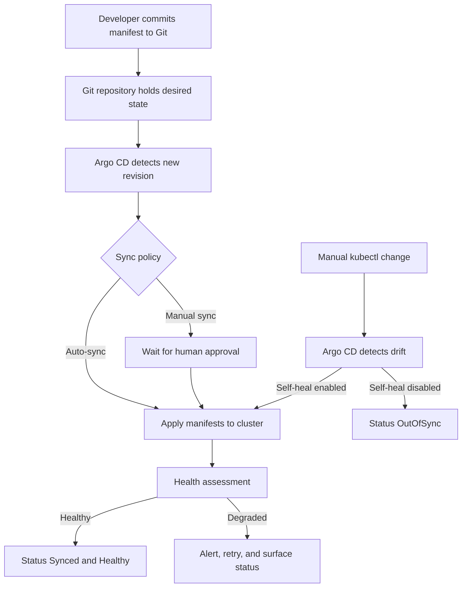

| Difficulty | Channel | Tags |
|---|---|---|
| beginner | devops | argocd, flux, declarative |

Imagine discovering that nearly 80% of the services your company is paying to run are stale, abandoned, or duplicated — and that the fix was not more servers but a different way of delivering software. That is exactly what happened when Adobe set out to migrate 10,400 pipelines from a legacy platform to a GitOps delivery system built on Kubernetes and Argo CD [1]. What started as a platform migration became a masterclass in declarative infrastructure, automated reconciliation, and the quiet power of Git as the single source of truth. Here is the story of how that shift works, why it matters, and how you can set up the same loop in your own cluster.

---

> ### Real-World Case — Adobe
>
> Adobe ran software delivery on a legacy internal container platform called Moonbeam (CaaS) that had become hard to scale, secure, and audit across hundreds of engineering teams. In 2H 2024 they set out to migrate 10,400 pipelines to Flex, a new GitOps delivery platform built on Kubernetes, Argo CD, Argo Workflows, Argo Events, and Argo Rollouts.
>
> | | |
> |---|---|
> | **Challenge** | Engineers were using fragile, queue-based imperative deployment workflows. Configuration drift, weak auditability, and manual intervention made it impossible to reliably manage thousands of services across tens of thousands of environments, and the legacy platform could not support the projected growth or compliance requirements. |
> | **Solution** | Adobe made Git the single source of truth and moved to declarative delivery: Kubernetes manifests and Helm/Kustomize definitions live in Git, Argo CD Applications point at those repos, and automated reconciliation continuously aligns live cluster state with the declared state, reverting drift and eliminating direct kubectl-style changes. They layered Argo Workflows, Events, and Rollouts on top for migration orchestration, progressive delivery, and governance, plus a self-service Node.js/React migration portal with start/pause/continue/end controls backed by long-running Argo Workflows. |
> | **Outcome** | Flex now manages 6,000+ services across nearly 50,000 environments, including ~19,000 production environments supporting 3,300+ production services, for 3,000+ developers. Adobe migrated or decommissioned 10,400 pipelines, cut deployment queue times significantly, improved security and auditability, and achieved substantial infrastructure cost savings — partly by discovering and retiring roughly 80% of previously identified services that were stale, abandoned, or duplicated. |
> | **Lesson** | Declarative GitOps eliminates drift and gives you auditability for free, but the real payoff and the real work are organizational: Adobe found that migration mandates did not build trust — demonstrated value did, and building end-to-end self-service tooling from day one mattered more than the Argo CD configuration itself. The surprise was that the migration became a platform-hygiene audit, exposing massive unused inventory; GitOps is as much a lifecycle-governance operating model as it is a deployment tool. |

---

## Hook — The Cluster That Drifted While Everyone Slept

It is 2:47 a.m. and a pager fires. A service is running with 12 replicas in production, but the Git repository says 3. Someone ran a `kubectl scale` during an incident last month, forgot to commit it, and now no one can explain why the cluster looks nothing like the repository. Sound familiar? This is configuration drift, and it is one of the most expensive silent failures in modern infrastructure. The scary part is not the mismatch itself — it is that your audit trail, your rollback story, and your disaster recovery plan are all built on an assumption that the cluster matches Git. When it does not, every one of those assumptions quietly breaks. The question is not whether drift will happen. It is whether your platform will notice and fix it before your customers do.

## Problem — When Kubernetes Has Too Many Chefs

Kubernetes is designed to be mutable. Anyone with the right credentials can `kubectl apply`, `kubectl edit`, or `kubectl delete` almost anything, which is wonderful for debugging and terrifying for governance. Multiply that flexibility by hundreds of engineers, dozens of environments, and a microservices architecture, and you get a system where the real state of production lives in the memories of whoever was on call. Many teams respond by adding process: change tickets, review boards, Slack approvals. But process does not stop a determined engineer at 3 a.m., and it does not reconcile the cluster back to a known-good state after an emergency hotfix. The deeper problem is philosophical. Imperative workflows ask, "What command should we run next?" Declarative workflows ask, "What should the world look like?" The second question is the one that scales, because it can be answered continuously by a machine rather than sporadically by a human [2]. Without a reconciler, your cluster becomes a snowflake — beautiful, unique, and impossible to reproduce.

## Real-World Case — Adobe's 10,400-Pipeline Bet on GitOps

Adobe's internal container platform, Moonbeam, had served hundreds of engineering teams, but it was becoming difficult to scale, secure, and audit. In the second half of 2024, Adobe began migrating 10,400 pipelines to Flex, a new GitOps delivery platform built on Kubernetes, Argo CD, Argo Workflows, Argo Events, and Argo Rollouts [1]. The results were dramatic: Flex now manages more than 6,000 services across nearly 50,000 environments, including roughly 19,000 production environments supporting 3,300+ production services for 3,000+ developers [1]. Deployment queue times dropped significantly, security and auditability improved, and infrastructure costs fell — partly because the migration revealed that around 80% of previously identified services were stale, abandoned, or duplicated [1]. That last number is the plot twist. GitOps did not just make delivery faster; it made the entire portfolio visible. When every service must declare itself in Git, the ghost services have nowhere to hide. Adobe's story proves that declarative delivery is as much an inventory and governance tool as it is a deployment mechanism.

## Deep Dive — Declarative vs. Imperative, and Why the Difference Matters

At the center of GitOps is a simple contract: Git holds the desired state, and a controller continuously makes reality match it [3]. In the declarative model, teams write YAML manifests, Helm charts, or Kustomize overlays that describe the complete target state — replicas, images, resource limits, network policies, everything [4][9][10]. Argo CD watches the repository and the cluster, compares the two, and reconciles any difference [2]. In the imperative model, teams run `kubectl create`, `kubectl edit`, or `kubectl patch` directly against the cluster. Those commands are fast and intuitive, but they bypass version control, which means they bypass review, history, and reproducibility. The trade-off is not about which tool is more powerful. It is about where the truth lives. Imperative workflows store truth in the cluster's current state and in human memory. Declarative workflows store truth in Git, where it can be diffed, reviewed, reverted, and audited. Here is the comparison that matters:

| Dimension | Declarative (GitOps) | Imperative (kubectl) |
|---|---|---|
| Source of truth | Git repository | Live cluster state |
| Audit trail | Every change is a commit | Scattered shell history |
| Rollback | `git revert` and sync | Manual re-apply, guesswork |
| Drift detection | Continuous reconciliation | None by default |
| Collaboration | Pull requests and reviews | Ad hoc, tribal knowledge |
| Disaster recovery | Rebuild from Git | Rebuild from memory |

💡 Insight: Declarative does not mean you never debug imperatively. It means every imperative fix must eventually become a commit, or the reconciler will undo it. That is a feature, not a bug — it forces operational knowledge back into version control [5].

## Workflow — The Reconciliation Loop That Never Sleeps

Building on the declarative contract, the actual workflow is a closed loop. First, a developer commits a change — a new image tag, a replica count, a Helm value — to the Git repository. Second, Argo CD detects the new commit through polling or a webhook and compares the desired manifest against the live cluster [3]. Third, if auto-sync is enabled, Argo CD applies the difference and then performs a health assessment to confirm the resources actually became healthy. Fourth, if someone makes a manual change, Argo CD notices the drift; with self-healing enabled, it reverts the cluster back to the Git-declared state automatically [2]. That final step is where the magic happens: the cluster becomes self-correcting, and Git becomes the only place where durable change can occur. The diagram below tells the visual story of that loop, including the drift branch that makes self-healing so valuable.



⚠️ Watch Out: Auto-sync with pruning enabled can delete resources that exist in the cluster but not in Git. That is powerful for cleanup and dangerous if your repository is incomplete. Start with pruning disabled in production, enable it in staging first, and make sure every resource is represented in Git before you let the reconciler delete anything [3].

## Code Example — Wiring Up an Application With Auto-Sync and Self-Healing

Now for the practical part. The code below creates an Argo CD `Application` custom resource, commits it to Git so the definition itself is versioned, applies it once, and then verifies both sync status and self-healing behavior. Notice the `automated` block: `prune: true` removes resources that disappear from Git, and `selfHeal: true` reverts manual cluster changes back to the declared state [2][3]. The retry policy prevents a transient API hiccup from leaving the application stuck in a failed sync. After applying, the script deliberately introduces drift by scaling a deployment to 10 replicas, then waits for the three-minute reconciliation window to demonstrate the cluster snapping back. That wait is the moment where the abstract idea of declarative infrastructure becomes tangible — you can watch a human mistake get corrected by a controller.

```bash
#!/usr/bin/env bash
set -euo pipefail

# 1. Define the desired state as an Argo CD Application CRD
mkdir -p apps/payments
cat > apps/payments/application.yaml <<'EOF'
apiVersion: argoproj.io/v1alpha1
kind: Application
metadata:
  name: payments
  namespace: argocd
spec:
  project: default
  source:
    repoURL: https://github.com/example/gitops-config.git
    targetRevision: main
    path: apps/payments
  destination:
    server: https://kubernetes.default.svc
    namespace: payments
  syncPolicy:
    automated:
      prune: true        # remove resources deleted from Git
      selfHeal: true     # revert manual drift automatically
    syncOptions:
      - CreateNamespace=true
    retry:
      limit: 5
      backoff:
        duration: 5s
        factor: 2
        maxDuration: 3m
EOF

# 2. Commit the Application definition so Git remains the source of truth
git add apps/payments/application.yaml
git commit -m "feat(payments): enable auto-sync and self-healing"
git push origin main

# 3. Register the Application with the cluster once
kubectl apply -f apps/payments/application.yaml

# 4. Inspect sync and health status
kubectl -n argocd get application payments -o wide
kubectl -n argocd get application payments \
  -o jsonpath='{.status.sync.status}{"\n"}'

# 5. Simulate drift, then watch self-healing restore the declared state
kubectl -n payments scale deployment payments-api --replicas=10
sleep 180  # allow the reconciliation interval to detect and correct drift
kubectl -n payments get deployment payments-api
```

The explanation is straightforward: steps 1 and 2 establish the declarative contract, step 3 installs the controller that enforces it, step 4 gives you observability into whether the contract is being honored, and step 5 is a live proof of self-healing [2][3]. In a real production setup, you would replace the inline manifest with a Helm chart or Kustomize overlay, store the Application definition in a bootstrap repository, and use an App-of-Apps pattern to manage hundreds of services [9][10]. The important design decision is that the `Application` resource itself lives in Git. If the bootstrap object only exists in the cluster, you have recreated the same drift problem one level up.

## Lessons Learned — What to Do Differently Tomorrow

The moral of Adobe's migration is not that Argo CD is magic. It is that making desired state explicit creates leverage everywhere — deployment speed, security, auditability, cost control, and even service inventory [1]. Here are the lessons worth taking into your next platform decision:

- **Treat Git as production.** If a change is not committed, it does not exist. Every hotfix must become a commit, or the reconciler will erase it.
- **Enable self-healing, but earn it gradually.** Start with auto-sync in staging, then add self-healing, then pruning. Each step increases trust and blast radius.
- **Keep the bootstrap layer declarative too.** Store your Argo CD `Application` resources in Git so the platform can rebuild itself [5].
- **Use health checks, not just sync status.** A resource can be synced and still be unhealthy. Argo CD distinguishes between them for a reason [3].
- **Expect the inventory surprise.** Adobe found roughly 80% of identified services were stale, abandoned, or duplicated [1]. GitOps makes that visible — and that visibility is a feature, not a failure.
- **Audit the drift, not just the commit.** Track how often self-healing fires. Frequent drift is a signal that someone needs a safer workflow, not a scolding.

🔥 Hot Take: The biggest win from GitOps is not faster deploys. It is the moment your team realizes that the cluster can no longer quietly disagree with the repository. That single property changes how you plan, review, and recover from failure.

---

## GitOps Reconciliation Loop


<details>
<summary><strong>Original Interview Question</strong></summary>

**Q:** You're setting up GitOps for a microservices deployment. How would you configure ArgoCD to automatically sync changes from your Git repository to Kubernetes, and what's the difference between declarative and imperative approaches in this context?

**A:** I'd configure ArgoCD by setting up a Git repository containing Kubernetes manifests or Helm charts, creating an Application CRD that points to the Git repository, enabling auto-sync with a health check interval of 3 minutes, and implementing self-healing to automatically revert any manual changes. The declarative approach involves defining the desired state in Git through YAML manifests, Helm charts, or Kustomize configurations, where ArgoCD continuously reconciles the actual state with the desired state. In contrast, the imperative approach uses kubectl commands to make direct changes to the cluster, bypassing the Git repository as the single source of truth.

</details>

## Conclusion

Adobe's migration is the story of a company discovering that its biggest infrastructure problem was not capacity — it was truth. Once Git became the single source of truth, 10,400 pipelines, 6,000+ services, and nearly 50,000 environments became auditable, reproducible, and dramatically cheaper to operate [1]. The same principle scales down to a single team. Start by moving one service's manifests into Git, register it with Argo CD, enable auto-sync with health checks, and then earn your way to self-healing. Watch what happens the first time someone runs a manual `kubectl` command and the cluster quietly puts itself back. That moment is the shift from hopeful operations to declarative confidence — and it is the one insight worth sharing with your team tomorrow.

---

## References

1. [Adobe incident report](https://www.cncf.io/case-studies/adobe) — article
2. [Argo CD Documentation](https://argo-cd.readthedocs.io/en/stable/) — documentation
3. [Argo CD Automated Sync Policy](https://argo-cd.readthedocs.io/en/stable/user-guide/auto_sync/) — documentation
4. [Kubernetes Declarative Configuration](https://kubernetes.io/docs/tasks/manage-kubernetes-objects/declarative-config/) — documentation
5. [Kubernetes Controllers](https://kubernetes.io/docs/concepts/architecture/controller/) — documentation
6. [OpenGitOps Principles](https://opengitops.dev/) — documentation
7. [Flux Documentation](https://fluxcd.io/flux/) — documentation
8. [Helm Documentation](https://helm.sh/docs/) — documentation
9. [Kubernetes Kustomization](https://kubernetes.io/docs/tasks/manage-kubernetes-objects/kustomization/) — documentation
10. [Infrastructure as Code](https://en.wikipedia.org/wiki/Infrastructure_as_code) — article

---

**Author:** Satishkumar Dhule — [GitHub](https://github.com/satishkumar-dhule) · [LinkedIn](https://linkedin.com/in/satishkumar-dhule) · [Website](https://satishkumar-dhule.github.io)
