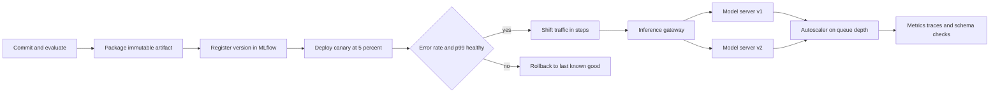

| Difficulty | Channel | Tags |
|---|---|---|
| beginner | devops | mlops, deployment |

At Netflix, an inference request is never just an inference request. The same platform that ranks what you might watch next also serves commerce models and, increasingly, large language models with radically different CPU, GPU, memory, and engine requirements [1]. Picture the constraint: more than 300 models, roughly one million requests per second, and one consistent interface for every product team [1]. One incompatible schema or one badly batched decode loop can turn a routine deploy into a flood of failed predictions, which is why the line between deployment and serving matters more than most developers expect.

---

> ### Real-World Case — Netflix
>
> Netflix runs member-scale ML workloads such as recommendations and commerce on an in-house inference platform. As it added LLM serving, it had to support radically different model sizes, CPU/GPU requirements, and rapidly changing inference engines behind one consistent system.
>
> | | |
> |---|---|
> | **Challenge** | Separate the deployment lifecycle from the serving runtime: rolling out new GPU-backed model versions without dropping requests, while the runtime handled model loading, batching, routing, and inference. A model I/O schema change exposed a coordination gap in the standard rollout strategy because upstream consumers could not update their config until the new model was fully live. |
> | **Solution** | Netflix kept a unified JVM serving layer for routing, A/B testing, feature fetching, and logging, and delegated GPU inference to its Model Scoring Service with NVIDIA Triton handling model loading, batching, and GPU scheduling, and vLLM performing inference. A Java control plane above Triton handled deployment, versioning, health checks, autoscaling, and multi-region rollout. To handle breaking schema changes, Netflix added 'Versioned' deployments that keep an independent deployment per (modelId, modelVersion), so old and new versions serve simultaneously and consumers can migrate on their own schedule. They also pre-materialized model weights on Amazon FSx to reduce cold-start latency and pinned compatible Triton and vLLM versions together. |
> | **Outcome** | The platform serves roughly 1 million inference requests per second across 300+ models. Versioned deployment eliminated failed requests during incompatible input/output schema migrations, at the cost of temporary GPU cost from overlapping deployments. On the serving side, moving constrained decoding from vLLM V0's per-request processing to V1's batch-level processing kept logits-processing time flat as batch size grew, removing tail-latency spikes under real concurrency. |
> | **Lesson** | Deployment is the control-plane lifecycle — artifact packaging, versioning, health checks, traffic shifting, and rollback. Serving is the data-plane runtime — model loading, routing, batching, feature fetching, and inference. The critical design decision is the contract between them: when the model interface is backward-compatible, cheap red-black rollouts work; when it is not, you need versioned deployments and a stable client contract. Serving optimizations like batching, cold-start mitigation, and engine version pinning are separate engineering problems from rollout strategy. |

---

## Hook — One Platform, 300 Models, and a Million Requests Every Second

Most teams learn the difference between deployment and serving the hard way: at 2am, with a green deploy pipeline and a red latency graph. Netflix did not have that luxury. Its in-house inference platform serves recommendations, commerce workloads, and now LLM traffic behind one consistent system, and the diversity is the whole point [1]. The platform handles roughly one million inference requests per second across more than 300 models, each with different sizes, CPU or GPU needs, and fast-moving inference engines [1]. One incompatible input schema could turn a routine rollout into a stream of failed predictions. The stakes are not academic, they are member-facing latency, GPU spend, and trust in the platform. So how do you deploy and serve all of that without the system collapsing under its own diversity?

## Problem — Deployment Is Not Serving, and That Confusion Costs You Sleep

Here is the trap: deployment and serving sound like two words for the same job, right up until a schema change takes down predictions. Deployment is the discipline of moving a model safely through CI/CD, infrastructure provisioning, policy checks, monitoring, and rollback [3]. Serving is the runtime discipline of answering requests: routing, batching, model loading, version selection, and response optimization [4]. When teams blur the line, two failures appear. First, a model passes deployment checks but its input/output contract breaks the serving path, so requests fail after rollout. Second, serving costs balloon because nobody owns the runtime trade-offs between latency, throughput, and GPU memory. Many developers discover this the hard way: the deploy was green, the dashboards were quiet, and p99 latency was already climbing. The question is not whether to separate these concerns, but where to draw the boundary.

## Real-World Case — Netflix Tames LLM Serving at Member Scale

Netflix did not get a clean boundary by accident. Its in-house inference platform serves recommendations, commerce, and LLM workloads behind one consistent system, and that diversity is the engineering challenge [1]. The platform handles roughly one million inference requests per second across more than 300 models, each with different sizes, CPU or GPU requirements, and rapidly changing inference engines [1]. As LLM serving arrived, the team had to support radically different model shapes without forcing every product team to rebuild its own stack. Two details matter. On the deployment side, versioned deployment eliminated failed requests during incompatible input/output schema migrations, at the cost of temporary GPU spend from overlapping deployments [1]. On the serving side, moving constrained decoding from vLLM V0's per-request processing to V1's batch-level processing kept logits-processing time flat as batch size grew, removing tail-latency spikes under real concurrency [1]. Notice what changed: not a smarter model, but a better-behaved system under load.

## Deep Dive — Two Disciplines, One Pipeline

Building on that case, the cleanest mental model is a table. Deployment answers a change-management question; serving answers a traffic-management question.

| Concern | Deployment | Serving |
|---|---|---|
| Question answered | Can this model safely reach production? | Can this request be answered fast and correctly? |
| Core artifacts | Containers, manifests, pipelines, policies | Endpoints, routes, model handlers, caches |
| Failure mode | Bad rollout, drift, missing rollback | Timeout, queue buildup, cold start, schema mismatch |
| Primary metric | Change failure rate, lead time | p50 and p99 latency, throughput, error rate |
| Typical tools | Kubernetes, Terraform, MLflow, SageMaker | KServe, BentoML, TensorFlow Serving, TorchServe |

On the deployment side, Kubernetes gives you declarative rollouts and replica management [2], while MLflow tracks experiments and model versions and SageMaker packages the surrounding pipeline [11][12]. Continuous delivery practices keep the release path boring, which is exactly what you want [3]. On the serving side, KServe and BentoML wrap model servers with routing, autoscaling, and version-aware endpoints [4][5]. TensorFlow Serving and TorchServe specialize in loading and executing models efficiently [6][7]. For LLM workloads, vLLM's continuous batching and PagedAttention change the economics of memory and concurrency [8][10].

Three trade-offs show up in every design review:
- Latency versus throughput: batching raises throughput but can inflate p99 if the queue is unbounded [8].
- Batch versus real-time: offline scoring optimizes cost per row, while interactive serving optimizes tail latency per user.
- Cold start versus cost: warm replicas cut first-request latency but keep GPUs idle, so the right answer depends on traffic shape [6].

Autoscaling deserves special attention. Scaling on CPU alone is a trap for inference workloads; queue depth and concurrency are better signals because they reflect actual backpressure [9]. Which brings you to the operational question: what does the pipeline actually look like when a commit becomes a served prediction?

## Workflow — From Commit to a Sub-50ms Response

The workflow below is the boundary made concrete. It is deliberately boring at the edges and strict in the middle, because that is how you keep failed requests out of production.

1. Commit and evaluate: every model change runs training, offline evaluation, and contract tests before it can ship [3].
2. Package an immutable artifact: the container or model bundle gets a content hash, not a mutable tag [2].
3. Register the version: the artifact is recorded in a registry such as MLflow with its schema and metrics [12].
4. Deploy a canary: route a small slice of traffic, watch error rate and p99, then widen or roll back [2].
5. Route through a gateway: an inference gateway selects model names and versions, handles retries, and enforces timeouts [4].
6. Autoscale on pressure: scale replicas using queue depth and concurrency, not just CPU utilization [9].
7. Observe the contract: track input drift, output shape, latency, and GPU memory alongside business metrics.

The Deployment-to-Serving Pipeline diagram traces this exact path, from a commit to a served prediction, with the canary decision and rollback branch made explicit. For the classic 10K QPS with sub-50ms question, the answer rarely starts with a faster model. It starts with bounded queues, warm replicas, connection reuse, and a gateway that can shed load before it reaches a GPU pod [4][9]. Throughput comes from batching; tail latency comes from protecting the critical path [10].

## Code Example — A Versioned, Batched Serving Endpoint

The snippet below makes the boundary executable. It deliberately keeps deployment decisions out of the request path and makes the serving contract explicit. The registry is keyed by model name and immutable version, unknown versions fail closed, and the active model is warmed at startup. In production, you would place a short-window queue in front of the inference call and batch requests, which is the same batch-level thinking Netflix applied to constrained decoding [1][8]. The code is illustrative but follows a real production pattern: validate the contract before touching the model, then keep inference side-effect free so horizontal scaling stays safe.

## Lessons Learned — What to Change Tomorrow

The most useful takeaway is not a tool, it is a separation of concerns that survives real traffic.

- Separate the questions. Deployment asks whether a model can safely reach production; serving asks whether a request can be answered correctly under pressure [3][4].
- Version the contract, not just the weights. Netflix's versioned deployment eliminated failed requests during incompatible schema migrations, then paid for overlapping GPU deployments during the transition [1].
- Treat cold start as a product requirement. Warm the active version at boot and keep a small overflow pool rather than discovering latency on the first user request [6].
- Autoscale on the right signal. Queue depth and concurrency reveal pressure sooner than CPU utilization [9].
- Optimize the batch, not the average. Tail latency is where users live, which is why batch-level constrained decoding mattered more than a headline throughput number [1][10].

A common battle scar is shipping a model change and a preprocessing change in the same commit. When predictions break, nobody can tell whether the weights, the schema, or the serving handler is at fault. Split those changes, version the schema, and keep a rollback path that does not require a rebuild. The memorable insight is simple: deployment is a change-management problem, serving is a traffic-management problem, and mature teams stop pretending they are the same thing.

---

## Deployment-to-Serving Pipeline

<strong>Original Interview Question</strong>

**Q:** Explain the key differences between model serving and model deployment in ML systems, including specific technologies, scaling considerations, and real-world implementation patterns?

**A:** Deployment encompasses CI/CD pipelines, infrastructure setup, and monitoring using tools like Kubernetes, MLflow, and SageMaker. Serving focuses on runtime inference APIs with frameworks like TensorFlow Serving, TorchServe, or BentoML, handling request routing, model versioning, and autoscaling. Key trade-offs include latency vs throughput, batch vs real-time inference, and cold start optimization.

## Conclusion

The journey started with a deceptively simple question: what is the difference between deployment and serving? It ends with a practical rule. Deployment is how a model earns the right to receive traffic; serving is how it keeps that right under load. Netflix's platform shows both halves in the same system: versioned deployment prevented failed requests during schema migrations, and batch-level constrained decoding removed tail-latency spikes at member scale [1]. Tomorrow, make the boundary visible in your own stack. Put a version field in every request, fail closed on unknown versions, warm your models before the first user arrives, and measure p99 instead of hiding behind averages. The memorable insight worth sharing with your team is this: most serving incidents are not model problems, they are boundary problems that were never made explicit.

---

## References

1. [Netflix incident report](https://netflixtechblog.com/in-house-llm-serving-at-netflix-a5a8e799ea2c) — article
2. [Kubernetes Deployments](https://kubernetes.io/docs/concepts/workloads/controllers/deployment/) — documentation
3. [MLOps](https://en.wikipedia.org/wiki/MLOps) — documentation
4. [KServe: Standardized Serverless ML Inference Platform](https://github.com/kserve/kserve) — documentation
5. [BentoML: Build, Ship, and Scale AI Applications](https://github.com/bentoml/BentoML) — documentation
6. [TensorFlow Serving](https://github.com/tensorflow/serving) — documentation
7. [TorchServe: Serve PyTorch Models at Scale](https://github.com/pytorch/serve) — documentation
8. [vLLM: Easy, Fast, and Cheap LLM Serving](https://github.com/vllm-project/vllm) — documentation
9. [Horizontal Pod Autoscaling](https://kubernetes.io/docs/tasks/run-application/horizontal-pod-autoscale/) — documentation
10. [Efficient Memory Management for Large Language Model Serving with PagedAttention](https://arxiv.org/abs/2309.06180) — paper
11. [What is Amazon SageMaker?](https://docs.aws.amazon.com/sagemaker/latest/dg/whatis.html) — documentation
12. [MLflow: Platform for the Machine Learning Lifecycle](https://github.com/mlflow/mlflow) — documentation

---

**Author:** Satishkumar Dhule — [GitHub](https://github.com/satishkumar-dhule) · [LinkedIn](https://linkedin.com/in/satishkumar-dhule) · [Website](https://satishkumar-dhule.github.io)
