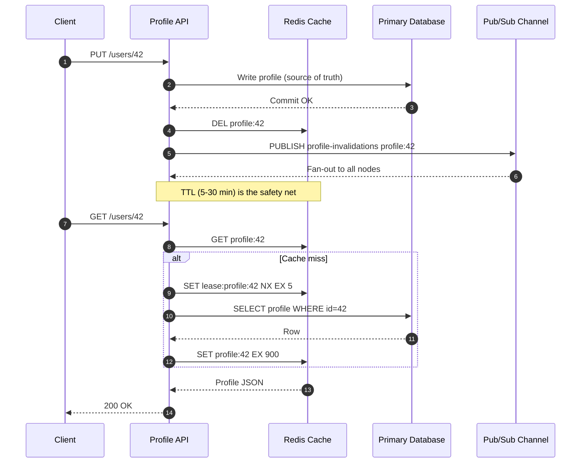

| Difficulty | Channel | Tags |
|---|---|---|
| beginner | backend | redis, memcached, cache-invalidation |

Imagine a single profile edit—a new job title—fanning out across thousands of servers, each holding a cached copy that millions of readers might see. That is the moment caching stops being a performance trick and becomes a distributed-systems contract. Facebook (Meta) ran memcached as a massive look-aside cache between its web servers and MySQL, absorbing read traffic for the social graph while writes constantly threatened to expose stale profiles and friend lists [1]. The lessons from that fleet explain why cache invalidation is less about deleting a key and more about coordinating a fleet without crushing the database underneath it [1].

---

> ### Real-World Case — Facebook (Meta)
>
> Facebook used memcached as a massive look-aside cache between its web servers and MySQL to absorb read traffic for the social graph, including user profiles and friend lists. With writes constantly updating this data, the cache had to be invalidated correctly across thousands of servers without collapsing the databases underneath.
>
> | | |
> |---|---|
> | **Challenge** | Two concurrency bugs plagued the cache: stale sets, where a slow reader writes an old value back into memcached after a newer write has already invalidated it, and thundering herds, where a hot key is repeatedly invalidated and thousands of concurrent readers all stampede the database at once. |
> | **Solution** | Facebook deliberately chose delete-on-write rather than write-through: a database update invalidates the key, and the next read repopulates it. To make that safe, they added leases to memcached. A cache miss returns a 64-bit lease token, and a set is rejected if a delete invalidated that lease in the meantime. Leases also throttle herd behavior by issuing at most one token per key every 10 seconds, so one client refreshes from MySQL while the rest wait briefly and retry. |
> | **Outcome** | For keys especially prone to thundering herds, Facebook measured peak database query rates of 17K/s without leases versus 1.3K/s with leases over a one-week period. The lease mechanism cut peak database load by roughly 92% while keeping the cache architecture simple and scalable. |
> | **Lesson** | Write-through sounds intuitive, but at scale invalidation-by-deletion plus leases prevents stale writes and database stampedes. The counterintuitive insight is that sometimes the safest cache update is not writing to the cache at all, but deleting the key and coordinating who is allowed to refill it. |

---

## Hook — The Update That Multiplies

A user updates a profile. One row changes in one database. Yet the write must reach every cache replica, every app server with a local cache, and every background worker holding a copy. Miss one, and a recruiter sees the old job title, a support agent quotes stale account data, and the bug report lands on your team. Cache invalidation is not a cleanup task; it is a correctness problem with a performance bill attached. The more servers you add, the more copies can betray you—which is exactly why Facebook's memcached architecture remains such a useful cautionary tale [1].

## Problem — When a Cache Copy Becomes a Lie

Many developers discover the hard part of caching only after the cache is working. Reads are fast, hit rates look healthy, and then a profile update exposes the ugly truth: the cache is now a second source of truth, and nobody agreed on how to keep it honest. You might think a short TTL solves everything, but TTL is a backstop, not an invalidation strategy. It guarantees eventual freshness while leaving a window where users see stale data—and when a hot key expires, a stampede of requests can hit the database at once [6].

Sound familiar? The problem gets worse in distributed systems because invalidation has to cross process boundaries. A delete on one node does not automatically reach a local in-memory cache on another. Invalidating before the database commit can repopulate the cache with the old row. Invalidating after the commit can still race with a slow reader. These are not edge cases at scale; they are Tuesday. The core challenge is ordering: database first, cache second, broadcast third, with a TTL and a lease to catch the failures that ordering cannot prevent [5].

## Real-World Case — Facebook (Meta)

Facebook's social graph made this problem concrete. Profiles, friend lists, and other graph data were read far more often than they were written, so the company placed memcached as a look-aside cache between web servers and MySQL to absorb enormous read traffic [1]. The architecture worked beautifully—until a popular key expired or was invalidated and thousands of requests discovered the same miss at the same time.

That is the thundering herd, and Facebook's fix was elegant: a lease. Instead of letting every request hammer MySQL, one request received a short-lived lease to recompute the value while the others waited briefly or served a stale value [1][6]. For keys especially prone to these herds, Facebook measured peak database query rates of 17K/s without leases versus 1.3K/s with leases over a one-week period—roughly a 92% reduction in peak database load [1]. The plot twist is that the solution was not a bigger database. It was a coordination primitive that made the cache safer under pressure.

## Deep Dive — Redis, Memcached, and the Trade-Offs That Bite

Building on Facebook's lease mechanism, the real design question becomes: which cache gives you the invalidation tools you need without adding more moving parts than your team can operate? Redis and Memcached are both fast key-value stores, but they solve different problems.

Redis offers pub/sub, optional persistence, and rich data structures. That pub/sub channel lets one service publish an invalidation event and every subscriber react—useful when app servers keep local caches [2]. However, Redis pub/sub is fire-and-forget: messages are not retained for subscribers that are offline, so TTL and a database fallback are still mandatory [2][8]. Memcached is deliberately simpler. It is a pure cache with no built-in pub/sub, which means invalidation across nodes must be coordinated by the application, often through a message bus or a versioned key scheme [3][10].

| Dimension | Redis | Memcached |
|---|---|---|
| Invalidation support | Pub/sub plus application logic | Manual coordination required |
| Persistence | Optional snapshots and AOF [8] | None by design |
| Data structures | Strings, hashes, sets, sorted sets, streams | Simple key-value |
| Scaling model | Cluster or sentinel | Straightforward horizontal sharding |
| Memory overhead | Higher per key and feature | Lower for pure caching |
| Best fit | Complex invalidation, sessions, leaderboards | High-throughput, simple read caching |

💡 Insight: For profile data, a TTL of 5–30 minutes is a common starting point, with shorter windows for sensitive fields [4]. The TTL is not there to hide bugs; it is there to bound the damage when an invalidation message is lost.

🔥 Hot Take: Write-through sounds safer than it often is. Writing the new value into the cache immediately can race with a concurrent reader that loaded the old row before the commit. A delete-after-commit strategy—often called write-invalidate—is frequently the safer default, because the next read repopulates the cache from the source of truth. If read-after-write latency matters, combine deletion with a short-lived lease and a versioned key, not blind overwrites [1][5].

## Workflow — The Invalidation Playbook

Here is the playbook that turns the theory into an operational sequence. The Mermaid sequence diagram below visualizes the same flow, from the client request to the pub/sub fan-out and the lease-protected cache miss.

1. Read through the cache first. Return the cached profile on a hit; do nothing else.
2. On a miss, acquire a short lease for that key before querying the database.
3. Load the row from the database, then set the cache with a TTL.
4. On an update, commit to the database first—it is the source of truth.
5. Delete the cache key rather than overwriting it, which avoids stale-read races.
6. Publish an invalidation event so every node with a local cache drops its copy.
7. Treat the TTL as a safety net, and monitor hit rate, database QPS, p99 latency, and invalidation lag.

🎯 Key Point: The order is the architecture. Database first, cache second, broadcast third. Reverse any two of those steps and you have built a machine for producing stale data under load.

## Code Example — Write, Delete, Broadcast, Repeat

The Python example below implements the read path with a lease and the write path with delete-after-commit plus pub/sub broadcast. Notice the deliberate choice to delete rather than overwrite: the next reader rebuilds the value from the database, which keeps the cache subordinate to the source of truth. The lease token prevents one worker from releasing another worker's lock, and the TTL ensures that a lost invalidation message cannot create permanent staleness.

## Lessons Learned — What the 92% Number Really Teaches

The moral of Facebook's 92% reduction is not that leases are magic. It is that cache invalidation is a coordination problem, and coordination problems get cheaper when you stop letting every request act independently [1][6].

Here are the battle scars worth remembering:

- **Invalidating before the commit.** A reader can repopulate the cache with the old row between the delete and the commit. Commit first, then invalidate.
- **Trusting pub/sub as durable delivery.** Redis pub/sub does not retain messages for offline subscribers [2]. Pair it with TTL and a version check.
- **Using a long TTL as a substitute for invalidation.** TTL bounds staleness; it does not eliminate it. Profiles can tolerate minutes, but permissions and security settings often cannot [4].
- **Ignoring hot keys.** One celebrity profile or one viral account can turn a single expiration into a database spike. Leases and request coalescing are the seatbelt [1][6].
- **Watching only hit rate.** A 99% hit rate can still hide a 1% miss storm that saturates the database. Track database QPS and p99 latency alongside cache metrics [4].

⚠️ Watch Out: Memcached's simplicity is an advantage until you need cross-node invalidation. If your application already depends on pub/sub or persistence, Redis removes custom coordination code. If you only need a fast, simple cache and can tolerate a TTL-driven refresh, Memcached's lower overhead may win [9][10].

---

## Cache Invalidation Sequence

<strong>Original Interview Question</strong>

**Q:** You're building a user profile service that caches frequently accessed profiles. How would you implement cache invalidation when a user updates their profile, and what trade-offs would you consider between Redis and Memcached?

**A:** Implement write-through caching with TTL-based expiration. On profile update, invalidate the cache by deleting the key and writing new data to both the database and cache. Redis offers pub/sub for automatic distributed invalidation, while Memcached requires manual coordination across nodes.

## Conclusion

The next time you add a cache, remember the single profile edit that became a fleet-wide coordination problem. A cache is a copy, not a source of truth. Start with delete-after-commit, add a TTL as a safety net, use leases for hot keys, and broadcast invalidations to every node that keeps a local copy. Then measure database QPS and p99 latency, not just hit rate. Facebook's 92% reduction is the payoff for treating invalidation as a first-class part of the design—and the difference between a cache that helps you sleep and one that wakes you up at 3 a.m.

---

## References

1. [Facebook (Meta) incident report](https://www.usenix.org/system/files/conference/nsdi13/nsdi13-final170.pdf) — article
2. [Redis Pub/Sub documentation](https://redis.io/docs/latest/develop/interact/pubsub/) — documentation
3. [Memcached GitHub repository and protocol documentation](https://github.com/memcached/memcached) — documentation
4. [Amazon ElastiCache best practices](https://docs.aws.amazon.com/AmazonElastiCache/latest/dg/BestPractices.html) — documentation
5. [Cache invalidation](https://en.wikipedia.org/wiki/Cache_invalidation) — documentation
6. [Thundering herd problem](https://en.wikipedia.org/wiki/Thundering_herd_problem) — documentation
7. [RFC 7234: HTTP/1.1 Caching](https://datatracker.ietf.org/doc/html/rfc7234) — documentation
8. [Redis persistence documentation](https://redis.io/docs/latest/operate/oss_and_stack/management/persistence/) — documentation
9. [What is Amazon ElastiCache?](https://docs.aws.amazon.com/AmazonElastiCache/latest/dg/WhatIs.html) — documentation
10. [Memcached](https://en.wikipedia.org/wiki/Memcached) — documentation

---

**Author:** Satishkumar Dhule — [GitHub](https://github.com/satishkumar-dhule) · [LinkedIn](https://linkedin.com/in/satishkumar-dhule) · [Website](https://satishkumar-dhule.github.io)
