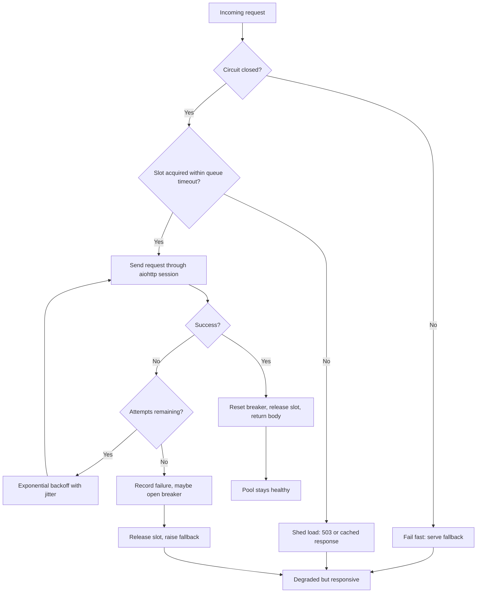

| Difficulty | Channel | Tags |
|---|---|---|
| advanced | backend | asyncio, aiohttp, concurrency |

Thirty services, each available 99.99% of the time. Multiply them together and you get 99.7% — roughly 2+ hours of downtime a month and millions of failed requests. That is the arithmetic Netflix's engineers put on the whiteboard before they built Hystrix, and it is the same arithmetic hiding inside every aiohttp.ClientSession you have ever written [1]. The uncomfortable truth is that your API's reliability is not the average of its dependencies — it is the product of them. This is the story of how a connection pool becomes the difference between a graceful wobble and a fleet-wide outage.

---

> ### Real-World Case — Netflix
>
> Netflix's API depended on dozens of internal services, and the team calculated that 30 dependencies each at 99.99% uptime still yield only 99.7% aggregate uptime — about 3 million failures and 2+ hours of downtime per month. A single latent dependency could back up requests, threads, and connections across the fleet, turning a localized slowdown into a cascading outage.
>
> | | |
> |---|---|
> | **Challenge** | How to bound concurrent calls per dependency, enforce timeouts, and prevent retries and hung connections from exhausting the connection pool when a downstream service slows down — without making the overload worse by adding capacity. |
> | **Solution** | Netflix built Hystrix, wrapping each dependency call in a command with a small per-dependency thread pool or semaphore, a timeout set near the dependency's healthy p99.5 latency, a circuit breaker that trips on error or latency thresholds, and a fallback. When a dependency went latent, Hystrix rejected or short-circuited calls instead of queueing them, releasing pressure so the dependency could recover. |
> | **Outcome** | Netflix reported 100+ Hystrix command types and 40+ thread pools executing 10+ billion thread-isolated and 200+ billion semaphore-isolated calls per day, with a dramatic improvement in uptime and resilience. In one latency incident, all but one machine in a cluster tripped its breaker and served fallbacks, and 500s did not increase because users received degraded but functional responses. Netflix also documented the trap: 100 servers × 10 connections = 1,000; doubling to 20 simply held 2,000 connections open and made recovery harder. |
> | **Lesson** | Under latency, the counterintuitive move is not to enlarge the pool or retry harder — it is to cap concurrency, fail fast, and shed load so the downstream can recover. The circuit breaker is a pressure-release valve for the connection pool, not just an error counter. |

---

## Hook — The Math That Breaks Your API at 3 A.M.

It starts the way these things always start: one dependency gets slow. Not down — slow. A downstream service that normally answers in 40ms starts taking 3 seconds, and nobody has deployed anything. Your aiohttp handlers keep accepting work, your event loop keeps scheduling tasks, and every one of those tasks is now sitting on a socket that will not return for another 2.6 seconds.

Nothing has crashed. That is what makes it terrifying. The graphs look almost normal for the first ninety seconds, and then the queue depth line goes vertical.

Here is the question worth sitting with: when the hundred-and-first concurrent request arrives and your pool only holds a hundred connections, what exactly should happen? Most codebases answer with silence — the request waits. It waits while holding memory, while the client's timeout clock runs, and while every other request behind it waits too. That silence is how a localized slowdown becomes a cascading outage.

The answer is not a bigger pool. It is a pool that knows how to say no, how to back off, and how to fail in a way that keeps the rest of your service alive. 🎯 That is what you are going to build.

## Problem — Concurrency Without Backpressure Is Just a Slow Crash

An async HTTP client feels infinitely scalable because awaiting is cheap. That illusion lasts right up until the moment every coroutine is blocked on the same saturated resource. aiohttp gives you connection pooling out of the box [2][8], but the defaults solve throughput, not resilience. Three failure modes show up again and again.

First, unbounded concurrency. A semaphore caps in-flight requests, but a plain `asyncio.Semaphore` with no acquisition timeout simply parks the overflow in an unbounded queue [3], and every parked coroutine is a scheduled task still holding memory [10]. Memory grows, latency grows, and by the time the downstream recovers you are processing stale work nobody is waiting for anymore.

Second, retry amplification. A naive retry loop triples the load on a service that is already struggling. Three attempts across a thousand clients is three thousand requests per original call — the classic retry storm. Without jitter, every client backs off in lockstep and hammers the service again at the same instant.

Third, shared fate. One slow dependency consumes the same connection pool that healthy dependencies need. This is why the bulkhead pattern exists: isolate the failure so it cannot drain resources from everything else.

Sound familiar? Every team hits this eventually. The good news is that the failures are predictable, which means they are designable-against. The bad news is that the fix is not one library call — it is a small, deliberate piece of infrastructure that most codebases never bother to write.

## Real-World Case — Netflix and the Tyranny of Multiplication

Netflix did not discover this problem in a lab. They discovered it by running an API that depended on dozens of internal services, and by doing the arithmetic that most teams avoid: 30 dependencies at 99.99% uptime each still yields only 99.7% aggregate uptime — about 3 million failures and more than 2 hours of downtime per month [1]. No single team was failing. The system was failing as a product of its parts.

Worse, a single latent dependency could back up requests, threads, and connections across the fleet, turning a localized slowdown into a cascading outage. The team's response was Hystrix, and the operational numbers are the part worth memorizing: 100+ Hystrix command types and 40+ thread pools executing more than 10 billion thread-isolated and 200 billion semaphore-isolated calls per day [1]. That is not a small experiment bolted onto the side. That is the request path.

The payoff showed up in exactly the scenario you would hope for. In one latency incident, all but one machine in a cluster tripped its breaker and served fallbacks. 500s did not increase, because users received degraded but functional responses instead of errors [1]. The breaker converted a hard failure into a soft one.

And then the plot twist. Netflix documented the trap that almost every team falls into: adding capacity does not fix a cascading failure. 100 servers times 10 connections equals 1,000. Double the connections to 20 and you simply hold 2,000 connections open — and make recovery harder, because now there is twice as much in-flight work to drain [1]. ⚠️ More connections is not more resilience. Sometimes it is just a bigger blast radius.

## Deep Dive — Four Control Loops, One Budget

A resilient pool is not one mechanism. It is four small control loops that each answer a different question. Understanding what each one is for — and what it is not for — is where most implementations go wrong.

**Admission control (the semaphore).** A semaphore answers: how many requests may be in flight at once? Size it from Little's Law rather than vibes: concurrency equals arrival rate multiplied by latency [9]. If you serve 500 requests per second at 200ms, you need about 100 concurrent slots. If latency triples during an incident, that same pool is now effectively one-third the size — which is fine, as long as you shed the excess instead of queuing it forever.

**Retry policy (exponential backoff with jitter).** Retries answer: is this failure worth another attempt? Only transient failures qualify. Exponential backoff reduces pressure over time [5], and jitter prevents synchronized retries. The subtle rule many developers miss: retries belong inside the semaphore, not outside it, so a retrying request does not consume multiple slots.

**Circuit breaking.** The breaker answers: is this dependency even worth talking to right now? It moves through closed, open, and half-open states, and the half-open state is the whole point — it lets a trickle of probe traffic through so recovery is detected without immediately re-flooding the service [4].

**Bulkheads.** Isolation answers: can one bad dependency starve the others? Separate pools per upstream, or at minimum separate semaphores, keep a slow payments API from consuming the capacity your auth checks need.

Here is the trade-off table that matters in review:

| Strategy | Protects against | Fails when | Cost |
|---|---|---|---|
| Semaphore only | Unbounded concurrency | Dependency hangs for minutes | Cheap, no recovery signal |
| Semaphore + queue timeout | Unbounded backlog | Downstream returns errors fast | Small, needs tuning |
| Retries + backoff | Transient blips | Service is genuinely overloaded | Amplifies load without jitter |
| Circuit breaker | Repeated failure | Threshold set too high or too low | Needs state, adds a failure mode |
| Bulkheads | Blast radius | Pool count explodes | Operational overhead |

The insight that ties them together: all four share one time budget. If your total timeout is 10 seconds, a connect timeout of 3 and a read timeout of 5 leaves 2 seconds of slack — and your retry loop must fit inside that budget, not stack on top of it. 🔥 A retry that outlives the caller's timeout is pure waste: you are doing work for a client that has already given up.

## Workflow — The Request Lifecycle, Step by Step

Here is the sequence the diagram below illustrates. Follow a single request through it and the design stops feeling like a pile of patterns.

1. **Check the breaker first.** If the breaker is open, return a fallback immediately. The request never touches the pool, so a broken dependency costs zero capacity.
2. **Acquire a slot with a deadline.** Wrap `semaphore.acquire()` in `asyncio.wait_for`. If the pool is saturated past the queue timeout, shed the load with a fast, explicit error instead of an invisible wait.
3. **Send the request with a split timeout.** Connect fast, read patiently, and cap the whole call. A single monolithic timeout hides which phase actually failed.
4. **Classify the outcome.** 2xx and 4xx mean the dependency is healthy [6] — a 404 is not a reason to trip a breaker. 5xx and transport errors are failures.
5. **Retry only transient failures, with jitter.** Back off exponentially, cap the delay, and stop after a small number of attempts. Never retry non-idempotent methods blindly.
6. **Update the breaker.** Success resets the failure count. Failure increments it, and crossing the threshold opens the breaker with a cool-down window.
7. **Release the slot in a `finally`.** Every path — success, retry exhaustion, cancellation, exception — must release exactly once. This is the line that saves you at 3 a.m.

Notice the ordering: breaker, then admission, then retry. Reversing any two of those produces a subtly worse system. If you retry before admission, one logical request can occupy several slots. If you admit before checking the breaker, you pay pool capacity to learn something you already knew.

On the operational side, this aligns with the reliability pillar's guidance to bound retries, isolate failures, and test for degraded modes rather than assuming perfection [7]. Resilience is a property you verify, not a property you hope for.

## Code Example — A Pool That Says No Gracefully

The implementation below is deliberately small enough to read in one sitting and complete enough to survive production. It combines a three-state circuit breaker, a bounded semaphore queue, a split timeout budget, and jittered exponential backoff.

A few decisions are worth flagging before you read the code. The connector is configured with `limit=0` on purpose — the semaphore is the single admission controller, and two independent limiters can deadlock each other. The breaker is checked before the slot is acquired, so open-circuit requests cost nothing. And `record_success()` fires on any non-5xx response, including 4xx, because a 404 means the dependency is alive and answering.

The explanation after the snippet walks through each section line by line, including the `finally` block that prevents the most common pool-starvation bug in async Python.

## Lessons Learned — What to Change Tomorrow

The headline lesson is the one Netflix paid for: reliability multiplies, it does not average [1]. A pool with perfect retries cannot save you if a slow dependency can occupy every slot indefinitely. Backpressure is not an optimization — it is the mechanism that keeps your service responsive under conditions it was never designed for.

Here are the battle scars worth remembering:

- **More connections is not more resilience.** Doubling pool size during an incident doubles the in-flight work you have to drain later. Fix the timeout, not the ceiling [1].
- **An unbounded queue is a memory leak with extra steps.** Every wait needs a deadline, including the wait for a slot.
- **Retry inside the semaphore.** Otherwise a single logical request can consume three slots and triple your effective load.
- **A 404 is not a failure.** Classify by status class, not by the presence of a response.
- **Two limiters deadlock.** Pick one source of truth for concurrency and configure the other to stay out of the way.
- **Close the session on shutdown.** File descriptors do not clean themselves up, and Kubernetes will happily restart you into the same leak.
- **Tune the breaker threshold with data.** Too low and you open on normal variance; too high and you never protect anything.

💡 Insight: the most valuable metric here is not error rate — it is queue wait time. When slot acquisition time starts climbing, you have minutes of warning before users see a single failed request.

If this feels like a lot, start with two changes: add a queue-acquisition timeout, and add jitter to your retries. Those two alone eliminate most cascading failures. Everything else is refinement.

---

## Request Lifecycle Through the Pool

<strong>Original Interview Question</strong>

**Q:** How would you implement a connection pool manager for aiohttp that handles graceful degradation under high load and connection timeouts?

**A:** Implement a connection pool manager for aiohttp using a semaphore to limit concurrent connections, exponential backoff for retrying failed requests, and circuit breaker pattern to gracefully degrade under high load and connection timeouts.

## Conclusion

The moral of the story is uncomfortable but liberating: you cannot make a dependent system reliable by making each dependency slightly better. Thirty perfect dependencies still multiply out to a number that includes downtime. What you can do is decide, in advance, how your service behaves when the hundred-and-first request arrives and the pool is full. Build the semaphore with a deadline. Retry with jitter. Trip the breaker before you spend a slot. Release in a `finally`. Do those four things and a degraded dependency becomes a slow Tuesday instead of an incident channel. The one insight worth repeating to your team: resilience is not the absence of failure — it is the shape of your failure.

---

## References

1. [Netflix incident report](https://github.com/Netflix/Hystrix/wiki/Operations) — article
2. [aiohttp Client Advanced Reference](https://docs.aiohttp.org/en/stable/client_advanced.html) — documentation
3. [asyncio Synchronization Primitives](https://docs.python.org/3/library/asyncio-sync.html) — documentation
4. [Circuit Breaker Design Pattern](https://en.wikipedia.org/wiki/Circuit_breaker_design_pattern) — article
5. [Exponential Backoff](https://en.wikipedia.org/wiki/Exponential_backoff) — article
6. [MDN Web Docs: HTTP Response Status Codes](https://developer.mozilla.org/en-US/docs/Web/HTTP/Status) — documentation
7. [AWS Well-Architected Framework: Reliability Pillar](https://docs.aws.amazon.com/wellarchitected/latest/reliability-pillar/welcome.html) — documentation
8. [aio-libs/aiohttp on GitHub](https://github.com/aio-libs/aiohttp) — documentation
9. [Little's Law](https://en.wikipedia.org/wiki/Little%27s_law) — article
10. [asyncio Tasks and Coroutines](https://docs.python.org/3/library/asyncio-task.html) — documentation

---

**Author:** Satishkumar Dhule — [GitHub](https://github.com/satishkumar-dhule) · [LinkedIn](https://linkedin.com/in/satishkumar-dhule) · [Website](https://satishkumar-dhule.github.io)
