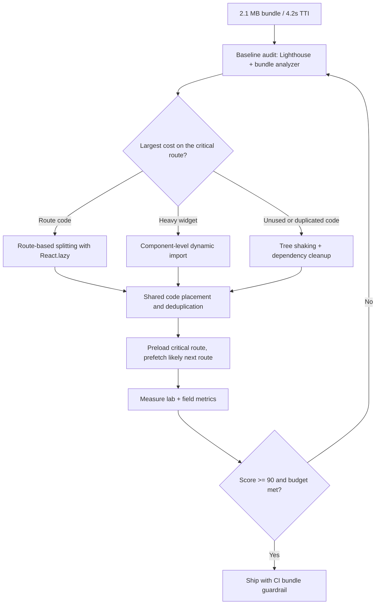

| Difficulty | Channel | Tags |
|---|---|---|
| intermediate | frontend | lighthouse, bundle, lazy-loading |

In 2017, Pinterest replaced its homegrown mobile web framework with a React, Redux, and webpack progressive web app built for a global audience that often browsed on weak mobile networks [1]. The core bundle fell from 650 KB to 150 KB, time spent rose 40%, user-generated ad revenue climbed 44%, and core engagements jumped 60% [1]. That is performance work measured in business outcomes, not just a prettier Lighthouse badge. This is the same journey a team faces when the audit says 65, the bundle says 2.1 MB, and Time to Interactive says 4.2 seconds.

---

> ### Real-World Case — Pinterest
>
> In 2017 Pinterest rebuilt its mobile web experience as a React, Redux, and webpack progressive web app, replacing a slow homegrown framework for a global audience that often browsed on mobile devices with weak network connections.
>
> | | |
> |---|---|
> | **Challenge** | The mobile web app shipped large, monolithic JavaScript bundles that delayed how quickly the experience became interactive. Pinterest needed to shrink the code required for first load and defer everything else, without breaking a highly interactive image-heavy UI. |
> | **Solution** | Pinterest implemented route-based code splitting with React Router and lazy loading, splitting webpack output into a vendor chunk (~73KB), a core entry chunk (~72KB), and async route chunks. The team used webpack-bundle-analyzer to visualize chunk composition, discovered duplicate code spread across async chunks, and deliberately moved that shared code into the main chunk. They also added service worker precaching, progressive JPEGs, and a virtualized Masonry grid. |
> | **Outcome** | The core bundle dropped from 650KB to 150KB. Business metrics moved sharply: time spent up 40%, user-generated ad revenue up 44%, and core engagements up 60%. Counterintuitively, moving duplicate code into the entry chunk increased that chunk by 20% but decreased all lazily loaded chunks by up to 90%. |
> | **Lesson** | Optimize for what actually ships on first load, not for the smallest possible individual chunk. Sometimes intentionally growing the entry bundle makes the total lazy-loaded payload dramatically smaller, and measurable performance gains translate directly into engagement and revenue. |

---

## Hook — The 65 That Will Not Budge

The audit starts innocently enough. Lighthouse returns 65, Time to Interactive sits at 4.2 seconds, and the production bundle weighs 2.1 MB. On a fast office laptop, the app feels acceptable; on a mid-tier Android phone on a crowded train, it feels broken. Every route downloads the dashboard, the analytics charts, the rich-text editor, and a date library that one screen actually uses. The score is not the disease; it is the fever. The real question is which bytes block the first interaction, and why every user pays for features they may never open.

Here is the uncomfortable part: adding more servers or upgrading the CDN will not fix this. The bottleneck is JavaScript that must be downloaded, parsed, compiled, and executed before the main thread can respond. Until those bytes are removed from the critical path, the score will keep hovering in the sixties, and product teams will keep blaming the network.

## Problem — When Every Route Pays for Every Feature

A 2.1 MB bundle is rarely one bad decision. It is a pile of reasonable decisions made at different times: a charting library imported at the top of a page, a utility package pulled in for one function, a polyfill shipped to browsers that no longer need it, and a vendor chunk that changes on every deploy. Each choice looked harmless in review. Together, they create a download that delays interactivity for every visitor.

Time to Interactive matters because it approximates the moment a user can reliably tap a button and get a response [8]. On a slow connection, the browser spends seconds fetching the bundle; on a mid-tier CPU, it spends more seconds parsing and executing it. The result is a page that looks painted but does not respond. Users do not file a bug report for that. They leave.

Many developers reach for `React.lazy()` immediately. That is a good instinct, but it is not a strategy. Lazy loading a component that is visible on the first screen makes the experience worse, not better. Splitting every small component creates a waterfall of requests. The real work is deciding which code belongs on the critical path, which code can wait, and which code should not ship at all.

## Real-World Case — Pinterest's 2017 PWA Rebuild

In 2017, Pinterest rebuilt its mobile web experience as a React, Redux, and webpack progressive web app, replacing a slow homegrown framework for a global audience that often browsed on mobile devices with weak network connections [1]. This was not a lab experiment or a demo. It was a high-traffic product where every kilobyte had a revenue consequence.

The headline result was dramatic: the core bundle dropped from 650 KB to 150 KB [1]. Business metrics moved just as sharply. Time spent increased 40%, user-generated ad revenue increased 44%, and core engagements increased 60% [1]. That combination is rare. Performance work often improves one vanity metric while leaving the business flat; here, the user experience and the bottom line moved together.

Then comes the plot twist. Pinterest moved duplicate code into the entry chunk. That made the entry chunk about 20% larger, yet every lazily loaded chunk shrank by up to 90% [1]. Read that again. The entry bundle got bigger, and the app got faster. The lesson is not that bigger bundles are good. The lesson is that the browser was re-downloading shared code across many async chunks, and consolidating it removed duplication from the paths users actually traveled. Optimization is about total critical-path cost, not a single number in a build report.

That counterintuitive result is why bundle work rewards measurement over intuition. Pinterest did not guess its way to a 150 KB core bundle. The team analyzed what was loading, changed the boundaries, and measured the effect on real users [1].

## Deep Dive — The Physics of a Smaller Bundle

Code splitting is a budgeting exercise. The goal is to keep the initial route small enough to become interactive quickly, then load the rest on demand. `React.lazy()` lets a component be loaded through a dynamic import, and `Suspense` provides a fallback while that import resolves [2][3]. Under the hood, the bundler creates a separate chunk, and the browser fetches it only when the component renders [4][10].

There are three common splitting strategies, and they solve different problems:

| Strategy | Best for | Trade-off |
|---|---|---|
| Route-based splitting | Dashboards, admin tools, multi-page apps | A slow route still needs its own chunk; navigation can expose a loading state |
| Component-based splitting | Modals, editors, charts below the fold | Too many chunks create a request waterfall and more network overhead |
| Vendor splitting | Stable third-party code | Cache-friendly, but shared code can be duplicated across async chunks |

Route-based splitting is usually the safest default because it matches how users navigate. Component-based splitting is powerful for heavy widgets that are not needed on first paint. Vendor splitting can improve caching, but it can also create the duplication problem Pinterest encountered. The right boundary is the one that minimizes the bytes needed for the next meaningful interaction.

The second half of the equation is tree shaking. Modern bundlers can remove unused exports when code is written as ES modules and packages declare their side effects correctly [5]. That sounds automatic, but it is easy to defeat with CommonJS dependencies, barrel files that re-export everything, or top-level code that runs on import. A single `import _ from 'lodash'` can pull in far more than the one function a component needs.

Measurement closes the loop. `webpack-bundle-analyzer` shows where the bytes actually live, including duplicate packages and oversized chunks [6]. Lighthouse gives a repeatable lab score [8], while real-user monitoring with `PerformanceObserver` shows what actual visitors experience on real devices [11]. Lab data tells you what changed; field data tells you whether it mattered.

Finally, do not forget non-JavaScript bytes. Images below the fold should use native lazy loading or an intersection observer [7], and route-level code splitting should be paired with a deliberate preload and prefetch strategy [9]. The browser should fetch what the user needs next, not everything the app might eventually need.

## Workflow — From 2.1 MB to a 90+ Score

The Mermaid diagram below turns the optimization into a loop rather than a one-time cleanup. Here is the sequence that consistently works:

1. **Establish a baseline and a budget.** Record Lighthouse scores, TTI, bundle size, and real-user metrics before changing anything [8][11]. Set an explicit budget for the initial route, such as a gzipped JavaScript ceiling that the team agrees not to exceed.
2. **Analyze the bundle.** Run `webpack-bundle-analyzer` and rank chunks by size and duplication [6]. Do not start splitting until the largest offenders are visible.
3. **Split by route first.** Convert top-level route components to `React.lazy()` imports and wrap the route tree in `Suspense` [2][3][4]. This usually removes the biggest amount of code from the initial download with the least risk.
4. **Isolate heavy widgets.** Move charts, editors, video players, and modals behind dynamic imports. Keep above-the-fold UI eager so the first interaction does not wait on a second request.
5. **Remove and deduplicate dependencies.** Replace broad utility imports with specific ones, delete unused packages, and enable production tree shaking with ES modules [5]. Check whether shared code should live in the entry chunk to avoid duplication across async chunks.
6. **Tune loading priority.** Preload the critical route, prefetch the most likely next route on hover or idle, and lazy-load below-the-fold images [7][9]. Avoid prefetching every route; that just recreates the original bundle problem with extra steps.
7. **Measure, guard, and repeat.** Compare lab and field metrics, add a bundle-size check to CI, and investigate regressions before they reach production [8][11]. Return to step 2 whenever a new heavy dependency lands.

The loop matters because bundles regress. A feature flag, a new chart library, or a forgotten import can undo weeks of work. The guardrail is what turns a cleanup into a durable improvement.

## Code Example — Lazy Routes Without the Jank

Here is a production-shaped pattern that combines route splitting, a heavy widget split, an error boundary, and prefetching. The key detail is that lazy imports are not enough on their own: a failed chunk request should degrade gracefully, and a likely next route should start loading before the user clicks.

The magic comments name the generated chunks so build reports stay readable. The nested `Suspense` boundary keeps a slow chart from blanking the entire page. The prefetch helper triggers the same dynamic import on hover, which lets the browser warm the chunk while the user is deciding. None of this is exotic; it is the difference between a demo and an app that holds up on a bad network.

## Lessons Learned — The Score Is a Symptom, Not the Goal

The Pinterest case is memorable because it refuses the simple story. A 650 KB to 150 KB reduction is the headline, but the durable lesson is that the team optimized the path users actually traveled [1]. Sometimes that means a smaller entry chunk. Sometimes it means a slightly larger entry chunk that eliminates duplication everywhere else. The build report is evidence, not a trophy.

Here are the takeaways worth carrying into the next performance review:

- **Measure before splitting.** The largest chunk in the analyzer is not always the one blocking interaction. Identify what loads on the critical route first [6].
- **Route-based splitting is the default.** It maps cleanly to navigation and usually delivers the biggest initial win [4].
- **Component splitting is for deferred value.** Use it for modals, editors, and below-the-fold widgets, not for the hero of the page.
- **Tree shaking needs discipline.** ES modules, correct side-effect declarations, and specific imports are not optional [5].
- **Duplication can hide in plain sight.** Shared code copied into many async chunks can cost more than a larger entry chunk [1].
- **Guard the gains.** Add bundle budgets to CI and watch field metrics, not just the lab score [8][11].

Common battle scars include lazy-loading the first screen, importing an entire utility library for one function, forgetting an error boundary around a lazy component, and declaring victory after testing only on a fast office connection. Each mistake looks small in isolation and expensive in aggregate.

If this feels overwhelming, start with one route. Measure it, split it, and compare the before-and-after bundle report. The first clear win builds the evidence and the appetite for the next one.

---

## Bundle Optimization Loop

<strong>Original Interview Question</strong>

**Q:** You're tasked with improving a React app's Lighthouse performance score from 65 to 90+. The bundle size is 2.1MB and Time to Interactive is 4.2s. What specific steps would you take to optimize the bundle and implement lazy loading?

**A:** Implement code splitting with React.lazy() and Suspense, analyze bundle composition with webpack-bundle-analyzer to identify largest chunks, remove unused dependencies and optimize imports, add dynamic imports for heavy components and third-party libraries, implement route-based splitting for better initial load times, and utilize tree shaking with proper ES module configuration.

## Conclusion

Pinterest's 2017 rebuild is the reminder that performance work is product work: a 650 KB core bundle became 150 KB, and time spent, ad revenue, and core engagements all moved in the right direction [1]. The path from a 2.1 MB bundle and a 4.2-second TTI to a 90+ Lighthouse score is not a single trick. It is a loop: measure the critical path, split by route, isolate heavy widgets, remove unused code, deduplicate shared chunks, prefetch deliberately, and guard the result in CI. Start tomorrow with one route and one bundle report. The first chunk you delete is the first second you give back to your users.

---

## References

1. [Pinterest incident report](https://medium.com/dev-channel/a-pinterest-progressive-web-app-performance-case-study-3bd6ed2e6154) — article
2. [React.lazy — React Reference](https://react.dev/reference/react/lazy) — documentation
3. [Suspense — React Reference](https://react.dev/reference/react/Suspense) — documentation
4. [Code Splitting — webpack Guides](https://webpack.js.org/guides/code-splitting/) — documentation
5. [Tree Shaking — webpack Guides](https://webpack.js.org/guides/tree-shaking/) — documentation
6. [webpack-bundle-analyzer — GitHub](https://github.com/webpack-contrib/webpack-bundle-analyzer) — documentation
7. [Lazy loading — MDN Web Docs](https://developer.mozilla.org/en-US/docs/Web/Performance/Lazy_loading) — documentation
8. [Lighthouse overview — Chrome for Developers](https://developer.chrome.com/docs/lighthouse/overview) — documentation
9. [Reduce JavaScript payloads with code splitting — web.dev](https://web.dev/articles/reduce-javascript-payloads-with-code-splitting) — blog
10. [import() — JavaScript | MDN](https://developer.mozilla.org/en-US/docs/Web/JavaScript/Reference/Operators/import) — documentation
11. [PerformanceObserver — MDN Web Docs](https://developer.mozilla.org/en-US/docs/Web/API/PerformanceObserver) — documentation

---

**Author:** Satishkumar Dhule — [GitHub](https://github.com/satishkumar-dhule) · [LinkedIn](https://linkedin.com/in/satishkumar-dhule) · [Website](https://satishkumar-dhule.github.io)
