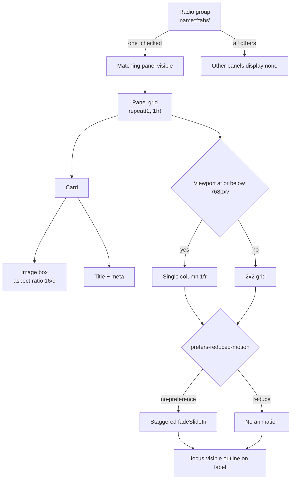

| Difficulty | Channel | Tags |
|---|---|---|
| beginner | frontend | css, flexbox, grid, animations |

A late hero image arrives, shoves the headline down, and steals the tap you were about to make. That tiny visual jolt is Cumulative Layout Shift, and at Yahoo! JAPAN News it became a business problem worth measuring, fixing, and celebrating [1]. The same failure hides inside ordinary design-system pages, especially tab panels filled with image cards that reserve no space. The fix is less about JavaScript wizardry and more about CSS that refuses to let the page move.

---

> ### Real-World Case — Yahoo! JAPAN
>
> Yahoo! JAPAN News, one of Japan's largest news platforms with over 22 billion page views per month, had article pages where the hero image loaded late and pushed the headline and body text down, producing poor Cumulative Layout Shift (CLS) scores in Chrome's field data.
>
> | | |
> |---|---|
> | **Challenge** | The team needed to reserve the correct amount of space for images before they loaded so the layout stayed stable, while still supporting older browsers such as iOS 9 that lacked the modern CSS aspect-ratio property. |
> | **Solution** | They identified the shifting hero image with DevTools Layout Shift Regions, then used Aspect Ratio Boxes: the backend API supplied each image's aspect ratio, and CSS reserved a fixed-ratio placeholder before the image arrived. This is the same fixed-ratio reservation technique used for 16:9 image areas in card grids. |
> | **Outcome** | URLs with poor performance in Search Console dropped 98%, lab CLS fell from about 0.2 to 0, page views per session rose 15.1%, session duration rose 13.3%, and bounce rate fell 1.72 percentage points. |
> | **Lesson** | Reserve space for every image before it loads. Native aspect-ratio is the clean solution, but when legacy browsers block it, derive the ratio from the backend and use a padding-based aspect-ratio box rather than letting content jump. |

---

## Hook — The 0.2-Second Shift That Moved a News Giant

Yahoo! JAPAN News serves more than 22 billion page views per month, so a small layout wobble compounds into billions of frustrating moments. On article pages, the hero image loaded late and pushed the headline and body text down, producing poor Cumulative Layout Shift scores in Chrome field data [1]. Readers experienced the digital equivalent of someone yanking a book out of their hands mid-sentence.

Here is the uncomfortable part: the page was not slow in the traditional sense. The content arrived. The image simply arrived after the browser had already painted the text in the wrong place. That is the trap many teams miss, and it leads directly to the question at the heart of this article: how do you build interactive UI that never moves the page, even when images are still loading?

The answer starts with a CSS-only tab panel for a design-system docs page — radio inputs, labels, grid cards, fixed 16:9 image boxes, a staggered entrance, visible keyboard focus, and respect for reduced motion. No JavaScript required.

## Problem — When Tabs Become a Layout Minefield

Tabs look simple from the outside: click a label, reveal a panel. Under the hood, they touch almost every part of frontend engineering. State management, keyboard behavior, focus order, responsive layout, image sizing, animation preferences, and performance metrics all collide in one small component.

The usual instinct is to reach for a JavaScript tab library. That works in an application shell, but a design-system docs page is often statically generated, progressively enhanced, and expected to survive with scripting disabled or delayed. A JavaScript tab component can also introduce hydration mismatches, shipping costs, and extra focus-management bugs. For a documentation page, that is a lot of machinery for a pattern the browser already understands.

Meanwhile, the content inside each tab creates a second problem. Cards contain images with a fixed 16:9 area, a title, and a meta line. If the image box has no reserved height, the browser discovers the image dimensions late and shifts the title and meta line downward. That is exactly the pattern Yahoo! JAPAN fought at scale [1].

A third problem is motion. A staggered entrance animation feels polished, but it can trigger discomfort for readers who set a reduced-motion preference. Many developers remember the animation and forget the media query. The result is a component that looks delightful in a demo and fails in production for real users.

## Real-World Case — Yahoo! JAPAN News

Yahoo! JAPAN News is one of Japan's largest news platforms, handling over 22 billion page views per month. Its article pages had a specific defect: the hero image loaded late and displaced the headline and body text, creating poor Cumulative Layout Shift scores in Chrome's field data [1].

The impact was measurable far beyond a lab score. URLs with poor performance in Search Console dropped 98%, lab CLS fell from about 0.2 to 0, page views per session rose 15.1%, session duration rose 13.3%, and bounce rate fell 1.72 percentage points [1][7]. Those numbers are the difference between a page that feels trustworthy and one that feels broken.

The team's lesson applies directly to the tab panel in this article. A 16:9 card image without reserved space is a layout shift waiting for a slow network. The fix is not a more dramatic loading spinner. It is layout discipline: tell the browser exactly how much space the image will occupy before the image arrives. That is what `aspect-ratio` does, and it is why the Yahoo! JAPAN case belongs in a conversation about CSS tabs [3][7].

## Deep Dive — Radios, Siblings, Grid, and Motion

The core trick is older than most frontend frameworks: a group of radio inputs shares a `name`, so the browser enforces single selection for free. Each radio is paired with a ``, and the label becomes the clickable tab. The `:checked` pseudo-class identifies the active radio, and the subsequent-sibling combinator `~` reveals the matching panel [2][9].

The plot twist is DOM order. The selector `input:checked ~ .panel` only reaches panels that come after the input in the same parent. If you wrap each input and panel in its own ``, the selector breaks. The markup must keep all inputs, labels, and panels as siblings, or use `:has()` on a container if browser support is acceptable for your audience [9].

| Approach | Strength | Weakness | Use when |
|---|---|---|---|
| JavaScript tabs | Full ARIA tab semantics and roving tabindex | Bundle cost, hydration risk, breaks without JS | Rich app shells |
| Radio tabs | Zero JavaScript, native keyboard grouping | Announced as radio buttons, not tabs | Docs, static sites, progressive enhancement |
| `:target` panels | URL-addressable state | History jumps and weaker grouping | Deep-linkable content sections |

Accessibility is the nuance that separates a clever demo from a production component. Native radios give you arrow-key navigation inside the group, but screen readers announce a radio group rather than a tablist. For a docs page with clear labels, that trade-off is often acceptable. For a complex application with rich tab semantics, a JavaScript ARIA tab pattern may still be the better fit.

Layout comes next. CSS Grid with `repeat(2, 1fr)` creates the desktop 2x2 card arrangement, and a media query collapses it to one column on small screens [6]. The image container uses `aspect-ratio: 16 / 9`, so the browser reserves the correct box before the image loads [3]. That single declaration is the quiet hero of the CLS story.

Motion needs its own guardrail. Wrapping the animation in `@media (prefers-reduced-motion: no-preference)` makes the entrance opt-in for users who have not asked the operating system to reduce motion [4]. The animation itself should use `opacity` and `transform`, not properties that trigger layout. Focus styles should target `:focus-visible`, and because the radio input may be visually hidden, the visible label needs a focus ring through a selector such as `input:focus-visible + label` [5][8].

🔥 Hot Take: A CSS-only tab panel is not automatically more accessible than a JavaScript one. It is more resilient. Accessibility still depends on labels, focus visibility, reading order, and testing with real assistive technology.

## Workflow — From Markup Order to Motion Guardrails

Building this component is a sequence of small decisions, and each one protects the next. The Mermaid flowchart below shows the state and layout path: a radio group selects a panel, the panel becomes a grid, cards reserve image space, the viewport decides column count, and the motion preference decides whether the entrance animates.

1. Define the tab data and the cards inside each panel. Keep titles and meta lines short so the layout stays predictable.
2. Emit every radio input, label, and panel as siblings in the same container. Mark the first radio as checked so the page has a valid default state.
3. Style the checked state with `:checked` and hide the other panels with a sibling selector [2][9].
4. Apply `display: grid` and `grid-template-columns: repeat(2, 1fr)` to the panel for the desktop 2x2 layout [6].
5. Add a media query at 768 pixels or below that switches the panel to a single column.
6. Give every image container `aspect-ratio: 16 / 9` so the browser reserves space and prevents layout shift [3][7].
7. Put the entrance animation inside `@media (prefers-reduced-motion: no-preference)` and stagger cards with `animation-delay` or a custom property [4][11].
8. Keep the radio focusable, hide it visually without `display: none`, and draw a `:focus-visible` outline on its label [5][8].
9. Test with keyboard only, a screen reader, reduced motion enabled, and a throttled network to confirm that the layout does not move.

This workflow is intentionally boring. Boring is good when the goal is a component that behaves the same on a fast laptop, a slow phone, and a browser with JavaScript disabled.

## Code Example — A Build-Time Markup Generator

The JavaScript below is not runtime tab logic. It is a build-time generator that produces the static HTML structure the CSS expects. The CSS still does all the switching, layout, and animation work in the browser.

The important detail is the order inside the template: input, label, panel, repeated for every tab. That order is what allows `input:checked ~ .panel` to find the correct panel. The generator also marks the first tab as checked, keeps every radio in the same `name` group, and gives each card its own image, title, and meta line. The image path is passed through a CSS custom property so the stylesheet can own the visual presentation.

Once this HTML is emitted, the browser needs no JavaScript to switch tabs. The radio group handles selection, the labels handle clicks, and the CSS handles visibility. If the script never runs in the browser, the page still works because the output is plain HTML.

## Lessons Learned — Reserve Space, Respect Users, Test the Edges

The Yahoo! JAPAN story is a reminder that layout shift is not a cosmetic metric. It changes how people read, tap, and trust a page [1][7]. The CSS-only tab panel wins because it treats space as a contract: the image box exists before the image does, the grid exists before the cards animate, and the focus ring exists before the keyboard arrives.

Here are the battle scars worth remembering:

- Hiding the radio with `display: none` removes it from the focus order. Use a visually hidden technique that keeps it focusable [5].
- Wrapping each input and panel in a separate container breaks the sibling selector. Keep them as siblings or reach for `:has()` [9].
- `nth-child` stagger delays become wrong when cards are filtered or reordered. Prefer a custom property such as `--i` set by the generator.
- Animating `height`, `top`, or `margin` causes layout work. Animate `opacity` and `transform` instead.
- `aspect-ratio` is widely supported, but older browsers may need a padding-top fallback [3][10].
- A radio group is not a tablist. Document the trade-off and test with a screen reader before calling the component accessible [8].

🎯 Key Point: The fastest tab panel is the one the browser can render without waiting for a framework, and the most stable one is the one that reserves space before the network answers.

Tomorrow, audit one interactive component for layout shift and one animation for reduced-motion handling. Those two checks catch more real-world pain than another round of visual polish. The memorable insight to share with your team: CSS-only does not mean less accessible, and layout stability is a feature users feel before they can name it.

---

## CSS-Only Tab State and Layout Flow

<strong>Original Interview Question</strong>

**Q:** Build a CSS-only tab panel for a design-system docs page. Use radio inputs to switch tabs (no JavaScript). Desktop: a 2x2 grid of cards under each tab; mobile: single column. Each card has a fixed 16:9 image area, a title, and a short meta line. Add a subtle entrance animation with a stagger and keep focus-visible outlines; ensure prefers-reduced-motion is respected?

**A:** Use a set of radio inputs with a shared `name` attribute and corresponding `` elements for each tab section. The `:checked` state of each radio controls visibility of its associated panel via adjacent sibling selectors. Each panel renders a 2×2 card grid on desktop and collapses to a single column on mobile. Cards use `aspect-ratio: 16/9` for fixed image containers, with a title and meta line below.

## Conclusion

Yahoo! JAPAN's recovery was not built on a dramatic new framework. It came from treating layout space as a promise and measuring the result in field data [1]. The CSS-only tab panel follows the same principle: reserve the image box, keep the DOM order honest, respect reduced-motion preferences, and make keyboard focus impossible to miss. Start with one component tomorrow, check its layout shift under a throttled network, and test it with the keyboard and reduced motion enabled. The lesson worth repeating to your team is simple: users may never compliment a page that never moves, but they will absolutely notice when it does.

---

## References

1. [Yahoo! JAPAN incident report](https://web.dev/case-studies/yahoo-japan-news) — article
2. [MDN: :checked](https://developer.mozilla.org/en-US/docs/Web/CSS/:checked) — documentation
3. [MDN: aspect-ratio](https://developer.mozilla.org/en-US/docs/Web/CSS/aspect-ratio) — documentation
4. [MDN: prefers-reduced-motion](https://developer.mozilla.org/en-US/docs/Web/CSS/@media/prefers-reduced-motion) — documentation
5. [MDN: :focus-visible](https://developer.mozilla.org/en-US/docs/Web/CSS/:focus-visible) — documentation
6. [MDN: CSS Grid Layout](https://developer.mozilla.org/en-US/docs/Web/CSS/CSS_grid_layout) — documentation
7. [web.dev: Cumulative Layout Shift](https://web.dev/articles/cls) — documentation
8. [WCAG 2.2: Focus Visible](https://www.w3.org/WAI/WCAG22/Understanding/focus-visible.html) — documentation
9. [MDN: Subsequent-sibling combinator](https://developer.mozilla.org/en-US/docs/Web/CSS/Subsequent-sibling_combinator) — documentation
10. [Can I use: CSS aspect-ratio](https://caniuse.com/mdn-css_properties_aspect-ratio) — documentation
11. [MDN: animation-delay](https://developer.mozilla.org/en-US/docs/Web/CSS/animation-delay) — documentation

---

**Author:** Satishkumar Dhule — [GitHub](https://github.com/satishkumar-dhule) · [LinkedIn](https://linkedin.com/in/satishkumar-dhule) · [Website](https://satishkumar-dhule.github.io)
