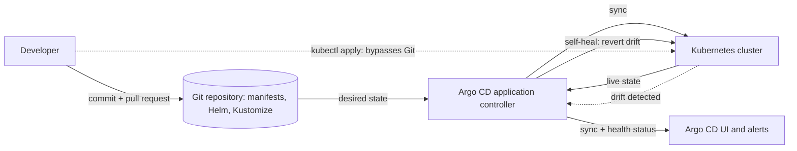

| Difficulty | Channel | Tags |
|---|---|---|
| beginner | devops | argocd, flux, declarative |

Adobe's platform team watched a quiet success story turn into a scalability cliff. The company replaced its legacy Moonbeam CaaS platform with Flex, a GitOps delivery platform built on Kubernetes and the Argo ecosystem, and adoption exploded from roughly 100 to 16,000 Argo CD applications in months. By October 2024, Flex managed more than 22,000 apps, 30,000 deployments a month, and 360+ remote clusters — and at around 2,500 apps, the single shared EKS control plane began to buckle [1]. The lesson is not that GitOps fails at scale; it is that the difference between declarative and imperative operations decides whether your platform bends or breaks.

---

> ### Real-World Case — Adobe
>
> Adobe replaced its legacy Moonbeam CaaS platform with Flex, a GitOps-based delivery platform built on Kubernetes and the Argo ecosystem (Argo CD, Workflows, Events, Rollouts). Adoption exploded from about 100 to 16,000 Argo CD applications in months; by October 2024 Flex was managing more than 22,000 Argo CD apps, 30,000 deployments a month, and 360+ remote Kubernetes clusters. At roughly 2,500 apps, the single shared EKS control plane began to buckle, causing CI/CD outages, hung workflows, and deployments that took far too long.
>
> | | |
> |---|---|
> | **Challenge** | Adobe needed hundreds of teams to declare desired state in Git and let Argo CD auto-sync and self-heal it, without the reconciliation loop itself saturating the Kubernetes API server and etcd. The old imperative model—manual steps and queue-based pipelines—made drift, rollback, and auditing painful, so Git had to become the single source of truth. |
> | **Solution** | Flex uses Argo CD Application CRDs pointing at per-service deploy repos containing Helm charts and manifests, with automated sync and self-heal so manual cluster edits are reverted as drift. At scale Adobe tuned the loop: app-controller replicas 8→12, reconciliation timeout 3→6→9 minutes, self-heal timeout 0→5→10 minutes, excluding unmanaged resources, switching from Kubernetes APIs to Argo CD APIs with an informer cache, gzip-compressing Redis responses, and archiving old Argo Workflows. They then moved to a cell-based 'Flexbox' architecture with multiple Argo CD control planes, relocating services between cells with zero runtime downtime. |
> | **Outcome** | Flex grew to more than 22,000 Argo CD apps, 30,000 deployments per month, 360+ remote clusters, and 1,000+ production services; it later supported 3,000+ production services and 3,000+ developers. Adobe benchmarked five control planes managing 10,000 apps each to support 50,000+ apps. The GitOps migration touched 10,400 pipelines, retired about 80% of previously identified services, cut deployment queue times, and delivered substantial infrastructure cost savings. |
> | **Lesson** | The default 3-minute reconciliation interval is not a target. At scale, aggressive auto-sync plus self-heal can become a self-inflicted denial-of-service against the Kubernetes API server and etcd—Adobe's ArgoCon talk showed Argo Workflows load alone stretching Argo CD syncs from 15 to 25 minutes. Declarative GitOps gives you auditability and drift correction, but you must tune the reconciliation loop and shard the control plane as you grow. The surprise: the Git-based inventory exposed roughly 80% zombie services, so the cost case came partly from platform cleanup, not just faster deploys. |

---

## Hook — The Pager Did Not Care That the Diagram Looked Beautiful

The architecture diagram was elegant: one Git repository, one Argo CD instance, one Kubernetes cluster, and a dream. Every deployment flowed through a pull request, every change was auditable, and every environment looked identical on paper. Then the application count crossed a few thousand, and the dashboard that once inspired confidence started telling a different story.

Sync operations queued behind each other. Health checks timed out. A developer merged a one-line replica change and waited. And waited. Somewhere between the merge and the running pod, the platform had become the bottleneck it was built to remove.

That is the moment GitOps stops being a tutorial and becomes an engineering discipline. The stakes are simple: if your delivery platform cannot reconcile fast enough, teams route around it. They reach for `kubectl`, hotfix the cluster directly, and quietly recreate the configuration drift that GitOps was supposed to eliminate.

So how do you configure Argo CD so that Git remains the single source of truth without turning your control plane into a single point of failure? And why does the declarative-versus-imperative distinction matter more at scale than it does in a demo?

💡 **Insight:** GitOps is not a tool you install. It is a contract that every change goes through version control — and that contract only holds if reconciliation is fast and reliable.

## Problem — GitOps Without Discipline Is Just YAML With Extra Steps

Here is the uncomfortable truth: most teams adopt Argo CD and immediately undermine it. They install the controller, point it at a repository, enable auto-sync, and then keep a terminal open for "quick fixes." Within a month, the cluster no longer matches Git, and nobody knows which change came from where.

This is configuration drift, and it is the core problem GitOps exists to solve [3]. It shows up in predictable ways:

- A production hotfix applied with `kubectl edit` that never makes it back into the repository.
- A Helm value changed manually during an incident and forgotten by morning.
- A namespace created by hand that mysteriously disappears when auto-prune runs.
- An audit trail that ends at "someone with cluster access did something."

The imperative approach feels faster because it is immediate. You type a command, the cluster changes, and the feedback loop is measured in seconds. The cost is deferred: no review, no history, no reproducibility, and no safe rollback. In a single-cluster startup, that cost may stay hidden. In a multi-cluster platform with hundreds of services, it compounds into outages.

Therefore, the real question is not whether to use Argo CD. It is whether your team is willing to treat Git as the only path to production — including during incidents, when the temptation to improvise is strongest.

## Real-World Case — Adobe's Flex Platform Hit a Wall at 2,500 Applications

Adobe did not stumble into GitOps by accident. The company replaced its legacy Moonbeam CaaS platform with Flex, a delivery platform built on Kubernetes and the Argo ecosystem — Argo CD, Workflows, Events, and Rollouts — to standardize how thousands of services shipped [1].

The results were dramatic. Flex grew from about 100 Argo CD applications to 16,000 in months, and by October 2024 it was managing more than 22,000 Argo CD apps, 30,000 deployments per month, and 360+ remote Kubernetes clusters, supporting 1,000+ production services and 3,000+ developers [1]. That is the success story.

Here is the plot twist: at roughly 2,500 applications, the single shared EKS control plane began to buckle [1]. CI/CD outages followed. Workflows hung. Deployments that should have taken minutes stretched far too long. The platform had scaled its application count faster than it had scaled the control plane responsible for reconciling all of it.

The fix was architectural, not cosmetic. Adobe moved toward sharded control planes and benchmarked five control planes managing 10,000 apps each to support 50,000+ applications [1]. The broader migration touched 10,400 pipelines, retired about 80% of previously identified services, cut deployment queue times, and delivered substantial infrastructure cost savings [1].

🎯 **Key Point:** Adobe's incident was not a GitOps failure. It was a capacity-planning failure in the reconciliation layer — the exact layer that declarative GitOps depends on.

## Deep Dive — Declarative Versus Imperative, Beyond the Dictionary Definition

Building on Adobe's experience, the technical distinction becomes concrete. Kubernetes itself is built around declarative configuration: you describe the desired state, and controllers work to make reality match it [2]. GitOps extends that idea one level up — the desired state lives in Git, and a controller such as Argo CD reconciles the cluster against the repository [3][4].

The imperative approach is the opposite: you issue commands that describe actions, not outcomes. `kubectl scale deployment checkout --replicas=6` says "do this now." It does not say "this is the permanent desired state," and nothing will restore it if someone changes it later.

| Dimension | Declarative (GitOps) | Imperative (kubectl) |
|---|---|---|
| Source of truth | Git repository | Whoever ran the last command |
| Change review | Pull request, approvals, CI checks | None by default |
| Drift handling | Continuous reconciliation and self-healing | Drift accumulates silently |
| Rollback | Revert a commit | Reconstruct history manually |
| Auditability | Full commit history | Partial, at best |
| Best use | Steady-state production delivery | Debugging, break-glass, one-off inspection |

Declarative does not mean "no commands." It means the command's output is captured in version control. Kustomize overlays and Helm charts are declarative because they render a complete desired state from files that live in Git [6][7]. Infrastructure as code follows the same principle: the repository describes the end state, and tooling converges toward it [8].

The nuance many developers miss is that reconciliation is a loop, not an event. Argo CD compares the live cluster state to the desired state, reports OutOfSync when they differ, and — if auto-sync and self-healing are enabled — corrects the difference automatically [5]. That loop is what turns a deployment tool into a control system.

🔥 **Hot Take:** Imperative commands are not the enemy. Unreviewed, unrecorded imperative commands are. Keep `kubectl` for debugging; keep production state in Git.

## Workflow — Wiring Auto-Sync, Self-Healing, and a Three-Minute Reconciliation Loop

With the concepts clear, the implementation becomes a sequence of deliberate choices. The diagram below illustrates the flow: a developer commits to Git, Argo CD compares desired and live state, syncs the cluster, and reverts drift when self-healing is enabled.

1. **Store the desired state in Git.** Keep plain manifests, Helm charts, or Kustomize overlays in a dedicated repository, with environment differences expressed as overlays rather than branches [6][9].
2. **Create an Application custom resource.** The Application CRD tells Argo CD which repository, revision, path, and destination cluster define the workload [10].
3. **Enable automated sync.** Set `syncPolicy.automated` with `prune: true` so resources deleted from Git are removed from the cluster, and `selfHeal: true` so manual edits are reverted [5].
4. **Tune the reconciliation interval.** Argo CD's default reconciliation timeout can be adjusted globally in `argocd-cm` with `timeout.reconciliation: 180s` — the three-minute health check cadence many teams standardize on [5].
5. **Add retries and sync options.** A bounded retry policy with exponential backoff prevents a transient API failure from leaving an application stuck, while options such as `CreateNamespace` and `PruneLast` make rollouts safer.
6. **Scale the control plane before it becomes the bottleneck.** Adobe's experience is the warning: shard Argo CD instances and use ApplicationSets or an app-of-apps pattern as application counts climb into the thousands [1].
7. **Observe sync and health continuously.** Alert on `OutOfSync` duration, reconciliation latency, and degraded health — not just on pod restarts.

⚠️ **Watch Out:** Enabling `prune: true` without a review process is how teams delete production namespaces. Pair pruning with sync windows, protected labels, and a staging environment that mirrors the production path.

## Code Example — An Application That Syncs, Heals, and Proves It

The following script defines a production-shaped Argo CD Application declaratively, waits for it to become healthy, and then deliberately introduces drift to demonstrate self-healing. It is the smallest useful version of the workflow described above — and it runs with `kubectl` already pointed at a cluster with Argo CD installed.

The Application references a Kustomize overlay, enables pruning and self-healing, and caps retries so a broken sync fails loudly instead of looping forever. The final step commits the next change through Git, which is the only path production should accept once the contract is in place.

💡 **Insight:** The `resources-finalizer.argocd.argoproj.io` finalizer ensures that deleting the Application also cleans up the resources it owns — a small detail that prevents orphaned workloads during decommissioning.

## Lessons Learned — What to Do Differently Tomorrow

The journey from a single Argo CD demo to a platform serving thousands of applications is a story about discipline and capacity, not about picking the right YAML indentation.

- **Make Git the only road to production.** Every manual cluster change is a future incident with a delayed timer. Use break-glass access for emergencies, then reconcile the fix back into Git immediately.
- **Treat reconciliation as a scaling dimension.** Adobe's control plane buckled at roughly 2,500 apps [1]. Measure sync latency and queue depth long before you reach that number, and plan for sharding.
- **Enable self-healing, but protect against pruning surprises.** Self-healing restores the desired state; pruning deletes what Git no longer declares. Both are powerful, and both deserve guardrails.
- **Keep the imperative escape hatch small and visible.** `kubectl` is excellent for debugging. It is a poor source of truth.
- **Separate desired state from environment differences.** Kustomize overlays and Helm values keep one logical application reproducible across environments [6][7].
- **Alert on drift, not just downtime.** An application that has been OutOfSync for thirty minutes is an incident in progress, even if every pod is healthy.

Consequently, the practical next step is unglamorous: audit how changes reached production last month. Count the ones that bypassed Git. That number is your real GitOps maturity score — and the fastest place to improve.

---

## GitOps Reconciliation Loop

<strong>Original Interview Question</strong>

**Q:** You're setting up GitOps for a microservices deployment. How would you configure ArgoCD to automatically sync changes from your Git repository to Kubernetes, and what's the difference between declarative and imperative approaches in this context?

**A:** I'd configure ArgoCD by setting up a Git repository containing Kubernetes manifests or Helm charts, creating an Application CRD that points to the Git repository, enabling auto-sync with a health check interval of 3 minutes, and implementing self-healing to automatically revert any manual changes. The declarative approach involves defining the desired state in Git through YAML manifests, Helm charts, or Kustomize configurations, where ArgoCD continuously reconciles the actual state with the desired state. In contrast, the imperative approach uses kubectl commands to make direct changes to the cluster, bypassing the Git repository as the single source of truth.

## Conclusion

Adobe's Flex platform proves both halves of the GitOps promise: it can scale to tens of thousands of applications and dramatically simplify delivery, and it can fail loudly when the control plane is treated as an afterthought [1]. The difference between those outcomes is not a YAML trick. It is the decision to make Git the single source of truth, to let a controller reconcile continuously, and to scale that controller before it becomes the bottleneck. Start tomorrow by auditing how production changed last month, then move every bypass into a pull request. The memorable takeaway worth sharing with your team: declarative GitOps does not remove operational work — it relocates that work into reviewable, reversible commits.

---

## References

1. [Adobe incident report](https://www.cncf.io/case-studies/adobe) — article
2. [Kubernetes documentation: Declarative object configuration](https://kubernetes.io/docs/concepts/overview/working-with-objects/declarative-config/) — documentation
3. [GitOps overview](https://en.wikipedia.org/wiki/GitOps) — article
4. [Argo CD GitHub repository](https://github.com/argoproj/argo-cd) — documentation
5. [Argo CD documentation: Automated sync policy](https://argo-cd.readthedocs.io/en/stable/user-guide/auto_sync/) — documentation
6. [Kustomize documentation](https://kustomize.io/) — documentation
7. [Helm documentation](https://helm.sh/docs/) — documentation
8. [Infrastructure as code](https://en.wikipedia.org/wiki/Infrastructure_as_code) — article
9. [Kubernetes documentation: Managing resources with Kustomize](https://kubernetes.io/docs/tasks/manage-kubernetes-objects/kustomization/) — documentation
10. [Argo CD documentation: Declarative setup](https://argo-cd.readthedocs.io/en/stable/operator-manual/declarative-setup/) — documentation

---

**Author:** Satishkumar Dhule — [GitHub](https://github.com/satishkumar-dhule) · [LinkedIn](https://linkedin.com/in/satishkumar-dhule) · [Website](https://satishkumar-dhule.github.io)
