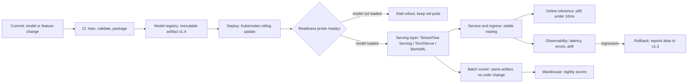

| Difficulty | Channel | Tags |
|---|---|---|
| beginner | devops | mlops, deployment |

Picture a data scientist with a model that finally beats the baseline — and no way to get it in front of a single customer. That was Uber before Michelangelo: one-off serving containers, no reproducible pipeline, and no shared place to compare experiments, so ML impact was capped by whatever a few people could hand-build [1]. The fix was not a better model. It was separating two jobs that everyone had been blurring together: deployment and serving. Here is what that distinction actually buys you, and where teams still get it wrong.

---

> ### Real-World Case — Uber
>
> Before Michelangelo, Uber's data scientists built models with R, scikit-learn, and custom algorithms while separate engineering teams built one-off serving systems for each project. There was no reproducible pipeline, no standard place to compare experiments, and no path to production—most teams had to create a bespoke serving container, so ML impact was limited to what a few people could hand-build.
>
> | | |
> |---|---|
> | **Challenge** | Uber needed to separate two problems that were being conflated: the deployment lifecycle (packaging, versioning, promoting, and monitoring a model across batch and online environments) and the serving runtime (low-latency inference, request routing, feature fetching, and horizontal scaling). The platform had to make deployment repeatable without forcing every team to become serving-infrastructure experts, while still serving predictions in milliseconds at hundreds of thousands of QPS. |
> | **Solution** | Michelangelo made deployment a first-class lifecycle: model artifacts—metadata, learned parameters, and compiled feature-DSL expressions—are packaged in a ZIP, stored in a versioned model repository, and pushed through Uber's standard code-deployment infrastructure to online or offline containers. Models are addressed by UUID or mutable tag, so a new version loads alongside the old one for atomic cutover, rollback, and A/B tests without client changes. Serving stayed separate: stateless prediction clusters behind load balancers load multiple models into memory, fetch features from Cassandra, and scale horizontally by adding hosts; batch deployment runs the same artifacts as Spark jobs. |
> | **Outcome** | The highest-traffic models served more than 250,000 predictions per second. P95 latency was under 5ms when models did not need Cassandra feature lookups and under 10ms when they did. The shared feature store held roughly 10,000 features, and dozens of teams adopted one deploy-and-serve path instead of bespoke containers. The same packaged model could run batch and online with no code changes. |
> | **Lesson** | Deployment and serving are different control-plane and data-plane problems, and conflating them is what creates bespoke snowflake systems. Keep deployment focused on artifacts, versions, rollout, and rollback; keep serving focused on stateless in-memory inference, routing, and horizontal scale. Versioning by UUID plus mutable tags is the small design choice that makes zero-downtime rollouts and A/B testing possible. |

---

## Hook — The Notebook That Could Not Ship

The model is done. The notebook is beautiful. The offline AUC is 0.91, the confusion matrix is a work of art, and the stakeholder demo went well.

Then someone asks the only question that matters: what is the p95 latency, and how many requests per second can it take?

Silence. Because nobody has measured it. The model has only ever run over a 400,000-row CSV with unlimited time and no concurrency. The path from that notebook to a production endpoint is a six-week project nobody scoped: containerize it, wrap it in an API, load the model at startup, add health checks, put it behind a load balancer, wire up autoscaling, and figure out how to roll back when version 2 turns out to be worse.

⚠️ Watch Out: This gap is where most ML projects quietly die. Not in training. In the last mile.

The uncomfortable truth is that training is the part everyone optimizes for, and shipping is the part that determines whether the model ever earns a dollar. The teams that win treat those as two separate engineering problems with two separate toolchains — and they connect them with a contract, not a prayer [10].

## Problem — Why "It Runs on My Laptop" Is an Incident Waiting to Happen

Many developers assume deployment and serving are the same thing wearing different hats. You build a model, you put it somewhere, requests hit it. Done. That mental model holds right up until the first real traffic spike.

Here is the thing though: the two disciplines answer completely different questions.

- Deployment asks: how does this exact artifact get from a commit to production safely, repeatably, and reversibly?
- Serving asks: how does each individual request get a correct answer in single-digit milliseconds while the system is under load?

Those questions have different failure modes. Deployment failures are about drift, missing approvals, and unreproducible environments. Serving failures are about memory, cold starts, head-of-line blocking, and a model that quietly deserializes 40 seconds after the pod reports healthy.

The stakes are asymmetric. A bad deployment is usually a slow-burn problem — you notice it in a dashboard, you roll back, you write a postmortem. A bad serving layer is a live outage affecting every user at once, and it does not care that your model was excellent offline.

Consequently, teams that conflate the two end up with the worst of both worlds: bespoke containers per project that are impossible to audit, and a runtime nobody has load-tested because everyone assumed the platform team owned it. Sound familiar?

💡 Insight: If your answer to "how do we ship a model" is "ask Priya, she has the container somewhere," you do not have a deployment process. You have a person.

## Real-World Case — Uber's Michelangelo

Uber hit this wall at scale, and the pre-Michelangelo picture is almost painfully familiar. Data scientists built models in R, scikit-learn, and custom algorithms while separate engineering teams built one-off serving systems for each project. There was no reproducible pipeline, no standard place to compare experiments, and no path to production. Most teams had to create a bespoke serving container, so ML impact was limited to what a few people could hand-build [1].

Now the results, because the numbers are the whole argument. The highest-traffic models served more than 250,000 predictions per second. P95 latency stayed under 5ms when models did not need Cassandra feature lookups, and under 10ms when they did. The shared feature store held roughly 10,000 features. Dozens of teams adopted one deploy-and-serve path instead of bespoke containers. And the same packaged model could run batch and online with no code changes [1].

Read that last sentence again, because it is the payoff of the whole architecture. The artifact CI produced was identical to the artifact the online server loaded. Not "equivalent." Identical bytes. That single decision eliminates an entire category of bugs — the training-serving skew that comes from two code paths that drifted apart three sprints ago.

🎯 Key Point: Uber's win was not a faster model. It was one deploy-and-serve contract shared by hundreds of models.

The lesson generalizes well beyond ride-sharing. When a feature store is shared [1] and the packaging format is shared, adding the twentieth model costs a fraction of adding the first. That is the compounding return that bespoke containers can never produce.

## Deep Dive — Deployment vs. Serving: Two Jobs, One Artifact

Building on Uber's example, it helps to draw a hard line between the two layers. Deployment is the supply chain. Serving is the storefront. Both are necessary, and neither substitutes for the other.

| Dimension | Deployment | Serving |
| --- | --- | --- |
| Core question | How does the artifact reach production safely? | How does each request get answered fast? |
| Typical tools | Kubernetes, Terraform, MLflow, SageMaker, GitHub Actions [7][9] | TensorFlow Serving, TorchServe, BentoML, FastAPI [4][5][6] |
| Failure mode | Drift, irreproducibility, bad rollback | Cold start, OOM, tail latency |
| Success metric | Deploy frequency, change failure rate | p95/p99 latency, throughput, error rate |
| Scaling lever | Pod replicas, cluster capacity | Batching, model compression, concurrency |

Deployment owns the pipeline: train, validate, package, register, promote, monitor, roll back. Modern registries such as MLflow give you a numbered, immutable address for every artifact, which is what makes rollback a one-line pointer change instead of an archaeology project [7]. Managed platforms like SageMaker compress that into a familiar workflow at the cost of some control over the runtime [9].

Serving owns the runtime: request routing, model loading, version pinning, batching, and autoscaling. Dedicated model servers exist because they solve problems a generic web framework does not. TensorFlow Serving handles versioned model directories and hot-swapping natively [4]; TorchServe brings similar semantics to PyTorch with handlers and snapshot-based rollback [5]; BentoML packages the model plus its dependencies and exposes adapters for HTTP and gRPC [6].

However — and this is the plot twist — the biggest lever is usually not the framework. It is the batching strategy. Clipper's work on low-latency prediction serving showed that a thin scheduling layer between the API and the model can improve both throughput and tail latency at once by batching across concurrent requests and adapting per-model [8]. You might think batching always adds latency. Actually, bounded micro-batching often reduces p99 because it prevents the model from being invoked a thousand times with batch size one.

The second lever is cold start. A 2GB model that takes 40 seconds to deserialize will happily serve zero requests per second while reporting healthy, unless your readiness probe actually checks the model. This is why warm-up at startup and a strict /readyz gate matter more than most tuning work.

🔥 Hot Take: If your serving layer reports healthy before the model is loaded in memory, you do not have a health check. You have a lie with a status code.

## Workflow — From Commit to a Sub-10ms Prediction

So how do the two layers actually connect? The flow below is the pattern that scales from one model to a hundred, and it is the same shape Uber converged on with a shared packaging and serving path [1].

The diagram traces a single change through the system: a commit triggers CI, CI produces an immutable artifact, the registry assigns it a version, Kubernetes rolls it out gradually, the readiness probe gates traffic, and the serving layer answers online requests while the exact same artifact runs a batch scoring job overnight [2][3][11].

1. Commit. A model change, feature change, or dependency bump lands in version control. Nothing reaches production that is not in the repo.
2. Train and validate in CI. Reproducible environment, pinned dependencies, offline metrics, and a regression gate against the current production baseline [12].
3. Package. The model, preprocessing, and dependency lockfile ship as one immutable artifact. This is the contract that makes batch and online identical [1].
4. Register. The artifact gets a version in the model registry and an alias such as staging or production [7].
5. Deploy as a rollout. Kubernetes starts new pods alongside old ones rather than replacing them, so a bad version can be reversed without downtime [2].
6. Gate on readiness. Only pods that have loaded the model receive traffic. Failed readiness means the rollout stalls instead of serving errors.
7. Scale on real signals. Horizontal Pod Autoscaling adds replicas based on CPU, memory, or queue depth — but for inference, custom metrics like requests-per-second and p95 latency are usually the honest signal [3].
8. Route and split. A Service or ingress layer provides stable discovery while traffic splitting enables canary percentage and A/B comparison [11].
9. Observe and roll back. Track latency, error rate, prediction drift, and feature freshness. Rollback is an alias change, not a rebuild.

💡 Insight: Steps 1–5 are deployment. Steps 6–9 are serving. The handoff between them is an immutable artifact and a version string — nothing more, nothing less.

Notice how much of this is boring on purpose. The interesting engineering happens once, in the platform, and then every subsequent model inherits it. That is the difference between a team that ships one model and a team that ships dozens.

## Code Example — A Serving Layer You Can Actually Ship

The code below is the smallest version of a real pattern: a FastAPI service that loads a versioned artifact at startup, exposes a readiness gate, serves predictions with measurable compute latency, and supports an atomic hot-swap to a new version without dropping a request. It is deliberately boring — that is the point.

The critical detail is that the admin reload endpoint loads the new model first and only then flips the pointer under a lock. Requests either see the old model or the new one, never a half-loaded object. In a Kubernetes rollout, the same principle applies at pod granularity: new pods must pass /readyz before the Service sends them traffic [2][11].

For batch work, reuse the identical artifact through the same load_model function in a job runner. No second code path, no separate preprocessing implementation, no skew [1]. That single constraint eliminates more production bugs than any amount of tuning.

⚠️ Watch Out: Never load a model inside the request handler. The first user to hit the pod will wait seconds for deserialization while the load balancer assumes the pod is fine. Load at startup, gate with readiness, then serve.

## Lessons Learned — What to Do Differently Tomorrow

The journey from a beautiful notebook to 250,000 predictions per second is not a story about better models. It is a story about separating concerns and then connecting them with a contract.

Here is the short version of what actually matters:

- Treat deployment and serving as distinct systems. One owns the pipeline and the rollback story [7][9]; the other owns latency, batching, and version pinning [4][5][6].
- Ship one immutable artifact. The exact bytes CI validated should be the bytes the server loads. This is what makes batch and online interchangeable [1].
- Make readiness mean something. A pod that has not loaded its model is not ready, no matter what the process says.
- Measure before optimizing. p95 and p99 under real concurrency, not offline accuracy, are the numbers that decide whether the feature ships [8].
- Autoscale on the right signal. CPU alone lies for inference workloads; queue depth and latency tell the truth [3].
- Prefer a shared platform over bespoke containers. The tenth model should be dramatically cheaper than the first, and it only is if the path is shared [1][10].
- Practice rollback before you need it. If reversing a deploy requires a rebuild, you do not have a rollback strategy [12].

Many developers learn this the hard way: the model is never the bottleneck, the last mile is. The teams that internalize that early spend their time on feature quality instead of firefighting serialization bugs at 2 a.m.

The moral of the story is almost anticlimactic. Deployment gets your model to production. Serving keeps it fast once it is there. Build the boring path once, make it shared, and the interesting work — the modeling — finally gets to compound.

---

## Deploy-and-Serve Pipeline

<strong>Original Interview Question</strong>

**Q:** Explain the key differences between model serving and model deployment in ML systems, including specific technologies, scaling considerations, and real-world implementation patterns?

**A:** Deployment encompasses CI/CD pipelines, infrastructure setup, and monitoring using tools like Kubernetes, MLflow, and SageMaker. Serving focuses on runtime inference APIs with frameworks like TensorFlow Serving, TorchServe, or BentoML, handling request routing, model versioning, and autoscaling. Key trade-offs include latency vs throughput, batch vs real-time inference, and cold start optimization.

## Conclusion

Deployment and serving are not two names for one job. Deployment is how a model earns the right to receive traffic; serving is how it survives once it does. Uber's platform is the proof at scale: one shared path, hundreds of models, over 250,000 predictions per second at single-digit millisecond p95 [1]. The next time a model is ready to ship, ask two separate questions — how does this roll out and roll back, and how does this answer a request in under ten milliseconds. Answering both explicitly is the difference between a demo and a product. Start with the boring parts: an immutable artifact, a readiness gate that actually checks the model, and a measured p95 under real concurrency. Everything else gets easier after that.

---

## References

1. [Uber incident report](https://www.uber.com/blog/michelangelo-machine-learning-platform) — article
2. [Kubernetes Documentation: Deployments](https://kubernetes.io/docs/concepts/workloads/controllers/deployment/) — documentation
3. [Kubernetes Documentation: Horizontal Pod Autoscaling](https://kubernetes.io/docs/tasks/run-application/horizontal-pod-autoscale/) — documentation
4. [TensorFlow Serving](https://github.com/tensorflow/serving) — documentation
5. [TorchServe](https://github.com/pytorch/serve) — documentation
6. [BentoML](https://github.com/bentoml/BentoML) — documentation
7. [MLflow: Open source platform for the machine learning lifecycle](https://github.com/mlflow/mlflow) — documentation
8. [Clipper: A Low-Latency Online Prediction Serving System](https://arxiv.org/abs/1612.03079) — paper
9. [Amazon SageMaker Developer Guide](https://docs.aws.amazon.com/sagemaker/latest/dg/whatis.html) — documentation
10. [MLOps](https://en.wikipedia.org/wiki/MLOps) — documentation
11. [Kubernetes Documentation: Service](https://kubernetes.io/docs/concepts/services-networking/service/) — documentation
12. [Continuous delivery](https://en.wikipedia.org/wiki/Continuous_delivery) — documentation

---

**Author:** Satishkumar Dhule — [GitHub](https://github.com/satishkumar-dhule) · [LinkedIn](https://linkedin.com/in/satishkumar-dhule) · [Website](https://satishkumar-dhule.github.io)
