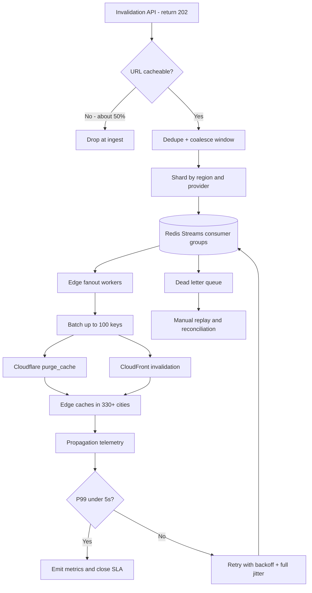

| Difficulty | Channel | Tags |
|---|---|---|
| intermediate | system-design | edge, caching, purging |

A price change goes live in Dublin, but a shopper in Sydney still sees the old number. That gap — the window between 'published' and 'actually everywhere' — is the entire job of a CDN purge system, and for years Cloudflare's version started with a request flying to a handful of core data centers before fanning out to 330+ cities, so Australian customers paid an ocean round trip before propagation even began [1]. What changed next cut global purge latency by 90.5% — and the lessons map directly onto the design of a system that must invalidate 10,000 objects per second while keeping every region under five seconds.

---

> ### Real-World Case — Cloudflare
>
> Cloudflare's cache purge had to invalidate content across 330+ cities in 120+ countries. Purge requests were backhauled to a few centralized 'core' data centers and fanned out through Quicksilver, so a customer in Australia paid an ocean round-trip before propagation even began. As usage grew, storing millions of daily purge keys also ate into cache disk space, tightly coupling storage cost to purge throughput.
>
> | | |
> |---|---|
> | **Challenge** | Guarantee fast, globally consistent invalidation without a central write funnel. The old design had three compounding problems: latency proportional to distance from the core, a throughput bottleneck at the single ingest point, and per-data-center storage that scaled with purge volume. P99 purge latency in May 2022 was as high as 6.35 seconds, and the core-based system could not be scaled by simply adding queues and batching because that added latency. |
> | **Solution** | Cloudflare rebuilt purge as a 'coreless' system: the API gateway and purge ingest moved to every edge data center, so a purge is validated and executed locally at the nearest node. Regional Durable Objects hold per-region purge queues with pointers tracking how far each data center has consumed the log, enabling replay after outages or maintenance. Dedicated purge fanout workers in well-connected hub data centers broadcast to their regions, and a Rust service called CacheDB (built on RocksDB) runs beside every cache proxy to do machine-to-machine fanout and actively delete purged objects instead of lazily marking them expired. Ingest also filters out no-op purges before broadcasting. |
> | **Outcome** | Global P50 purge latency for tags, hostnames, and prefixes fell from 1,570ms (May 2022) to 149ms (Aug 2024), a 90.5% improvement; APAC went from 1,300ms to 199ms and Africa from 1,420ms to 303ms. The purge fanout workers alone cut end-to-end latency by 50% and tripled throughput, active purge cut storage requirements 10x, and Cloudflare extended all purge methods (URL, tag, hostname, prefix, everything) to every plan tier in April 2025. Notably, more than 50% of requested purge URLs turned out to be uncacheable and could be dropped at ingest. |
> | **Lesson** | The intuitive design — a central invalidation queue, batching, and exponential backoff — is exactly the architecture Cloudflare outgrew. At CDN scale the central coordinator is the bottleneck, so the winning move is to remove it: ingest and validate at the edge, broadcast peer-to-peer with replayable regional logs, and maintain the purge index next to the cache on every machine. Also, the cheapest invalidation is the one you never send — filtering no-op purges at the edge freed capacity for legitimate ones. |

---

## Hook — The 1.5-Second Ocean Round Trip

Picture a customer in Sydney hitting publish on a price change. The origin flips in 40 milliseconds. Then the waiting begins.

For years at Cloudflare, that wait started with a geography tax. Purge requests were backhauled to a small set of centralized core data centers, then fanned out through Quicksilver, the internal system that pushes configuration to every edge node. A purge triggered in Australia traveled across an ocean before the fan-out even began [1]. The architecture was clean, centralized, and easy to reason about — the kind of design that looks brilliant on a whiteboard and feels very different from a laptop in Melbourne.

There was a second, sneakier cost. Every purge key has to be stored somewhere, and at millions of purges per day those keys ate into the same cache disk space meant to hold content. Storage cost became tightly coupled to purge throughput: the more customers purged, the less cache could do its job [1].

Then came the numbers that made the industry sit up. Global P50 purge latency for tags, hostnames, and prefixes fell from 1,570ms in May 2022 to 149ms in August 2024. APAC went from 1,300ms to 199ms. Africa from 1,420ms to 303ms. That is a 90.5% improvement, and it did not come from a faster API call [1].

The real unlock was stranger than that: more than half of the requested purge URLs turned out to be uncacheable and could be dropped at ingest [1]. The fastest invalidation is the one you never send.

So what would you do with a five-second SLA and 10,000 invalidations per second? That question is the rest of this article.

## Problem — 10,000 Invalidations per Second, Five Seconds to Get It Right

Now scale the problem up. Your platform handles 10,000 concurrent invalidations per second, and the contract says every region sees fresh content within five seconds.

Do the napkin math before the architecture. 10,000 requests per second times a five-second budget means up to 50,000 invalidations in flight at any moment. Fan each one out to 330+ edge locations and you are pushing roughly 3.3 million edge messages per second — before retries [1]. Something has to give.

The pain shows up in four places:

- **The fan-out tax.** Every added region multiplies work. Naive per-object, per-region purging turns a throughput problem into an exponential one.
- **The retry storm.** When one provider rate-limits you, synchronized retries create a second, self-inflicted traffic spike exactly when the system is already struggling [8].
- **The storage tax.** Purge keys are metadata, but metadata lives in memory and on disk next to your cache. Millions of daily keys quietly shrink effective cache capacity [1].
- **The consistency illusion.** A 200 OK from a purge API means 'request accepted', not 'every edge is clean'. Teams that treat it as the latter ship stale content and then blame the CDN.

⚠️ **Watch Out:** The five-second SLA is usually measured at P50 by the provider and at P99 by your customers. Design for the tail, not the median.

Sound familiar? Almost every team that grows past a single region hits this wall, and most of them hit it while staring at a dashboard that insists everything is fine.

## Real-World Case — Cloudflare's Instant Purge Rebuild

Cloudflare's public write-up of the purge rebuild is one of the clearest looks at this problem in production [1]. Three changes mattered most.

**1. Move coordination to the edge.** Instead of funneling every purge through a few core facilities, purge fan-out workers took on regional coordination, pushing decisions closer to the caches they affect. The fan-out workers alone cut end-to-end latency by 50% and tripled throughput [1]. Edge compute fits this workload because the work is small, latency-sensitive, and embarrassingly parallel — the exact shape Cloudflare Workers are built for [2].

**2. Store less, not faster.** Active purge reduced storage requirements by roughly 10x by changing how purge state is represented and expired [1]. That decoupled purge volume from cache disk pressure, the coupling that had been quietly taxing every customer.

**3. Reject impossible work early.** More than 50% of requested purge URLs were uncacheable and could be dropped at ingest [1]. Filtering at the front door removed half the load before it ever touched a provider API.

| Metric | Before | After | Change |
|---|---|---|---|
| Global P50 purge latency | 1,570ms (May 2022) | 149ms (Aug 2024) | -90.5% |
| APAC P50 | 1,300ms | 199ms | -85% |
| Africa P50 | 1,420ms | 303ms | -79% |
| Purge fan-out throughput | baseline | 3x | +200% |
| Purge storage footprint | baseline | ~1/10 | -90% |

The follow-through matters too: in April 2025, Cloudflare extended every purge method — URL, tag, hostname, prefix, and everything — to every plan tier [1]. A purge primitive only enterprise customers can afford is not really a primitive.

🎯 **Key Point:** The headline was latency. The durable win was decoupling. Latency numbers impress; decoupled storage and throughput are what let a system keep its SLA as traffic grows.

## Deep Dive — TTL, Purge, and the Trade-Offs Nobody Draws on the Whiteboard

Step back from the vendor specifics. The design space for invalidation has three levers, and how they interact is what separates a system that holds its SLA from one that collapses during a flash sale.

**Lever 1: TTL is a fuse, not a strategy.** `Cache-Control: max-age=2, must-revalidate` gives a hard upper bound on staleness [4]. Two seconds sounds aggressive, and it is — but it is also the cheapest consistency you will ever buy, because it requires zero coordination. The catch: a short TTL multiplies origin traffic and cache churn, so it cannot be the only mechanism at high request rates. HTTP caching semantics define freshness and revalidation but deliberately do not define a purge API; invalidation is left to the implementation [5].

**Lever 2: Purge is a hint you must verify.** A purge request tells the CDN 'stop serving this', not 'this is now correct everywhere'. Propagation is asynchronous by nature. Treating the API response as a distributed commit is the single most common source of 'but I purged it' incidents.

**Lever 3: Not everything deserves invalidation.** Cacheability is the cheapest filter in the system. Private responses, authenticated API routes, range-heavy media, and objects with `Vary` headers that explode the key space often are not worth purging individually — or are not cached at all [4]. Cloudflare's finding that over half of purge URLs were uncacheable is not an edge case; it is a baseline [1].

Here is the trade-off table developers actually need:

| Strategy | Propagation | Origin load | Purge API cost | Consistency |
|---|---|---|---|---|
| TTL only (2s) | up to 2s | high | zero | bounded staleness |
| Purge on every write | seconds, variable | low | high | best effort |
| Hybrid: TTL + batched purge | well under 5s | moderate | low | bounded + fast path |
| Purge + `stale-while-revalidate` | instant read, async refresh | low | low | near-real-time |

That last row is the quiet winner for read-heavy content. `stale-while-revalidate` lets an edge serve a slightly stale object while fetching a fresh one in the background, absorbing purge storms without users waiting [6]. Combine it with a two-second TTL as a backstop and you get a system that is fast in the common case and correct in the worst case.

🔥 **Hot Take:** If your purge volume is enormous, the bug is probably upstream. Either you are caching things you should not, or you are invalidating on every write when a tag or prefix purge would do.

The other deep idea is **coalescing**. At 10,000 requests per second, many invalidations touch the same URL or prefix. Deduplicating inside a short window — even 50 milliseconds — can collapse a burst by an order of magnitude. It is the same principle behind request coalescing at the cache layer, and it is why a queue with consumer groups beats a direct API call every time [7].

## Workflow — From Invalidation Request to Verified Propagation

Here is the pipeline that turns those ideas into a system. Keep the Mermaid diagram below in your head: ingest, filter, dedupe, shard, batch, fan out, verify.

**Step 1 — Ingest and validate.** Accept invalidations over an async API and return 202 immediately. The caller gets an acknowledgment and an invalidation ID; the SLA clock starts now.

**Step 2 — Drop the uncacheable.** Check each URL against your cache policy before it costs anything. This filter alone removed more than half the load in Cloudflare's case [1].

**Step 3 — Dedupe and coalesce.** Hash each normalized URL and collapse duplicates inside a short window. Same URL ten thousand times becomes one key.

**Step 4 — Shard by region and provider.** A URL that only affects EU traffic should not wake edge nodes in APAC. Regional sharding is how you avoid the fan-out tax.

**Step 5 — Batch aggressively.** Group up to 100 keys per provider call. Batching is the single biggest lever on API cost and rate-limit pressure [3].

**Step 6 — Fan out through consumers.** Redis Streams consumer groups give you at-least-once delivery, backpressure, and replay without building a queue from scratch [7].

**Step 7 — Verify, retry, dead-letter.** Retry with exponential backoff and full jitter, cap at three attempts, then route to a dead-letter queue with the original payload for manual replay [8].

⚠️ **Watch Out:** At-least-once delivery means your purge handler must be idempotent. Purging the same URL twice is harmless; double-counting it against a quota or billing meter is not.

## Code Example — An Edge Purge Coordinator in TypeScript

Time to make it concrete. The TypeScript below is a trimmed version of an edge-side purge coordinator — the piece between your invalidation API and the provider APIs. It focuses on the three decisions that matter most: filtering uncacheable URLs, deduplicating and batching, and retrying without starting a stampede.

A few details are worth calling out before you read it. The `AbortSignal.timeout(1500)` is deliberate: a slow provider must never consume your entire five-second budget, so each attempt gets a hard cap and the remaining time belongs to retries and verification. The backoff uses full jitter rather than a fixed multiplier, because synchronized retries are how a partial outage becomes a total one [8]. And the dead-letter branch logs structured JSON instead of throwing, so one poisoned batch cannot stall a consumer group trying to keep up with 10,000 messages per second.

Notice what is absent. There is no global lock, no per-URL database row, and no synchronous call to a core data center. Each of those would reintroduce the centralization that made the original problem expensive.

## Lessons Learned — What Actually Transfers to Your System

Seven sections in, here is what is worth stealing.

- **Filter before you fan out.** The cheapest invalidation is the one you never send. Validate cacheability at ingest; Cloudflare dropped more than 50% of purge URLs that way [1].
- **Batch or pay.** Provider APIs are priced and rate-limited per call. Batching 100 keys per request is the difference between a rounding error and a five-figure monthly bill [3].
- **Jitter is not optional.** Exponential backoff without jitter synchronizes clients into a thundering herd [8]. Full jitter is three lines of code and one saved incident.
- **TTL is your backstop, not your plan.** A two-second TTL bounds staleness but multiplies origin load [4]. Pair it with targeted purges; do not pick one.
- **Decouple storage from throughput.** If purge metadata competes with content for cache disk, growth in one degrades the other — the exact coupling Cloudflare spent years undoing [1].
- **Design for P99, market with P50.** Provider dashboards happily show the median. Your customers live in the tail.

💡 **Insight:** The most senior move in this design is subtraction. Every filter, every dedupe window, every regional shard removes work that would otherwise need to be fast.

Battle scars worth avoiding:

1. Purging on every database write instead of on publish — you invalidate ten times for one user-visible change.
2. Using wildcard purges for everything. They are powerful, coarse, and easy to over-apply [3].
3. Forgetting `Vary` headers when computing cache keys, then purging a URL whose variants never matched [4].
4. Treating a 200 from a purge API as proof of global propagation.
5. Building a custom queue when Redis Streams consumer groups already give you replay and backpressure [7].

If this feels overwhelming, you are not alone — most teams start with TTL-only caching, add purge when a product requirement forces it, and only build regional coordination when a latency graph embarrasses them in a review. The trick is knowing which stage you are in [9].

---

## Hybrid CDN Purge Architecture

<strong>Original Interview Question</strong>

**Q:** How would you design a multi-region CDN cache purging system that guarantees content propagation within 5 seconds while handling 10,000 concurrent invalidations per second?

**A:** Implement Cloudflare API + AWS CloudFront with distributed invalidation queue, edge compute coordination, and 2-second TTL. Use batch invalidation, exponential backoff, and regional cache headers for 5-second SLA.

## Conclusion

Remember the customer in Sydney waiting for a price change to appear. The fix was never a faster API call — it was moving coordination closer to the edge, refusing to purge what could not be cached, and decoupling purge state from cache storage [1]. Those three moves took global P50 from 1,570ms to 149ms and kept the tail in check [1].

Tomorrow, pick one: add a cacheability check at your invalidation ingest, collapse duplicate keys inside a 50ms window, or replace a fixed retry delay with full jitter. Each is a small change that buys a large margin against a five-second SLA. Then measure P99, not P50, and let the graph tell you where the next ocean round trip is hiding.

The memorable version: fast invalidation is mostly a subtraction problem — the best purge is the one your system is smart enough not to send.

---

## References

1. [Cloudflare incident report](https://blog.cloudflare.com/instant-purge) — blog
2. [Cloudflare Workers documentation](https://developers.cloudflare.com/workers/) — documentation
3. [Amazon CloudFront: Invalidating files](https://docs.aws.amazon.com/AmazonCloudFront/latest/DeveloperGuide/Invalidation.html) — documentation
4. [MDN: Cache-Control header](https://developer.mozilla.org/en-US/docs/Web/HTTP/Headers/Cache-Control) — documentation
5. [RFC 9111: HTTP Caching](https://datatracker.ietf.org/doc/html/rfc9111) — documentation
6. [RFC 5861: HTTP Cache-Control Extensions for Stale Content](https://datatracker.ietf.org/doc/html/rfc5861) — documentation
7. [Redis Streams documentation](https://redis.io/docs/latest/develop/data-types/streams/) — documentation
8. [AWS: Retry behavior and exponential backoff with jitter](https://docs.aws.amazon.com/general/latest/gr/api-retries.html) — documentation
9. [Wikipedia: Content delivery network](https://en.wikipedia.org/wiki/Content_delivery_network) — documentation

---

**Author:** Satishkumar Dhule — [GitHub](https://github.com/satishkumar-dhule) · [LinkedIn](https://linkedin.com/in/satishkumar-dhule) · [Website](https://satishkumar-dhule.github.io)
