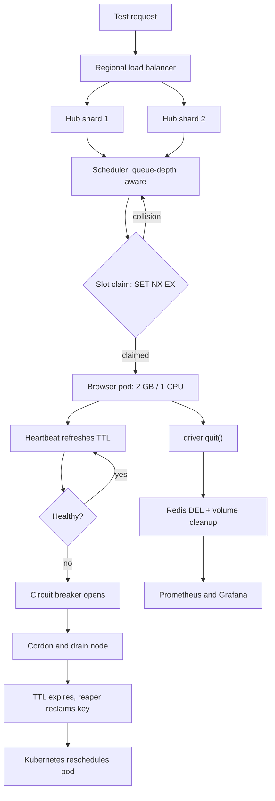

| Difficulty | Channel | Tags |
|---|---|---|
| advanced | system-design | selenium, webdriver, grid |

By 2014, Expedia Group's roughly 9,000 UI automation tests were crammed into more than 350 Jenkins jobs, each one competing for a build executor while stale browser processes quietly turned machines into zombies [1]. Suites took hours, concurrency was capped by the number of executors, and one abandoned Chrome could poison a machine for the next team in line [1]. Eventually Expedia pushed past 150,000 tests per day across 90+ hubs, spinning up and tearing down about 4,500 EC2 nodes daily and running 1,000 UI tests in roughly five minutes [1]. The uncomfortable lesson: a scalable Selenium Grid is not a bigger grid — it is a session lifecycle problem wearing a browser costume.

---

> ### Real-World Case — Expedia Group
>
> By 2014, Expedia's roughly 9,000 UI automation tests ran across more than 350 Jenkins jobs directly on build executors. Suites took hours, concurrency was capped by the number of executors, and stale browser processes frequently left executors unusable.
>
> | | |
> |---|---|
> | **Challenge** | Scale Selenium execution so the entire UI suite finished in roughly the duration of its slowest test, while eliminating leaked or stale browser sessions and controlling cloud cost across dozens of autonomous CI/CD teams. |
> | **Solution** | Expedia built Distributed Automation on SeleniumGridScaler, essentially Selenium Grid plus the EC2 API. Each team got its own hub; hubs autoscaled c5.xlarge nodes that each ran 15 Chrome or Firefox sessions, kept hub and nodes in the same subnet, and terminated nodes on demand or after idle time. Rather than one monolithic grid, they ran 90+ independent hubs, and they kept the hub as a plain Java process because a Dockerized hub caused hub-node communication instability at hundreds of concurrent tests. |
> | **Outcome** | Expedia reached more than 150,000 tests per day across 90+ hubs, creating, using, and terminating about 4,500 EC2 nodes daily. They demonstrated 1,000 UI tests completing in about 5 minutes, versus hours before. |
> | **Lesson** | At high concurrency, the winning move is often not one giant Selenium Grid but many small, independently autoscaling grids with disposable nodes. Treat browser sessions as cattle: create on demand, cap sessions per box, and destroy nodes aggressively to prevent stale-browser leaks and idle cost. |

---

## Hook — The 3 A.M. Question: What Happens When 10,000 Browsers Wake Up?

Picture this: it is 3 a.m., the pager fires, and your Selenium Grid is technically 'up.' The hub answers health checks. The dashboards are green. And yet every new test is stuck in `Pending` while 200 browser pods sit at 97% memory, each one convinced it is doing important work.

That is the cruel joke of distributed browser testing. The failure rarely looks like a crash. It looks like slowness. A session that never releases its slot. A Chrome process that outlives its driver. A node that passes its health check because the health check only asks whether the HTTP server is breathing.

At 10,000 concurrent sessions, those small leaks compound into an outage. The queue grows. The autoscaler adds pods that inherit the same leak. The bill climbs. And the test suite that was supposed to give developers confidence becomes the reason nobody trusts the pipeline.

So the real question is not 'How do you run 10,000 browsers?' It is 'How do you guarantee that every one of those browsers dies on time, every time, even when the node running it does not?'

## Problem — A Grid Is Not a Queue With Browsers Attached

Most teams start with the mental model of a queue: tests go in, browsers come out. That model survives a few hundred sessions. It collapses at scale because a browser session is a stateful, memory-hungry, externally visible resource with three independent lifecycles — the test process, the WebDriver process, and the browser process itself. When one of those lifecycles ends without the other two noticing, you get a leak.

Here is what that looks like in practice:

- **Executor exhaustion**: a Jenkins executor or Kubernetes pod stays 'busy' long after the test has failed, because `driver.quit()` hung or never ran.
- **Zombie browsers**: Chrome child processes survive a killed parent, holding shared memory and file handles until the node is recycled.
- **Hub saturation**: a single central hub becomes a throughput ceiling and a single point of failure; every session request funnels through it.
- **Silent memory growth**: each session leaves a temp profile, a Docker volume, or a few hundred megabytes of cached pages behind.
- **False health**: a `/status` endpoint returns 200 while the node is minutes away from OOM-killing its next browser.

⚠️ **Watch Out**: The dangerous leaks are the ones that pass health checks. A node with 50 orphaned Chrome processes can still answer HTTP requests just fine.

The stakes are easy to underestimate. At 10,000 concurrent sessions with a 2 GB memory limit per node, a 30% buffer is 120 GB of headroom. Sounds generous — until a leaky session costs 300 MB and the buffer disappears in a single busy afternoon.

Moreover, the problem is not just memory. It is *ownership*. Who owns a session when the scheduling pod dies? Who kills the browser when the hub loses the node? Who reclaims the Redis key when the test runner is SIGKILLed? If the answer is 'the process that created it,' you have designed a system that fails exactly when that process fails.

## Real-World Case — Expedia Group's Executor Graveyard

Expedia Group lived the queue model long enough to see its limits. By 2014, roughly 9,000 UI automation tests ran across more than 350 Jenkins jobs directly on build executors [1]. Concurrency was capped by the number of executors, so the suite's runtime was less a function of test complexity and more a function of how many machines happened to be free. Worse, stale browser processes frequently left executors unusable — a failed test could take a worker out of the pool until someone noticed [1].

The turning point was architectural, not incremental. Expedia moved from 'run tests on build machines' to a distributed automation platform with dedicated hubs and on-demand browser nodes. The result: more than 150,000 tests per day across 90+ hubs, creating, using, and terminating about 4,500 EC2 nodes daily, with 1,000 UI tests completing in about five minutes instead of hours [1].

Notice what did *not* change: Selenium still drove browsers, and tests still failed. What changed was the lifecycle contract. Nodes became disposable, sessions became time-bounded, and capacity became something the platform provisioned rather than something the test suite begged for.

💡 **Insight**: Expedia's 90+ hubs are the unsung hero of the story. A single giant hub would have been a spectacular bottleneck. Sharding by team, suite, or region turned the hub from a monolith into a routing layer.

That raises the next question: if nodes are disposable and sessions are time-bounded, what exactly has to be true for that contract to hold at 10,000 concurrent sessions? The answer lives in four failure domains.

## Deep Dive — The Four Failure Domains of a 10,000-Session Grid

**1. Capacity: the math you cannot skip.**

Before architecture, do the arithmetic. At 50 sessions per node, 10,000 concurrent sessions require at least 200 nodes. At 2 GB RAM per node, that is 400 GB baseline; add a 30% buffer and you are budgeting 520 GB of cluster memory. That buffer is not luxury — it is the space where leaks, rolling restarts, and traffic spikes live. Kubernetes resource requests and limits make that budget enforceable per pod [11], and on-demand EC2 capacity keeps the node pool from being pinned to a fixed fleet [12].

| Constraint | Calculation | Result |
|---|---|---|
| Concurrent sessions | Given | 10,000 |
| Node density | 10,000 / 50 | 200 nodes minimum |
| Baseline memory | 200 × 2 GB | 400 GB |
| Buffered memory | 400 GB × 1.3 | 520 GB |
| Uptime budget | 30 days × 0.1% | ~43 min/month |
| Session start | P99 target | < 2 seconds |

Those 200 nodes are a floor, not a target. Pod Disruption Budgets that keep 85% capacity available during voluntary disruptions mean you should provision closer to 235 nodes, and multi-AZ spread means each zone needs enough headroom to absorb a zone failure [5].

**2. State: Redis is the source of truth for liveness.**

A session key with a TTL is the closest thing a grid has to a heartbeat. When a node claims a session, it writes the claim atomically with `SET NX EX`; while the browser is alive, it refreshes the TTL. If the node dies, the refresh stops, Redis expires the key, and the session becomes reclaimable [7]. That is the difference between 'best-effort cleanup' and 'guaranteed eventual cleanup.'

⚠️ **Watch Out**: TTL alone is not enough. A node that is alive but wedged will keep refreshing the TTL forever. Pair the TTL with a separate liveness probe and a maximum session age.

**3. Health: probes, breakers, and the difference between alive and useful.**

Kubernetes liveness probes answer 'should this container be restarted?' Readiness probes answer 'should this pod receive traffic?' [4]. Neither answers 'can this node actually start a browser in under two seconds?' For that, you need application-level signals: queue depth per node, browser launch latency, orphan process count, and memory slope. A circuit breaker opens after three consecutive failures and gives the node a 30-second half-open window before routing returns [8].

🔥 **Hot Take**: Most 'Selenium Grid outages' are not Selenium outages. They are capacity-planning failures dressed up as flaky tests.

**4. Failure: partitions, split-brain, and the multi-DC trap.**

Across data centers, the CAP theorem stops being trivia and becomes an operating constraint [10]. If a regional hub cannot reach the global Redis cluster, does it stop accepting sessions or keep scheduling locally? The safe answer is usually the boring one: make each region a self-contained cell with its own session store, and replicate only aggregated metrics globally. Avoid a global leader election for session ownership unless you enjoy debugging split-brain at 3 a.m. [10].

**The plot twist**: the hub is the part everyone scales last. Teams add browser nodes and forget that every session request, status poll, and cleanup event still flows through the hub. Shard hubs by region or team, keep them stateless, and put a regional load balancer in front [2]. StatefulSets are for the browser nodes, not for the thing routing traffic to them [3].

This leads directly to the operational workflow: how a session actually moves from request to teardown without anyone manually rescuing it.

## Workflow — From Test Request to Graceful Teardown

The flowchart below traces the happy path and the two failure paths that matter most: a node that dies mid-session and a node that is asked to shut down gracefully.

1. **Route the request.** A regional load balancer sends the test to the nearest healthy hub shard, keeping P99 session initiation under two seconds.
2. **Pick a node by queue depth.** The scheduler ignores CPU and looks at pending sessions per node; HPA scales on the same signal [6].
3. **Claim the slot atomically.** The node writes `grid:session:` with `SET NX EX`. If the claim fails, the scheduler retries elsewhere instead of double-booking a browser.
4. **Start the browser under a cgroup.** The pod gets 2 GB RAM and 1 CPU; Chrome runs with `--disable-dev-shm-usage` so `/dev/shm` exhaustion does not kill it silently.
5. **Heartbeat the TTL.** A sidecar or background task refreshes the Redis key every `TTL / 3` seconds. Liveness is now observable from outside the node.
6. **Watch the signals.** Probes, browser-launch latency, and orphan counts feed Prometheus; the circuit breaker isolates a node after three consecutive failures [8].
7. **Tear down in the right order.** `driver.quit()` first, then Redis `DEL`, then volume and temp-profile cleanup. If `quit()` throws, the TTL is still the backstop.
8. **Handle the ugly paths.** On SIGTERM, the node stops accepting sessions and drains in-flight work. On a hard crash, the TTL expires, the reaper reclaims the key, and Kubernetes replaces the pod on a fresh node [3][5].

🎯 **Key Point**: Graceful shutdown and crash recovery are two different mechanisms. You need both. Graceful shutdown protects the sessions you can still save; TTL protects the ones you cannot.

The diagram is deliberately boring in the middle and paranoid at the edges. That is the shape of a reliable grid.

## Code Example — A Session Manager That Refuses to Leak

The Python example below implements the lifecycle contract from the workflow: atomic slot claiming, TTL heartbeats, guaranteed teardown, orphan reaping, and a SIGTERM drain path. It is written for an asyncio worker that owns browser sessions on a Kubernetes node.

**Step 1 — Claim before you launch.** The `SET NX EX` call is the admission control. Two schedulers racing for the same slot cannot both win, so you never start two browsers for one session [7].

**Step 2 — Heartbeat the lease.** The background task refreshes the TTL while the session is alive. If the node dies, the heartbeat dies with it and Redis eventually expires the key.

**Step 3 — Make cleanup unconditional.** The `finally` block cancels the heartbeat, calls `driver.quit()`, deletes the Redis key, and updates metrics. Even if the test raises, the slot is released [9].

**Step 4 — Reap what leaked.** The reaper scans for session keys with no TTL (`TTL == -1`), which indicates a bug or a crash that bypassed expiry, and deletes them [7].

**Step 5 — Drain on SIGTERM.** When Kubernetes evicts the pod, the manager stops accepting new sessions and waits for in-flight work to finish before the process exits. This is the difference between a rolling update and a rolling outage [3][5].

The important design decision is that no single line of cleanup is trusted on its own. `driver.quit()` can hang. The process can be SIGKILLed. Redis can be unreachable for a few seconds. The system is designed so that *any one* of those failures still leaves a path back to a clean state.

## Lessons Learned — Design for the Session That Never Ends

**Every session needs a deadline.** A session without a TTL is a promise to leak. Set a maximum age, refresh a heartbeat, and let expiry do the work your cleanup code cannot.

**Cleanup is a chain, not a call.** `driver.quit()` handles the browser. Redis `DEL` handles the slot. The reaper handles the key that lost its TTL. Kubernetes handles the pod. The volume cleaner handles the disk. Remove one link and the chain snaps.

**Autoscale on the signal that hurts.** CPU is a lagging indicator for browser workloads. Queue depth and pending sessions per node are the metrics that actually predict whether the next test will start on time [6].

**Shard the hub before you scale the nodes.** Expedia's 90+ hubs were not an accident; they were the difference between a routing layer and a bottleneck [1]. A single hub at 10,000 sessions is a single point of failure with extra steps [2].

**Test the failure paths in production-like conditions.** Kill a node mid-session. Partition a region. Fill `/dev/shm`. Run a canary with 1% of traffic. If the only failure mode you have tested is 'test assertion failed,' you have not tested the grid [5].

**Budget downtime in minutes, not percentages.** 99.9% sounds impressive until you translate it: about 43 minutes of downtime per month. Multi-AZ deployment and automatic failover are not premium features at that budget; they are the entry fee [5][10].

| Mistake | Symptom | Fix |
|---|---|---|
| Cleanup only in test code | Zombie browsers after crashes | TTL + reaper + init containers |
| One central hub | Queue latency spikes | Regional or team-based hub shards |
| CPU-based autoscaling | Pods scale after the queue explodes | Scale on queue depth |
| `driver.quit()` without a timeout | Pods hang on shutdown | Timeout, force-kill, TTL backstop |
| No maximum session age | Wedged nodes refresh forever | Hard cap plus liveness probe |

💡 **Insight**: The best grid operators do not measure how many sessions are running. They measure how long the oldest session has been running. That single metric catches more leaks than any dashboard full of throughput graphs.

So what should you do differently tomorrow? Add a TTL to every session record. Add a reaper that deletes keys without one. Add a SIGTERM handler that drains instead of dying. None of those changes require a 200-node cluster to validate — and all of them are the difference between a grid that scales and a grid that merely grows.

---

## Session Lifecycle Flow

<strong>Original Interview Question</strong>

**Q:** Design a scalable Selenium Grid architecture to handle 10,000 concurrent test sessions with 99.9% uptime, ensuring zero memory leaks through automatic session lifecycle management, real-time monitoring, and graceful node failure recovery across multiple data centers?

**A:** Deploy Kubernetes cluster with auto-scaling node pools, Redis session store with TTL policies, Prometheus metrics for memory monitoring, circuit breakers for node isolation, and sidecar containers for session cleanup. Implement health checks, resource quotas, and rolling updates.

## Conclusion

Expedia's journey from 350 Jenkins jobs to 150,000 tests a day was not a victory of bigger hardware. It was a victory of ownership: disposable nodes, time-bounded sessions, and cleanup that did not depend on the test process surviving [1]. At 10,000 concurrent sessions, the same principle holds. The architecture is Kubernetes and Redis and Prometheus, but the actual product is a guarantee — every browser dies on time, every slot comes back, and no node becomes a silent graveyard of Chrome processes.

Start small. Add a TTL. Write the reaper. Kill a pod on purpose and watch what happens. The grid you save may be your own.

---

## References

1. [Expedia Group incident report](https://medium.com/expedia-group-tech/distributed-automation-how-to-run-1000-ui-automation-tests-in-5mins-cf9a84ca32d1) — article
2. [Selenium (software)](https://en.wikipedia.org/wiki/Selenium_(software)) — documentation
3. [Kubernetes StatefulSets](https://kubernetes.io/docs/concepts/workloads/controllers/statefulset/) — documentation
4. [Configure Liveness, Readiness and Startup Probes](https://kubernetes.io/docs/tasks/configure-pod-container/configure-liveness-readiness-startup-probes/) — documentation
5. [Disruptions and Pod Disruption Budgets](https://kubernetes.io/docs/concepts/workloads/pods/disruptions/) — documentation
6. [Horizontal Pod Autoscaling](https://kubernetes.io/docs/tasks/run-application/horizontal-pod-autoscale/) — documentation
7. [Redis](https://en.wikipedia.org/wiki/Redis) — documentation
8. [Circuit breaker design pattern](https://en.wikipedia.org/wiki/Circuit_breaker_design_pattern) — documentation
9. [Coroutines and Tasks](https://docs.python.org/3/library/asyncio-task.html) — documentation
10. [CAP theorem](https://en.wikipedia.org/wiki/CAP_theorem) — documentation
11. [Resource Management for Pods and Containers](https://kubernetes.io/docs/concepts/configuration/manage-resources-containers/) — documentation
12. [Amazon EC2 Auto Scaling](https://docs.aws.amazon.com/autoscaling/ec2/userguide/what-is-amazon-ec2-auto-scaling.html) — documentation

---

**Author:** Satishkumar Dhule — [GitHub](https://github.com/satishkumar-dhule) · [LinkedIn](https://linkedin.com/in/satishkumar-dhule) · [Website](https://satishkumar-dhule.github.io)
