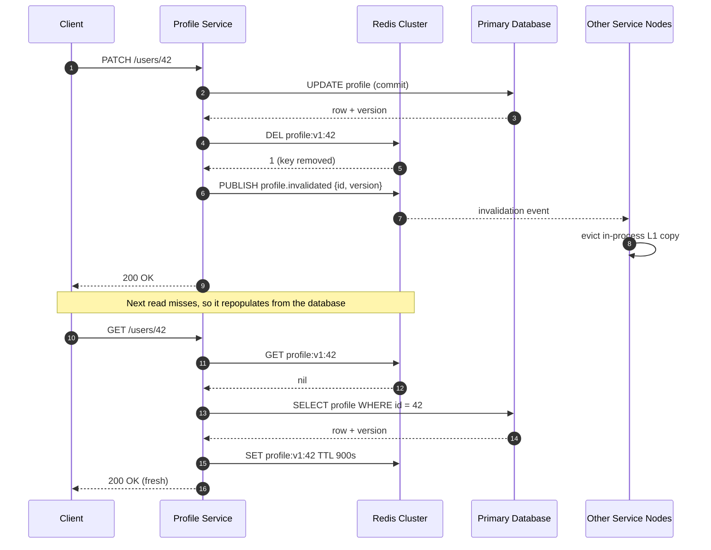

| Difficulty | Channel | Tags |
|---|---|---|
| beginner | backend | redis, memcached, cache-invalidation |

In 2013, engineers at Meta (then Facebook) published a paper about a cache tier serving billions of requests per second across trillions of items — and buried a number that should stop every backend developer cold: only about 4% of the deletes they issued actually invalidated anything [1]. The other 96% were wasted traffic. Picture a single profile update rippling across dozens of frontend clusters, each holding its own copy of the same user, each needing to forget. That is the invisible tax of cache invalidation, and it is exactly the problem you inherit the moment you put Redis or Memcached in front of a user profile service.

---

> ### Real-World Case — Meta (Facebook)
>
> Facebook relied on memcached as the de-facto cache for the social graph, serving billions of requests per second across trillions of cached items. Because the cache was spread across many frontend clusters sharing a sharded MySQL storage tier, a single profile update on one cluster could leave stale copies in every other cluster.
>
> | | |
> |---|---|
> | **Challenge** | Keep cached user/profile data consistent across a massive distributed fleet without turning every write into a storm of database queries. Naive cache-aside writes caused stale sets (an old value overwriting a newer one after concurrent reordering) and thundering herds (a hot key repeatedly invalidated, sending floods of reads to the database). |
> | **Solution** | On writes, Facebook updates the database then sends a delete (not a set) to memcached, because deletes are idempotent and safe to reorder. A per-database daemon called mcsqueal inspects committed SQL statements, extracts the affected cache keys, batches the invalidations, and ships them via mcrouter to every frontend cluster. They also introduced leases: a 64-bit token handed to one client on a miss that is invalidated by a concurrent delete, preventing stale sets, and issued only once per key every 10 seconds to suppress thundering herds. The writing server additionally invalidates its own cluster to preserve read-your-writes semantics. |
> | **Outcome** | Leases cut peak database query rate on thundering-herd-prone keys from 17K/s to 1.3K/s, a roughly 92% reduction in peak DB load, while the cache layer scaled to billions of requests per second and trillions of items. They also found only 4% of issued deletes actually invalidated cached data, which shaped how aggressively they batched invalidation traffic. |
> | **Lesson** | Invalidation is not the same as updating the cache. Deleting on write is deliberately preferred because it is idempotent and tolerates message reordering, and a stale cache entry is worse than a miss. Without built-in pub/sub like Redis, you end up building your own invalidation pipeline (mcsqueal + mcrouter) and concurrency control (leases) around Memcached. |

---

## Hook — The Profile That Would Not Change

Picture a Tuesday morning support queue. A user renamed themselves over the weekend, yet the mobile app still greets them with the old name, the invoice shows the old name, and the admin dashboard shows a third spelling entirely. Nothing crashed. No alert fired. The service is technically up — it is just wrong.

That is the special cruelty of cache staleness. Latency regressions get caught by dashboards; stale data quietly erodes trust one screenshot at a time. The profile service is the canonical example because profiles are read constantly and written rarely. A 1000:1 read-to-write ratio is normal, which means a single missed invalidation can be served thousands of times before anyone notices.

💡 Insight: A cache is a distributed system's memory of the past. Invalidation is how you tell it the present has changed.

So the question is not whether to cache profiles. It is how to make the cache forget on command — and what happens when the forget message never arrives.

## Problem — Two Copies of the Truth, One Winner

On the surface, the fix sounds trivial: when a user updates a profile, delete the cache key. In practice, that one line of code hides at least four distinct failure modes.

- Stale reads after a race. A reader misses, fetches the old row from the database, and writes it back to the cache just after the writer deleted the key. The old value now has a fresh TTL.
- Thundering herd. A popular key expires and thousands of concurrent requests all miss at once, hammering the primary database [5].
- Lost invalidation. The delete reaches one cache node but not another, or a subscriber is offline when the message fires.
- Cross-region drift. Each region holds its own copy, and no one owns the global truth.

TTL alone does not solve this; it only bounds how long the damage lasts. RFC 9111 formalizes the same tension for HTTP caches: freshness is a policy, not a guarantee [7]. If a profile can change at any moment, a TTL is a bet that nobody will notice the lag. Sometimes that bet is fine. For a display name printed on an invoice, it usually is not.

🎯 Key Point: Invalidation is a consistency protocol disguised as a delete call.

## Real-World Case — Meta (Facebook)

In 2013, engineers at Meta (then Facebook) published 'Scaling Memcache at Facebook', describing a cache tier that served billions of requests per second across trillions of items [1]. The architecture was deliberately simple: many frontend clusters, each with its own memcached pool, all sitting in front of a sharded MySQL storage tier. That simplicity created exactly the problem above. A profile update handled by one cluster had to invalidate copies living in every other cluster.

Two numbers from the paper matter more than any architecture diagram. First, leases — short tokens that let one request recompute a hot key while others wait — cut peak database query rates on thundering-herd-prone keys from roughly 17,000 queries per second to about 1,300, a 92% reduction [1]. Second, the team found that only about 4% of the deletes they issued actually invalidated cached data [1]. The other 96% were pure overhead, which is why they invested in batching invalidation traffic instead of firing one delete per write.

⚠️ Watch Out: The 4% figure is not a memcached failure. It is the normal shape of invalidation traffic at scale — most writes touch keys nobody is caching.

## Deep Dive — Redis, Memcached, and the Delete-vs-Update Plot Twist

Redis and Memcached are often described as interchangeable, right up until invalidation becomes the requirement.

| Dimension | Redis | Memcached |
|---|---|---|
| Invalidation | pub/sub plus client-side tracking | delete per node or external coordination |
| Data structures | strings, hashes, sets, streams | opaque blobs |
| Persistence | RDB and AOF options | none |
| Threading | mostly single-threaded command execution | multi-threaded |
| Best fit | coordination and complex invalidation | pure, simple caching |

Redis pub/sub gives you a fan-out channel: publish profile.invalidated and every subscriber drops its local copy [3][8]. Memcached has no such channel, so teams either broadcast deletes through a proxy, version their keys, or accept TTL-bounded staleness [2][9]. Consistent hashing keeps a given key on a predictable node, which makes targeted deletes cheaper, but it does not make them reliable [6].

Here is the plot twist. Many developers assume write-through means writing the new value into the cache on every update. That works for a single writer and falls apart under concurrency: two updates can reach the cache out of order, leaving the older value in place. Deleting is usually safer, because a delete carries no payload to reorder [4]. The cache then repopulates from the database on the next read.

Can a delete still lose a race? Yes. The residual window is a reader that fetched the old row before the commit and writes it back after the delete. Version-stamped values, leases like Meta's, or a short TTL close that gap. None of them is free, and all of them are cheaper than explaining a stale name to a customer.

## Workflow — Invalidation in Six Moves

With the trade-offs on the table, the implementation collapses into six moves. The sequence diagram below shows the write path and the read path that follows it.

1. Commit to the database first. The database is the source of truth; a cache update that lands before the commit can expose data that never existed.
2. Delete the cache key. Do not overwrite it. A missing key cannot be stale.
3. Publish an invalidation event. This evicts in-process L1 caches on every service node, not just the shared Redis tier.
4. Let subscribers evict locally. Fan-out is cheap; correctness is not.
5. Repopulate on the next read. A cache-aside read keeps the write path short.
6. Bound the damage with a TTL. Fifteen minutes for profiles means even a lost event self-heals.

The sequence in the diagram is the whole protocol: commit, delete, publish, evict, repopulate. There is no clever step hiding in the middle.

💡 Insight: Treat pub/sub as an optimization, never as the guarantee. The TTL is the guarantee.

Measure two things from day one: hit rate and invalidation fan-out. A healthy-looking hit rate paired with a fan-out that is 25x the write rate usually means keys are being deleted that nobody cached — the 4% problem showing up in your own dashboards.

## Code Example — A Profile Service That Refuses to Serve Stale Data

Time to make it concrete. The service below uses Redis as the shared L2 cache, a per-process dictionary as L1, and a short lease to blunt thundering herds. It is deliberately boring, because boring invalidation is the goal.

## Lessons Learned — What to Ship Tomorrow

The journey from a smiling stale cache to a predictable invalidation protocol comes down to a handful of decisions you can make this week.

- Delete, do not overwrite. A delete has no payload to reorder, so concurrent writers cannot resurrect an old value through the cache [4].
- Commit before you invalidate. If the cache is cleared before the database commit, a racing read repopulates from pre-commit data.
- Use TTL as a safety net, not a strategy. Fifteen minutes for profiles is a reasonable backstop; it is a terrible primary mechanism.
- Leases beat brute force. Meta's lease mechanism cut peak database load on hot keys by about 92% [1]. A 500ms lock is cheaper than a stampede.
- Measure the 4%. Count how many invalidations actually remove a key. If the ratio is low, batch the traffic instead of adding nodes.
- Choose storage by invalidation needs, not benchmarks. Redis earns its overhead when you need pub/sub, streams, or persistence; Memcached wins when you only need fast opaque blobs [2][3].
- Version your values. A monotonic version stamp turns a subtle race into a simple comparison, and it makes cross-region debugging tractable [6].

🔥 Hot Take: Most cache inconsistency bugs are not cache bugs. They are ordering bugs that the cache makes visible.

⚠️ Watch Out: Redis keyspace notifications and pub/sub are fire-and-forget. If a subscriber is restarting, the event is gone. Persistence does not save a message that was never queued [8]. For invalidation you truly cannot lose, use a durable stream or a change-data-capture log, and keep the TTL as the backstop.

---

## Profile Update Invalidation Sequence

<strong>Original Interview Question</strong>

**Q:** You're building a user profile service that caches frequently accessed profiles. How would you implement cache invalidation when a user updates their profile, and what trade-offs would you consider between Redis and Memcached?

**A:** Implement write-through caching with TTL-based expiration. On profile update, invalidate the cache by deleting the key and writing new data to both the database and cache. Redis offers pub/sub for automatic distributed invalidation, while Memcached requires manual coordination across nodes.

## Conclusion

The Meta paper's most useful lesson is not that memcached is fast. It is that invalidation traffic is mostly waste, the failures are mostly races, and the fixes are mostly unglamorous [1]. A profile service does not need a clever cache. It needs a clear order of operations: commit the truth, delete the copy, announce the change, and let a TTL cover the messages that never arrive. Do that tomorrow, and the next stale-name support ticket goes to someone else's queue. The one insight worth repeating to your team: a cache is not wrong because it is old — it is wrong because nobody told it what changed.

---

## References

1. [Meta (Facebook) incident report](https://www.usenix.org/conference/nsdi13/technical-sessions/presentation/nishtala) — article
2. [Memcached](https://en.wikipedia.org/wiki/Memcached) — documentation
3. [Redis](https://en.wikipedia.org/wiki/Redis) — documentation
4. [Cache invalidation](https://en.wikipedia.org/wiki/Cache_invalidation) — documentation
5. [Thundering herd problem](https://en.wikipedia.org/wiki/Thundering_herd_problem) — documentation
6. [Consistent hashing](https://en.wikipedia.org/wiki/Consistent_hashing) — documentation
7. [RFC 9111: HTTP Caching](https://datatracker.ietf.org/doc/html/rfc9111) — documentation
8. [Redis source repository](https://github.com/redis/redis) — documentation
9. [Memcached source repository](https://github.com/memcached/memcached) — documentation
10. [Amazon ElastiCache documentation](https://docs.aws.amazon.com/AmazonElastiCache/latest/dg/WhatIs.html) — documentation

---

**Author:** Satishkumar Dhule — [GitHub](https://github.com/satishkumar-dhule) · [LinkedIn](https://linkedin.com/in/satishkumar-dhule) · [Website](https://satishkumar-dhule.github.io)
