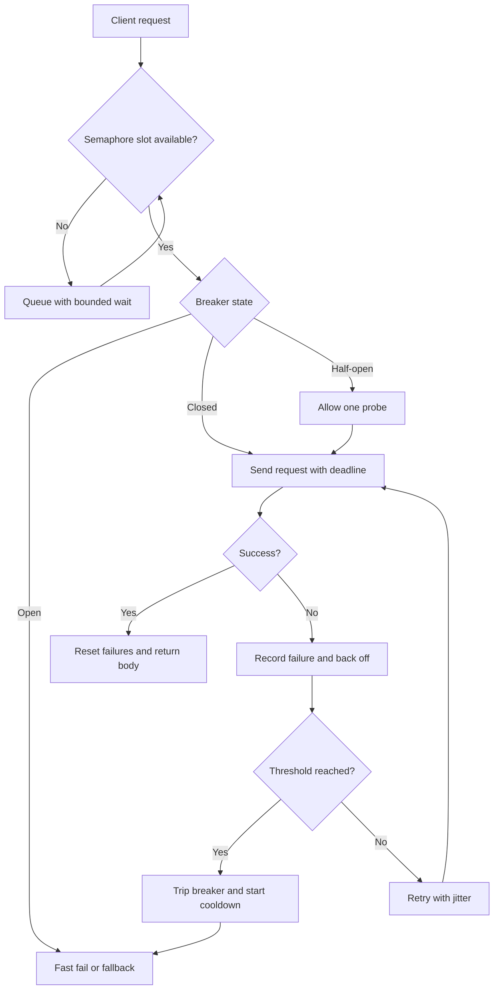

| Difficulty | Channel | Tags |
|---|---|---|
| advanced | backend | asyncio, aiohttp, concurrency |

Late in 2011, Netflix's API was absorbing roughly 20,000 requests per second at peak, and each member request fanned out into multiple upstream service calls [1]. A ten-second window could contain about 200,000 client requests and expand into more than 1,000,000 dependency calls across roughly 60 circuits, which meant one slow service had the power to consume the capacity reserved for everything else [1]. The lesson is not that Netflix is special; it is that connection management is a resilience problem wearing a networking costume. What follows is the story of how to build an aiohttp pool manager that bends under pressure instead of snapping.

---

> ### Real-World Case — Netflix
>
> By late 2011, Netflix's API was handling about 20,000 requests per second at peak, fanning each member request out into multiple upstream service calls. A 10-second window covered 200,000 client requests and could produce over 1,000,000 upstream calls across roughly 60 dependency circuits, so one slow service could tie up request capacity and cascade across the fleet.
>
> | | |
> |---|---|
> | **Challenge** | Prevent a single slow or failing dependency from exhausting the API's connection and concurrency budget, turning a localized slowdown into a member-facing outage, while still serving a usable response. |
> | **Solution** | Netflix wrapped every dependency call in a circuit-breaker/fallback layer with per-dependency thread pools and bounded queues, aggressive timeouts, and error-rate tracking over a 10-second rolling window. When failures crossed the threshold, the circuit tripped and calls immediately short-circuited to a fallback instead of waiting on a connection. Fallbacks ranged from custom local-cache responses to fail-silent and fail-fast. This is the same bulkhead, timeout, and circuit-breaker pattern later productized as Hystrix, which used semaphore isolation for hundreds of billions of calls per day. |
> | **Outcome** | During a real incident, Netflix bypassed a buggy shared cache and sent traffic directly to the database, which began throttling them. The database circuit tripped at an 80% error rate, and 157 of 200 API server instances served fallback responses from a local query cache. The short-circuited requests never reached the database, and video views were barely affected compared with the prior week. |
> | **Lesson** | A connection limit alone just moves the queue. The system survives only when the pool is paired with a breaker that fails fast and a fallback that does useful work. Also counterintuitive: during an incident, do not 'give it breathing room' by raising pool sizes and timeouts; shed load so the dependency can actually recover. |

---

## Hook — Ten Seconds That Nearly Took Down Netflix

It is 2:47 a.m. and the on-call phone lights up with a latency alert that makes no sense. Your service answers in 40 milliseconds. CPU is flat. Memory is fine. The only thing that changed is that one upstream dependency, the one that usually responds in 90 milliseconds, is now taking eight seconds on maybe two percent of calls.

Here is the trap: those slow calls do not just fail. They hold connections. Every held connection is a worker that cannot serve a fast request. Within minutes, the healthy 98 percent of traffic is waiting behind the sick 2 percent, and the queue is growing faster than it drains.

That is the moment a connection pool stops being a networking detail and becomes the difference between a degraded feature and a full outage. The question is not whether your service can handle load. It is whether it can fail in a way that keeps the important paths alive. Netflix answered that question in public [1], and the answer was not a bigger pool.

💡 Insight: Graceful degradation is not about doing everything slower. It is about doing fewer things on purpose so the essential ones still work.

## Problem — When Every Request Fans Out Into a Thousand Cuts

Fan-out is the hidden multiplier in modern backends. One user action becomes a profile lookup, a recommendation call, a playback license check, a metadata fetch, and a billing event. At modest scale, that arithmetic is invisible. At peak, it is brutal: Netflix's API handled about 20,000 requests per second, and a ten-second window contained roughly 200,000 client requests that could expand into more than 1,000,000 upstream calls across about 60 dependency circuits [1].

The failure mode is not linear. When concurrency rises past what a dependency can serve, latency does not creep upward; it falls off a cliff. Requests pile up in queues, timeouts fire, retries add more load to an already saturated system, and the retry storm outlives the original slowdown. A dependency that recovers in 30 seconds can keep your service down for 10 minutes because your own retry logic is still hammering it.

Many developers reach for one of four tools, and each solves a different slice of the problem:

| Tool | What it controls | What it does not fix |
|---|---|---|
| TCPConnector limit | Sockets per host and overall | Requests waiting in your own queue |
| asyncio.Semaphore | Concurrent in-flight coroutines | Slow dependencies that never time out |
| Rate limiter | Requests per second | A dependency that is failing fast |
| Circuit breaker | Calls to an unhealthy dependency | Capacity planning or retries |

The uncomfortable truth is that a pool without a timeout is a slow memory leak, a timeout without a breaker is a retry generator, and a breaker without a fallback is just a faster error. You need all four working together, and you need them scoped per dependency, not globally.

⚠️ Watch Out: A global semaphore feels safe, but it lets one sick dependency consume slots that healthy dependencies need. That is head-of-line blocking wearing a seatbelt.

## Real-World Case — Netflix and the Circuit That Saved the Database

In late 2011, Netflix ran an experiment in exactly this kind of pressure. The team deliberately bypassed a buggy shared cache and sent traffic straight to the database, which promptly began throttling them [1]. This was not a hypothetical drill; it was a live system with real members on the other side.

Then the circuit breaker did its job. The database circuit tripped at an 80 percent error rate. Of 200 API server instances, 157 served fallback responses from a local query cache, and the short-circuited requests never reached the database at all [1]. Video views were barely affected compared with the prior week.

Read that again. The database was throttling them, more than three-quarters of the fleet was serving fallback data, and members mostly did not notice. That is what graceful degradation looks like in production: not a perfect system, but a system that protects its core journey while a dependency is on fire.

🎯 Key Point: The circuit breaker did not make the database healthy. It made the API resilient. Those are different goals, and only one of them is under your control.

## Deep Dive — Semaphores, Timeouts, and the Circuit Breaker Triangle

Building on that incident, the first distinction to internalize is that a semaphore is admission control, not a rate limiter. `asyncio.Semaphore` caps how many coroutines hold a slot at once [2]. If your dependency takes 200 milliseconds to respond, 100 slots translate to roughly 500 requests per second. If latency doubles, throughput halves automatically. That self-throttling is a feature, but it also means pool size must be derived from latency budgets, not copied from a blog post.

The second distinction is about timeouts. aiohttp exposes connect, sock_read, and total timeouts, and they answer different questions: can the connection be established, is the socket still producing bytes, and has the whole operation exceeded its deadline [3][8]. A total timeout is your safety net, but it is not cancellation. When a coroutine is cancelled, cleanup still has to run, and a response object used outside its context manager will not do what you expect.

Next comes retry policy. Exponential backoff with jitter is the standard defense against synchronized retry storms [5]. The jitter matters more than the exponential part: without it, every client that failed at the same moment retries at the same moment. Retries also need a budget and an idempotency check. Retrying a POST that charges a card is not resilience; it is a billing incident with extra steps.

The circuit breaker is the piece that turns individual failures into a fleet-level decision [4]. It has three states: closed (traffic flows), open (calls fail fast), and half-open (a single probe tests recovery). The subtle part is scope. A breaker per dependency, per endpoint, or per shard behaves very differently from one global breaker. Netflix's 60 dependency circuits existed because a single global switch would have taken down everything to save one thing [1].

There is also the question of what counts as failure. A 500 from upstream is a failure. A 429 means the upstream is alive but asking you to slow down, and the correct response is backoff, not a circuit trip [7]. A 503 often means retry later, which RFC 9110 defines as a temporary condition [6]. Treating all non-2xx responses as identical is how teams end up tripping breakers during routine deploys.

🔥 Hot Take: The most important number in your pool is not max_connections. It is the deadline you are willing to spend on a dependency before falling back. Everything else is bookkeeping.

## Workflow — The Life of a Request Inside the Pool

With those trade-offs in mind, the request lifecycle becomes a sequence rather than a pile of decorators. The diagram below traces one call from admission to recovery.

1. Admit the request. Acquire the semaphore with a bounded wait. If the queue is full, reject early with a clear error instead of letting the request age into a timeout.
2. Check the breaker. If the dependency circuit is open and the cooldown has not elapsed, return the fallback immediately. If it is half-open, allow exactly one probe.
3. Attach a deadline. Set a total timeout that is smaller than the caller's deadline. A dependency should never be allowed to consume the entire request budget.
4. Send through the session. Reuse a single ClientSession with a TCPConnector that enforces both global and per-host limits [8][9].
5. Classify the outcome. Separate success, retryable failure, and permanent failure. Record only the failures that indicate dependency health.
6. Back off with jitter. Retry only within the budget, and only for operations that are safe to repeat.
7. Trip and recover. When the threshold is crossed, open the circuit, start the cooldown, and let a single probe decide when to close it again.

For sizing, start with a simple estimate: max_connections ≈ target_rps × p99_latency_in_seconds. If you need 400 requests per second at a 250-millisecond p99, you need about 100 slots. Then measure queue wait time. If wait time is climbing while upstream latency is flat, the pool is too small. If upstream errors climb while wait time is low, the pool is too large and you are protecting nothing.

💡 Insight: A pool manager that never rejects anything is not backpressure. It is a queue with optimistic branding.

## Code Example — Building the Pool Manager in Python

The implementation below puts the workflow into a single async context manager. It layers three defenses: a semaphore for admission, a per-dependency circuit breaker for health, and jittered retries for transient failures. The session and connector are created once, which is the difference between connection reuse and a TCP handshake per request.

The fetch method returns the status and body together so callers can make their own fallback decision. Failures are recorded inside the retry loop, and the breaker gate runs before the retry loop so an open circuit fails fast instead of sleeping through three backoffs. Notice that 4xx responses do not trip the breaker: the dependency is reachable, and the request itself is the problem.

The half-open state uses a single probe flag rather than a count. That detail prevents the thundering herd that appears when every waiting coroutine is allowed through the moment the cooldown expires. It is a small piece of state with an outsized effect.

🎯 Key Point: Keep the fallback outside the pool manager. The manager decides whether a call is allowed; the product decides what the user sees when it is not.

## Lessons Learned — What to Ship Before the Next Peak

Here is what the Netflix incident and the mechanics above add up to.

- **Degrade by dependency, not by service.** A breaker per upstream lets you lose recommendations while keeping playback alive.
- **Bound the queue, not just the pool.** An unbounded wait turns overload into latency, and latency into timeouts you did not choose.
- **Make fallbacks boring.** A local cache, a stale read, or a feature flag is more useful than a perfectly formatted 500.
- **Retry with jitter and a budget.** Exponential backoff without jitter synchronizes your clients into a polite DDoS [5].
- **Treat 429 and 503 differently from 500.** Backoff for throttling, trip for persistent failure [6][7].
- **Close sessions on shutdown.** Leaked connectors keep the event loop alive and make deploys look like hangs.
- **Measure queue wait, not just latency.** Latency tells you the dependency is slow; queue wait tells you the pool is the bottleneck.

⚠️ Watch Out: The most common production bug in this pattern is a breaker that resets on every success. If late successes keep closing the circuit while failures continue, the breaker never protects anything. Decide explicitly whether a success from a request started before the trip should count.

Many developers discover this pattern only after their first cascade. You can discover it before yours.

---

## Request Lifecycle Through the Pool

<strong>Original Interview Question</strong>

**Q:** How would you implement a connection pool manager for aiohttp that handles graceful degradation under high load and connection timeouts?

**A:** Implement a connection pool manager for aiohttp using a semaphore to limit concurrent connections, exponential backoff for retrying failed requests, and circuit breaker pattern to gracefully degrade under high load and connection timeouts.

## Conclusion

The Netflix story ends with a database in distress and members barely noticing, because the API chose to serve a smaller, reliable experience instead of a complete, failing one [1]. That choice was not improvised during the incident. It was designed into the system through circuits, fallbacks, and limits that had been tested before they were needed.

The same choice is available in any aiohttp service. Start with a deadline, add a semaphore sized from real latency numbers, put a breaker in front of every dependency that can fail independently, and make the fallback a product decision rather than an afterthought. Then run a game day: break a dependency on purpose and watch what your users experience.

The one idea worth repeating to your team is this: resilience is not the absence of failure. It is the presence of a smaller, intentional system that keeps working while something else is broken.

---

## References

1. [Netflix incident report](https://netflixtechblog.com/making-the-netflix-api-more-resilient-a8ec62159c2d) — article
2. [Python documentation: Synchronization Primitives](https://docs.python.org/3/library/asyncio-sync.html) — documentation
3. [Python documentation: Coroutines and Tasks — Timeouts](https://docs.python.org/3/library/asyncio-task.html#timeouts) — documentation
4. [Wikipedia: Circuit breaker design pattern](https://en.wikipedia.org/wiki/Circuit_breaker_design_pattern) — documentation
5. [Wikipedia: Exponential backoff](https://en.wikipedia.org/wiki/Exponential_backoff) — documentation
6. [RFC 9110: HTTP Semantics](https://datatracker.ietf.org/doc/html/rfc9110) — documentation
7. [MDN: 429 Too Many Requests](https://developer.mozilla.org/en-US/docs/Web/HTTP/Status/429) — documentation
8. [aiohttp documentation: Advanced Client Usage](https://docs.aiohttp.org/en/stable/client_advanced.html) — documentation
9. [aiohttp GitHub repository](https://github.com/aio-libs/aiohttp) — documentation

---

**Author:** Satishkumar Dhule — [GitHub](https://github.com/satishkumar-dhule) · [LinkedIn](https://linkedin.com/in/satishkumar-dhule) · [Website](https://satishkumar-dhule.github.io)
