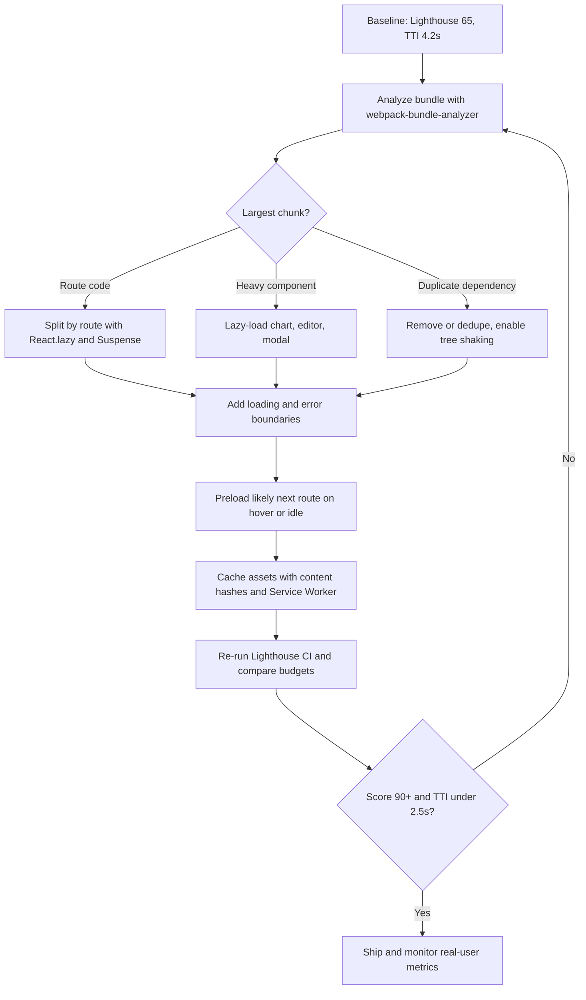

| Difficulty | Channel | Tags |
|---|---|---|
| intermediate | frontend | lighthouse, bundle, lazy-loading |

In 2017, Pinterest's mobile web experience shipped more than 2.5MB of JavaScript and could take roughly 23 seconds to become usable on an average Android phone over 3G, while converting only about 1% of unauthenticated visitors [1]. The team rebuilt it as a React/Redux/webpack PWA, cut the core bundle from about 650KB to 150KB, and brought Time to Interactive down to 5.6 seconds [1]. The lesson is not that React is slow; it is that shipping every byte to every user is. Here is the playbook for taking a React app from a 65 Lighthouse score to 90+ without turning performance into a six-month rewrite.

---

> ### Real-World Case — Pinterest
>
> In 2017 Pinterest rebuilt its mobile web experience as a React/Redux/webpack PWA after discovering its old mobile site converted only about 1% of unauthenticated visitors into signups, logins, or app installs. The old experience was a monolith shipping over 2.5MB of CPU-heavy JavaScript (~1.5MB in the main bundle plus ~1MB lazily loaded), and users often waited 23 seconds before any UI was usable on average Android hardware over 3G.
>
> | | |
> |---|---|
> | **Challenge** | A single, monolithic webpack bundle meant mobile users had to download, parse, and compile megabytes of JavaScript before the main thread could settle enough to become interactive. The bundle blocked Time to Interactive, First Meaningful Paint, and ultimately conversion on the exact low-end mobile traffic Pinterest was trying to grow internationally. |
> | **Solution** | Pinterest broke the monolith into route-based chunks with webpack's CommonsChunkPlugin: a ~73KB vendor chunk (React, Redux, React Router), a ~72KB entry chunk for the app shell and Redux store, and async route chunks of ~13-18KB loaded on demand via React Router code-splitting. They added a client-side route preloading system, used babel-preset-env to transpile only what target browsers need, applied chunk-specific hashes for long-term caching, and used Service Workers to cache the app shell and static assets for repeat visits. |
> | **Outcome** | The core bundle dropped from ~650KB to ~150KB (down from a 2.5MB+ JavaScript payload). First Meaningful Paint fell from 4.2s to 1.8s and Time to Interactive dropped from ~23s to 5.6s on average Android hardware over slow 3G, with repeat visits reaching 3.9s thanks to Service Worker caching. Business metrics improved too: time spent up 40%, user-generated ad revenue up 44%, and core engagements up 60%. |
> | **Lesson** | Code splitting is an architectural decision, not a one-time optimization: 2.5MB of JavaScript is not fixable by incremental trimming because the weight lives in what renders where and what ships before first paint. Equally important, Pinterest found that with ~600 JS files, 'all it takes is one ill-chosen import to bloat your bundle' — so they added bundle-size alerting and a custom ESLint rule banning dependency-heavy imports to stop performance from silently regressing. |

---

## Hook — The 23-Second Wait That Exposed a 2.5MB Problem

Picture this: it is Friday afternoon, the demo is Monday, and Lighthouse hands you a 65. The bundle is 2.1MB, Time to Interactive is 4.2 seconds on a fast laptop, and the app feels acceptable — until someone opens it on a three-year-old Android phone over conference Wi-Fi that is pretending to be 3G. The screen sits there. The spinner spins. The user leaves.

That gap between how fast your app feels on your machine and how fast it feels in the real world is where performance work begins. Pinterest lived through that gap at massive scale: its old mobile web experience shipped more than 2.5MB of JavaScript and could take around 23 seconds before the UI was usable on average Android hardware over 3G [1]. The stakes are not a prettier dashboard score. They are signups, engagement, and revenue.

💡 Insight: A 2.1MB bundle is not just a download problem. It is a parse problem, a compile problem, an execution problem, and a main-thread problem wearing a trench coat.

🔥 Hot Take: Most React performance problems are not React problems. They are distribution problems. You are sending too much code to people who do not need it yet.

## Problem — Why a 65 Score Is a Symptom, Not the Disease

Building on that Friday-afternoon panic, the first mistake is treating the Lighthouse score as the enemy. A score of 65 is a receipt. It tells you the browser is spending too long downloading, parsing, compiling, and executing JavaScript before the page becomes useful [6]. The 4.2-second Time to Interactive is the consequence, not the cause.

A 2.1MB bundle hurts in three stages. First, the network pays for it. Second, the browser parses and compiles it. Third, the main thread executes it, and every long task pushes interactivity further away. On a fast laptop, that cost hides. On a mid-range Android device, it becomes the whole user experience.

You might think the answer is to wrap every component in `React.lazy`. That is how teams end up with 80 tiny chunks, a request waterfall, and a spinner museum. Code splitting is a tool, not a strategy [2][3]. The strategy starts with understanding what is actually inside the bundle.

| Symptom | Likely cause | First move |
| --- | --- | --- |
| 65 performance score | Too much JavaScript on the critical path | Analyze bundle composition |
| 4.2s Time to Interactive | Long main-thread tasks | Split routes and defer non-critical widgets |
| 2.1MB bundle | Unused dependencies and duplicate libraries | Remove before splitting |
| Blank screen on mobile | Heavy initial payload or hydration | Audit the critical path and server response |

⚠️ Watch Out: Lighthouse runs under lab conditions [6]. A 90 in the lab can still feel like a 60 in the real world if your users are on slower devices, slower networks, or older browsers. Use lab scores to diagnose, but use real-user metrics to decide.

## Real-World Case — Pinterest's PWA Rebuild

Pinterest's 2017 rebuild is the proof that this problem is solvable without abandoning React. The old mobile site was a monolith: roughly 1.5MB in the main bundle plus about 1MB loaded lazily, with CPU-heavy JavaScript that often left users waiting around 23 seconds before any UI was usable on average Android hardware over 3G [1]. It converted only about 1% of unauthenticated visitors into signups, logins, or app installs [1].

The team rebuilt the experience as a React/Redux/webpack progressive web app and focused on the bytes that blocked the first meaningful moment. The core bundle dropped from about 650KB to about 150KB, down from a JavaScript payload of more than 2.5MB [1]. First Meaningful Paint fell from 4.2 seconds to 1.8 seconds, and Time to Interactive dropped from roughly 23 seconds to 5.6 seconds on average Android hardware over slow 3G [1]. Repeat visits reached 3.9 seconds thanks to Service Worker caching [1].

The business numbers moved too: time spent increased 40%, user-generated ad revenue increased 44%, and core engagements increased 60% [1]. This was not a lab-score vanity project. It was a product outcome.

🎯 Key Point: The plot twist is that Pinterest did not simply lazy-load everything. It rebuilt the delivery model: smaller core, split routes, deferred non-critical work, and aggressive caching. The win came from sequencing, not from a single API.

## Deep Dive — Code Splitting Without Splitting Your Sanity

Now that the stakes are clear, the technical question is where to make the cut. `React.lazy` and `Suspense` let you load a component only when it is needed, and dynamic `import()` gives the bundler a natural split point [2][5]. The build tool then emits a separate chunk that can be fetched on demand [3][4].

There are two main splitting strategies, and strong teams usually need both.

| Strategy | Best for | Real trade-off |
| --- | --- | --- |
| Route-based splitting | Pages reached through navigation | Simpler mental model and smaller initial load, but the next route may need a prefetch to avoid a spinner |
| Component-based splitting | Heavy charts, editors, modals, and below-the-fold widgets | Keeps first paint light, but too many chunks create a request waterfall |

Route-based splitting is the default because it maps to user intent. A user on the dashboard does not need the analytics page, the settings page, or the admin console. Component-based splitting is the scalpel for the 300KB chart library that only appears after a click. The right question is not “Can this be lazy-loaded?” It is “Does the user need this for the first meaningful interaction?”

Tree shaking is the other half of the story. Modern bundlers can remove unused exports when the code uses ES modules and the package declares its side effects correctly [4][7]. That is why a proper ES module configuration matters. Shipping a CommonJS build of a library can quietly drag in code that tree shaking would otherwise remove [7].

The bundle analyzer is your map. Tools like `webpack-bundle-analyzer` show which chunks are large, which dependencies are duplicated, and which “small” import actually pulled in a continent [9]. Many developers discover that the biggest win is not a new splitting pattern at all. It is removing an unused moment.js locale bundle, deduplicating two versions of a UI library, or replacing a 200KB utility package with 20 lines of code.

Finally, caching changes the economics. Content-hashed filenames let browsers cache chunks safely, and a Service Worker can serve repeat visits from cache [10]. That is how Pinterest reached 3.9-second repeat visits: the first load got smaller, and later loads got smarter [1].

💡 Insight: The fastest byte is the one you never send. The second fastest byte is the one the browser already has in cache.

## Workflow — From Bundle Map to 90+ Lighthouse Score

This leads to a repeatable workflow. The process below is deliberately boring, because performance work fails when it becomes a heroic one-time cleanup instead of a loop. The diagram maps the loop from baseline to verification.

1. Establish a baseline. Run Lighthouse with the mobile preset and throttling enabled, then record the score, bundle size, and Time to Interactive [6]. Do not optimize from vibes.
2. Open the bundle map. Use `webpack-bundle-analyzer` to rank chunks by parsed size, not just download size [9]. Look for duplicate dependencies, unused locales, and heavy libraries hiding behind innocent imports.
3. Set a performance budget. Pick a number for initial JavaScript, for example 170KB compressed, and enforce it in CI. A budget turns performance into a product constraint instead of a suggestion.
4. Split by route first. Convert top-level pages to `React.lazy` and wrap them in `Suspense` [2][5]. Keep the shell, navigation, and critical above-the-fold UI in the initial bundle.
5. Isolate heavy components. Lazy-load charts, rich text editors, video players, and modals that are not needed for first paint. Add error boundaries so a failed chunk does not take down the page.
6. Remove before you split again. Delete unused dependencies, deduplicate libraries, and verify tree shaking with ES modules [4][7]. Sometimes the best optimization is a smaller dependency graph.
7. Cache and prefetch. Add content hashes, configure long-lived caching, and use a Service Worker for repeat visits [10]. Prefetch likely next routes on hover or idle time, not on page load.
8. Verify in the loop. Re-run Lighthouse, compare against the budget, and check real-user metrics after shipping. If the score regresses, the loop starts again [6].

⚠️ Watch Out: Do not lazy-load the critical path. If the user needs the component immediately, splitting it adds a network round trip and can make Time to Interactive worse. Split for intent, not for the satisfaction of seeing more chunks in the build output.

## Code Example — Lazy Routes, Error Boundaries, and Preloading

Here is a production-shaped pattern that combines route-level splitting, component-level splitting, error boundaries, and hover prefetching. It uses `createElement` instead of JSX so the snippet is valid plain JavaScript. The code assumes route components exist at the imported paths; the structure is the important part.

The pattern does three things well. It keeps the initial shell small, it protects the app from a failed chunk request, and it starts loading the next route when the user signals intent with a hover. That last detail is where many teams leave performance on the table.

🎯 Key Point: A loading spinner is not a performance strategy. It is a fallback. The goal is to make the spinner rare by predicting what the user needs next.

## Lessons Learned — What Actually Moves the Needle

Pinterest's numbers are memorable, but the durable lesson is a decision-making framework. Performance work is product work, and the teams that win treat it as a continuous constraint rather than a quarterly rescue mission.

- **Remove before you split.** A 2.1MB bundle often contains code nobody uses. Delete unused dependencies and duplicate libraries before adding more chunks.
- **Split by user intent.** Route-based splitting is the safest default because it maps to navigation. Component-based splitting is for heavy widgets that are genuinely not needed on first paint.
- **Measure the cost of every chunk.** A split that creates a request waterfall is not an optimization. Use the bundle analyzer and Lighthouse together [6][9].
- **Do not lazy-load the critical path.** The first screen should not wait on a network round trip for code it needs immediately.
- **Treat third-party scripts like first-party code.** Analytics, chat widgets, and A/B testing tools compete for the same main thread. Audit them.
- **Set a budget and enforce it in CI.** A performance budget turns a vague goal into a merge-blocking constraint.
- **Watch real users after shipping.** Lab scores are a diagnosis; real-user metrics are the verdict [6].

💡 Insight: The biggest performance win is often unglamorous. It is not a clever React pattern. It is deleting 400KB of code that should never have shipped.

🔥 Hot Take: If your performance plan starts with `React.lazy`, you are probably optimizing the symptom. Start with the bundle map, then decide what deserves to exist at all.

Your next step is small and concrete: open the analyzer, find the largest chunk, and ask whether the user needs it on the first screen. If the answer is no, split it. If the answer is yes, make it smaller. Then measure again. Pinterest did not win by discovering a secret API; it won by making the bundle smaller, splitting what remained, and caching aggressively [1].

---

## Bundle Optimization Loop

<strong>Original Interview Question</strong>

**Q:** You're tasked with improving a React app's Lighthouse performance score from 65 to 90+. The bundle size is 2.1MB and Time to Interactive is 4.2s. What specific steps would you take to optimize the bundle and implement lazy loading?

**A:** Implement code splitting with React.lazy() and Suspense, analyze bundle composition with webpack-bundle-analyzer to identify largest chunks, remove unused dependencies and optimize imports, add dynamic imports for heavy components and third-party libraries, implement route-based splitting for better initial load times, and utilize tree shaking with proper ES module configuration.

## Conclusion

Pinterest did not win by discovering a secret React API. It won by making the bundle smaller, splitting what remained, and caching aggressively [1]. That is still the playbook: analyze the bundle, remove what should not exist, split by user intent, protect the experience with error boundaries, and verify with both lab and real-user metrics. Start tomorrow with one concrete action: open the bundle analyzer, find the largest chunk, and ask whether the first-screen user truly needs it. The fastest code is the code you never ship to that user, and that is the insight worth sharing with your team.

---

## References

1. [Pinterest incident report](https://medium.com/dev-channel/a-pinterest-progressive-web-app-performance-case-study-3bd6ed2e6154) — article
2. [MDN: JavaScript dynamic import()](https://developer.mozilla.org/en-US/docs/Web/JavaScript/Reference/Operators/import) — documentation
3. [MDN: Code splitting glossary](https://developer.mozilla.org/en-US/docs/Glossary/Code_splitting) — documentation
4. [webpack GitHub repository](https://github.com/webpack/webpack) — documentation
5. [React GitHub repository](https://github.com/facebook/react) — documentation
6. [Lighthouse GitHub repository](https://github.com/GoogleChrome/lighthouse) — documentation
7. [Wikipedia: Tree shaking](https://en.wikipedia.org/wiki/Tree_shaking) — documentation
8. [Wikipedia: Progressive web app](https://en.wikipedia.org/wiki/Progressive_web_app) — documentation
9. [webpack-bundle-analyzer GitHub repository](https://github.com/webpack-contrib/webpack-bundle-analyzer) — documentation
10. [MDN: Service Worker API](https://developer.mozilla.org/en-US/docs/Web/API/Service_Worker_API) — documentation

---

**Author:** Satishkumar Dhule — [GitHub](https://github.com/satishkumar-dhule) · [LinkedIn](https://linkedin.com/in/satishkumar-dhule) · [Website](https://satishkumar-dhule.github.io)
