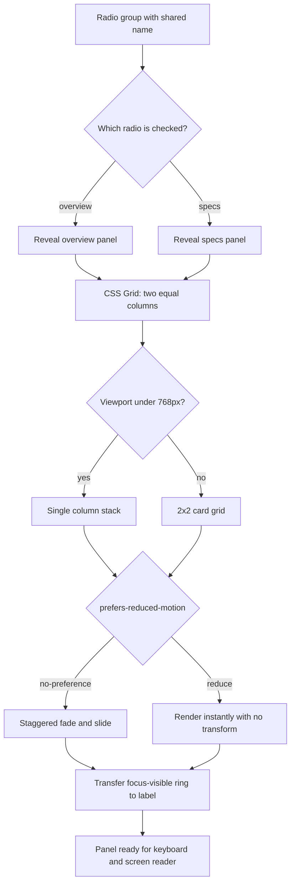

| Difficulty | Channel | Tags |
|---|---|---|
| beginner | frontend | css, flexbox, grid, animations |

In 2013, Apple shipped iOS 7 with parallax, zoom, and motion layered across the entire interface. For many users it felt magical; for others it triggered dizziness, nausea, and vertigo, prompting Apple to add a Reduce Motion setting and later push the web toward a standard way to honor it [1]. That same tension — delight versus discomfort — is hiding inside a beginner CSS interview question: build a tab panel with radio inputs, a 2x2 card grid, a staggered entrance, and no JavaScript. This is the story of how those constraints fit together, and why the smallest line of CSS in the whole exercise may be the one that protects 69 million people [8].

---

> ### Real-World Case — Apple
>
> In 2013, Apple shipped iOS 7 with heavy parallax, zoom, and motion effects throughout the interface. The motion was visually impressive but caused dizziness, nausea, and vertigo for some users, especially those with vestibular disorders. Apple added a Reduce Motion accessibility setting in iOS 7, then worked to give the web a standard way to honor that preference.
>
> | | |
> |---|---|
> | **Challenge** | Decorative UI animation was causing real physical harm, but websites had no standard way to detect that a visitor had asked their operating system to reduce motion. The same risk applies to the staggered fade-and-slide entrance animation in a CSS-only tab panel. |
> | **Solution** | Apple added Reduce Motion to iOS 7, proposed the prefers-reduced-motion media feature to the CSS Working Group in 2014, and shipped it in WebKit/Safari 10.1 in 2017. Developers can now put decorative animations behind @media (prefers-reduced-motion: no-preference) and serve a static or simplified variant when the user opts out. |
> | **Outcome** | Vestibular disorders affect as many as 69 million people in the United States alone. The feature became part of CSS Media Queries Level 5 and is now supported across major browsers; Apple's own site and other sites use it to disable scaling, parallax, and background video motion for users who enable Reduce Motion. |
> | **Lesson** | Motion is an accessibility issue, not just a design preference. Make the animated version opt-in with prefers-reduced-motion: no-preference and keep the default experience fully usable without motion, rather than treating reduced motion as an afterthought. |

---

## Hook — The Interface That Made People Sick

The launch reviews called iOS 7 the biggest change to iOS since the iPhone — and visually, it was. Parallax wallpaper, zoom transitions, and layered motion followed users through nearly every tap. Then the support forums filled with a different kind of review: dizziness, nausea, and vertigo, especially from people with vestibular disorders [1].

Apple responded with a Reduce Motion setting, but the deeper lesson took years to become a web standard. Motion is not neutral decoration. It is an input to the vestibular system, and for some users it is the difference between reading documentation and leaving the page.

💡 **Insight:** The most important animation decision is often whether to animate at all.

That tension is exactly what makes the CSS-only tab question interesting. You get four constraints — no JavaScript, a radio-driven state machine, a responsive card grid, and a stagger — plus one non-negotiable accessibility requirement. How do you satisfy all five without shipping a fragile hack? That question leads straight into the core problem.

## Problem — Four Constraints, One Fragile Selector

Strip away the visual polish and the challenge is a state machine made of form controls. A radio group can hold exactly one selected value, and CSS can react to that value with `:checked`. That is the entire engine [3]. Everything else is layout and respect for the user.

The constraints stack up quickly:

- **State:** radio inputs share a `name`, so only one tab can be active.
- **Presentation:** labels become the clickable tab buttons.
- **Visibility:** sibling selectors show the panel that matches the checked input.
- **Layout:** CSS Grid renders a 2x2 card matrix on desktop and a single column on mobile [4].
- **Media:** every card image locks to a 16:9 box with `aspect-ratio` [5].
- **Motion:** a short fade-and-slide runs with a stagger, but only when the user has not asked for reduced motion [2].
- **Focus:** keyboard users still need a visible ring, even though the real inputs are visually hidden [6].

Here is the real trade-off. JavaScript tabs can manage ARIA state, lazy-load panels, and restore focus. CSS-only tabs cannot do all of that; they trade runtime power for zero JavaScript, instant rendering, and a much smaller failure surface.

| Approach | Wins | Costs |
|---|---|---|
| CSS-only radio tabs | No JS bundle, works before hydration, trivially cacheable | Limited ARIA semantics, markup must be ordered carefully |
| JavaScript tabs | Full tablist semantics, dynamic content, focus management | More code, hydration cost, more ways to break |

Neither option is universally correct. The interview question chooses the CSS-only path on purpose: it forces you to understand the platform instead of reaching for a library. And that path has a famous failure mode — one that a major company already exposed at planetary scale.

## Real-World Case — Apple's iOS 7 Motion Backlash

Apple's iOS 7 launch in 2013 is the canonical example of motion that ignored the body. Parallax and zoom effects were everywhere, and the reaction was immediate: users with vestibular disorders reported dizziness, nausea, and vertigo [1]. Apple added Reduce Motion to iOS 7, then continued investing in the preference across its platforms.

The numbers explain why this mattered beyond a niche complaint. Vestibular disorders affect as many as 69 million people in the United States alone [8]. For that population, a 300-millisecond slide is not a delightful detail; it is a physical event.

Apple's WebKit team later documented the web-side answer: a media feature that lets sites respond to the operating system preference. That feature became part of CSS Media Queries Level 5 [7] and is now supported across major browsers [9]. Apple's own site uses it to disable scaling, parallax, and background video motion when Reduce Motion is on.

⚠️ **Watch Out:** Adding a reduce-motion branch after launch is remediation. Designing the motion gate into the component from the first commit is engineering.

The takeaway is not that animation is bad. It is that animation needs consent. That principle turns the tab panel from a styling exercise into a small accessibility contract — and the contract is enforced by the selectors you choose.

## Deep Dive — Radios, Siblings, and the Focus Ring Nobody Sees

The first plot twist is that the tab pattern is not really about tabs. It is about sibling order. A radio input can only style elements that come after it in the same parent, using the general sibling combinator `~`. The adjacent sibling combinator `+` is the trap: it matches only the very next element, and the next element after the first input is usually a label, not a panel [3].

A robust structure keeps the inputs and labels as siblings, then places one `.tabs__panels` container after them. Each checked input reveals its panel by ID:

```css
#tab-overview:checked ~ .tabs__panels > #panel-overview { display: grid; }
```

That single selector is the whole state machine. The `:checked` pseudo-class reflects the radio group's current value, and `~` lets CSS reach forward to the panel container [3].

**Layout:** the panel is `display: grid` with `repeat(2, minmax(0, 1fr))`, which gives equal columns that can shrink without overflowing [4]. At `max-width: 48rem`, the grid collapses to one column. The `minmax(0, 1fr)` detail matters: without the zero minimum, long titles can force a column wider than its share.

**Images:** `aspect-ratio: 16 / 9` replaces the old padding-top hack and reserves space before the image loads, reducing layout shift [5]. Pair it with `object-fit: cover` so photos fill the box without distortion.

**Motion:** the stagger is just `animation-delay` per card. The important choice is the media query around it. Wrapping the animation in `@media (prefers-reduced-motion: no-preference)` makes motion opt-in rather than opt-out [2]. When a panel switches from `display: none` to `display: grid`, the cards animate again, which makes the tab change feel responsive without extra JavaScript.

**Focus:** the radio inputs are visually hidden, but they still receive keyboard focus. A global `:focus-visible` rule on the input draws a ring around something nobody can see. The fix is to move the ring to the label with a sibling selector [6]:

```css
#tab-overview:focus-visible ~ label[for=tab-overview] { outline: 2px solid currentColor; }
```

That is the nuance most candidates miss. Accessibility is not a separate checklist bolted on at the end; it is a selector decision made in the middle of the layout.

🎯 **Key Point:** CSS-only tabs are a radio group with a visual disguise. Label them honestly, test them with a keyboard, and do not claim ARIA tab semantics the markup cannot deliver.

## Workflow — From Markup Skeleton to Accessible Motion

With the mental model in place, the build becomes a sequence rather than a pile of tricks. The flow below is the same one to follow in a design-system docs page, a code review, or a whiteboard interview.

1. **Define the content contract.** Each tab needs a stable ID, a visible label, and a panel. The first radio starts with `checked` so the page never renders an empty state.
2. **Build the radio skeleton.** Use one `fieldset` with a visually hidden `legend` so the group has an accessible name. Give every radio the same `name` and a unique `id`.
3. **Place labels and panels as siblings.** Keep inputs and labels adjacent in the DOM for focus styling, then put the panels container after them for the `~` selector.
4. **Wire visibility.** Scope each `:checked` rule to a specific input ID and panel ID. Avoid broad selectors that reveal every panel at once.
5. **Lay out the cards.** Use a two-column grid on desktop and a one-column grid below 48rem. Add `minmax(0, 1fr)` to prevent overflow.
6. **Reserve image space.** Apply `aspect-ratio: 16 / 9` to the image wrapper and set intrinsic `width` and `height` on the `img`.
7. **Add motion behind a preference check.** Wrap the stagger in `prefers-reduced-motion: no-preference`, then verify that the reduced path is completely static.
8. **Move the focus ring.** Transfer `:focus-visible` styling from the hidden input to its visible label.
9. **Verify the experience.** Tab through the radios, use arrow keys to switch tabs, zoom to 200%, enable Reduce Motion, and run a screen reader pass.

The flow diagram tells the same story visually: state first, layout second, motion last.

## Code Example — A Copy-Paste Module With Zero Runtime JavaScript

The code below is a copy-paste module for a docs site. It exports markup and CSS as template strings so a build step can inline them; the browser still receives zero runtime JavaScript for the tab behavior itself.

The markup section creates the radio group, the visible labels, and the panel container. Notice that each input sits immediately before its label, which keeps the focus selector simple, while all panels live in one container after the inputs so the general sibling combinator can reach them.

The CSS section does four jobs in order. First, it hides the radios visually without removing them from the accessibility tree or the tab order. Second, it reveals only the panel tied to the checked input. Third, it builds the responsive card grid and locks the image boxes to 16:9. Fourth, it gates the stagger behind `prefers-reduced-motion: no-preference` and moves the focus ring to the label.

One production detail is easy to miss: set `width` and `height` attributes on the images even though CSS controls the final size. The attributes give the browser an intrinsic aspect ratio, which helps the layout stay stable before the image arrives.

💡 **Insight:** The module ships JavaScript to the build, not to the user. That distinction is why the pattern is still legitimately called CSS-only.

## Lessons Learned — The Motion Contract

Here is what the exercise teaches once the syntax is done.

- **Motion needs consent.** The `prefers-reduced-motion: no-preference` wrapper is not extra credit; it is the difference between a polished component and a hostile one [2]. Apple's experience showed that at scale [1].
- **The sibling combinator is the architecture.** If `~` cannot reach the panel, the markup order is wrong. Fix the structure before adding more selectors [3].
- **Hidden inputs still own the keyboard.** Focus styling belongs on the label, not on the invisible radio [6].
- **`aspect-ratio` is the modern answer.** It removes the padding-top hack and keeps image slots stable [5].
- **Use `minmax(0, 1fr)`.** A grid column with a zero minimum prevents long words and titles from forcing horizontal scroll [4].
- **Do not fake ARIA.** A CSS-only radio switcher is not a full tablist implementation. Name it clearly, test it with assistive technology, and use JavaScript tabs when full tab semantics are required.

Battle scars worth avoiding:

- Animating the panel instead of the cards makes the stagger impossible to tune and can cause a flash on slower devices.
- Using `visibility: hidden` to hide panels keeps them in the accessibility tree in some setups; `display: none` is the safer default for inactive panels.
- Forgetting `animation-fill-mode: backwards` causes cards to appear at full opacity during their delay, which defeats the stagger.
- Testing only with a mouse hides the focus bug completely. Keyboard testing is not optional.

🔥 **Hot Take:** Most CSS-only tabs fail not because the selectors are hard, but because the author never tabbed through the result. The fix is a five-minute keyboard test, not a rewrite.

The component is small, but the lesson scales. Every animation, every focus ring, and every hidden input is a promise to the person on the other side of the screen.

---

## CSS-Only Tab Decision Flow



<details>
<summary><strong>Original Interview Question</strong></summary>

**Q:** Build a CSS-only tab panel for a design-system docs page. Use radio inputs to switch tabs (no JavaScript). Desktop: a 2x2 grid of cards under each tab; mobile: single column. Each card has a fixed 16:9 image area, a title, and a short meta line. Add a subtle entrance animation with a stagger and keep focus-visible outlines; ensure prefers-reduced-motion is respected?

**A:** Use a set of radio inputs with a shared `name` attribute and corresponding `` elements for each tab section. The `:checked` state of each radio controls visibility of its associated panel via adjacent sibling selectors. Each panel renders a 2×2 card grid on desktop and collapses to a single column on mobile. Cards use `aspect-ratio: 16/9` for fixed image containers, with a title and meta line below.

</details>

## Conclusion

Apple's iOS 7 story is often remembered as a design milestone, but its real legacy is a question every interface must answer: who gets to opt out of motion? [1] The CSS-only tab panel is a tiny version of that question. Radio inputs provide the state, sibling selectors provide the switching, CSS Grid provides the responsive layout, `aspect-ratio` protects the image slots, and `prefers-reduced-motion` protects the user.

Tomorrow, before shipping any animated component, add the preference check and move the focus ring to the element people can actually see. Then tab through it once. That is the whole transformation: from a clever demo to a component that respects the body on the other side of the glass.

The memorable insight to share with your team: the best animation is the one the user asked for, and the best tab is the one that works with a keyboard, a screen reader, and a vestibular system that says not today.

---

## References

1. [Apple incident report](https://webkit.org/blog/7551/responsive-design-for-motion/) — article
2. [MDN: prefers-reduced-motion](https://developer.mozilla.org/en-US/docs/Web/CSS/@media/prefers-reduced-motion) — documentation
3. [MDN: :checked pseudo-class](https://developer.mozilla.org/en-US/docs/Web/CSS/:checked) — documentation
4. [MDN: CSS Grid Layout](https://developer.mozilla.org/en-US/docs/Web/CSS/CSS_grid_layout) — documentation
5. [MDN: aspect-ratio](https://developer.mozilla.org/en-US/docs/Web/CSS/aspect-ratio) — documentation
6. [MDN: :focus-visible](https://developer.mozilla.org/en-US/docs/Web/CSS/:focus-visible) — documentation
7. [W3C Media Queries Level 5](https://www.w3.org/TR/mediaqueries-5/) — documentation
8. [Wikipedia: Balance disorder](https://en.wikipedia.org/wiki/Balance_disorder) — article
9. [Can I use: prefers-reduced-motion](https://caniuse.com/prefers-reduced-motion) — documentation
10. [MDN: Using CSS animations](https://developer.mozilla.org/en-US/docs/Web/CSS/CSS_animations/Using_CSS_animations) — documentation

---

**Author:** Satishkumar Dhule — [GitHub](https://github.com/satishkumar-dhule) · [LinkedIn](https://linkedin.com/in/satishkumar-dhule) · [Website](https://satishkumar-dhule.github.io)
