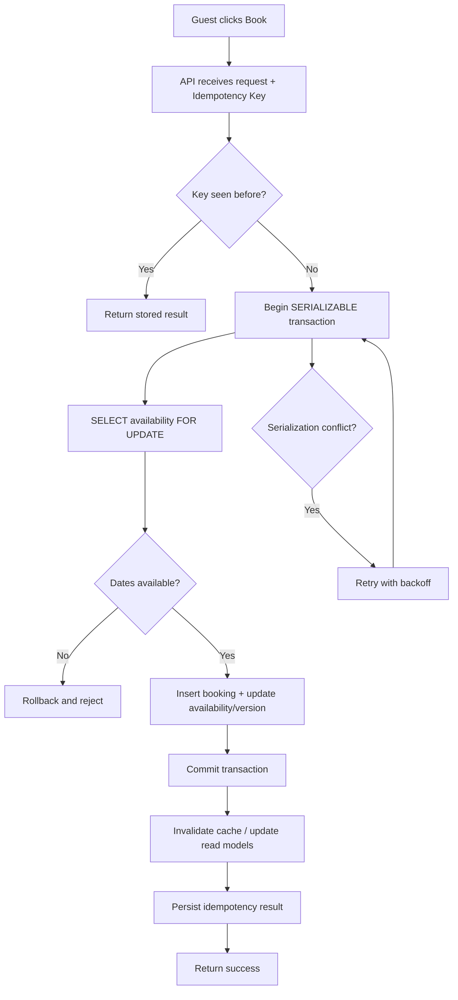

| Difficulty | Channel | Tags |
|---|---|---|
| intermediate | database | acid, isolation-levels, mvcc |

Picture this: a guest taps “Book” on their dream stay, the spinner hangs, they tap again—and your system quietly processes the same reservation twice. Airbnb faced this exact risk in its reservation booking flow, where double clicks, mobile retries after timeouts, or lost responses could send the same payment request through multiple services, risking duplicate charges to guests and duplicate payouts to hosts [1]. For developers building high-availability booking systems, preventing double bookings is not just a database trick—it is a full-stack reliability challenge. This is the story of how teams move from fragile flows to trustworthy, exactly-once outcomes.

---

> ### Real-World Case — Airbnb
>
> Airbnb's reservation booking flow spans a service-oriented payments platform. When a guest clicks 'Book' twice, a mobile client retries after a timeout, or a response is lost in transit, the same booking/payment request can hit multiple services and be executed more than once, risking duplicate charges to guests and duplicate payouts to hosts.
>
> | | |
> |---|---|
> | **Challenge** | Make booking and payment writes exactly-once (at-most-once money movement) across distributed services without holding long database locks or sacrificing latency. A retried request must not create a second financial transaction, and the system must remain correct even when a response is lost after the downstream work already succeeded. |
> | **Solution** | Airbnb built Orpheus, a generic idempotency library. Clients send an idempotency key; the service acquires a database row-level lock on that key as an expiring lease, and all idempotency reads/writes go to a sharded master database rather than a replica. Pre/post-RPC database work is collapsed into single atomic transactions, network calls are kept out of transactions, and errors are classified as retryable or non-retryable. Duplicate requests either return the stored response or are blocked until the lease expires. |
> | **Outcome** | Orpheus was rolled out across multiple Airbnb payments services, giving reservation-related money movement exactly-once semantics and preventing duplicate charges and payouts from double clicks, retries, and lost responses. The master-only idempotency store also eliminated replica lag as a source of duplicate processing, while the in-process library design kept latency low enough for the payments hot path. |
> | **Lesson** | A database transaction gives you atomicity, not mutual exclusion: two concurrent requests can still both pass an availability check at READ COMMITTED. Correctness has to be enforced at the write boundary with an atomic claim (row lock, conditional write, or constraint). And when that claim is an idempotency check, never read it from a lagging replica—stale reads can resurrect an already-processed request as a duplicate. |

---

## Hook — The moment a retry becomes a disaster

It is late, traffic is spiking, and a property has one open weekend left. A user retries because the network hiccups, and suddenly two requests race toward the same inventory. Sound familiar? Building on this tension, the real fear is not just a bad user experience—it is money moving twice and trust evaporating once. Distributed systems make retries inevitable, so the question becomes: how do you design for them instead of praying they never happen [2]?

## Problem — Why booking systems are a race condition magnet

Booking inventory is a scarce, time-bound resource: the same dates cannot be sold twice. However, high availability architectures replicate data, split responsibilities across services, and embrace retries for resilience, which creates windows where concurrent requests see the same “available” state. Therefore, developers must balance correctness (no double bookings) with performance (fast checks and confirmations). You are fighting lost updates, partial failures, and ambiguous client outcomes all at once—classic challenges in transaction processing and concurrency control [3][4].

## Real-World Case — Airbnb

At Airbnb, the reservation booking flow spans a service-oriented payments platform. When a guest clicked “Book” twice, a mobile client retried after a timeout, or a response was lost in transit, the same booking or payment request could hit multiple services and be executed more than once [1]. This led to the risk of duplicate charges to guests and duplicate payouts to hosts. Consequently, Airbnb rolled out Orpheus across multiple payments services to provide exactly-once semantics for reservation-related money movement, prevented duplicates from double clicks and retries, eliminated replica lag as a source of duplicate processing with a master-only idempotency store, and kept latency low enough for the payments hot path through an in-process library design [1].

## Deep Dive — Transactions, isolation, and idempotency working together

This leads to a layered defense. At the database level, strong isolation such as SERIALIZABLE can prevent concurrent transactions from producing anomalies, while optimistic concurrency control detects conflicts via version checks and retries safely [3][5]. Specifically, Multi-Version Concurrency Control (MVCC) lets readers see consistent snapshots without blocking every read, but write-write conflicts on the same inventory rows still need careful handling [4]. Moreover, database guarantees alone are not enough in distributed flows: you need application-level idempotency keys so retried requests map to the same logical operation, a principle echoed in reliable API and payment design [6]. For hot properties, teams often combine row-level locks (e.g., locking specific date ranges), read replicas for fast availability browsing, and write-through cache invalidation on successful bookings to keep latency low without sacrificing correctness [7][8].

## Workflow — From availability check to confirmed booking

Building on these concepts, a resilient booking workflow separates cheap reads from authoritative writes. First, show availability from replicas or cached views for speed. Then, on confirmation, route the request through an idempotent API that records a unique request key. Next, start a transaction that locks the target date rows, re-validates availability, writes the booking, and commits atomically. If a conflict or serialization failure occurs, retry with exponential backoff and jitter; if the client retries the same request, return the original result instead of reprocessing [2][6]. The diagram below illustrates this flow, including conflict detection and idempotent replay handling [1][5].

## Code Example — Locking dates and retrying safely

Here is a simplified Python example showing the core idea: acquire row-level locks on the relevant availability rows, verify they are free, create the booking, and retry on transient serialization conflicts. In production, you would also persist and check an idempotency key before entering the critical section to guarantee exactly-once effects across retries [1][6].

Key points to notice: the `FOR UPDATE` clause prevents concurrent writers from claiming the same dates, the version/timestamp checks support optimistic patterns, and bounded retries with backoff reduce thundering-herd failures under contention [2][5].

## Lessons Learned — What to do differently tomorrow

The journey comes back to where it started: retries are normal, but duplicate side effects do not have to be. Teams that succeed combine strong transactional boundaries, conflict-aware retries, and idempotent request handling so the system stays correct even when networks misbehave [1][2]. Watch out for hot inventory that amplifies lock contention—monitor wait times, add circuit breakers, and consider partitioning strategies when needed [7]. If this feels overwhelming, you are not alone; many developers discover that reliability is a set of reinforcing layers, not a single switch. The memorable takeaway: design every booking path as if the same request will arrive twice—because eventually, it will.

---

## Idempotent Booking Flow

<strong>Original Interview Question</strong>

**Q:** You're building a booking system for Airbnb where multiple users can reserve the same property simultaneously. How would you design the transaction handling to prevent double bookings while maintaining high availability?

**A:** Use SERIALIZABLE isolation with optimistic concurrency control. Implement row-level locks on property availability tables, use MVCC snapshot reads for checking availability, and apply application-level validation to ensure atomic booking operations.

## Conclusion

Double bookings happen when systems trust timing instead of designing for it. By combining strong transaction isolation, row-level locking, idempotent request handling, and disciplined retries, you can protect both inventory and customer trust—even under timeouts and duplicate clicks. Tomorrow, audit one critical write path in your service: if the same request arrives twice, will your system do the right thing once, or the wrong thing twice?

---

## References

1. [Airbnb incident report](https://medium.com/airbnb-engineering/avoiding-double-payments-in-a-distributed-payments-system-2981f6b070bb) — article
2. [Exponential backoff](https://en.wikipedia.org/wiki/Exponential_backoff) — documentation
3. [Isolation (database systems)](https://en.wikipedia.org/wiki/Isolation_(database_systems)) — documentation
4. [Multiversion concurrency control](https://en.wikipedia.org/wiki/Multiversion_concurrency_control) — documentation
5. [PostgreSQL Transactions](https://www.postgresql.org/docs/current/tutorial-transactions.html) — documentation
6. [Idempotence](https://en.wikipedia.org/wiki/Idempotence) — documentation
7. [How To Use Row-Level Locks in PostgreSQL](https://www.digitalocean.com/community/tutorials/how-to-use-row-level-locks-in-postgresql) — blog
8. [Amazon ElastiCache Caching Strategies](https://docs.aws.amazon.com/AmazonElastiCache/latest/dg/Strategies.html) — documentation

---

**Author:** Satishkumar Dhule — [GitHub](https://github.com/satishkumar-dhule) · [LinkedIn](https://linkedin.com/in/satishkumar-dhule) · [Website](https://satishkumar-dhule.github.io)
