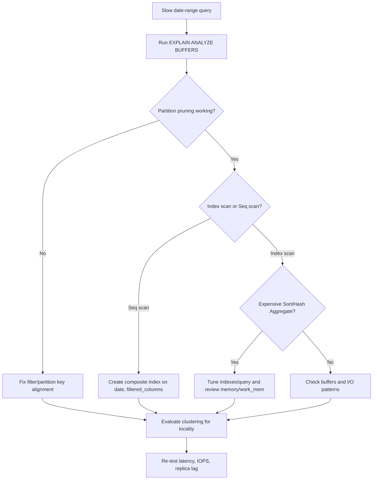

| Difficulty | Channel | Tags |
|---|---|---|
| intermediate | database | explain, query-plan, partitioning |

In 2024, CoinGecko's PostgreSQL table storing eight years of hourly crypto prices grew past 1TB. Average queries took over 30 seconds, IOPS alerts fired daily even after provisioned IOPS was raised to 24K, and replica lag began threatening their SLO/SLA [1]. If you have ever watched a "simple" date-range query stall on a massive partitioned table, you know the sinking feeling. This is the story of how developers can trace that slowdown, read the clues in an EXPLAIN plan, and turn a struggling query into a fast, predictable one.

---

> ### Real-World Case — CoinGecko
>
> CoinGecko's PostgreSQL table storing eight years of hourly crypto prices grew past 1TB. Average queries took over 30 seconds, IOPS alerts fired daily even after provisioned IOPS was raised to 24K, and replica lag began threatening their SLO/SLA.
>
> | | |
> |---|---|
> | **Challenge** | Date-range price lookups on the single monolithic table were saturating I/O and hurting API latency. Adding indexes was attempted first but did not solve it because the queries also filtered on keys inside a JSONB currency column, making per-application indexes impractical. |
> | **Solution** | They range-partitioned the prices table by month to match the timestamp-range access pattern, migrated roughly 1.2TB with dual-write triggers and a foreign-data-wrapper copy to avoid cold-cache IOPS spikes, and prewarmed partitions with pg_prewarm. Critically, after the switch they used EXPLAIN-driven investigation to find queries missing a lower or upper date bound, which forced scans across all partitions, and rewrote those queries to constrain the partition key. |
> | **Outcome** | p99 response time dropped from 4.13s to 578ms, an ~86% reduction. IOPS fell 20%, replica lag disappeared immediately after the switch, and their dry run measured 6-8x faster queries on the partitioned table. |
> | **Lesson** | Partitioning only helps when the WHERE clause constrains the partition key at both ends. An unbounded predicate like 'created_at > ?' can scan every partition and actually perform worse than the original unpartitioned table, which is exactly why verifying partition pruning in EXPLAIN is the first diagnostic step. |

---

## Hook — A Date Filter That Should Be Fast

Picture a dashboard that asks for one month of completed events from a 100M-row table partitioned by date. On paper, it should scan only the relevant partitions and return in milliseconds. In reality, the query drags, dashboards time out, and on-call engineers start refreshing metrics. Building on CoinGecko's experience, the stakes are clear: slow queries do not just annoy users, they burn IOPS, inflate costs, and put reliability targets at risk [1].

## Problem — Why Partitioning Alone Is Not Enough

Partitioning can dramatically reduce the amount of data scanned, but only when the planner can eliminate irrelevant partitions and use efficient access paths [2][5]. However, teams often assume partitioning is a magic fix. If partition pruning fails, indexes are ignored, or the executor performs expensive sorts and aggregates, PostgreSQL may still read far more data than necessary. Therefore, the real challenge is not just having partitions—it is proving the database is using them the way you expect.

## Real-World Case — CoinGecko

CoinGecko faced exactly this kind of scale pressure as its hourly crypto price table crossed 1TB. Queries averaged more than 30 seconds, daily IOPS alerts persisted despite raising provisioned IOPS to 24K, and replica lag threatened service commitments [1]. Consequently, performance tuning became a reliability issue, not just an optimization exercise. After revisiting their partitioning strategy, their dry run measured 6-8x faster queries on the partitioned table, p99 response time dropped from 4.13s to 578ms (~86% reduction), IOPS fell 20%, and replica lag disappeared immediately after the switch [1].

## Deep Dive — Reading the EXPLAIN Plan Like a Detective

This leads to the most important diagnostic tool: `EXPLAIN (ANALYZE, BUFFERS)`. First, verify partition pruning by checking that only the expected partitions appear in the plan; if many partitions remain, the filter may not align with the partition key or may be written in a way the planner cannot prune effectively [2][3]. Next, compare index scans to sequential scans—large seq scans on targeted partitions often signal missing or unusable indexes [3]. Moreover, look for expensive Sort or Hash Aggregate nodes, which can dominate runtime on wide date ranges. Specifically, if queries filter on both date and another column like status, a composite index can help PostgreSQL find matching rows without scanning and sorting excess data [4][6].

## Workflow — Step-by-Step Optimization Path

Building on those clues, a practical workflow emerges: reproduce the slow query with `EXPLAIN (ANALYZE, BUFFERS)`, confirm pruning, inspect scan types, and identify costly operators. Then create a composite index such as `(event_date, status)` to match the WHERE clause, ideally with `CONCURRENTLY` to reduce locking impact in production [4]. Finally, evaluate clustering or physical ordering strategies when range scans benefit from data locality, while remembering that clustering is a maintenance decision with trade-offs [7]. The diagram below maps this investigation flow from symptom to solution.

## Code Example — Diagnose, Index, and Re-test

For example, developers can start by capturing the real execution plan, then add an index that matches the query pattern and re-run the analysis. The goal is not guesswork; it is measurable improvement in scanned buffers, execution time, and stability [3][4][8].

After applying changes, compare before-and-after plans to confirm fewer partitions scanned, better index usage, and reduced sort or I/O cost. Sound familiar? Small schema-aware fixes often beat throwing more hardware at the problem.

## Lessons Learned — What to Do Tomorrow

The journey from CoinGecko's 30-second queries to sub-second p99 latency highlights a timeless lesson: partitioning is a foundation, not a finish line [1][5]. Many developers think more partitions automatically mean faster queries until they learn pruning, indexing, and execution plans must work together. Here is the thing though—teams that routinely inspect `EXPLAIN (ANALYZE, BUFFERS)` catch regressions before users do [3]. If this feels overwhelming, you are not alone; start with one slow query, validate each hypothesis, and let the plan guide the fix. Ever wondered why a "small" missing index can feel like a production outage? Because at 100M rows, tiny inefficiencies scale brutally.

---

## Query Optimization Flow

<strong>Original Interview Question</strong>

**Q:** You have a PostgreSQL table with 100M rows partitioned by date. A query filtering on a specific date range is still slow. What would you check in the EXPLAIN plan and how would you optimize it?

**A:** Check partition pruning effectiveness, index utilization patterns, and expensive sort operations. Create composite indexes on (date, filtered_columns) and evaluate clustering strategies for optimal data access.

## Conclusion

So what should you do tomorrow? Pick one slow date-range query, run `EXPLAIN (ANALYZE, BUFFERS)`, and prove whether pruning, indexing, or sorting is the real culprit. CoinGecko's turnaround shows that disciplined diagnosis can unlock massive gains without guesswork. The memorable insight: in large PostgreSQL tables, performance is rarely about one feature—it's about whether the planner's path matches your query's reality.

---

## References

1. [CoinGecko incident report](https://dev.to/coingecko/scaling-postgresql-performance-with-table-partitioning-136o) — blog
2. [PostgreSQL Documentation: Table Partitioning](https://www.postgresql.org/docs/current/ddl-partitioning.html) — documentation
3. [PostgreSQL Documentation: Using EXPLAIN](https://www.postgresql.org/docs/current/using-explain.html) — documentation
4. [PostgreSQL Documentation: Multicolumn Indexes](https://www.postgresql.org/docs/current/indexes-multicolumn.html) — documentation
5. [Wikipedia: Partition (database)](https://en.wikipedia.org/wiki/Partition_(database)) — documentation
6. [PostgreSQL Documentation: CREATE INDEX](https://www.postgresql.org/docs/current/sql-createindex.html) — documentation
7. [PostgreSQL Documentation: CLUSTER](https://www.postgresql.org/docs/current/sql-cluster.html) — documentation
8. [PostgreSQL Documentation: Performance Tips](https://www.postgresql.org/docs/current/performance-tips.html) — documentation

---

**Author:** Satishkumar Dhule — [GitHub](https://github.com/satishkumar-dhule) · [LinkedIn](https://linkedin.com/in/satishkumar-dhule) · [Website](https://satishkumar-dhule.github.io)
