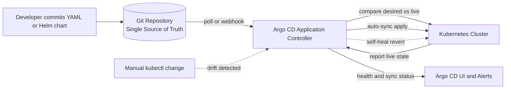

| Difficulty | Channel | Tags |
|---|---|---|
| beginner | devops | argocd, flux, declarative |

Somewhere inside Intuit's platform team, a canary rollout stalls halfway through, and nobody can tell which scripted step left the cluster in a half-configured state [1]. That single moment of blind panic is why thousands of engineering teams abandoned imperative deployment scripts in favor of declarative GitOps with Argo CD. By the end of this story, you will understand the reconciliation loop that makes clusters self-healing, the real tradeoff between declarative and imperative approaches, and how to wire it all up without shipping a 3 a.m. surprise of your own [1].

---

> ### Real-World Case — Intuit
>
> In 2018 Intuit began migrating thousands of services to Kubernetes, but deployments were driven by imperative scripts that executed step-by-step commands. When a canary or blue-green rollout failed, engineers had to manually figure out which step broke and write compensating steps, and even successful deployments gave no way to verify the live cluster actually matched the intended state.
>
> | | |
> |---|---|
> | **Challenge** | Imperative deployment scripts made complex rollouts hard to debug, impossible to audit, and prone to latent configuration drift that only surfaced later under changing load or environmental conditions. Intuit needed a way to make the desired state of thousands of applications verifiable, consistent, and automatically reconciled across 100+ multi-tenant clusters. |
> | **Solution** | Intuit developed Argo CD, a declarative GitOps continuous-delivery controller for Kubernetes. Each application is defined as an Application CRD pointing at a Git repository containing manifests, Helm charts, or Kustomize overlays; Argo CD continuously diffs the live cluster against Git and auto-syncs to the declared state, with self-healing to revert manual drift. Git became the single source of truth, so Jenkins only promoted an image tag via a commit and never needed cluster credentials. |
> | **Outcome** | Intuit reported deployment time down 80%, rollbacks under 10 minutes, and roughly 500,000 developer hours saved annually (about 57 developer-years). The platform scaled to monitoring around 2 million constantly changing Kubernetes resources reconciled from several thousand Git repositories, and Argo CD was open-sourced and adopted by 170+ companies including Red Hat, Tesla, and Ticketmaster. |
> | **Lesson** | The win came not from automating imperative steps faster, but from changing the model: declaring the desired state in Git and letting a controller continuously reconcile reality to it. That makes every change auditable and every rollback a revert, and it eliminates the entire class of 'which step failed?' deployment failures. |

---

## Hook — When the Deployment Script Lies to You

Picture the worst kind of deployment failure: the one that reports success. A pipeline runs 22 steps, finishes green, and the dashboard says everything is healthy. Then a customer hits an endpoint and gets a 503 because step 14 quietly skipped a ConfigMap. This is the special horror of imperative deployment scripting — the script describes the journey, not the destination, so a successful execution says nothing about whether the cluster actually matches what you intended [1]. Intuit lived this at scale when it began migrating thousands of services to Kubernetes in 2018 [1]. The deployments worked until they did not, and when they broke, engineers had to reverse-engineer a sequence of commands to figure out where reality diverged from intent. That is not a tooling inconvenience. That is a reliability tax paid on every incident, and it compounds as your service count grows.

## Problem — The Destination Was Never Written Down

Here is the uncomfortable truth: with imperative deployments, the desired state of your system lives in someone's head, a runbook, or a CI log. Commands like kubectl set image or kubectl scale mutate the cluster directly, so the only record of what happened is the shell history of whoever ran them [5]. Consequently, three painful things follow. First, configuration drift becomes invisible — staging and production diverge one hotfix at a time, and nobody notices until a bug only reproduces in prod. Second, rollbacks are guesswork, because undoing an imperative change requires writing a compensating command and hoping it perfectly inverts the original. Third, audits become archaeology, since the cluster no longer has a trustworthy source of truth [3]. You might think this is just a process problem that better documentation solves. It is not. Documentation rots the moment a human is on call at 2 a.m., while a Git commit is immutable, reviewable, and timestamped.

## Real-World Case — Intuit Bet the Platform on Git as the Source of Truth

Intuit's migration is the clearest documented case of this problem and its cure. As thousands of services moved to Kubernetes, imperative scripts made failed canary and blue-green rollouts a forensic exercise: engineers had to identify the broken step and hand-write compensating steps, and even successful deploys gave no way to verify the live cluster matched intent [1]. Intuit's platform team flipped the model so that Git declared the desired state and a controller continuously reconciled the cluster toward it. The results were not marginal. Intuit reported deployment time down 80 percent, rollbacks completed in under 10 minutes, and roughly 500,000 developer hours saved annually — about 57 developer-years [1]. The platform grew to reconcile around 2 million constantly changing Kubernetes resources from several thousand Git repositories, and the tool at the center of it, Argo CD, was open-sourced and adopted by 170+ companies including Red Hat, Tesla, and Ticketmaster [1]. That is the transformation this article unpacks.

## Deep Dive — Declarative vs Imperative, and Why the Loop Wins

The distinction sounds academic until you see it operating. In the imperative model, you issue commands and the cluster moves through a sequence of intermediate states that only your script understands [5]. In the declarative model, you commit the complete desired end state as YAML, Helm charts, or Kustomize overlays, and a controller like Argo CD continuously compares desired versus live, then acts to close the gap [2][4]. That comparison is the reconciliation loop, the same control-plane pattern Kubernetes itself uses for built-in resources [9]. The loop is what delivers self-healing: if someone runs a manual kubectl change, the live state diverges, Argo CD detects the drift and reverts it unless the change is disabled or the drift is explicitly ignored [6]. Here is the real tradeoff table developers should internalize:

| Dimension | Imperative (kubectl scripts) | Declarative (GitOps with Argo CD) |
| --- | --- | --- |
| Source of truth | Shell history / runbook | Git repository [3] |
| Drift detection | Manual, usually after an incident | Continuous, automated [2] |
| Rollback | Compensating commands, error-prone | Revert a commit, controller reconciles [1] |
| Audit trail | CI logs, often incomplete | Immutable commits and PR reviews |
| Review process | None by default | Pull request review before merge |
| Best fit | One-off debugging, emergencies | Repeatable multi-service deployments |

🔥 Hot Take: imperative commands are not evil — kubectl is still the fastest way to debug a live pod. The mistake is letting imperative commands become your deployment mechanism. Use them for investigation, never for state you expect to persist. The declarative approach also gives you prune and self-heal semantics, which is where teams get their first real taste of a cluster that defends its own intended state [6]. Prune deletes resources removed from Git; self-heal reverts manual drift. Together they turn Git into an enforceable contract rather than a suggestion.

## Workflow — Wiring the Reconciliation Loop

Building on the loop concept, the setup follows a predictable sequence that maps directly to the diagram below. First, store your manifests or Helm charts in a Git repository that becomes the single source of truth [3]. Second, install Argo CD into its own namespace and connect it to that repository. Third, define an Application custom resource that points at the repo, revision, and path [7]. Fourth, enable automated sync with prune and self-heal so the controller both applies new commits and repairs drift [6]. Fifth, set a sensible health check interval — a few minutes is typical, and three minutes is a common production choice because it balances responsiveness against API server load. Sixth, watch the sync and health status in the UI or CLI, and alert on OutOfSync or Degraded rather than on pod restarts alone. The diagram tells the visual story: commits flow from Git into the Application controller, the controller compares desired state against the live cluster, and any manual kubectl drift gets pulled back into line.

## Code Example — A Production-Shaped Application CRD

The code below is the heart of the setup: an Argo CD Application that declares where the desired state lives and how aggressively the controller should enforce it. Notice the automated block — prune removes resources deleted from Git, and selfHeal reverts manual cluster changes [6]. The retry block prevents a transient API error from leaving you in a permanently failed sync, and CreateNamespace lets the controller bootstrap the target namespace. The final commands demonstrate the payoff: you force a sync, wait for health, then deliberately scale a deployment by hand and watch the controller drag the cluster back to the declared state. That last step is the moment most developers finally believe the model — the cluster corrects you, not the other way around.

## Lessons Learned — What to Carry Into Your Next Deploy

The journey from imperative scripts to declarative GitOps is less about a tool and more about a contract: Git says what should exist, and the controller makes it so. Keep these lessons close. 

- 🎯 Key Point: Treat Git as the only path to production. If a change cannot be expressed as a commit, it should not reach the cluster [3].
- ⚠️ Watch Out: enabling selfHeal without understanding prune can delete resources you forgot were managed. Stage the rollout per application, not all at once [6].
- 💡 Insight: Pin targetRevision to a branch for continuous delivery, but pin to tags or commit SHAs for regulated environments where reproducibility matters more than freshness.
- 🔥 Hot Take: alerts on pod restarts are noise. Alert on OutOfSync duration and Degraded health — those are the signals that the contract is being violated [2].
- 🎯 Key Point: use Helm or Kustomize overlays for environment differences instead of forking manifests. Divergence in structure is where drift sneaks back in [4].
- ⚠️ Watch Out: imperative kubectl debugging is fine, but any fix that must persist belongs in a pull request. Otherwise the next self-heal cycle will erase your heroics.

If this feels overwhelming, you are not alone — most teams start with a single non-critical service, prove the loop, then expand. That incremental path is exactly how a 2-million-resource platform gets built without a big-bang rewrite [1].

---

## GitOps Reconciliation Loop

<strong>Original Interview Question</strong>

**Q:** You're setting up GitOps for a microservices deployment. How would you configure ArgoCD to automatically sync changes from your Git repository to Kubernetes, and what's the difference between declarative and imperative approaches in this context?

**A:** I'd configure ArgoCD by setting up a Git repository containing Kubernetes manifests or Helm charts, creating an Application CRD that points to the Git repository, enabling auto-sync with a health check interval of 3 minutes, and implementing self-healing to automatically revert any manual changes. The declarative approach involves defining the desired state in Git through YAML manifests, Helm charts, or Kustomize configurations, where ArgoCD continuously reconciles the actual state with the desired state. In contrast, the imperative approach uses kubectl commands to make direct changes to the cluster, bypassing the Git repository as the single source of truth.

## Conclusion

The moral of Intuit's story is simple and a little ruthless: if your deployment process cannot survive someone running kubectl by hand, it is not a process — it is a hope [1]. Declarative GitOps replaces that hope with a loop that never stops checking, so rollbacks become reverts, drift becomes visible, and audits become a git log away. Tomorrow, pick one non-critical service, put its manifests in Git, wire up an Argo CD Application with prune and selfHeal enabled, and then deliberately break it with kubectl. Watching the cluster heal itself will teach you more than any runbook. The one insight worth sharing with your team: in GitOps, the cluster is not something you change — it is something that converges.

---

## References

1. [Intuit incident report](https://blogs.intuit.com/2021/03/16/deploy-code-faster-with-new-innovation/) — article
2. [Argo CD Documentation](https://argo-cd.readthedocs.io/en/stable/) — documentation
3. [GitOps — Wikipedia](https://en.wikipedia.org/wiki/GitOps) — documentation
4. [Kubernetes: Declarative Management of Kubernetes Objects Using Configuration Files](https://kubernetes.io/docs/tasks/manage-kubernetes-objects/declarative-config/) — documentation
5. [Kubernetes: Managing Kubernetes Objects Using Imperative Commands](https://kubernetes.io/docs/tasks/manage-kubernetes-objects/imperative-command/) — documentation
6. [Argo CD: Automated Sync Policy](https://argo-cd.readthedocs.io/en/stable/user-guide/auto_sync/) — documentation
7. [argoproj/argo-cd on GitHub](https://github.com/argoproj/argo-cd) — documentation
8. [fluxcd/flux2 on GitHub](https://github.com/fluxcd/flux2) — documentation
9. [Kubernetes: Controllers](https://kubernetes.io/docs/concepts/architecture/controller/) — documentation
10. [OpenGitOps Principles](https://opengitops.dev/) — documentation

---

**Author:** Satishkumar Dhule — [GitHub](https://github.com/satishkumar-dhule) · [LinkedIn](https://linkedin.com/in/satishkumar-dhule) · [Website](https://satishkumar-dhule.github.io)
