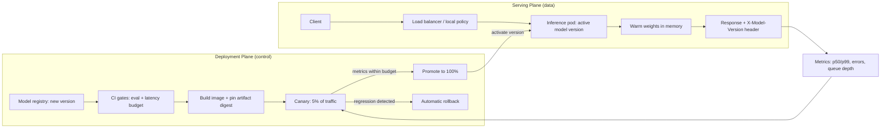

| Difficulty | Channel | Tags |
|---|---|---|
| beginner | devops | mlops, deployment |

A model that takes 30 ms to run still misses its latency budget when a shared routing layer adds 10 to 20 ms of serialization and extra network hops to every call. Netflix found that out at scale: its Switchboard service gave more than 30 clients a single entry point for model routing and experimentation, then became a latency tax, a tail-latency amplifier, and a single point of failure [1]. The fix was not to stop experimenting — it was to stop making every request pay for a control-plane decision. That distinction, between deployment and serving, is the whole story.

---

> ### Real-World Case — Netflix
>
> As Netflix's ML serving platform scaled, it relied on Switchboard as a centralized entry point to route client requests to the right models and apply experimentation/config rules across 30+ service clients. While this abstraction sped up model iteration, putting a routing service in the critical request path created operational and performance issues in production.
>
> | | |
> |---|---|
> | **Challenge** | How to decouple model deployment/configuration concerns (model selection, sharding, experimentation, rollout control) from low-latency model serving, without introducing a single point of failure or unacceptable inference latency. |
> | **Solution** | Netflix evolved from Switchboard to Lightbulb: instead of proxying requests through a central router, it decoupled routing/experimentation metadata from the live request path and integrated it with Envoy for client-side/data-plane routing. This preserved a common client abstraction and flexible traffic routing while removing the extra routing hop from serving. |
> | **Outcome** | Switchboard had added 10–20ms of latency per request due to serialization/deserialization and extra network hops, exposed requests to tail-latency amplification, and posed a single point of failure that could degrade or disable multiple ML-powered experiences. The new architecture aimed to eliminate that hop and availability risk while retaining fast experimentation and decoupled client/model evolution. |
> | **Lesson** | Model deployment and model serving are distinct layers: deployment/orchestration manages config, rollout, and experimentation, but placing those controls in the synchronous serving path can become a latency and reliability bottleneck. Separating control-plane routing metadata from data-plane inference improves scalability and resilience. |

---

## Hook — The 15 Milliseconds Nobody Put in the Budget

Start with a mental model of a healthy inference call. A request arrives, your service deserializes a small payload, runs a forward pass that takes 30 ms, and returns a score. Your p99 budget is 100 ms, so you have room to breathe.

Now insert a convenience: a central routing service sitting between every client and every model. It reads experiment configuration, decides which model version should answer, serializes the request again, forwards it, and serializes the response on the way back. That convenience costs 10 to 20 ms per call — a fifth of your entire budget, spent on plumbing instead of prediction [1].

This is not hypothetical. It is the arc of Netflix's model serving platform. Switchboard gave teams one centralized entry point that routed client requests to the right model and applied experimentation and configuration rules across more than 30 service clients [1]. Model iteration got faster. Then the bill came due in latency, tail amplification, and availability risk.

The interesting part is not that Netflix removed a hop. It is why the hop existed in the first place — and what that reveals about the line between deployment and serving.

## Problem — Two Words Teams Use Interchangeably, and Pay For

Deployment and serving get used as synonyms in standups, job posts, and architecture diagrams. They are not synonyms, and the gap between them is where production incidents breed [2].

Deployment is the control plane. It answers: what artifact should exist, where should it run, who approved it, and how do we get back to the previous state? That means CI/CD pipelines, infrastructure as code, container images, environment promotion, and rollback strategy [3].

Serving is the data plane. It answers: given a request right now, which model runs, how fast, and what happens when traffic quadruples? That means inference runtimes, request routing, model loading, batching, autoscaling, and version-aware responses [5][6][7].

When teams blur the two, a predictable set of failures follows:

- **Budget confusion.** Latency SLOs get assigned to the serving team, but the extra hop was introduced by a deployment-platform decision.
- **Rollback that rolls back the wrong thing.** Restarting a pod restores the process, not the model weights, unless versioning is a first-class serving concern.
- **Autoscaling on the wrong signal.** CPU-based scaling misses GPU memory pressure and queue depth, so pods look healthy while requests pile up [4].
- **Cold start blindness.** A deployment that scales to zero looks cheap until the first request after idle pays the full model-load tax.

The cost is rarely one dramatic outage. It is a slow accumulation of milliseconds and ownership gaps — precisely the trap Netflix walked into at scale.

## Real-World Case — Netflix and the Router in the Critical Path

Netflix's model serving platform grew into a mesh of models, clients, and experiments. To keep that mesh manageable, the team used Switchboard as a centralized entry point: client requests landed there, and Switchboard applied routing, experimentation, and configuration rules before sending work to the right model, spanning more than 30 service clients [1].

The benefits were real. Clients did not need to redeploy every time a model changed. Experiments could be configured centrally. Model evolution and client evolution decoupled, which is exactly the leverage a platform team is supposed to create.

The costs were also real, and they compounded:

- **Latency tax:** 10 to 20 ms added per request from serialization and deserialization plus the extra network hops [1][12].
- **Tail-latency amplification:** a router that fans out to model backends inherits the slowest dependency, so the router's p99 can be worse than the p99 of any single backend [1][10].
- **Single point of failure:** one centralized component in the critical path meant a degradation there could degrade or disable multiple ML-powered experiences at once [1].

⚠️ Watch Out: this is the classic abstraction trade-off. A shared routing layer buys consistency and speed of iteration, and charges rent on every request in the form of latency, coupling, and blast radius. The rent is invisible in a design review and glaringly obvious on a p99 dashboard.

Netflix's response was not to abandon experimentation. The new architecture aimed to remove the extra hop and the availability risk while keeping fast experimentation and decoupled client/model evolution [1]. In other words: keep the capability, delete the central dependency.

That only works if you understand what the router was actually doing for you. Which brings us to the mechanics.

## Deep Dive — Latency, Throughput, and the Physics of Inference

Once you separate the planes, the trade-offs become concrete instead of philosophical.

**Latency versus throughput.** Real-time serving optimizes for the slowest acceptable single request; batch inference optimizes for total work per hour. Dynamic batching is the lever in between: coalesce concurrent requests into one forward pass to raise accelerator utilization, at the cost of queueing delay [9]. Clipper's work on low-latency prediction serving made this explicit years ago, showing that batching policy is a design decision, not a runtime afterthought [9].

**Cold start.** Loading a large model into GPU memory can take seconds. If your autoscaler scales to zero, or a rollout replaces pods faster than weights can load, you have built a latency spike generator. The fix is usually warm pools, readiness gates, and pre-pulled artifacts — not a bigger timeout.

**Versioning.** A model version is not a container tag. Serving needs to know which version answered, expose it in responses and metrics, and support traffic splitting for canaries. Model registries and serving runtimes solve different halves of this problem [5][8][13].

**Tail latency.** Averages lie. With a router in the path, one slow dependency can dominate total request time, and retries multiply load exactly when the system is already struggling [10]. Budget latency end to end, per hop, and treat request queue depth as a first-class metric [11].

Here is the comparison most architecture reviews skip:

| Concern | Centralized router | Library or sidecar routing |
|---|---|---|
| Added latency per call | Extra hop plus serialization (10–20 ms observed at Netflix) [1] | Near-zero extra hop; policy evaluated locally |
| Experiment velocity | Very fast, centrally configured | Fast, but needs client or library upgrades |
| Blast radius | One component can affect many experiences [1] | Failures scoped per client |
| Client coupling | Low at first, grows into a shared dependency | Higher upfront, lower at runtime |
| Operational surface | One place to debug, one place to break | Many places to observe, harder to standardize |

💡 Insight: the question is never 'router or no router.' It is 'which responsibilities truly need to be centralized, and which can move to the edge of the request path?'

🔥 Hot Take: most microservice ML platforms quietly reintroduce a monolith the moment they put a synchronous routing service in front of every prediction. The hop is not free just because it is well-documented.

This leads directly to the workflow that avoids the trap: keep the control plane centralized and keep the data plane short.

## Workflow — Separating the Control Plane from the Data Plane

The workflow below generalizes Netflix's lesson. Deployment stays centralized and opinionated. Serving stays local, versioned, and observable. The diagram 'Two-Plane Model Serving' traces both planes and the single point where they meet.

1. **Train and register.** A training job produces an artifact plus metadata and writes it to a model registry under an immutable version identifier [13].
2. **Gate in CI.** Automated evaluation, latency benchmarks, and schema checks run before anything ships. A model that blows the p99 budget does not get promoted, no matter how good its accuracy looks.
3. **Package.** Build a container that holds the serving runtime and the model artifact, pinned by digest [3].
4. **Canary.** Send a small slice of traffic to the new version, with the routing decision made as close to the caller as possible — library or sidecar, not a shared central hop [1].
5. **Observe.** Compare latency, error rate, and business metrics between versions. Emit the model version on every response and every metric sample [11].
6. **Promote or roll back automatically.** Promotion is a control-plane action; rollback flips traffic back to a known-good version without rebuilding anything.
7. **Scale on the right signal.** Use queue depth, in-flight requests, and accelerator utilization alongside CPU, and keep warm capacity for models with expensive loads [4].

The key structural detail is what is missing: there is no synchronous routing dependency between the deployment plane and the serving plane. The deployment plane activates a version; the serving plane answers requests on its own.

## Code Example — A Serving Layer That Swaps Models Without Dropping Requests

The snippet in the code block is a compact version of the pattern: a FastAPI service that keeps model versioning in the data plane, exposes readiness separately from liveness, reports which version answered, and swaps models atomically without blocking in-flight requests.

The design choices are small but consequential. Model loading sits behind a holder object, and activation is a single reference assignment, so readers never observe a half-loaded model. Liveness and readiness are separate endpoints, so a pod can be alive while refusing traffic until weights are in memory. Every response carries the model version, turning 'which model answered this?' from incident-time archaeology into a header lookup.

What it deliberately does not do is put a central router in front of the model. Traffic routing belongs at the load balancer or in the client library, where an experiment decision costs a local evaluation instead of a network round trip [1][10].

💡 Insight: the `/admin/models/{version}` endpoint is meant to be called by the deployment plane after CI gates and canary checks pass — not by clients on the request path.

## Lessons Learned — What to Do Differently Tomorrow

The Netflix story is not an argument against platforms. It is an argument for putting the platform in the control plane and keeping the data plane boring.

- **Name the planes.** Write down which team owns deployment and which owns serving, and attach SLOs to each. Ambiguity is how 15 ms becomes nobody's problem.
- **Budget latency per hop.** If a request has a 100 ms p99 budget and a shared component contributes 10 to 20 ms, that component spends 10 to 20 percent of the budget before any model runs [1].
- **Treat the request path as sacred.** Every synchronous dependency in it is a latency tax and an availability risk. Ask whether the decision can be made locally.
- **Design for the slowest dependency.** Tail-latency amplification means your router's p99 is a function of its worst backend. Measure end to end, not per service [10].
- **Make versioning observable.** A version that only exists in a deployment manifest is invisible during an incident. Put it in responses, logs, and dashboards [11].
- **Scale on queueing signals.** CPU is a proxy. Queue depth and in-flight requests tell the real story for inference workloads [4].
- **Warm the pool.** Cold starts are a rollout problem disguised as a traffic problem.

⚠️ Common battle scar: teams remove the central router, celebrate the latency win, and accidentally rebuild it as an undocumented shared library that every client must upgrade in lockstep. The hop is gone; the coupling is not. Keep the policy versioned and independently deployable.

🎯 Key Point: separate deployment from serving, and most of the hard questions — who owns the latency budget, what a rollback actually rolls back, and where experimentation lives — answer themselves.

---

## Two-Plane Model Serving

<strong>Original Interview Question</strong>

**Q:** Explain the key differences between model serving and model deployment in ML systems, including specific technologies, scaling considerations, and real-world implementation patterns?

**A:** Deployment encompasses CI/CD pipelines, infrastructure setup, and monitoring using tools like Kubernetes, MLflow, and SageMaker. Serving focuses on runtime inference APIs with frameworks like TensorFlow Serving, TorchServe, or BentoML, handling request routing, model versioning, and autoscaling. Key trade-offs include latency vs throughput, batch vs real-time inference, and cold start optimization.

## Conclusion

Circle back to that 15 milliseconds. It was never really about milliseconds. It was about a platform team centralizing a decision that belonged at the edge of the request path, then discovering that convenience in the control plane becomes rent in the data plane [1].

The next time a design review proposes a shared service in front of every prediction, ask two questions: does this decision need to be made synchronously, and does it need to be made centrally? If either answer is no, keep it out of the request path.

Here is the line worth repeating to your team: deployment decides what should run, serving decides what answers — blur them and you pay in milliseconds you never budgeted.

Start small. Pick one model, expose its version on every response, split liveness from readiness, and measure the cost of every hop between the client and the forward pass. That audit usually finds more latency than any rewrite.

---

## References

1. [Netflix incident report](https://netflixtechblog.com/state-of-routing-in-model-serving-16e22fe18741) — article
2. [MLOps — Wikipedia](https://en.wikipedia.org/wiki/MLOps) — documentation
3. [Kubernetes Deployments](https://kubernetes.io/docs/concepts/workloads/controllers/deployment/) — documentation
4. [Horizontal Pod Autoscaling in Kubernetes](https://kubernetes.io/docs/tasks/run-application/horizontal-pod-autoscale/) — documentation
5. [TensorFlow Serving repository](https://github.com/tensorflow/serving) — documentation
6. [TorchServe repository](https://github.com/pytorch/serve) — documentation
7. [BentoML repository](https://github.com/bentoml/BentoML) — documentation
8. [Deploy models to Amazon SageMaker](https://docs.aws.amazon.com/sagemaker/latest/dg/deploy-model.html) — documentation
9. [Clipper: A Low-Latency Online Prediction Serving System](https://arxiv.org/abs/1612.03079) — paper
10. [Load balancing (computing) — Wikipedia](https://en.wikipedia.org/wiki/Load_balancing_(computing)) — documentation
11. [Prometheus overview](https://prometheus.io/docs/introduction/overview/) — documentation
12. [Introduction to gRPC](https://grpc.io/docs/what-is-grpc/introduction/) — documentation

---

**Author:** Satishkumar Dhule — [GitHub](https://github.com/satishkumar-dhule) · [LinkedIn](https://linkedin.com/in/satishkumar-dhule) · [Website](https://satishkumar-dhule.github.io)
