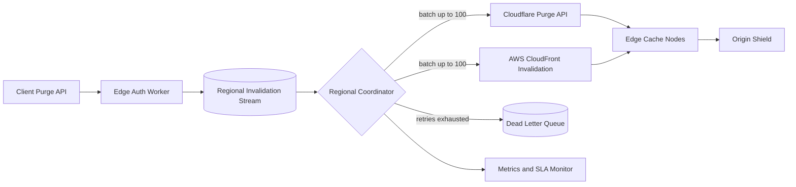

| Difficulty | Channel | Tags |
|---|---|---|
| intermediate | system-design | edge, caching, purging |

For more than a decade, every Cloudflare cache purge request took a long trip: it was backhauled to one of a few centralized core data centers, authorized there, and then fanned out worldwide through Quicksilver, the company's hub-and-spoke config distribution system [1]. That worked when the network was small. At 270+ cities and millions of purges per day, write throughput saturated, Kafka queues and batching added latency, and a customer purging from Australia watched requests cross the Pacific before local caches were invalidated [1]. The fix cut global P50 purge latency to 149ms, a 90.5% improvement—and it reveals why a 5-second propagation SLA is really an architecture problem, not a TTL setting [1].

---

> ### Real-World Case — Cloudflare
>
> For over a decade, every Cloudflare cache purge request was backhauled to one of a few centralized 'core' data centers, authorized there, and then fanned out globally through Quicksilver, Cloudflare's hub-and-spoke config distribution system. As the network grew past 270 cities and customers issued millions of purges per day, this architecture hit hard limits: write throughput saturated, so Cloudflare inserted Kafka queues and batching that added latency, and a customer purging from Australia had to cross the Pacific before local caches were invalidated.
>
> | | |
> |---|---|
> | **Challenge** | Guarantee fast, uniform invalidation of cached content across 330 cities and 120+ countries without a central choke point, while also supporting hard 'flexible' purges by cache-tag, hostname, and URL prefix. Unlike a URL purge, a tag purge gives no cache key, so Cloudflare could not know which of thousands of machines held matching files without scanning every disk. The old system's P99 was roughly 6.35 seconds for URL purges and 5.97 seconds for flexible purges, already breaching the 5-second target, and storing purge history on every machine consumed cache disk space. |
> | **Solution** | Cloudflare re-architected the system as 'Coreless Purge': the API gateway, authentication, and purge services moved from core data centers to every edge data center, with Workers and Durable Objects queuing and broadcasting purges peer-to-peer. The key innovation was CacheDB, a Rust sidecar built on RocksDB that runs on every cache machine, indexes cached files by URL, hostname, and cache-tag, and keeps a local purge queue. The cache proxy consults CacheDB on every cache HIT, so a purge logically takes effect the instant it reaches a machine, even if millions of matching files are still being deleted from disk; Consul handles last-mile fan-out and health within each data center. |
> | **Outcome** | Global P50 purge latency for tags, hostnames, and prefixes dropped to under 150ms (149ms globally), a 90.5% improvement from 1,570ms in May 2022, with regional P50s ranging from 115ms in Western North America to 303ms in Africa. The redesign also cut purge-history storage by 10x, allowed immediate deletion of purged content instead of waiting for lazy expiry, and improved cache retention and hit ratios, reducing origin egress. Single-file purges reached a P50 of 234ms, with a target below 200ms. |
> | **Lesson** | The counterintuitive fix was not to make the central purge pipeline faster but to remove the center entirely: push indexing and purge execution to every machine, and make a purge effective on the read path (check pending purges on cache HIT) rather than waiting for physical deletion to finish. A system that scaled for a decade through batching and queues can quietly become the bottleneck, and a reliable 'hammer' like Quicksilver can lead you to treat every new problem as a nail. |

---

## Hook — The Clock Starts Before the Purge Does

The clock starts the moment a publisher hits publish. Somewhere, an editor sees the new headline, a customer refreshes a product page, and a stale page loads. The promise of a modern CDN is that invalidation feels instant, yet the machinery behind that promise is often a Rube Goldberg chain of queues, central authorization, and best-effort fanout.

Picture a purge request leaving Sydney. Before a single edge cache in Australia is cleared, that request may cross an ocean, wait behind thousands of others, and get batched by a system trying to protect its own write throughput. The result is a propagation window that looks fine in a dashboard and terrible in a customer's browser.

This is the story of why a 5-second cache purge SLA is less about TTLs and more about distributed systems design—and what one of the largest networks on the planet had to rebuild to make it real.

## Problem — Freshness, Throughput, and the Geography Tax

Cache invalidation is one of the two hard problems in computer science for a reason: the cache is a copy, and every copy eventually disagrees with the source of truth. The naive fix is a short TTL. Set max-age=2 and let content expire quickly. However, short TTLs trade origin load for freshness, and at scale that trade becomes brutal. Every expiring object becomes a cache miss, every miss becomes an origin request, and a 2-second TTL on popular content can turn a quiet origin into a traffic jam.

The opposite extreme—purge every URL that might be affected—creates a different failure mode. A single template change can invalidate millions of objects across dozens of regions. Multiply that by 10,000 concurrent invalidation requests per second and the control plane becomes the bottleneck, not the data plane.

Now add the constraints that make this genuinely hard:
- **Latency:** every edge should see the invalidation within 5 seconds.
- **Throughput:** the system must absorb 10K invalidations/sec without dropping or unbounded queueing.
- **Availability:** 99.99% uptime for the purge API, because deploys and incident response depend on it.
- **Consistency:** a purge acknowledged as complete must not be silently lost in one region.

You might think this is a caching problem. In practice, it is a coordination problem: who authorizes a purge, where that decision is recorded, how it fans out, and how you prove it happened [2]. The moment you centralize any of those steps, geography starts charging rent.

## Real-World Case — Cloudflare's Instant Purge

For years, Cloudflare answered that coordination question with a hub-and-spoke design. Every purge request was backhauled to one of a few centralized core data centers, authorized there, and then distributed globally through Quicksilver, its configuration propagation system [1]. It was elegant, auditable, and increasingly wrong for a network that had grown past 270 cities.

The symptoms were predictable to anyone who has scaled a control plane. Write throughput saturated as customers issued millions of purges per day. Kafka queues and batching were inserted to absorb the load, which protected the system but added latency. And a customer purging from Australia paid a geographic tax: the request crossed the Pacific before local caches were invalidated [1].

Cloudflare's redesign moved authorization and fanout closer to the edge. The results were measurable: global P50 latency for tag, hostname, and prefix purges dropped to 149ms, a 90.5% improvement from 1,570ms in May 2022. Regional P50s ranged from 115ms in Western North America to 303ms in Africa. Purge-history storage shrank by 10x, purged content could be deleted immediately instead of waiting for lazy expiry, and better cache retention improved hit ratios and reduced origin egress. Single-file purges reached a P50 of 234ms, with a target below 200ms [1].

The plot twist is that the biggest win did not come from making the CDN faster. It came from removing a central authority from the hot path.

## Deep Dive — Four Layers, One Bounded Propagation Window

Building on that lesson, the architecture for a 5-second multi-region purge system has four layers: an ingest API, a durable invalidation log, regional coordinators, and provider adapters.

The ingest API does the cheap work first: authentication, schema validation, and idempotency. Every request gets a deterministic key so retries do not create duplicate purges. This matters because at 10K requests/sec, clients retry aggressively, and without idempotency your queue becomes a denial-of-service vector against itself.

The durable log—Redis Streams with consumer groups, or Kafka if you need longer retention—decouples acceptance from execution [7]. Consumer groups give you horizontal scale and at-least-once delivery. The trade-off is that at-least-once means duplicates, so provider adapters must be idempotent or cheap enough that duplicate purges are harmless.

Regional coordinators own the fanout for their geography. They batch up to 100 invalidations per provider API call, coalesce wildcard patterns, and track per-region progress. Batching is where cost and throughput are won: fewer API calls mean lower provider bills and less rate-limit pressure. But batching also adds queueing delay, so the batch window must be short—tens of milliseconds, not seconds.

Provider adapters translate a canonical invalidation into Cloudflare purge calls, CloudFront invalidations, or Fastly purges [5]. This is the messiest layer because providers differ in semantics: some support wildcards, some support tags, some charge per path, and all of them rate-limit. A canonical model plus a thin adapter keeps that complexity out of the core.

Here is the honest trade-off table:

| Strategy | Freshness | Origin load | Control-plane cost | Best for |
|---|---|---|---|---|
| Short TTL only | Good | High | Low | Low-churn, cache-friendly assets |
| Purge everything | Excellent | Medium | Very high | Rare emergency corrections |
| Hybrid TTL + targeted purge | Excellent | Low | Moderate | Dynamic content at scale |

The hybrid wins because it uses TTL as a safety net and purges as a precision tool. A 2-second TTL bounds staleness even if a purge is lost; targeted purges keep origin traffic sane. Cache-Control: max-age=2, must-revalidate gives you that bound without surrendering control [3][4].

Two more mechanisms keep the system honest. Exponential backoff with jitter prevents synchronized retry storms across regions [8]. A circuit breaker stops hammering a provider that is already failing, failing fast after a threshold of consecutive errors and routing failures to a dead-letter queue for reconciliation [9].

Finally, anycast routing helps requests reach a nearby coordinator, but it does not eliminate the speed of light [6]. The goal is not zero latency. The goal is a bounded, observable, and recoverable propagation window.

## Workflow — From Publish Click to Edge Invalidation

Here is how the pieces move in sequence. The diagram below shows the full path from an API request to edge cache invalidation.

1. **Accept and authenticate.** The purge API validates the token, normalizes the request into a canonical invalidation, and assigns an idempotency key.
2. **Append to the log.** The invalidation is written to a regional Redis Stream with a retention window. The API returns 202 Accepted with a purge ID as soon as the write is durable.
3. **Route by region.** A regional coordinator claims a batch from the consumer group. Region affinity keeps most purges local, so an Australian request is handled by an Australian coordinator.
4. **Coalesce and batch.** The coordinator deduplicates paths, merges wildcard patterns, and groups up to 100 entries per provider call.
5. **Fan out to providers.** Each adapter calls its provider with a tight timeout. Successful calls are acknowledged; failures are retried with exponential backoff and jitter.
6. **Handle poison messages.** After three failed attempts, the batch moves to a dead-letter queue with context for manual or automated reconciliation.
7. **Verify and measure.** Per-region completion events update the purge status and feed P50/P99 latency dashboards. A purge is only marked complete when every required region acknowledges it.

The mermaid diagram illustrates the flow: client request, edge authorization, regional stream, coordinator, provider APIs, edge caches, and the dead-letter path.

## Code Example — A Consumer Loop You Can Reason About

The code below implements the core consumer loop: read a batch from Redis Streams, deduplicate paths, call the Cloudflare purge API with a timeout, retry with exponential backoff and jitter, and route exhausted batches to a dead-letter stream. It is intentionally small enough to reason about, but it contains the production-critical decisions.

Three details matter most. First, the batch size is capped at 100 to match provider limits and keep each call inside the latency budget. Second, AbortSignal.timeout(1500) prevents a slow provider from consuming the entire 5-second SLA. Third, messages are acknowledged only after success or after being written to the dead-letter queue, which prevents silent loss.

One caveat: this loop is per-process. In production you would run many consumers in the same group, add metrics around batch latency and retry counts, and persist the idempotency key alongside the path so duplicate deliveries collapse safely.

## Lessons Learned — What Actually Makes the SLA Hold

**1. Move authorization out of the hot path.** Cloudflare's biggest win came from removing centralized authorization, not from tuning caches [1]. If every purge must touch one region, geography sets your floor.

**2. Treat invalidation as a durable event, not an API call.** Accept fast, persist the intent, and let regional workers do the work. Redis Streams or Kafka gives you replay, consumer groups, and backpressure [7].

**3. Batch for cost, but bound the batch window.** A 100-item batch cuts provider calls dramatically. A 5-second batch window destroys your SLA. Keep the window in the tens of milliseconds.

**4. Use TTL as a safety net, not the strategy.** A short TTL bounds worst-case staleness when a purge is lost, while targeted purges protect origin capacity [3][4].

**5. Design for duplicates and failure.** At-least-once delivery means duplicates. Idempotency keys, idempotent adapters, exponential backoff with jitter, and circuit breakers are not optional polish; they are the difference between a retry storm and a graceful degradation [8][9].

⚠️ **Watch out:** measuring only the API response time hides the real problem. The SLA is about edge propagation. Instrument per-region acknowledgment, not just queue enqueue.

🔥 **Hot take:** if your purge system cannot survive a provider outage without dropping invalidations, you do not have a purge system. You have a best-effort notification service.

Many teams discover this the hard way during a deploy freeze or a viral traffic spike. The fix is architectural: local authorization, durable fanout, bounded retries, and observable completion. That is the difference between a 5-second promise and a 5-second reality.

---

## Multi-Region Purge Architecture

<strong>Original Interview Question</strong>

**Q:** How would you design a multi-region CDN cache purging system that guarantees content propagation within 5 seconds while handling 10,000 concurrent invalidations per second?

**A:** Implement Cloudflare API + AWS CloudFront with distributed invalidation queue, edge compute coordination, and 2-second TTL. Use batch invalidation, exponential backoff, and regional cache headers for 5-second SLA.

## Conclusion

The Cloudflare story is a reminder that cache invalidation is never just about caches. It is about where decisions are made, how intent travels, and how you prove that every edge saw the change. Start by measuring regional propagation latency, not API latency. Then move authorization closer to the edge, put a durable log between acceptance and execution, batch aggressively but briefly, and make failure visible with dead-letter queues and per-region completion tracking. Do that, and your 5-second SLA becomes an engineering guarantee instead of a marketing slide.

---

## References

1. [Cloudflare incident report](https://blog.cloudflare.com/instant-purge/) — article
2. [Content delivery network — Wikipedia](https://en.wikipedia.org/wiki/Content_delivery_network) — documentation
3. [Cache-Control — MDN Web Docs](https://developer.mozilla.org/en-US/docs/Web/HTTP/Headers/Cache-Control) — documentation
4. [RFC 9111: HTTP Caching](https://datatracker.ietf.org/doc/html/rfc9111) — documentation
5. [Invalidating files — Amazon CloudFront](https://docs.aws.amazon.com/AmazonCloudFront/latest/DeveloperGuide/Invalidation.html) — documentation
6. [Anycast — Wikipedia](https://en.wikipedia.org/wiki/Anycast) — documentation
7. [Redis Streams — redis/redis on GitHub](https://github.com/redis/redis) — documentation
8. [Exponential backoff — Wikipedia](https://en.wikipedia.org/wiki/Exponential_backoff) — documentation
9. [Circuit breaker design pattern — Wikipedia](https://en.wikipedia.org/wiki/Circuit_breaker_design_pattern) — documentation

---

**Author:** Satishkumar Dhule — [GitHub](https://github.com/satishkumar-dhule) · [LinkedIn](https://linkedin.com/in/satishkumar-dhule) · [Website](https://satishkumar-dhule.github.io)
