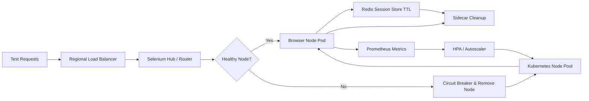

| Difficulty | Channel | Tags |
|---|---|---|
| advanced | system-design | selenium, webdriver, grid |

In 2014, Expedia Group’s UI automation pipeline hit a breaking point: roughly 9,000 tests spread across 350+ Jenkins jobs ran directly on Jenkins executors, where each executor could handle only a few browsers and stale processes steadily crippled capacity, stretching feedback loops from minutes to hours [1]. What if that bottleneck could be replaced with an elastic grid that scales on demand, cleans up after itself, and stays resilient across data centers? This is the journey from brittle test infrastructure to a platform built for 10,000 concurrent sessions and 99.9% uptime.

---

> ### Real-World Case — Expedia Group
>
> Until late 2014, Expedia ran roughly 9,000 UI automation tests across 350+ Jenkins jobs directly on Jenkins executors. Each executor could only run a few browsers, stale browser processes accumulated and made executors unusable, and suite runs took hours, choking the company's CI/CD feedback loop.
>
> | | |
> |---|---|
> | **Challenge** | Scale Selenium Grid to run thousands of concurrent browser sessions on demand without stale sessions and memory leaks degrading the infrastructure, while keeping costs proportional to actual test load rather than keeping a large static grid running 24/7. |
> | **Solution** | Built 'Distributed Automation' using SeleniumGridScaler (Selenium Grid plus the EC2 API) on AWS: the hub read how many tests would run, spun up the exact number of nodes needed (15 Chrome/Firefox sessions per c5.xlarge), attached them to the hub, then terminated every node and shut itself down after the run, with idle-time node termination as a backstop. They later moved to a Kubernetes/EKS, Docker, Helm and Traefik architecture for dynamic hub creation. A key counterintuitive finding: running the hub itself in Docker caused hub-node communication instability at hundreds of concurrent tests, so they ran the hub as a regular Java process instead. |
> | **Outcome** | Grew to 90-100+ SeleniumGridScaler hubs running more than 150,000 tests per day (140k+ in the later Kubernetes write-up), with 1,000 UI tests completing in about 5 minutes instead of hours. Node scale-up took roughly 2-4 minutes on EC2, and disposable per-run nodes eliminated the stale-browser buildup that had been bricking Jenkins executors. |
> | **Lesson** | Treat browser nodes as cattle, not pets: provision them per test run and destroy them afterward so leaked browser processes and memory can never accumulate. Autoscale on actual queue/session demand rather than CPU, and be careful about containerizing the Grid hub itself at high concurrency. |

---

## Hook — When 9,000 Tests Bring CI to Its Knees

Picture a release train waiting on test results while browser processes pile up like abandoned tabs. Sound familiar? Teams often start with a simple Selenium setup because it works—until growth turns convenience into chaos [2]. At scale, every stuck session consumes memory, every flaky node delays merges, and every hour-long suite erodes trust in automation. The stakes are not just slower builds; they are slower delivery, higher infrastructure costs, and developers learning to ignore the very safety net meant to protect them. So how do teams move from fragile executors to a grid that thrives under pressure?

## Problem — The Hidden Cost of Unmanaged Test Sessions

The core challenge is not merely running more browsers—it is managing their entire lifecycle reliably. Long-lived nodes accumulate memory leaks, orphaned sessions, and stale driver processes that silently degrade performance. Without isolation, one misbehaving test can poison an executor and cascade into queue backlogs. Add multi-region traffic, unpredictable load spikes, and strict uptime targets, and the problem becomes architectural: session state must be durable yet ephemeral, capacity must scale elastically, and failures must be contained quickly. For 10,000 concurrent sessions, even small inefficiencies multiply into hundreds of gigabytes of memory pressure and minutes of lost developer time.

## Real-World Case — Expedia Group

Expedia Group’s experience shows what happens when test infrastructure outgrows its foundation. Until late 2014, the company ran about 9,000 UI automation tests across 350+ Jenkins jobs directly on Jenkins executors. Each executor supported only a few browsers, and stale browser processes accumulated until executors became unusable, choking CI/CD feedback loops for hours [1]. The turnaround came from distributed automation: scaling to 90-100+ SeleniumGridScaler hubs running more than 150,000 tests per day, cutting 1,000 UI tests to roughly 5 minutes, and provisioning nodes in about 2-4 minutes on EC2 with disposable per-run nodes that eliminated stale-browser buildup [1][8]. This shift reframed test execution from a shared, fragile resource into an elastic, replaceable fleet.

## Deep Dive — Architecture for Scale, Resilience, and Zero Leaks

Building on this lesson, a modern grid separates concerns across orchestration, state, and observability. A Kubernetes cluster with auto-scaling node pools hosts browser pods, while StatefulSets or managed deployments distribute hubs and nodes across availability zones for fault tolerance [3]. Session metadata lives in a Redis cluster with TTL-based expiration and connection pooling, ensuring abandoned sessions expire automatically instead of lingering in memory [5]. Prometheus scrapes node and session metrics to surface memory growth trends, queue depth, and failure rates in real time [6].

However, scale alone is not enough. Circuit breakers isolate unhealthy nodes, weighted round-robin balancing routes traffic by capacity and response time, and strict CPU/memory quotas (for example, 2 GB RAM and 1 CPU per node) prevent noisy neighbors. For throughput, 10,000 sessions at 50 sessions per node requires at least 200 nodes; adding a 30% buffer pushes baseline cluster memory to roughly 520 GB. To meet a P99 session initiation under 2 seconds and 99.9% uptime, regional load balancing, multi-AZ placement, and Pod Disruption Budgets become non-negotiable [3][4].

## Workflow — Step-by-Step Session Lifecycle and Recovery

This leads to a workflow where every session has a clear beginning, middle, and end. The diagram below illustrates the request path, scaling triggers, and recovery loops. When a test requests a browser, the load balancer selects a healthy node based on weight and latency. The hub records session state in Redis with a TTL, and sidecar containers watch for completion or timeout to trigger cleanup. Prometheus alerts on memory thresholds (for example, 80%), prompting rolling restarts or scale-out via the Horizontal Pod Autoscaler [4][6]. If health checks fail three times consecutively, the node is removed, a circuit breaker opens for a short recovery window, and traffic shifts to healthy capacity. Canary deployments and leader-election safeguards further reduce risk from bad releases and network partitions [3][7].

1. Enqueue: Test request enters regional load balancer and hub queue.
2. Allocate: Scheduler places session on a healthy node with available quota.
3. Persist: Session metadata written to Redis with TTL and heartbeat updates [5].
4. Observe: Prometheus and Grafana track memory, duration, and queue depth [6].
5. Recover: Failed nodes isolated, drained, and replaced; rolling updates maintain capacity [3][4].
6. Cleanup: Sidecars and periodic scans remove stale volumes, keys, and processes.

## Code Example — Session Cleanup and Health Monitoring Sidecar

Consequently, automation must enforce hygiene continuously, not as an afterthought. The following Python example demonstrates a lightweight control loop that checks node health, expires stale sessions, and signals when memory pressure warrants intervention. It mirrors production patterns—externalized state, TTL-aware cleanup, and proactive remediation—without relying on manual intervention [5][6].

## Lessons Learned — Build for Failure, Automate for Cleanliness

The journey from overloaded executors to an elastic grid reveals a few durable truths. First, disposable infrastructure beats durable snowflakes: replacing nodes is safer than nursing them back to health. Second, session lifecycle management is a first-class feature—TTLs, sidecars, and rolling restarts prevent slow leaks from becoming outages [5][7]. Third, observability turns guesswork into control; memory trends and queue depth should drive scaling and remediation decisions [6].

If this feels overwhelming, you are not alone—many teams evolve into this architecture incrementally. A practical next step is to audit where sessions leak today, add TTL-based cleanup, and instrument memory and queue metrics before chasing maximum concurrency. What would change in release velocity if test feedback dropped from hours to minutes again? [1][4]

---

## Scalable Selenium Grid Flow

<strong>Original Interview Question</strong>

**Q:** Design a scalable Selenium Grid architecture to handle 10,000 concurrent test sessions with 99.9% uptime, ensuring zero memory leaks through automatic session lifecycle management, real-time monitoring, and graceful node failure recovery across multiple data centers?

**A:** Deploy Kubernetes cluster with auto-scaling node pools, Redis session store with TTL policies, Prometheus metrics for memory monitoring, circuit breakers for node isolation, and sidecar containers for session cleanup. Implement health checks, resource quotas, and rolling updates.

## Conclusion

Scaling Selenium Grid is less about adding browsers and more about engineering trust: predictable sessions, observable health, and fast recovery. Start by making sessions disposable, enforcing TTL-based cleanup, and wiring metrics into autoscaling and remediation loops. Do that, and test infrastructure becomes an accelerator again—not the bottleneck everyone works around.

---

## References

1. [Expedia Group incident report](https://medium.com/expedia-group-tech/distributed-automation-how-to-run-1000-ui-automation-tests-in-5mins-cf9a84ca32d1) — article
2. [Selenium (software)](https://en.wikipedia.org/wiki/Selenium_(software)) — documentation
3. [Kubernetes StatefulSets](https://kubernetes.io/docs/concepts/workloads/controllers/statefulset/) — documentation
4. [Horizontal Pod Autoscaling](https://kubernetes.io/docs/tasks/run-application/horizontal-pod-autoscale/) — documentation
5. [Redis](https://en.wikipedia.org/wiki/Redis) — documentation
6. [Prometheus (software)](https://en.wikipedia.org/wiki/Prometheus_(software)) — documentation
7. [SeleniumHQ docker-selenium](https://github.com/SeleniumHQ/docker-selenium) — documentation
8. [What is Amazon EC2 Auto Scaling?](https://docs.aws.amazon.com/autoscaling/ec2/userguide/what-is-amazon-ec2-auto-scaling.html) — documentation

---

**Author:** Satishkumar Dhule — [GitHub](https://github.com/satishkumar-dhule) · [LinkedIn](https://linkedin.com/in/satishkumar-dhule) · [Website](https://satishkumar-dhule.github.io)
