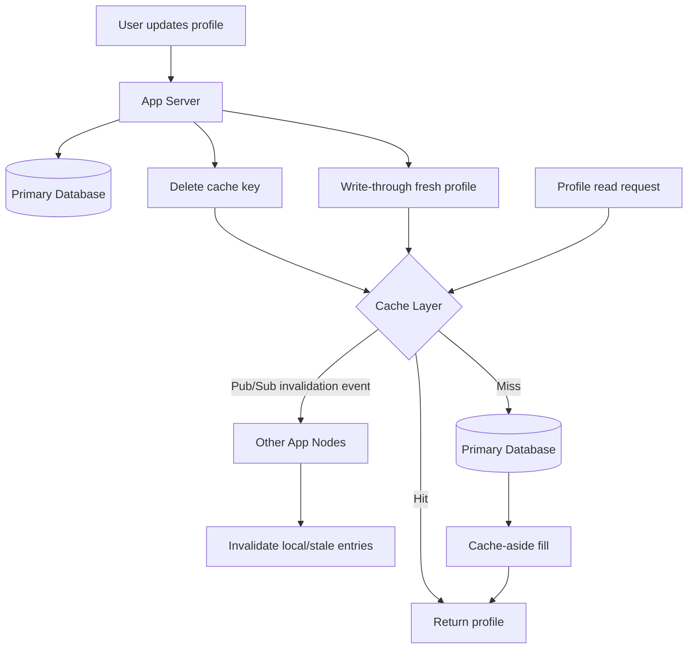

| Difficulty | Channel | Tags |
|---|---|---|
| beginner | backend | redis, memcached, cache-invalidation |

At Meta (Facebook), the social graph—including user profiles and their connections—served over 1 billion users, with TAO processing roughly 1 billion reads and millions of writes per second over many petabytes of data [1]. To keep profile and graph reads fast while preserving correctness, Facebook fronted MySQL with large-scale caching layers that had to handle frequent invalidations on writes, hot keys, and cross-region consistency [1]. Picture this: a user changes their display name, refreshes the page, and still sees the old one. What seems like a tiny glitch at that scale becomes a correctness crisis—and that is exactly where the cache invalidation story begins.

---

> ### Real-World Case — Meta (Facebook)
>
> Facebook’s social graph—including user profiles and their connections—served over 1 billion users, with TAO processing roughly 1 billion reads and millions of writes per second over many petabytes of data. To keep profile and graph reads fast while preserving correctness, Facebook fronted MySQL with large-scale caching layers (Memcached and later TAO’s cache tiers) that had to handle frequent invalidations on writes, hot keys, and cross-region consistency.
>
> | | |
> |---|---|
> | **Challenge** | When a user updated profile or graph data, the system had to avoid serving stale cached values without overwhelming MySQL during cache misses or invalidations. At this scale, simple caching broke down due to thundering herds/stampedes on popular keys, stale sets from concurrent updates, replication lag across regions, and the operational complexity of coordinating invalidations across thousands of cache servers. |
> | **Solution** | Facebook used cache-aside with explicit delete-on-write invalidation (write to DB, then delete/invalidate cache) and added mechanisms to make it safe at scale: lease tokens in Memcached to prevent stampedes and stale sets, mcrouter for routing/fan-out, and cross-region invalidation tied to the MySQL replication/binlog stream so caches weren’t invalidated before replicas applied writes. TAO evolved this into a graph-aware, write-through cache architecture with two-tier cache clusters, synchronous read-after-write updates for the originating tier, and asynchronous invalidation/refill messages to other tiers to maintain high hit rates and consistency guarantees. |
> | **Outcome** | The TAO deployment reported in USENIX ATC 2013 achieved about a 96.4% overall read hit rate, with read workloads dominating (99.8% reads vs 0.2% writes) and over 1 billion reads and millions of writes per second in production. The paper also reports 99.8% of follower read failures over 90 days were handled without user-visible errors in aggregate availability terms (4.9×10^-6 failed read queries over 90 days), and secondary-region replication lag was under 1 second 85% of the time, under 3 seconds 99% of the time, and under 10 seconds 99.8% of the time. |
> | **Lesson** | At massive scale, cache invalidation is a distributed-systems problem, not just a key delete: you need coordination to prevent stampedes/stale sets and to align invalidation with replication. Simpler cache engines like Memcached can deliver extreme performance but require additional infrastructure (leases, routing, invalidation pipelines) for correctness, while richer systems can offer built-in primitives—illustrating the core trade-off between operational simplicity/speed and native support for complex invalidation and consistency patterns. |

---

## Hook — The Refresh That Lied

A profile update should feel instant and truthful. You hit save, the spinner disappears, and your new bio appears everywhere—or so you expect. However, behind that simple action sits a race between databases and caches, and when the cache wins with stale data, trust erodes. For a platform operating at Meta’s scale, TAO reported about a 96.4% overall read hit rate with read workloads dominating at 99.8% reads versus 0.2% writes [1]. That efficiency is powerful, but it raises the stakes: every missed invalidation can echo across billions of reads. Sound familiar? Even at smaller scales, the same tension shows up the moment developers add caching to speed up user profiles.

## Problem — Fast Reads, Fragile Freshness

Building on this tension, the core challenge is balancing latency and correctness. Caching frequently accessed profiles reduces database load and improves response times, but it introduces the age-old question of when cached data should be considered invalid [2]. Moreover, profile data is read-heavy yet personally sensitive—users notice immediately when their changes do not appear. Teams must decide how to propagate updates, how long to let data live, and how to coordinate across multiple servers. Therefore, the problem is not just “add a cache”; it is designing a system where speed does not quietly sabotage truth [7].

## Real-World Case — Meta (Facebook)

This leads directly to Meta’s battle-tested experience. The TAO deployment described in USENIX ATC 2013 handled over 1 billion reads and millions of writes per second in production while maintaining high availability and consistency guarantees [1]. Specifically, the paper reports 99.8% of follower read failures over 90 days were handled without user-visible errors (4.9×10^-6 failed read queries over 90 days), and secondary-region replication lag was under 1 second 85% of the time, under 3 seconds 99% of the time, and under 10 seconds 99.8% of the time [1]. Consequently, the lesson is clear: at massive scale, cache invalidation is not a minor optimization detail—it is a foundational correctness mechanism that must survive hot keys, distributed writes, and cross-region delays.

## Deep Dive — Choosing a Strategy and a Cache

However, not every team runs at Meta’s scale, so the trade-offs must be grounded in practical choices. A common approach is write-through caching with TTL-based expiration: on profile update, delete the cache key and write the new data to both the database and cache to keep reads fresh [6]. TTLs (for example, 5–30 minutes for profiles) act as a safety net if an invalidation is missed [2]. For reads, a cache-aside pattern often complements this by loading from the database on a miss and populating the cache [6].

When choosing the cache engine, Redis and Memcached offer different strengths. Redis provides pub/sub for distributed invalidation signals, persistence options, and advanced data structures that enable more complex coordination patterns [3][4]. Memcached, by contrast, focuses on a simpler architecture with low memory overhead and fast performance for pure key-value caching, but it lacks built-in persistence and pub/sub, so invalidation across nodes typically requires manual coordination [5][8]. In short: Redis favors flexibility and coordination, while Memcached favors simplicity and raw caching efficiency.

## Workflow — From Update to Consistent Read

Building on these trade-offs, a reliable workflow makes the behavior predictable. When a user updates a profile, the service writes to the primary database, invalidates the cache entry, and then writes through the fresh value; subsequent reads hit the cache or fall back to cache-aside on a miss. In distributed deployments, Redis pub/sub can broadcast invalidation events so other app nodes drop stale copies promptly [4]. Meanwhile, monitoring cache hit rates, latency, and invalidation failures helps teams detect drift before users do [6]. The diagram below illustrates this end-to-end flow.

## Code Example — Write-Through Update with TTL

To make this concrete, the following example shows a profile update flow using write-through caching and explicit invalidation. It demonstrates deleting the key, persisting to the database, and setting a fresh cached value with a TTL. In a Redis-backed deployment, teams can extend this with pub/sub notifications so peer services invalidate their views as well [4][6].

💡 Insight: Deleting before and after the write (or using atomic patterns where available) can reduce windows where stale reads slip through under concurrency.

⚠️ Watch Out: Without distributed coordination, multiple app nodes may keep serving stale data even after one node invalidates its local view.

## Lessons Learned — Keep Caches Honest

Tying it all back to the opening hook, Meta’s experience shows that high cache hit rates are valuable only when paired with disciplined invalidation and observability [1]. For most teams, write-through updates, key deletion on change, sensible TTLs, and a cache-aside read path form a strong baseline [2][6]. Choose Redis when distributed invalidation, pub/sub, or richer data structures matter; choose Memcached when simplicity and low-overhead caching are the priority [3][5][8]. The actionable next step: audit profile update paths tomorrow—verify every write invalidates or refreshes the right keys, add TTL guardrails, and track hit/miss metrics so stale data never gets the last word. 🎯 Key Point: Caching makes systems fast; invalidation makes them trustworthy.

---

## Profile Cache Invalidation Flow

<strong>Original Interview Question</strong>

**Q:** You're building a user profile service that caches frequently accessed profiles. How would you implement cache invalidation when a user updates their profile, and what trade-offs would you consider between Redis and Memcached?

**A:** Implement write-through caching with TTL-based expiration. On profile update, invalidate the cache by deleting the key and writing new data to both the database and cache. Redis offers pub/sub for automatic distributed invalidation, while Memcached requires manual coordination across nodes.

## Conclusion

The journey from Meta’s billion-read reality to a single profile update in your service comes down to one principle: speed without freshness is a bug waiting to happen. Start by enforcing delete-on-update, pairing write-through with a sensible TTL, and instrumenting hit rates and invalidation paths. If your system spans multiple nodes, add a coordination mechanism like Redis pub/sub or a disciplined invalidation protocol. Do that tomorrow, and your cache will accelerate trust—not undermine it.

---

## References

1. [Meta (Facebook) incident report](https://www.usenix.org/system/files/conference/atc13/atc13-bronson.pdf) — paper
2. [Cache invalidation - Wikipedia](https://en.wikipedia.org/wiki/Cache_invalidation) — documentation
3. [Redis Data Types Documentation](https://redis.io/docs/latest/develop/data-types/) — documentation
4. [Redis Pub/Sub Documentation](https://redis.io/docs/latest/develop/interact/pubsub/) — documentation
5. [Memcached GitHub Repository](https://github.com/memcached/memcached) — documentation
6. [Caching Patterns - AWS Database Caching Strategies Using Redis](https://docs.aws.amazon.com/whitepapers/latest/database-caching-strategies-using-redis/caching-patterns.html) — documentation
7. [Cache (computing) - Wikipedia](https://en.wikipedia.org/wiki/Cache_(computing)) — documentation
8. [Memcached Official Site](https://memcached.org/) — documentation

---

**Author:** Satishkumar Dhule — [GitHub](https://github.com/satishkumar-dhule) · [LinkedIn](https://linkedin.com/in/satishkumar-dhule) · [Website](https://satishkumar-dhule.github.io)
