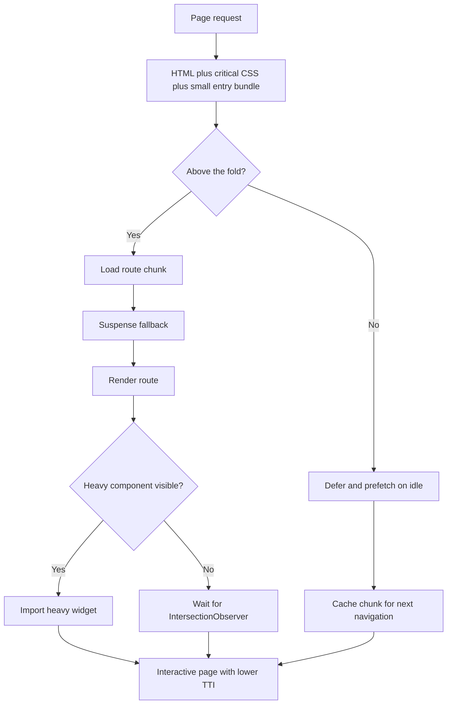

| Difficulty | Channel | Tags |
|---|---|---|
| intermediate | frontend | lighthouse, bundle, lazy-loading |

Your Lighthouse score is 65. The bundle weighs 2.1MB. Time to Interactive sits at 4.2 seconds, which means a measurable slice of your audience leaves before the app ever responds to a tap. Netflix ran into the same wall on its logged-out homepage, where a heavy React bundle delayed interactivity on a page that looked almost static [1]. What the team did next is a practical blueprint for shipping less JavaScript — and it begins with treating your bundle, not your framework, as the suspect.

---

> ### Real-World Case — Netflix
>
> Netflix analyzed its logged-out homepage—a critical entry point for new and returning members—and found that client-side JavaScript was slowing down how quickly users could interact with the page. Despite the page being largely static, it shipped a significant React bundle that delayed interactivity on slower devices and networks.
>
> | | |
> |---|---|
> | **Challenge** | Reduce the JavaScript payload and Time to Interactive for the logged-out homepage without sacrificing developer experience or the ability to add interactivity where needed. |
> | **Solution** | The team removed the client-side React framework from the landing page, replacing it with vanilla JavaScript for the small amount of interactivity required (e.g., sign-in and language selection). They kept React on the server for templating to maintain developer ergonomics, prefetched React for subsequent pages users were likely to visit, and eliminated hundreds of kilobytes of unnecessary client-side code. |
> | **Outcome** | Netflix cut ~200KB of JavaScript from the logged-out homepage, reducing the bundle by over 50% for that page. Time to Interactive improved by 50% on desktop (from ~3.5s to ~1.7s in their measurements), with significant gains on mobile as well. |
> | **Lesson** | Not every page needs a full SPA framework on the client—matching the tool to the page’s actual interactivity needs can yield outsized performance wins, and you can still preserve developer workflows by using frameworks server-side. |

---

## Hook — The 4.2-Second Wait That Costs You Users

The dashboard was green. The release notes were polished. Then the support queue filled with a sentence no engineer wants to read: 'The site feels broken on my phone.'

Nothing had crashed. The app was simply hauling 2.1MB of JavaScript into every session, and on a mid-tier Android device that payload had to be downloaded, parsed, compiled, and executed before a single button could respond. Time to Interactive: 4.2 seconds. Lighthouse: 65. The feature worked perfectly on a developer laptop and failed the people it was built for.

This is the quiet trap of modern frontend work. React makes it easy to compose features, and every feature brings dependencies, polyfills, icon packs, analytics wrappers, and one more charting library. The bundle grows one pull request at a time until the homepage behaves like an application launch. Netflix's logged-out homepage told the same story: static-looking, surprisingly expensive, and slow to become interactive [1].

The uncomfortable question is not 'How do you add lazy loading?' It is 'Why is all of this code on the critical path in the first place?'

## Problem — Bundle Size Is a Proxy for Main-Thread Pain

Bundle size is a proxy metric. The real cost is main-thread time. A browser must download each byte, decompress it, parse it into an abstract syntax tree, compile it, and execute it; only then can React attach handlers and paint a responsive interface [11]. On a fast laptop that sequence feels free. On a throttled 4G connection and a mid-tier phone, it is the difference between a product and a loading screen.

The target is a Lighthouse score above 90, which means the initial JavaScript must shrink dramatically, not just move. Many teams reach for a single fix, add React.lazy() to one route, and wonder why nothing changes. The score barely moves because the biggest chunk is still the entry bundle: the framework, the UI kit, the state library, and a date library with every locale.

There is also an organizational problem. Performance is invisible in code review. A new dependency that adds 40KB gzipped looks like a one-line change, and no reviewer sees the phone in a user's hand. Consequently, the bundle becomes an archaeology site: layers of features nobody wants to delete because nobody knows who owns them.

The stakes are concrete: slower interactivity correlates with higher bounce rates, lower conversion, and more support tickets. The fix is a system, not a trick. Netflix's case shows what happens when a team treats JavaScript as a budget instead of an unlimited resource.

## Real-World Case — Netflix and the Logged-Out Homepage

Netflix examined its logged-out homepage, a critical entry point for new and returning members, and found that client-side JavaScript was delaying interactivity. The page was largely static, yet it shipped a substantial React bundle that had to be fetched and executed before users could interact, especially on slower devices and networks [1].

The team did not simply minify harder. They audited what the page actually needed, removed roughly 200KB of JavaScript from that page, and cut the bundle by more than 50%. The result was a Time to Interactive improvement of about 50% on desktop, from roughly 3.5 seconds to 1.7 seconds, with meaningful gains on mobile as well [1].

The plot twist is that the biggest win came from shipping less on the first request, not from a new performance library. Netflix deferred the React bundle used for the signed-in experience, served the logged-out page with lighter client-side behavior, and prefetched the heavier code only when a visitor was likely to need it. The page stopped paying for an application it had not opened yet.

That is the mental model to steal: splitting is useful, but deletion and deferral are cheaper. A 200KB chunk that loads later is still a 200KB chunk; a 200KB chunk that was never needed is pure savings.

## Deep Dive — Splitting, Tree Shaking, and the Cost of Over-Splitting

Code splitting changes when JavaScript is paid for, not whether it is paid for [2]. The browser loads a small entry bundle, then fetches additional chunks on demand. React.lazy() lets you render a dynamic import as a component, and Suspense provides a fallback while the chunk arrives [3][4]. The dynamic import() syntax is what bundlers detect to create those chunks [9].

There are three common splitting strategies, and they solve different problems:

| Strategy | What it splits | Best for | Main risk |
| --- | --- | --- | --- |
| Route-based | One chunk per route | Most apps with distinct screens | Shared code duplicated or waterfalled |
| Component-based | Heavy widgets below the fold | Charts, editors, maps, modals | Too many tiny requests |
| Vendor-based | Third-party libraries | Long-term caching | A single giant vendor chunk |

Route-based splitting is usually the highest-leverage first move because users rarely need every screen on first load. Component-based splitting shines for heavy, conditionally visible UI such as a charting library or a rich text editor. Vendor splitting helps caching, but a monolithic vendor chunk can hide the real offenders; split it by usage pattern, not by package list.

Tree shaking is the other half of the story. Modern bundlers can remove unused exports when code is authored as ES modules and packages declare side-effect-free files, which is what the sideEffects flag enables [6]. CommonJS packages, barrel files that re-export everything, and top-level side effects all defeat this optimization. Importing a single lodash function from the full build, for example, can pull in far more than expected.

Suspense is not a loading strategy by itself. A lazy component still needs an error boundary for failed chunk loads, a meaningful fallback, and a prefetch strategy so navigation does not feel like a cold start. Similarly, lazy loading images with loading='lazy' helps the network and the main thread, but it does not fix a bloated JavaScript entry point [8].

Here is the counterintuitive part: over-splitting is real. Dozens of 5KB chunks create request overhead, cache churn, and waterfalls that can feel slower than one well-sized chunk. HTTP/2 multiplexing softens the penalty but does not eliminate it. The goal is fewer bytes on the critical path, not the maximum possible number of files.

💡 Insight: Lazy loading code you never needed is just procrastination. Deleting it is performance.

## Workflow — From 2.1MB to a Budget You Can Defend

Treat optimization as a loop, not a heroic afternoon. The workflow below moves from measurement to deletion to splitting, then locks the gains in place. The Bundle Optimization Flow diagram traces the same path a request takes.

1. Establish a baseline. Run Lighthouse in mobile mode with CPU and network throttling, and record Core Web Vitals such as Time to Interactive and Interaction to Next Paint. A score without a repeatable environment is a rumor.

2. Set a performance budget. Pick a hard ceiling for initial JavaScript, for example 170KB gzipped, and treat it like a test that can fail. Budgets turn performance into a product constraint instead of a quarterly cleanup [10].

3. Analyze the bundle. Run webpack-bundle-analyzer to see the real composition of the 2.1MB artifact [7]. Look for duplicated packages, full-library imports, locale bloat, and dependencies that exist for one small feature.

4. Delete and replace before splitting. Remove unused dependencies, switch to per-method imports, replace heavyweight libraries, and drop polyfills the supported browsers no longer need. This is the cheapest win and the one teams skip.

5. Split by route, then by heavy component [5]. Keep the entry bundle small, lazy-load screens that are not needed immediately, and defer below-the-fold widgets until they are visible or likely to be used.

6. Add prefetching and resilient loading states. Prefetch the most likely next route on hover or idle, show a purposeful fallback, and wrap lazy boundaries in error handling so a failed chunk does not blank the page.

7. Guard the gains in CI. Fail builds that exceed the budget, re-run Lighthouse on a schedule, and review bundle diffs in pull requests. Performance regresses silently unless the pipeline refuses to let it.

🎯 Key Point: Measure, delete, split, prefetch, enforce. In that order, the score moves for reasons you can explain.

## Code Example — Route Splitting, Prefetching, and a Safety Net

The example below applies route-based splitting, component-based splitting, a prefetch hint, and an error boundary in one small React app. It uses React.lazy() and Suspense for the loading contract [3][4], and dynamic import() so the bundler can create separate chunks [9].

The important detail is not the syntax. It is the boundary: the entry bundle stays small, each route pays only for its own screen, and the heavy chart is loaded only when the user asks for it. The code is illustrative but follows production patterns.

## Lessons Learned — Ship Less, Later, Then Make Later Feel Instant

Performance work fails when it is framed as a tooling task. The teams that win treat JavaScript as a product budget and revisit it continuously. Here is what to carry forward:

- Delete before you split. The fastest chunk is the one that never ships. Netflix's biggest gain came from removing and deferring JavaScript, not from adding a library [1].
- Split at boundaries users understand. Routes and heavy widgets are natural seams; arbitrary micro-chunks create waterfalls.
- Tree shaking is a packaging discipline. ES modules and correct sideEffects metadata matter more than a bundler setting [6].
- Loading states are part of the feature. A spinner that appears after a blank screen is not a strategy; Suspense, error boundaries, and prefetching make lazy loading feel intentional.
- Measure on the devices your users own. A mid-tier phone on throttled 4G is the real test, not a developer laptop.
- Put a budget in CI. Without enforcement, the 2.1MB bundle comes back one pull request at a time [10].

⚠️ Watch Out: Lazy loading a dependency you do not need simply moves the waste off the critical path. It still ships, still parses, and still costs money.

🔥 Hot Take: Most performance optimization projects would be better named dependency deletion projects. The tooling is the easy part; ownership is the hard part.

The memorable insight: ship less, later — then make later feel instant.

---

## Bundle Optimization Flow

<strong>Original Interview Question</strong>

**Q:** You're tasked with improving a React app's Lighthouse performance score from 65 to 90+. The bundle size is 2.1MB and Time to Interactive is 4.2s. What specific steps would you take to optimize the bundle and implement lazy loading?

**A:** Implement code splitting with React.lazy() and Suspense, analyze bundle composition with webpack-bundle-analyzer to identify largest chunks, remove unused dependencies and optimize imports, add dynamic imports for heavy components and third-party libraries, implement route-based splitting for better initial load times, and utilize tree shaking with proper ES module configuration.

## Conclusion

The journey from a 65 to a 90+ Lighthouse score is rarely a single heroic change. It is a sequence of honest questions: what is in the bundle, who needs it now, and what can wait? Netflix asked those questions about a logged-out homepage and cut roughly 200KB and half its interactivity time [1]. The same discipline applies to your 2.1MB React app: analyze the artifact, delete the dead weight, split along real boundaries, prefetch what comes next, and enforce a budget so the problem does not return.

Start tomorrow with one measurement and one deletion. Run the analyzer, find the largest chunk nobody can justify, and remove it. Then split the next route. The score will follow, but more importantly, the product will feel faster to the people who were about to leave.

---

## References

1. [Netflix incident report](https://medium.com/dev-channel/a-netflix-web-performance-case-study-c0bcde26a9d9) — article
2. [MDN: Code splitting](https://developer.mozilla.org/en-US/docs/Glossary/Code_splitting) — documentation
3. [React: lazy](https://react.dev/reference/react/lazy) — documentation
4. [React: Suspense](https://react.dev/reference/react/Suspense) — documentation
5. [webpack: Code Splitting](https://webpack.js.org/guides/code-splitting/) — documentation
6. [webpack: Tree Shaking](https://webpack.js.org/guides/tree-shaking/) — documentation
7. [webpack-bundle-analyzer](https://github.com/webpack-contrib/webpack-bundle-analyzer) — documentation
8. [MDN: Lazy loading](https://developer.mozilla.org/en-US/docs/Web/Performance/Lazy_loading) — documentation
9. [MDN: import() dynamic import](https://developer.mozilla.org/en-US/docs/Web/JavaScript/Reference/Operators/import) — documentation
10. [web.dev: Reduce JavaScript payloads with code splitting](https://web.dev/articles/reduce-javascript-payloads-with-code-splitting) — blog
11. [Chrome for Developers: Lighthouse performance scoring](https://developer.chrome.com/docs/lighthouse/performance/performance-scoring) — documentation

---

**Author:** Satishkumar Dhule — [GitHub](https://github.com/satishkumar-dhule) · [LinkedIn](https://linkedin.com/in/satishkumar-dhule) · [Website](https://satishkumar-dhule.github.io)
