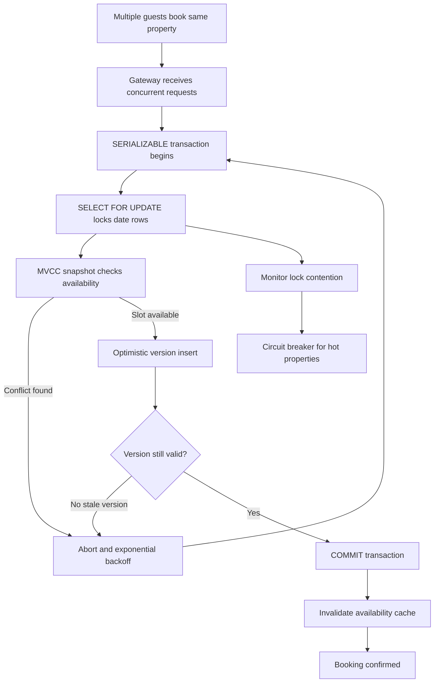

| Difficulty | Channel | Tags |
|---|---|---|
| intermediate | database | acid, isolation-levels, mvcc |

Everyone loves to say 'just use SERIALIZABLE and call it a day.' Everyone is also wrong about what that actually costs. When Booking.com migrated its centralized Order Platform from sharded MySQL to Cassandra, the lack of true ACID transactions forced a custom locking layer whose timeouts were indistinguishable from real business failures — a mess that took a fundamental rethink to untangle [1]. If you're building a booking system where two guests can reserve the same property at once, that cautionary tale is your map through the minefield.

---

> ### Real-World Case — Booking.com
>
> Booking.com's centralized Order Platform orchestrates every reservation — checkout, payment, and fulfillment for hotels, flights, and cars — and was originally built on sharded MySQL, then migrated to Cassandra as part of its 'Connected Trip' initiative. Because reservation data is transactional by nature, Cassandra's row-level isolation and lack of true ACID transactions forced highly denormalized models plus a custom locking layer built on lightweight transactions, whose timeouts were indistinguishable from genuine business-rule failures, along with OpenSearch replication for secondary indexes.
>
> | | |
> |---|---|
> | **Challenge** | Guarantee that multi-step, read-modify-write reservation updates across many rows and partitions are atomic and conflict-free (no double bookings or lost updates), while keeping the order system highly available across regions and avoiding the master-failover downtime and complexity that had plagued sharded MySQL. |
> | **Solution** | They migrated the entire Order Platform to CockroachDB, a distributed SQL database that provides serializable ACID transactions with optimistic concurrency control, MVCC, and automatic transaction retries — replacing the hand-rolled LWT locking with database-enforced correctness. Native CDC and secondary indexes let them delete the OpenSearch synchronization layer and extra cross-checks, and they run a single managed cluster across three regions (Frankfurt, London, Ireland). |
> | **Outcome** | The Order Platform now stores roughly 20TB of reservation data across 3 regions with 99.999% availability (write SLI reported at 99.99998%), with nodes able to fail without customer-visible disturbance; the team eliminated the custom locking system, the OpenSearch data duplication, and significant operational overhead, and is moving remaining Cassandra workloads off entirely. |
> | **Lesson** | The 'more available' NoSQL choice was the trap: weak isolation pushed concurrency control into fragile application-level locks whose failures couldn't even be diagnosed correctly. Choosing a database with real serializable transactions delivered both correctness and better measured availability — strong consistency and high availability are not a zero-sum tradeoff. |

---

## Hook — Two guests, one villa, zero room for error

It's 2am, and your pager is screaming. Two guests just booked the same oceanfront villa for the same week, and both have confirmation emails. Welcome to the double-booking nightmare — the bug that turns a routine Tuesday into an incident review. This isn't a hypothetical: reservation systems live and die by their ability to serialize competing writes, and the stakes climb fast when money, trust, and reputation are on the line. Sound familiar? By the end of this journey, you'll know exactly how to stop it — and why the obvious fix is often the wrong one.

## Problem — When two transactions want the same row

Building on that nightmare scenario, the core challenge is deceptively simple: two transactions want to write the same availability slot, and the database must pick a winner without corrupting either. In a naive setup, both guests read 'available,' both insert a booking, and your system cheerfully confirms both. The database world calls this a race condition; your customers call it a ruined vacation.

Here is the thing though — the pain isn't just about correctness. Add high availability into the mix, and suddenly you're trading consistency for uptime. Shard your data for scale, and cross-shard transactions become a distributed-consensus problem. Cache aggressively for speed, and cache invalidation becomes a second job. Many developers discover this the hard way: the moment a team declares 'our booking system is done' is the moment a subtle isolation anomaly appears in production.

The real question isn't whether to prevent double bookings — it's how to prevent them without turning the system into a single, fragile bottleneck. That tension is exactly what the next case study is about.

## Real-World Case — Booking.com's Order Platform

Nowhere is that tension more visible than at Booking.com. Its centralized Order Platform orchestrates every reservation — checkout, payment, and fulfillment across hotels, flights, and cars. The platform was originally built on sharded MySQL, then migrated to Cassandra as part of the 'Connected Trip' initiative, chasing scale and global reach [1].

But wait, it gets better. Cassandra's row-level isolation and lack of true ACID transactions meant reservation data — transactional by nature — couldn't be modeled cleanly. Teams had to build highly denormalized data models plus a custom locking layer on top of lightweight transactions. The plot twist? Those LWT timeouts were indistinguishable from genuine business-rule failures, so a technical hiccup looked exactly like 'this room isn't available.' On top of that, OpenSearch replication was needed just to maintain secondary indexes [1].

The impact was operational debt at staggering scale: roughly 20TB of reservation data across 3 regions, with a reported write SLI of 99.99998% and availability at 99.999% — impressive numbers, but achieved at the cost of a bespoke locking system and duplicated data. The team eventually eliminated the custom locking layer and the OpenSearch duplication, and began moving remaining Cassandra workloads off entirely [1]. Here is what that teaches: consistency shortcuts have a way of collecting interest.

## Deep Dive — Isolation levels, locks, and the MVCC magic

Building on Booking.com's lesson, consider the machinery that makes safe bookings possible. The ACID properties — Atomicity, Consistency, Isolation, Durability — form the contract every transaction is supposed to honor [2]. Yet 'isolation' is a spectrum, not a switch, and picking the wrong rung is where most double-booking bugs are born [3].

💡 Insight: SERIALIZABLE is the strongest isolation level — it makes concurrent transactions look as if they ran one after another, eliminating write skew and phantom reads entirely [4].

That sounds perfect, right? Here is the catch: strength has a cost. Optimistic concurrency control takes a different approach — instead of locking, it lets transactions proceed and checks for conflicts at commit time using a version column [5]. If two transactions touched the same data, one aborts and retries. MVCC (Multiversion Concurrency Control) adds another layer: each transaction reads a snapshot of the database as it existed at a point in time, so readers never block writers and writers never block readers [6].

⚠️ Watch Out: MVCC snapshot reads alone won't save you. Two transactions can both read 'available' from their snapshots and both commit — a classic write skew. That's why locking still matters.

🔥 Hot Take: Many developers think row-level locks are a performance killer. Actually, locking only the specific date rows that conflict — rather than the whole property — keeps concurrency high and contention low. It is a scalpel, not a sledgehammer [7].

Here is the real tradeoff, laid bare:

| Strategy | Consistency | Throughput | When to use it |
|---|---|---|---|
| Pessimistic locks (SELECT FOR UPDATE) | Strong | Moderate | Hot properties with frequent conflicts |
| Optimistic locking (version column) | Strong | High under low contention | Mostly read-heavy workloads |
| SERIALIZABLE isolation | Strongest | Lower under contention | Critical booking operations |
| Eventual consistency (Cassandra-style) | Weak | Very high | Non-transactional aggregates |

🎯 Key Point: There is no universal winner. The right choice depends on conflict frequency, latency budget, and how angry customers get when things go wrong.

So which pattern wins when thousands of guests are clicking 'Reserve' at once? The workflow ahead shows how these pieces fit together.

## Workflow — From click to confirmed booking

Building on those trade-offs, here is how a production booking flow actually moves. The Mermaid diagram below — 'Booking Transaction Flow' — maps every twist in the road from a guest's click to a confirmed reservation.

1. Request arrives: The gateway receives concurrent booking requests and routes each into its own SERIALIZABLE transaction.
2. Lock the dates: SELECT ... FOR UPDATE grabs row-level locks on the specific availability rows overlapping the requested range. Other transactions targeting those dates must wait.
3. Snapshot check: An MVCC read verifies the slot is still free, using a consistent view of the data.
4. Optimistic insert: The booking is written with a version check. If the version is stale, the transaction aborts.
5. Retry with backoff: Conflicts trigger exponential backoff — patience is cheaper than a corrupted booking.
6. Commit and invalidate: On success, the transaction commits and the availability cache is invalidated so the next guest sees fresh data.
7. Watch the hot properties: A circuit breaker monitors lock contention. When one villa becomes the internet's favorite, the system sheds load rather than collapsing.

⚠️ Watch Out: Cache invalidation is notoriously hard. Invalidate on successful writes, not on reads, or the system will serve stale availability to every guest in line.

Each of these steps is a guardrail. Skip one, and the double-booking bug quietly returns. But how does this translate into code that can actually ship? That's next.

## Code Example — A booking service that refuses to double-book

Building on the workflow, here is the implementation. The Python example in the code block models a real booking service with three layers: a repository for database interactions, a service for orchestration, and a clean retry loop. Pay attention to how each layer earns its keep.

The AvailabilityRepository opens a SERIALIZABLE transaction, then uses lock_date_range() to issue SELECT ... FOR UPDATE on overlapping date rows. That's the pessimistic guard — only conflicting rows get locked, so unrelated properties keep humming along. Next, has_conflict() performs an MVCC snapshot read to confirm the slot is genuinely free. Finally, insert_booking() writes with a version value, adding optimistic protection on top of the pessimistic lock.

The BookingService.reserve() method ties it together. It retries on SerializationFailure, backing off exponentially with self.base_delay * (2 ** (attempt - 1)). Notice the two distinct failure paths: a serialization conflict gets another try, while a genuine DateRangeUnavailable returns immediately — no point retrying a booking that's truly taken.

💡 Insight: Separating 'retryable' from 'terminal' failures is a small detail that saves enormous pain. Teams that retry everything end up hammering the database during incidents, which is how a minor hiccup becomes an outage.

🔥 Hot Take: Production code would swap the illustrative connection pool for a real pool of 20–50 PostgreSQL connections and add metrics on lock wait time. But the concurrency skeleton stays exactly the same.

Run this pattern locally with a test suite that fires 100 concurrent requests at one property. The algorithm should produce exactly one confirmed booking — anything else means a guardrail is missing.

## Lessons Learned — Battle scars worth keeping

Building on the code, here is what actually sticks. The journey from a double-booking nightmare to a hardened booking system isn't about memorizing isolation levels — it's about knowing which guardrail to reach for, and when.

🎯 Key Point — Battle scars:
- Battle scar #1: Trusting MVCC alone. Snapshot reads prevent dirty reads, not write skew. Pair them with row-level locks or version checks.
- Battle scar #2: Locking too broadly. Locking an entire property table instead of specific date rows turns high concurrency into a traffic jam.
- Battle scar #3: Treating every timeout as a retry signal. Booking.com learned that LWT timeouts looked like business failures — visibility into why a transaction failed matters as much as the failure handling itself [1].
- Battle scar #4: Forgetting cache invalidation. A brilliant transaction is useless if the next guest sees yesterday's availability.

For example, a team launching a new property listing might choose optimistic locking first because conflicts are rare — then switch to pessimistic FOR UPDATE locks when that listing goes viral. That adaptive approach is the real skill.

If this feels overwhelming, you are not alone. Even large teams with 99.999% availability targets wrestle with these trade-offs [1]. Start with one property, one date range, and a test that fires concurrent requests. Master that, and scale becomes a series of informed choices rather than guesswork.

The moral? Consistency isn't free, but neither is chaos. Choose deliberately.

---

## Booking Transaction Flow

<strong>Original Interview Question</strong>

**Q:** You're building a booking system for Airbnb where multiple users can reserve the same property simultaneously. How would you design the transaction handling to prevent double bookings while maintaining high availability?

**A:** Use SERIALIZABLE isolation with optimistic concurrency control. Implement row-level locks on property availability tables, use MVCC snapshot reads for checking availability, and apply application-level validation to ensure atomic booking operations.

## Conclusion

That beachfront villa with two confirmations? It never had to happen. Booking.com's migration proved that transactional integrity, cache coherence, and clear failure signals are non-negotiable when reservations are the product [1]. Tomorrow, audit one critical write path in your system: check whether it relies on snapshot reads alone, whether locks are scoped tightly, and whether a timeout tells you the real story. Leave your team with one sentence they can quote: 'Consistency is a design decision, not a database default.' The next double-booking bug is already waiting for someone who skipped this step — make sure it isn't yours.

---

## References

1. [Booking.com incident report](https://www.cockroachlabs.com/customers/booking-com) — article
2. [ACID — Wikipedia](https://en.wikipedia.org/wiki/ACID) — documentation
3. [Isolation (database systems) — Wikipedia](https://en.wikipedia.org/wiki/Isolation_(database_systems)) — documentation
4. [Serializability — Wikipedia](https://en.wikipedia.org/wiki/Serializability) — documentation
5. [Optimistic concurrency control — Wikipedia](https://en.wikipedia.org/wiki/Optimistic_concurrency_control) — documentation
6. [Multiversion concurrency control — Wikipedia](https://en.wikipedia.org/wiki/Multiversion_concurrency_control) — documentation
7. [Two-phase locking — Wikipedia](https://en.wikipedia.org/wiki/Two-phase_locking) — documentation
8. [CockroachDB — GitHub repository](https://github.com/cockroachdb/cockroach) — documentation
9. [Apache Cassandra — GitHub repository](https://github.com/apache/cassandra) — documentation
10. [PostgreSQL — GitHub repository](https://github.com/postgres/postgres) — documentation

---

**Author:** Satishkumar Dhule — [GitHub](https://github.com/satishkumar-dhule) · [LinkedIn](https://linkedin.com/in/satishkumar-dhule) · [Website](https://satishkumar-dhule.github.io)
