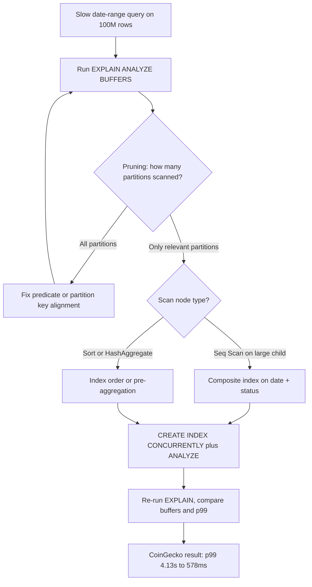

| Difficulty | Channel | Tags |
|---|---|---|
| intermediate | database | explain, query-plan, partitioning |

Picture an hourly crypto-prices table that quietly grew past 1TB over eight years, until a single query took more than 30 seconds and pushed IOPS beyond 24,000. That was CoinGecko's reality on PostgreSQL RDS, where request queues piled up and Apdex scores slid toward the danger zone [1]. Adding an index was not the rescue: prices lived in a JSONB column keyed by currency, so a useful index would have helped exactly one application. The turnaround cut p99 latency from 4.13s to 578ms, and every clue was already sitting in the EXPLAIN plan [1].

---

> ### Real-World Case — CoinGecko
>
> CoinGecko's hourly crypto-prices table on PostgreSQL RDS grew past 1TB after 8 years of data, with average queries taking over 30 seconds. As request volume rose, IOPS repeatedly breached 24K, request queues grew, and Apdex scores fell, threatening SLO/SLA commitments. Indexing failed because the data is stored in a JSONB column keyed by currency, so a useful index would only help one application.
>
> | | |
> |---|---|
> | **Challenge** | Diagnose why date-range queries on a multi-terabyte table were slow and reduce IOPS/latency without downtime, by ensuring queries only touch relevant data instead of scanning the whole table. |
> | **Solution** | They chose monthly RANGE partitioning on the timestamp column since nearly all queries filter on a timestamp range (max four months). After a full dry run on a cloned production DB, they built a parallel partitioned table, copied 1.2TB of data using Foreign Data Wrappers to avoid cold-cache IOPS spikes, prewarmed partitions with pg_prewarm, and swapped tables atomically via rename plus sync triggers. When one query still scanned all partitions, they fixed it by adding proper date bounds; another query using 'created_at > ?' without an upper bound scanned empty future partitions, fixed by removing those pre-created partitions. |
> | **Outcome** | p99 response time dropped from 4.13s to 578ms (~86% reduction), IOPS fell 20% (multiplying savings across replicas), replica lag disappeared, and dry runs measured 6-8x faster queries. Prewarming the partitioned table took 3 hours versus 10 for the original. |
> | **Lesson** | Partition pruning only works if the query's WHERE clause includes the partition key with both bounds; a query that was fast on an unpartitioned table can scan every partition after partitioning if it lacks a lower date limit. Always verify pruning in EXPLAIN, and beware pre-created future partitions and cache warming on the new table. |

---

## Hook — The Query That Ate the Afternoon

Ever wondered why a query on 'just one month of data' can still make a database sweat? Picture a 100M-row events table, partitioned by date, and a dashboard request for January 2024. The developer who wrote it did everything right on paper: a clean range predicate, a partitioned table, and an index that looks reasonable. Then the complaints start. Average response time is north of 30 seconds, the IOPS graph resembles a heart attack, and an SLA that used to be boring becomes a daily negotiation [1].

Here is the uncomfortable truth: partitioning is a promise, not a guarantee. You can partition by date and still read every partition in the table, because the planner only skips work when the predicate and the partition key line up [3]. Sound familiar? The investigation begins not with a new index, but with one question: what did the planner actually do?

## Problem — When More Hardware Stops Helping

However, the pain rarely arrives with a siren. A table grows, a few queries slow down, and the standard response is to add an index or buy a bigger instance. On a managed service such as Amazon RDS for PostgreSQL, provisioning more storage and IOPS is easy enough [9], but at 1TB and beyond, IOPS turns into a budget line item rather than a quick fix [1].

The deeper issue is that a partitioned table is many small tables wearing one logical costume. Queries get routed to child partitions, and if the date predicate is buried inside a function, a cast, or a JSONB expression, pruning can quietly fail [3]. Meanwhile, every row the planner cannot skip becomes buffer reads, and those buffer reads become IOPS, queue depth, and a falling Apdex score [1].

Many developers assume an index on the parent table magically fixes all the children. It does not work like a spell: index usage has to appear in the plan, on the partitions that survive pruning, with the expected scan type [4]. A composite index on (date, filtered_columns) is often the right answer, but only after confirming that the planner wants a narrow range scan instead of a sequential sweep.

⚠️ Watch Out: A 100M-row table with a slow date query is not automatically a partitioning problem. It might be a predicate problem, a statistics problem, or a sort problem wearing a partitioning costume. So how do you tell them apart?

## Real-World Case — CoinGecko

This leads directly to one of the clearest documented examples of the stakes. CoinGecko's hourly crypto-prices table on PostgreSQL RDS passed 1TB after eight years of accumulated market data. Average queries took over 30 seconds, IOPS repeatedly broke 24,000, request queues grew, and Apdex scores fell far enough to threaten SLO and SLA commitments [1].

The obvious move failed for an interesting reason: prices were stored in a JSONB column keyed by currency, so even a perfectly crafted index would have served only one application [1][6]. That is the plot twist. The data was not badly indexed by accident; it was shaped in a way that made a single universal index impossible.

The team restructured the hot table into partitions and measured dry runs that were 6-8x faster. In production, p99 response time dropped from 4.13s to 578ms, roughly an 86% reduction, while IOPS fell by 20%, a saving that multiplies across every read replica [1][10]. Replica lag disappeared, and prewarming the partitioned table took 3 hours instead of 10.

💡 Insight: The win was not one magic index. It was reducing the amount of data each query was forced to touch, then proving it with measured plans and latency numbers. But what does a plan look like when pruning is silently failing? That question leads straight into the deep dive.

## Deep Dive — Reading the Plan Like a Detective

Building on CoinGecko's experience, the output of EXPLAIN (ANALYZE, BUFFERS) is the crime scene. Estimates tell you what the planner believed; actual rows and buffer counts tell you what happened. A gap between the two usually means stale statistics, a misestimated predicate, or a data distribution the planner cannot model [5].

Here is what deserves attention, in order:

- **Partition pruning:** The Append or Merge Append node should reference only the relevant child partitions. If a January query touches 96 monthly partitions, the date predicate is not pruning [3].
- **Index utilization:** Look for Index Scan or Bitmap Index Scan on the survivors. A Seq Scan is not always evil, but a Seq Scan on a 50M-row child for a one-day filter is a confession [4].
- **Sort and hash nodes:** Expensive Sort and HashAggregate operations often explain tail latency even when row counts look sane [5].
- **Buffer counts:** Shared hit versus shared read blocks reveal whether the work is cached or hammering storage [9].

⚠️ Watch Out: Planning-time pruning and execution-time pruning are different animals. Parameterized queries and prepared statements can delay pruning until execution, so test with the same bind parameters production uses [2].

### Option A vs Option B — the real tradeoff

| Option | Best for | Real tradeoff |
| --- | --- | --- |
| Composite B-tree on (date, status) | Dashboards filtering a range plus a status | More index storage and write overhead |
| BRIN | Append-only, naturally ordered time series | Less precise when rows are scattered |
| JSONB GIN or expression index | Queries by one specific currency key | Helps one access pattern, CoinGecko's exact trap [6] |
| Date partitioning with pruning | Almost any time-range workload | Wrong key or non-sargable predicate turns it into overhead [3] |

**When would you actually use this?** Reach for the composite B-tree when filters are predictable and selective. Reach for BRIN when data arrives in chronological order and approximate block skipping is enough. Reach for a JSONB expression index when one key truly dominates traffic, and accept that other keys stay slow.

🔥 Hot Take: CLUSTER feels like a permanent fix, but it is a one-time physical rewrite. Future inserts drift back out of order unless the table is re-clustered or an access method that tolerates drift is chosen [7].

The next question is not what to change, but in what order. That is where a repeatable workflow earns its keep.

## Workflow — From 30 Seconds to a Repeatable Decision Path

With the plan decoded, turn the diagnosis into a loop rather than a one-off heroic debugging session. The **Query Optimization Decision Flow** Mermaid diagram included with this article shows the route: capture the plan, verify pruning, inspect scan types, attack sorts, add the composite index, then re-measure.

1. **Capture the real plan.** Run EXPLAIN (ANALYZE, BUFFERS) on the exact query with production-like literals or binds [5].
2. **Verify pruning.** Count the child partitions inside the Append node. Fewer is better; one or two for a single month is the goal [3].
3. **Inspect nodes.** Note Seq Scan, Index Scan, Sort, and HashAggregate, plus the actual-versus-estimated row gap [4].
4. **Add the composite index safely.** Use CREATE INDEX CONCURRENTLY so writes keep flowing, then ANALYZE to refresh statistics.
5. **Consider physical order.** Evaluate CLUSTER or BRIN only when the access pattern is genuinely sequential and the maintenance cost has been accepted [7].
6. **Re-run and compare.** Success means fewer buffers and lower p99, not a prettier plan [1].

💡 Insight: Treat the plan as a before-and-after photograph. Without the 'before' photo, every optimization is just a guess with extra steps.

Ready to see the commands that make this loop real? The next section puts them into a script you can adapt tomorrow.

## Code Example — A Production-Safe Diagnostic Script

Here is the workflow turned into a runnable bash script. It uses psql with a read-only connection string, captures the plan before and after indexing, and keeps writes available during index creation.

```bash
#!/usr/bin/env bash
# Diagnostic script for a slow, date-partitioned PostgreSQL table.
set -euo pipefail

DSN="postgresql://readonly@analytics.internal:5432/prod"
START='2024-01-01'
END='2024-02-01'

# 1. Capture the truth: timing, actual rows, and buffer reads.
psql "$DSN" <<SQL
EXPLAIN (ANALYZE, BUFFERS, VERBOSE)
SELECT * FROM events
WHERE event_date >= '${START}' AND event_date < '${END}'
  AND status = 'completed';
SQL

# 2. Pruning check: the Append node should list only January children.
#    If all 96 monthly partitions appear, fix the predicate before indexing.

# 3. Build the composite index online; CONCURRENTLY avoids blocking writes.
psql "$DSN" <<SQL
CREATE INDEX CONCURRENTLY IF NOT EXISTS idx_events_date_status
  ON events (event_date, status) INCLUDE (event_id);
SQL

# 4. Refresh statistics so the planner can cost the new index correctly.
psql "$DSN" -c 'ANALYZE events;'

# 5. Capture the after-photo and compare 'Buffers:' lines with step 1.
psql "$DSN" <<SQL
EXPLAIN (ANALYZE, BUFFERS)
SELECT * FROM events
WHERE event_date >= '${START}' AND event_date < '${END}'
  AND status = 'completed';
SQL
```

The first EXPLAIN produces the baseline; its Append node and buffer counts are the evidence. The composite index puts the range column first and the equality column second, which matches this WHERE clause. CONCURRENTLY keeps the table writable, and ANALYZE prevents the planner from costing a brand-new index with stale statistics. The second EXPLAIN is the proof: fewer buffers and lower actual time mean the change earned its place. The full annotated explanation lives in the `codeExample` field.

## Lessons Learned — Battle Scars and the Next Morning

The story comes full circle here: eight years of hourly prices, a 1TB table, and 30-second queries were not fixed by buying more disks. CoinGecko's 4.13s-to-578ms result came from making the planner ignore data it did not need [1].

Battle scars worth remembering:

- **Indexing before measuring.** Teams burn hours building indexes the planner never uses. Capture the plan first [4].
- **Assuming partitioning equals pruning.** Wrapping the partition key in a function or using a mismatched type can send the query through every partition [3].
- **Treating CLUSTER as permanent.** It is a one-time rewrite with a lock, and entropy wins afterwards [7].
- **Hoping one JSONB index rules them all.** Keyed data means one index serves one application [6].
- **Forgetting the replicas.** A 20% IOPS drop multiplies across the read fleet [10].

If this feels overwhelming, you are not alone. Start with one query, one plan, and one measurement. 

So what changes tomorrow? Pick your slowest date-range query, run EXPLAIN (ANALYZE, BUFFERS), and count the partitions it touches before touching a single index. Share this one rule with your team: partitioning does not make queries faster; it makes the right queries cheaper by letting the planner ignore data. That is the insight worth carrying into the next incident.

---

## Query Optimization Decision Flow



<details>
<summary><strong>Original Interview Question</strong></summary>

**Q:** You have a PostgreSQL table with 100M rows partitioned by date. A query filtering on a specific date range is still slow. What would you check in the EXPLAIN plan and how would you optimize it?

**A:** Check partition pruning effectiveness, index utilization patterns, and expensive sort operations. Create composite indexes on (date, filtered_columns) and evaluate clustering strategies for optimal data access.

</details>

## Conclusion

Eight years of hourly prices and a 1TB table did not get rescued by more hardware. CoinGecko's journey from 4.13s to 578ms [1] started with a plan, a pruning check, and the courage to reshape the table instead of adding another index. Tomorrow, take your slowest date-range query, capture EXPLAIN (ANALYZE, BUFFERS), and count the partitions it touches before changing anything else. If that count is larger than your date filter deserves, you have found the villain of your own story. Carry one line back to your team: partitioning does not make queries faster; it makes the right queries cheaper by letting the planner ignore data.

---

## References

1. [CoinGecko incident report](https://dev.to/coingecko/scaling-postgresql-performance-with-table-partitioning-136o) — article
2. [PostgreSQL](https://en.wikipedia.org/wiki/PostgreSQL) — documentation
3. [Partition (database)](https://en.wikipedia.org/wiki/Partition_(database)) — documentation
4. [Database index](https://en.wikipedia.org/wiki/Database_index) — documentation
5. [Query optimization](https://en.wikipedia.org/wiki/Query_optimization) — documentation
6. [JSON](https://en.wikipedia.org/wiki/JSON) — documentation
7. [B-tree](https://en.wikipedia.org/wiki/B-tree) — documentation
8. [PostgreSQL source repository](https://github.com/postgres/postgres) — documentation
9. [Amazon RDS for PostgreSQL](https://docs.aws.amazon.com/AmazonRDS/latest/UserGuide/CHAP_PostgreSQL.html) — documentation
10. [Working with read replicas for Amazon RDS](https://docs.aws.amazon.com/AmazonRDS/latest/UserGuide/USER_ReadReplica.html) — documentation

---

**Author:** Satishkumar Dhule — [GitHub](https://github.com/satishkumar-dhule) · [LinkedIn](https://linkedin.com/in/satishkumar-dhule) · [Website](https://satishkumar-dhule.github.io)
