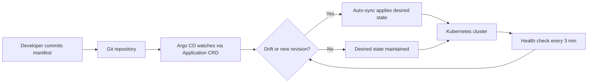

| Difficulty | Channel | Tags |
|---|---|---|
| beginner | devops | argocd, flux, declarative |

In 2018, Intuit began moving thousands of services — including QuickBooks and TurboTax — onto Kubernetes, yet releases were still driven by imperative deployment scripts [1]. When a deploy failed halfway, developers had to reverse-engineer which step broke and write compensating commands; even a "successful" run offered no proof the cluster matched the intended state [1]. That quiet gap between "deploy finished" and "cluster is correct" is exactly the problem GitOps exists to solve. Stick around, because the fix is less about buying new tooling and more about giving up a little control.

---

> ### Real-World Case — Intuit
>
> In 2018 Intuit began migrating thousands of services (QuickBooks, TurboTax) onto Kubernetes, but releases were still driven by imperative deployment scripts. When a deploy failed midway, developers had to manually figure out which step broke and write compensating steps; even a 'successful' deploy offered no way to verify the cluster actually matched the intended state.
>
> | | |
> |---|---|
> | **Challenge** | Replace brittle imperative scripts with a declarative, version-controlled GitOps delivery system that continuously compares live cluster state against a Git-defined desired state, works across hundreds of clusters and thousands of developers, and makes rollbacks trivial and auditable. |
> | **Solution** | Intuit built Argo CD: a Git repository of Kubernetes manifests/Kustomize overlays acts as the single source of truth, with an Application CRD per service/environment pointing at that repo. Jenkins CI promotes a release simply by committing a new image tag to the deployment repo, and Argo CD continuously diffs and auto-syncs the cluster to Git (with self-healing and Git-based rollback). Satisfying their own enterprise scale needs, Intuit then open-sourced Argo CD, which became a CNCF project. |
> | **Outcome** | Deployment time dropped ~80%, rollbacks fell to under 10 minutes (CNCF reports MTTR 45 min to under 5 min), and Argo CD saves Intuit roughly 500,000 developer hours a year (about 57 years). The platform grew to 11,000+ applications across 375+ clusters, 15,000+ nodes, 5,000 developers and ~1,000 deployments per day; the open-source tool is now used by thousands of organizations. |
> | **Lesson** | Defining desired state declaratively in Git and letting a controller continuously reconcile it eliminates the guesswork of imperative scripts: every change is auditable, drift is auto-corrected, and rollback is just a Git revert. The pain was so universal that the tool Intuit built for itself became the industry standard. |

---

## Hook — The deploy looked fine. Then the cluster drifted

It was mid-deploy when the scripts gave up. Picture the scene: a QuickBooks release is underway, half the pods are updated, half are not, and the only clue is a trail of imperative commands that ran before things went sideways. Developers stare at the cluster asking the question nobody wants to ask at 3 a.m. — which step broke, and what state is the cluster actually in? Sound familiar? Teams everywhere have lived this moment, where "the deploy finished" and "the cluster is correct" are two completely different claims. Here is the uncomfortable truth: the tool that caused the mess is often the one teams reach for to fix it.

## Problem — When kubectl becomes the source of truth (it isn't)

Start with the mundane reality of imperative work. A developer runs kubectl apply, kubectl set image, or kubectl rollout, and the cluster changes immediately [5]. That feels productive — instant feedback, quick fixes, the dopamine hit of a green terminal. However, every command writes state into the cluster without leaving a durable, reviewable record in version control. Consequently, the next person has no idea what changed, when, or why.

This is configuration drift, and it is the silent tax on imperative deployments. One engineer hotfixes a replica count at 2 a.m.; another tunes a ConfigMap during an incident; nobody writes it down. Over weeks, the live cluster and the repository drift apart like two friends who stopped texting. You might think the manifests in Git describe reality, but actually they describe reality as of the last honest commit.

The stakes are not abstract. When a failed deploy leaves a cluster half-updated, recovery depends on a developer reconstructing the command sequence by hand and writing compensating steps — the digital equivalent of un-baking a cake. Even a "successful" deploy offers no verification that the running state matches the intended state [1]. That gap is where outages hide.

So what is the alternative? If a cluster cannot be trusted to remember intent, intent needs a home outside the cluster. That home is Git, and the bridge is a controller that never stops comparing the two.

## Real-World Case — Intuit

Consider Intuit, the company behind QuickBooks and TurboTax. In 2018, Intuit began migrating thousands of services onto Kubernetes, yet releases were still driven by imperative deployment scripts [1]. When a deploy failed midway, developers had to manually determine which step broke and write compensating commands; even a "successful" deploy offered no way to verify the cluster matched the intended state [1].

The pain scaled with the platform. As the number of services grew, the manual forensic work after each failed release grew with it, turning routine deploys into investigations. Therefore, the team looked for a model where Git — not a runbook of commands — became the single source of truth.

The transformation was remarkable. Deployment time dropped roughly 80%, and rollbacks fell to under 10 minutes, with CNCF reporting MTTR improving from about 45 minutes to under 5 minutes [1]. Argo CD now saves Intuit approximately 500,000 developer hours a year — around 57 years of human effort [1]. The platform grew to more than 11,000 applications across 375+ clusters and 15,000+ nodes, serving 5,000 developers who run about 1,000 deployments per day [1].

💡 Insight: The lesson here is not "buy a new tool." It is "stop making humans the reconciliation loop." But how does a controller actually replace that loop without becoming a bottleneck? That question drives the deep dive.

## Deep Dive — Declarative versus imperative, and why drift wins

Building on Intuit's experience, the core shift is philosophical before it is technical. GitOps is essentially continuous delivery plus infrastructure as code applied to Kubernetes [9][10], where Git acts as the declarative source of truth and a controller continuously reconciles the live cluster toward that declared state [2]. Argo CD, an open-source continuous delivery tool for Kubernetes, does exactly this by watching a repository and comparing desired state to observed state [2].

Here is the thing though: declarative and imperative are not merely "YAML versus commands." They are two different mental models of ownership. Kubernetes itself models workload intent as API objects [6], and the declarative object-management model is documented directly by the project [3].

With the declarative approach, the complete desired state lives in version control — YAML manifests, Helm charts, or Kustomize overlays [3][4]. Argo CD continuously monitors the cluster and reconciles actual state toward that declaration. Every change arrives as a commit, which gives teams auditability, code review, and fast rollbacks [3].

With the imperative approach, changes are applied directly through commands such as kubectl set image [5]. Those changes bypass version control, so tracking and collaboration suffer, drift accumulates across environments, and rollbacks require manual intervention [5].

| Option | Declarative (GitOps + Argo CD) | Imperative (kubectl commands) |
|---|---|---|
| Source of truth | Git repository | Live cluster state |
| Change mechanism | Commit and merge | Direct commands |
| Drift handling | Self-healing reconciliation | Manual detection and fixes |
| Auditability | Full history in Git | Scattered shell history |
| Rollback | Revert a commit | Reconstruct prior state by hand |
| Best for | Teams, multi-env, regulated setups | Quick local experiments, one-off debugging |

⚠️ Watch Out: Declarative does not mean "never run kubectl." Imperative commands remain excellent for exploration and debugging; the trouble starts when those commands become the deployment pipeline.

🔥 Hot Take: Self-healing is the feature that makes teams nervous, because it quietly deletes the emergency fix a developer just applied at 2 a.m. That is the point. If the fix is not in Git, it is not a fix — it is a time bomb with a countdown no one can see.

Here is a nuance many developers miss: auto-sync and self-healing solve different problems. Auto-sync pulls new commits into the cluster; self-healing reverts drift from out-of-band changes. Configuring only the first leaves the door open for manual edits. Moreover, a health check interval — typically 1 to 5 minutes, with 3 minutes a common choice — controls how quickly Argo CD notices problems [2].

So the controller never sleeps. But what happens step by step between a developer's git push and a healthy pod? The workflow maps that journey.

## Workflow — From git push to self-healed cluster

This leads directly to the reconciliation loop — the visual story of a commit becoming a running pod. Kubernetes holds cluster state in etcd [6], while Argo CD keeps watching Git; the Application custom resource is the contract between the two [2].

The diagram below, GitOps Reconciliation Flow, traces the path from a developer's commit to a self-healed cluster:



Step by step, the flow works like this:

1. A developer commits a manifest or Helm chart change to the Git repository.
2. Argo CD's Application CRD detects the new revision on its configured poll interval [2].
3. A diff is computed between Git's desired state and the cluster's live state.
4. When drift or a new revision appears, auto-sync applies the changes to the cluster.
5. Self-healing reverts any out-of-band manual edits back to the declared state.
6. Health checks run on a cycle — often every 3 minutes — to confirm workloads are healthy [2].
7. The loop repeats forever, which is precisely why drift cannot accumulate unnoticed.

Consequently, a cluster is never "done" in the old sense; it is continuously nudged toward the declared state. You might think constant reconciliation is wasteful, but actually it is cheap compared to a 2 a.m. incident. However, a controller is only as good as the declaration it trusts, which brings the story to code.

## Code Example — An auto-syncing Application CRD

Here is the implementation that turns the theory into an auto-syncing, self-healing Argo CD Application. The snippet uses bash because it mirrors what a platform engineer pastes into a terminal or CI job; the Application manifest itself is the declarative artifact.

```bash
#!/usr/bin/env bash
set -euo pipefail

# Submit the Application CRD declaratively via kubectl
cat <<'EOF' | kubectl apply -f -
apiVersion: argoproj.io/v1alpha1
kind: Application
metadata:
  name: quickbooks-api
  namespace: argocd
spec:
  project: default
  source:
    repoURL: https://github.com/acme/gitops-manifests.git
    targetRevision: HEAD
    path: apps/quickbooks-api/prod
  destination:
    server: https://kubernetes.default.svc
    namespace: production
  syncPolicy:
    automated:
      prune: true       # remove resources deleted from Git
      selfHeal: true    # revert manual kubectl edits
    syncOptions:
      - CreateNamespace=true
EOF

# Trigger an immediate sync, then block until Healthy and Synced
argocd app sync quickbooks-api
argocd app wait quickbooks-api --health --sync
```

Walking through it:

- The cat heredoc pipes an Application CRD into kubectl apply, so the desired state is submitted as a manifest rather than a sequence of commands.
- spec.source points to the Git repository, uses HEAD as the targetRevision, and selects the production overlay under apps/quickbooks-api/prod.
- spec.destination targets the in-cluster API server and the production namespace.
- syncPolicy.automated.prune removes resources that were deleted from Git, keeping the cluster from hoarding stale objects.
- syncPolicy.automated.selfHeal is the anti-drift guardrail: it reverts changes made directly with kubectl.
- CreateNamespace=true prevents a failed sync when the target namespace does not yet exist.
- argocd app sync forces an immediate reconciliation, while argocd app wait --health --sync blocks until the app reports both Healthy and Synced.

⚠️ Watch Out: Test selfHeal in a staging namespace first. It will happily delete a hotfix that was never committed.

When would you actually use this? Any service whose desired state is stable enough to live in Git — that is, nearly every production workload. For one-off debugging, stick with imperative commands, then commit the result.

## Lessons Learned — Battle scars and the road ahead

By now the journey from frantic imperative scripts to a self-healing GitOps loop is clear. Here are the takeaways worth keeping.

- Git is the source of truth, not the cluster. If a change is not in Git, it does not exist in the official story [3].
- Auto-sync and self-healing are complementary. Configure both, or drift creeps back in.
- Tune the health check interval deliberately. Three minutes is a sensible default; shorter intervals increase API load, longer ones delay detection [2].
- Prune with care. Enable prune: true only when the repository truly owns the resources.
- Secrets need special handling. Never commit plaintext secrets; use a secrets operator or an encrypted overlay.
- Clean up after yourself. Retire obsolete imperative runbooks so nobody accidentally reintroduces drift.

Battle scars — common mistakes and how to avoid them:

1. Forgetting selfHeal, then wondering why manual edits persist. Enable it explicitly.
2. Pointing multiple Applications at the same resources, causing sync fights. Give each resource a single owner.
3. Ignoring health checks, so a "synced" app can still be broken. Always wait for --health.
4. Treating auto-sync as permission to skip code review. Commits should still be reviewed.
5. Setting the health interval to 10 seconds and overwhelming the API server. Start at 3 minutes [2].

🎯 Key Point: The most memorable insight is this — a deployment is not finished when a command returns; it is finished when the cluster's observed state matches the declared state in Git, and a controller proves it continuously.

If this feels overwhelming, you are not alone. Many teams start with a single non-critical service, watch the loop behave for a week, and then expand. Flux CD offers a similar model if Argo CD is not a fit [7], and a Kubernetes primer can smooth the learning curve [8]. Ultimately, GitOps is continuous delivery plus infrastructure as code applied to Kubernetes [9][10].

---

## GitOps Reconciliation Flow


<details>
<summary><strong>Original Interview Question</strong></summary>

**Q:** You're setting up GitOps for a microservices deployment. How would you configure ArgoCD to automatically sync changes from your Git repository to Kubernetes, and what's the difference between declarative and imperative approaches in this context?

**A:** I'd configure ArgoCD by setting up a Git repository containing Kubernetes manifests or Helm charts, creating an Application CRD that points to the Git repository, enabling auto-sync with a health check interval of 3 minutes, and implementing self-healing to automatically revert any manual changes. The declarative approach involves defining the desired state in Git through YAML manifests, Helm charts, or Kustomize configurations, where ArgoCD continuously reconciles the actual state with the desired state. In contrast, the imperative approach uses kubectl commands to make direct changes to the cluster, bypassing the Git repository as the single source of truth.

</details>

## Conclusion

The story that opened with a half-finished QuickBooks deploy ends with a very different ritual. Instead of reverse-engineering commands, developers push a commit and let Argo CD prove the cluster matches Git — the same shift that helped Intuit cut deployment time by roughly 80% and reclaim about 500,000 developer hours a year [1]. The moral: stop asking "did the deploy run?" and start asking "does the cluster match the declaration?" Tomorrow, pick one service, write its desired state in Git, wire an Application with auto-sync and self-healing, and let the reconciliation loop carry the burden. Your future 3 a.m. self will thank you — and the cluster will finally tell the truth.

---

## References

1. [Intuit incident report](https://blogs.intuit.com/2021/03/16/deploy-code-faster-with-new-innovation/) — article
2. [Argo CD GitHub repository](https://github.com/argoproj/argo-cd) — documentation
3. [Kubernetes Object Management](https://kubernetes.io/docs/concepts/overview/working-with-objects/object-management/) — documentation
4. [Manage Kubernetes Objects Declaratively with Kustomize](https://kubernetes.io/docs/tasks/manage-kubernetes-objects/declarative-config/) — documentation
5. [Manage Kubernetes Objects Using Imperative Commands](https://kubernetes.io/docs/tasks/manage-kubernetes-objects/imperative-command/) — documentation
6. [Kubernetes - Wikipedia](https://en.wikipedia.org/wiki/Kubernetes) — documentation
7. [Flux CD GitHub repository](https://github.com/fluxcd/flux2) — documentation
8. [An Introduction to Kubernetes - DigitalOcean](https://www.digitalocean.com/community/tutorials/an-introduction-to-kubernetes) — blog
9. [Continuous deployment - Wikipedia](https://en.wikipedia.org/wiki/Continuous_deployment) — documentation
10. [Infrastructure as code - Wikipedia](https://en.wikipedia.org/wiki/Infrastructure_as_code) — documentation

---

**Author:** Satishkumar Dhule — [GitHub](https://github.com/satishkumar-dhule) · [LinkedIn](https://linkedin.com/in/satishkumar-dhule) · [Website](https://satishkumar-dhule.github.io)
