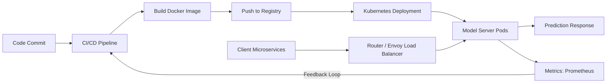

| Difficulty | Channel | Tags |
|---|---|---|
| beginner | devops | mlops, deployment |

When Netflix's personalization systems were pushing roughly one million inference requests per second across 30-plus client microservices, every single request had to squeeze through one custom routing proxy called Switchboard [1]. That proxy added a 10–20ms serialization hop and created a shared-fate failure mode where one slow component could drag down the entire platform. The fix was not a bigger cluster or a fancier model — it was removing the router from the hot path entirely [1]. That story captures the exact confusion this post untangles: the difference between deploying a model and serving it.

---

> ### Real-World Case — Netflix
>
> Netflix's centralized ML model serving platform powers member-facing personalization (title ranking, artwork, commerce, payment fraud detection) across hundreds of model types and versions. By 2025 it handled roughly 1 million requests per second for 30+ client microservices, but every inference request had to traverse a single custom routing proxy called Switchboard.
>
> | | |
> |---|---|
> | **Challenge** | Switchboard sat in the critical request path as a mandatory central gateway that selected the right model version, cluster shard, and A/B-test allocation. At scale it became a single point of failure whose outage would degrade many ML experiences at once, and it added 10–20ms of latency per request from serializing/deserializing payloads, with much worse tail-latency amplification — unacceptable for latency-sensitive clients — while also blurring separation of real vs. test traffic. |
> | **Solution** | Netflix split routing into two decoupled concerns. 'Lightbulb' is a lightweight service that reads only minimal request context and resolves it into a routing key plus model config (ObjectiveConfig) without touching the payload. Envoy sidecars — already used for all service-to-service traffic at Netflix — read the routing key from a header and route directly to the correct model shard VIP. This removed the central proxy from the hot path while preserving context-aware routing, A/B traffic splitting, canaries, shadow mode, and instant rollback. |
> | **Outcome** | The platform serves 1M+ requests/second across hundreds of model versions and 30+ client services. Removing the router from the request path eliminated the 10–20ms serialization hop and the shared-fate failure mode, reducing routing to minimal header-based overhead while keeping the single-integration client abstraction. |
> | **Lesson** | The very abstraction that accelerates model iteration (one central router for versioning, A/B tests, and rollouts) can become the latency and availability bottleneck. Separate lightweight routing metadata from heavy request payloads, and push routing down into the service mesh so deployment velocity doesn't cost latency or reliability. |

---

## Hook — The Million-Request Single Point of Failure

Picture a single proxy sitting in front of a platform that serves one million inferences every second. It is 3am, traffic is peaking, and that proxy — innocuously named Switchboard — is the only door every request must pass through [1]. One serialization hop later, 10–20 milliseconds have vanished, and a slow downstream service has turned a 'simple router' into a shared-fate time bomb.

💡 Insight: the most dangerous component in an ML system is rarely the model; it is the unsung piece of plumbing everybody forgot to question. Sound familiar? Developers have all been there — staring at a 500 error at 2am, wondering how a routing layer became the bottleneck. The stakes are real: when serving degrades, personalization, fraud detection, and checkout all feel it at once. What could possibly go wrong when one door guards a million requests a second?

## Problem — Where Deployment Ends and Serving Begins

Building on that tension, here is where most developers get tripped up. Deployment and serving sound interchangeable, but they are different jobs with different failure modes. Deployment is the journey from code commit to a running, observable model — CI/CD pipelines, infrastructure provisioning, rollout strategies, and rollback plans [2]. Serving is what happens on every single request: routing, model loading, batching, version selection, and squeezing latency out of inference [3].

⚠️ Watch Out: teams often pour weeks into deployment automation and then bolt on a naive endpoint, assuming the hard part is over. It is not. You might think a model that works in a notebook is 'deployed,' but actually getting it to answer reliably at 10,000 QPS is an entirely different discipline. So where exactly does one end and the other begin?

## Real-World Case — Netflix

The Netflix story answers that question brutally well. By 2025, the company's centralized model serving platform powered member-facing personalization — title ranking, artwork selection, commerce, and payment fraud detection — across hundreds of model types and versions [1]. It handled roughly one million requests per second for more than 30 client microservices, and every inference traversed that single custom routing proxy, Switchboard.

Removing the router from the request path eliminated the 10–20ms serialization hop and the shared-fate failure mode, cutting routing down to minimal header-based overhead while keeping the single-integration client abstraction intact [1]. 🔥 Hot Take: the winning move was subtraction, not addition. Many developers reach for more replicas or a faster model, but the real gain came from deleting a layer. Quantified impact: 1M+ requests per second, 30+ client services, hundreds of model versions — all on a leaner, safer path. But how does a team actually design that leaner path without breaking everything?

## Deep Dive — The Trade-offs Hiding Under the Hood

This leads directly into the trade-offs that separate a hobby endpoint from production-grade serving. First, latency versus throughput: real-time personalization often demands sub-100ms responses, while batch pipelines happily accept under one second in exchange for efficiency [3]. Second, batch versus real-time inference: batching requests improves GPU utilization but adds queueing delay, which is why frameworks like TorchServe expose explicit batching controls [4]. Third, model versioning and traffic splitting: serving multiple versions behind one endpoint lets teams run A/B tests and gradual rollouts, a pattern supported by managed platforms such as SageMaker [6].

💡 Insight: versioning is not a deployment concern that stops at release — it is a runtime reality that the serving layer must own on every request. Here is the tradeoff laid bare:

| Option A | Option B | The real tradeoff |
|---|---|---|
| Real-time inference | Batch inference | Low latency vs high throughput |
| Single router proxy | Header-based routing | Central control vs shared-fate risk |
| Vertical scaling (GPU memory) | Horizontal scaling (pod replicas) | Bigger box vs distributed resilience |
| Framework server (TF Serving) | Custom API (FastAPI) | Optimized inference vs flexibility |

⚠️ Watch Out: autoscaling policies look great on paper, but without proper readiness probes and warm-up handling, new pods will happily accept traffic before the model is loaded [7]. Every one of these choices shapes the workflow that follows.

## Workflow — From Commit to Inference: The Full Journey

Building on those trade-offs, the full journey from commit to inference is where deployment and serving finally meet. The step-by-step flow runs like this:

1. A developer pushes code and model artifacts to version control.
2. A CI/CD pipeline builds a Docker image and runs validation tests [2].
3. The image is pushed to a registry, and a Kubernetes Deployment rolls out new pods [2].
4. Model servers such as TensorFlow Serving or BentoML load the model versions inside those pods [3][8].
5. Client services send inference requests through a lightweight router or load balancer such as Envoy [10].
6. A Horizontal Pod Autoscaler scales replicas based on CPU or custom latency metrics [7].
7. Monitoring via Prometheus tracks latency, error rates, and per-version health [9].

The Mermaid diagram below tells this visual story — follow the solid line from commit to prediction, then notice how metrics loop back into the pipeline. 🎯 Key Point: that feedback loop is what makes the system self-correcting rather than merely reactive. But a diagram cannot prove the logic works — that takes code.

## Code Example — A Production-Shaped Serving Endpoint

Here is a production-shaped serving endpoint that directly tackles the version routing and latency tracking problem from earlier. The snippet uses FastAPI, a common choice for wrapping models because it is lightweight and async-friendly. Read it section by section, then notice how it encodes the lesson from Netflix's router removal: version selection driven by the request itself, plus observability baked in.

[code block]

Step by step: the MODEL_REGISTRY dictionary maps version strings to prediction functions, which is the runtime versioning the serving layer must own. The PredictRequest model defines a typed payload with a default version, so clients can opt into a specific model without redeploying. The /predict handler looks up the requested version and returns a 404 if it is missing — a graceful failure instead of a mysterious 500. time.perf_counter measures inference latency per version, feeding the monitoring discipline referenced earlier [9]. Finally, the /health endpoint gives orchestrators a readiness probe so traffic never reaches a pod before it is ready [7]. 🔥 Hot Take: this is not a toy — registry, typed request, latency tracking, and health check are exactly what keep a serving layer boring, and boring is a compliment in production. If this feels overwhelming, teams ship versions of this incrementally all the time.

## Lessons Learned — Battle Scars and What to Do Tomorrow

Consequently, the journey from a million-request bottleneck to a lean serving path yields a handful of hard-won lessons. Battle scars first:

⚠️ Watch Out for these classic mistakes — (1) treating deployment as the finish line when serving is where reliability is won or lost, (2) letting one router become a shared-fate failure mode, as Netflix learned [1], (3) autoscaling without warm-up handling so cold starts wreck latency [7], and (4) skipping per-version metrics until an incident forces the issue [9].

🎯 Key Point: every concept here answers the same question — when would you actually use this? Use deployment tooling like MLflow and Kubernetes when you need repeatable, rollback-safe releases [5][2]. Use dedicated model servers like TensorFlow Serving or TorchServe when inference performance dominates [3][4]. Use header-based routing when central control costs more than it saves [1]. The transformation is simple to state but hard to internalize: stop obsessing over the model in isolation and start treating the path to it as a first-class system.

---

## Deployment to Serving Flow

<strong>Original Interview Question</strong>

**Q:** Explain the key differences between model serving and model deployment in ML systems, including specific technologies, scaling considerations, and real-world implementation patterns?

**A:** Deployment encompasses CI/CD pipelines, infrastructure setup, and monitoring using tools like Kubernetes, MLflow, and SageMaker. Serving focuses on runtime inference APIs with frameworks like TensorFlow Serving, TorchServe, or BentoML, handling request routing, model versioning, and autoscaling. Key trade-offs include latency vs throughput, batch vs real-time inference, and cold start optimization.

## Conclusion

That brings the story full circle. Netflix's million-request-per-second platform did not get faster by adding machinery — it got faster by questioning the plumbing everyone assumed was harmless [1]. Deployment gets your model into the world; serving decides whether it survives contact with real traffic. Tomorrow, map your own request path, find the serialization hop nobody owns, and ask whether that component deserves to be there. Delete one unnecessary layer, instrument what remains, and your future 3am self will thank you.

---

## References

1. [Netflix incident report](https://netflixtechblog.com/state-of-routing-in-model-serving-16e22fe18741) — article
2. [Kubernetes Deployments Documentation](https://kubernetes.io/docs/concepts/workloads/controllers/deployment/) — documentation
3. [TensorFlow Serving (GitHub)](https://github.com/tensorflow/serving) — documentation
4. [TorchServe (GitHub)](https://github.com/pytorch/serve) — documentation
5. [MLflow (GitHub)](https://github.com/mlflow/mlflow) — documentation
6. [Amazon SageMaker Developer Guide](https://docs.aws.amazon.com/sagemaker/latest/dg/whatis.html) — documentation
7. [Kubernetes Horizontal Pod Autoscaling](https://kubernetes.io/docs/tasks/run-application/horizontal-pod-autoscale/) — documentation
8. [BentoML (GitHub)](https://github.com/bentoml/BentoML) — documentation
9. [Prometheus (GitHub)](https://github.com/prometheus/prometheus) — documentation
10. [Envoy Proxy (GitHub)](https://github.com/envoyproxy/envoy) — documentation

---

**Author:** Satishkumar Dhule — [GitHub](https://github.com/satishkumar-dhule) · [LinkedIn](https://linkedin.com/in/satishkumar-dhule) · [Website](https://satishkumar-dhule.github.io)
