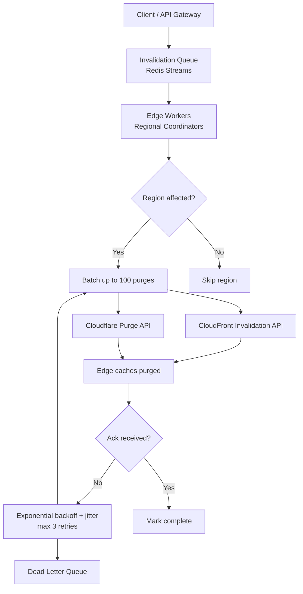

| Difficulty | Channel | Tags |
|---|---|---|
| intermediate | system-design | edge, caching, purging |

By 2022, Cloudflare's cache-purge system was buckling under its own scale: thousands of customers firing millions of purge calls per day, each routed through a handful of central "core" data centers, so an Australian customer watched a purge crawl across the Pacific and back before local content expired [1]. The result was a global P50 purge latency of 1,570ms — an eternity when a five-second SLA is on the line [1]. That bottleneck triggered a rebuild that, by August 2024, dropped P50 latency to 149ms across 330 cities — a 90.5% improvement [1]. Those lessons are exactly what you need when designing a multi-region invalidation system that survives 10,000 concurrent purges per second.

---

> ### Real-World Case — Cloudflare
>
> By 2022, Cloudflare's original cache-purge system was buckling under its own scale. Thousands of customers were issuing millions of purge API calls per day, and the design stored purge history on every machine, consumed cache disk space, and routed every request through a few central 'core' data centers — so a customer in Australia had to send a purge across the Pacific and back before local content was invalidated.
>
> | | |
> |---|---|
> | **Challenge** | Propagate invalidations (by URL, tag, hostname, prefix, or everything) globally and fast, without latency scaling with distance from a core data center, without storage costs growing linearly with purge throughput, and while a single tag purge could match millions of cached files across hundreds of data centers and thousands of machines. |
> | **Solution** | Rebuilt it as 'coreless purge': the nearest data center ingests and locally tests each request (filtering out the >50% of purges targeting non-cacheable URLs), then queues it in regional Durable Objects with a Regional Autoscaler that load-balances a 'goldilocks zone' of throughput, plus regional fanout workers that cut cross-region retries. Each machine runs CacheDB, a Rust/RocksDB sidecar indexing its own disk by hostname/tag/URL; the cache proxy checks CacheDB's pending-purge queue on every HIT to force an immediate MISS even before files are physically deleted, with Consul handling intra-datacenter health. |
> | **Outcome** | Global P50 purge latency fell from 1,570ms (May 2022) to 149ms (August 2024) — a 90.5% improvement — across data centers in 330 cities and 120+ countries; single-file purges reached 234ms P50. The fanout worker alone cut end-to-end latency 50% and tripled throughput, and abandoning 'lazy purge' for active deletion saved 10x storage while improving cache hit ratios and reducing origin egress. |
> | **Lesson** | The centralized design was 'very, very good' — sub-second P99 replication — yet became the bottleneck: hub-and-spoke wrote latency into distance and tied cost to usage. The fix was to treat invalidation-signal propagation and physical deletion as separate problems, push coordination to regional edges, and add cheap per-machine indexes rather than a global one. |

---

## Hook — A Purge That Crossed an Ocean

Picture a release day gone wrong: a wrong price sits on the product page, the fix is already deployed, but stale content keeps loading in Sydney because the invalidation is queued behind a core data center thousands of miles away. Sound familiar? Many developers discover the hard way that cache purging is not a "set it and forget it" feature — it is a distributed systems problem wearing a deceptively simple API costume. The stakes are real: every stale second is wrong data in front of customers, and at 10,000 invalidations per second, a slow path becomes a global incident. But here is the twist that trips up even experienced teams: adding more cache capacity often makes purging worse, not better. Why would more cache mean slower purges?

## Problem — When "Delete This URL" Becomes a Distributed Nightmare

Building on that tension, the core challenge sounds almost trivial: tell every edge location to forget a specific URL within five seconds. A content delivery network is, after all, a distributed set of servers positioned close to users [4]. However, the moment you demand 99.99% availability, strong consistency, and 10,000 invalidations per second, that trivial request turns into a coordination problem across continents. You are simultaneously fighting three enemies: physical distance (signals cannot outrun the speed of light), API rate limits (providers throttle batch calls), and partial failure (one region succeeds while another silently keeps serving stale bytes). Many teams assume a single purge API call fans out magically and uniformly; in reality, each provider has its own invalidation semantics, and mixing them without a coordinator is how a 1,570ms tail survives [1]. This leads to an obvious question: what does a system that actually meets the SLA look like under the hood?

## Real-World Case — Cloudflare

To see how that tension played out in production, look at the numbers — they tell the story better than any architecture diagram. By May 2022, Cloudflare's original purge system stored purge history on every machine, consumed precious cache disk space, and funneled every request through a few central core data centers [1]. Consequently, a purge issued far from those cores paid a round-trip penalty before local content was invalidated. Cloudflare's answer was a ground-up redesign: a fanout worker that pushed invalidations directly to every data center, active deletion instead of the old "lazy purge" approach, and a reworked purge API [1]. The impact was dramatic: global P50 purge latency fell from 1,570ms in May 2022 to 149ms in August 2024 — a 90.5% improvement — with single-file purges reaching 234ms P50 [1]. Moreover, the fanout worker alone cut end-to-end latency by 50% and tripled throughput, while active deletion saved 10x storage and improved cache hit ratios and origin egress [1]. But wait, it gets better: deleting more aggressively actually made the cache healthier, not weaker — a plot twist worth unpacking next.

## Deep Dive — Why Active Deletion Beats Lazy Purge

This leads to the central design question: how do you invalidate fast without melting your origin? The old answer was "lazy purge" — mark content stale and let it expire naturally. That sounds efficient until stale bytes occupy cache disk and force revalidation traffic later. Cloudflare flipped the model to active deletion: physically remove the object so the next request is a clean miss [1]. Here is the thing though — the counterintuitive result was 10x less storage, better cache hit ratios, and less origin egress [1]. Why? Because stale entries were polluting the cache, evicting useful hot objects, and generating wasteful revalidation round-trips.

Here is what you need to know about the core tradeoffs:
- **Latency vs. consistency:** A 2-second TTL with `Cache-Control: max-age=2, must-revalidate` keeps dynamic content fresh between explicit purges, but it is a safety net, not a substitute for invalidation [3][9]. The formal HTTP caching rules live in RFC 9111 [5].
- **Cost vs. control:** CloudFront invalidates by exact path or wildcard [8], and provider APIs throttle calls, so batching 100 paths per call is both a performance and a cost win — teams report roughly 90% lower API costs.
- **Fanout vs. coordination:** Pushing invalidations directly to each data center removes the central bottleneck, but you now need idempotency and reconciliation when a region is partitioned.

**Option A vs Option B — the real tradeoff:**

| Approach | Propagation | Storage | Origin Egress | When to use it |
| --- | --- | --- | --- | --- |
| Lazy purge (TTL expiry) | Unpredictable, up to TTL | High — stale objects linger | Higher (revalidation) | Static assets, low-value content |
| Active deletion via fanout | Sub-second to ~2s | 10x lower | Lower | Prices, inventory, auth, breaking news |
| Central core routing | Slow (1,570ms P50) [1] | Medium | Medium | Legacy only — avoid |

💡 **Insight:** The fanout pattern works well because it moves the invalidation decision to the edge, where the content actually lives, instead of asking a distant core for permission.

🔥 **Hot Take:** If your purge design relies on a single central coordinator, you have not built a cache purging system — you have built a queue with delusions of scale.

⚠️ **Watch Out:** Pattern-based purges with wildcards (`/path/*`) are powerful and dangerous. A single typo can erase an entire namespace. Scope patterns to the narrowest path possible.

🎯 **Key Point:** Many developers think caching and purging are opposing forces; in practice, aggressive, precise deletion improves both freshness and hit ratio.

So when would you actually use this? Reach for active fanout deletion whenever content correctness is user-visible — pricing, stock levels, session state, or breaking news. Keep TTL-only expiry for truly immutable assets with hashed filenames, where a purge is unnecessary. Even with fanout, though, you still need a reliable ordering mechanism to survive failures — which is where the workflow gets interesting.

## Workflow — From API Call to Global Purge in Five Seconds

Building on the active-deletion model, the end-to-end flow turns one invalidation request into a coordinated fanout. The diagram below ("CDN Invalidation Flow") maps the path you are about to walk through.

1. **Accept and validate:** An API gateway receives purge requests and rejects overly broad wildcards before they reach the queue.
2. **Enqueue:** Validated invalidations land in Redis Streams with consumer groups, which give you ordering, retries, and backpressure out of the box [6].
3. **Coordinate at the edge:** Edge workers read from the stream and act as regional cache coordinators, deciding which data centers actually hold the object — because smart invalidation only purges affected regions [7].
4. **Batch and fanout:** Coordinators group up to 100 purges per provider call and push directly to CloudFront and Cloudflare endpoints [2][1], cutting API costs by roughly 90%.
5. **Confirm and reconcile:** Each region acknowledges; failures get exponential backoff with jitter and at most three retries, then a circuit breaker trips after five consecutive failures and dead-letter entries await manual review.

Consequently, a purge that once crawled through a core data center now races straight to the edge. However, this only works if the code doing the batching and retrying is production-grade — which brings us to the implementation.

## Code Example — A Production-Grade Batch Purger

Bringing that workflow to life, here is what the implementation does, piece by piece. The constructor captures provider credentials and initializes a circuit-breaker counter plus a dead-letter list, so failures never vanish silently. The `backoff()` helper implements exponential delay with jitter (`Math.random() * 250`), which spreads retries out and prevents a synchronized retry storm — ⚠️ without jitter, thousands of failed purges retry in lockstep and hammer the provider. Next, `purgeBatch()` checks the circuit breaker before doing any work; once five consecutive failures accumulate, it fails fast instead of burning calls [1]. The Cloudflare `fetch` sends up to 100 path patterns in a single `purge_cache` call, and the CloudFront `createInvalidation` call batches the same paths through the AWS SDK [2]. A successful pass resets the failure counter, while a final failure writes the batch to the dead-letter queue for manual review. Notice that this code favors idempotency: re-running the same purge is harmless, which is exactly what you want when networks partition. 🎯 Pro tip: scope `files` patterns to exact paths rather than broad wildcards whenever possible — the blast radius of a typo is the difference between a purge and an outage.

## Lessons Learned — The Five-Second SLA Is a System Property

Building on the journey from a 1,570ms bottleneck to a 149ms P50 [1], the biggest lesson is that a five-second SLA is not a feature you bolt on — it is an emergent property of queue design, fanout topology, and honest failure handling. Here is what teams repeatedly learn the hard way:

- **Treat purges as idempotent events.** Networks partition and retries happen; a design that assumes exactly-once delivery will eventually serve stale content or purge twice.
- **Measure the tail, not the average.** Cloudflare's 234ms P50 for single-file purges is impressive, but your SLA lives in the P99 [1].
- **Budget for failure before success.** Circuit breakers, dead-letter queues, and reconciliation are not optional extras — they are what keep a 10K/sec stream from becoming a 10K/sec incident.
- **Push decisions to the edge.** Central coordinators add a round trip; edge workers remove it [7].

⚠️ **Watch Out — battle scars:** The most common mistakes are (1) wildcards that are too broad and erase half a namespace, (2) retry storms without jitter, and (3) treating a CDN provider's API as infinitely available. After debugging this pattern many times, here is what works: narrow patterns, jittered backoff, and a circuit breaker that trips early.

🔥 **Hot Take:** Strong consistency across regions in five seconds is less about fancy algorithms and more about refusing to pretend a failed purge succeeded.

So what should you do differently tomorrow? Audit one purge path in your own system and ask: if this region never acknowledged, would anyone notice? If the answer is no, you have found your next incident. The memorable insight to take to your team is simple: **the fastest purge is the one that never had to travel to a core data center** — move the decision to the edge, and five seconds stops feeling like a stretch goal.

---

## CDN Invalidation Flow

<strong>Original Interview Question</strong>

**Q:** How would you design a multi-region CDN cache purging system that guarantees content propagation within 5 seconds while handling 10,000 concurrent invalidations per second?

**A:** Implement Cloudflare API + AWS CloudFront with distributed invalidation queue, edge compute coordination, and 2-second TTL. Use batch invalidation, exponential backoff, and regional cache headers for 5-second SLA.

## Conclusion

From a purge that crossed the Pacific and back to a fanout that lands in 149ms across 330 cities, the story of Cloudflare's instant purge is really a story about moving decisions closer to data [1]. You do not need Cloudflare's scale to borrow the pattern: batch your invalidations, delete actively instead of waiting for TTL, push coordination to the edge, and make failure honest with backoff, circuit breakers, and dead-letter queues. Start with one change this week — narrow a wildcard, add jitter to a retry, or measure your P99 purge latency — and you will already be ahead of most teams. The next time a wrong price sits on a product page in Sydney, the fix will be measured in milliseconds, not minutes.

---

## References

1. [Cloudflare incident report](https://blog.cloudflare.com/instant-purge/) — article
2. [AWS CloudFront CreateInvalidation API Reference](https://docs.aws.amazon.com/cloudfront/latest/APIReference/API_CreateInvalidation.html) — documentation
3. [MDN Web Docs — HTTP caching](https://developer.mozilla.org/en-US/docs/Web/HTTP/Caching) — documentation
4. [Wikipedia — Content delivery network](https://en.wikipedia.org/wiki/Content_delivery_network) — documentation
5. [RFC 9111 — HTTP Caching](https://datatracker.ietf.org/doc/html/rfc9111) — documentation
6. [Redis — GitHub repository](https://github.com/redis/redis) — documentation
7. [Cloudflare Workers SDK — GitHub repository](https://github.com/cloudflare/workers-sdk) — documentation
8. [AWS CloudFront — Invalidating Files](https://docs.aws.amazon.com/cloudfront/latest/developerguide/InvalidatingFiles.html) — documentation
9. [MDN Web Docs — Cache-Control header](https://developer.mozilla.org/en-US/docs/Web/HTTP/Reference/Headers/Cache-Control) — documentation

---

**Author:** Satishkumar Dhule — [GitHub](https://github.com/satishkumar-dhule) · [LinkedIn](https://linkedin.com/in/satishkumar-dhule) · [Website](https://satishkumar-dhule.github.io)
