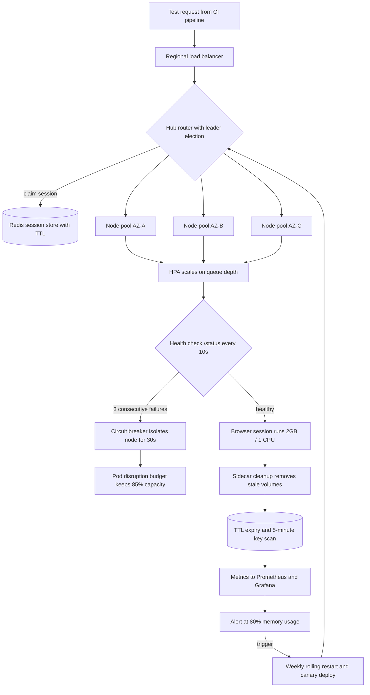

| Difficulty | Channel | Tags |
|---|---|---|
| advanced | system-design | selenium, webdriver, grid |

At Zalando, a centralized Selenium Grid had grown into the single point of failure for many internal teams running UI tests across in-house docker-selenium grids and Sauce Labs [1]. Long-lived browser nodes meant constant maintenance as browsers, drivers, and Selenium versions changed, while memory growth forced periodic restarts [1]. Teams that adopted Zalando's disposable Zalenium approach watched test-suite runtime fall from more than an hour to six minutes [1]. Now scale that same ambition to 10,000 concurrent sessions across multiple data centers with 99.9% uptime — how does a grid stay healthy without becoming the next 3 AM incident?

---

> ### Real-World Case — Zalando
>
> Zalando's Engineering Productivity team supported many internal teams running UI tests on a mix of in-house docker-selenium grids and Sauce Labs. Their centralized Selenium Grid had become a single point of failure, and long-lived browser nodes meant constant maintenance as browsers, drivers and Selenium versions changed — while memory growth forced periodic restarts.
>
> | | |
> |---|---|
> | **Challenge** | Run the common Chrome/Firefox tests quickly and reliably at high parallelism without a flaky, leak-prone shared grid, still cover rare browsers (Safari, IE/Edge), and avoid paying premium cloud rates for every single test. |
> | **Solution** | They built and open-sourced Zalenium: a dynamically scaling, disposable Selenium Grid that spins up a fresh docker-selenium container on demand for each test session and destroys it the moment the test finishes, so browser state and leaked memory can never accumulate across sessions. Capabilities it cannot serve locally are automatically redirected to Sauce Labs, BrowserStack or TestingBot; it also added video recording, live preview and Kubernetes support. |
> | **Outcome** | Adopters reported test-suite runtime dropping from more than an hour to six minutes, and Zalando's docker-selenium creator reported the local grid runs around 2x faster than paid cloud-based Selenium solutions. Zalenium's design was influential enough that its capabilities were folded into Selenium Grid 4's official architecture. |
> | **Lesson** | For stateful, leak-prone browser processes, immutability beats remediation: make each node disposable per session instead of fighting memory leaks with GC tuning and scheduled restarts, and route only rare capabilities to expensive cloud providers. |

---

## Hook — The 3 AM Restart Ritual

The deploy looked fine. Then the grid stopped handing out sessions, and every pipeline queued up behind a single tired browser node. Zalando's Engineering Productivity team knew this feeling well: their centralized grid had become the bottleneck, and long-lived nodes quietly accumulated memory until a restart turned into a ritual [1]. Picture rows of Chrome processes slowly bloating, each one a tiny time bomb ticking toward the next forced recycle [11]. Here is the thing though — the fix was not a bigger machine. It was a mindset shift about what a browser node even is. Sound familiar? If a rogue node has ever stalled your suite, this is your story with a much bigger number attached. The real question is not whether nodes fail, but what happens in the three seconds after one does.

## Problem — When the Grid Becomes the Bottleneck

Building on that tension, consider the scale. Ten thousand concurrent test sessions is not one big grid; it is a distributed scheduling problem with a memory problem stapled to it. At 50 sessions per node, the math demands at least 200 nodes, and at 2GB per pod that is 400GB of baseline memory plus a 30% buffer — roughly 520GB — before a single test runs. ⚠️ Watch Out: memory leaks are not a slow nuisance at this size; they are a cascade, because one bloated node takes down every session assigned to it. A 99.9% uptime target allows only about 43 minutes of downtime per month, leaving no room for a manual restart at 2am.

Here is what you are really up against:
- Throughput: 10,000 sessions / 50 per node = 200 nodes minimum.
- Memory: about 520GB cluster budget once the buffer is added.
- Latency: P99 session initiation under 2s through regional load balancing.
- Availability: 99.9% with multi-AZ deployment and automatic failover.

Many developers discover the hard way that a hub holding session state in memory becomes a single point of failure the moment it restarts [3]. So how does a design stop each of these numbers from becoming a fresh failure mode? That leads directly to the approach Zalando proved in production.

## Real-World Case — Zalando

Zalando is not a hypothetical; it is the blueprint. Their Engineering Productivity team supported numerous internal teams running UI tests on a mix of in-house docker-selenium grids and Sauce Labs [1]. The centralized Selenium Grid had become a single point of failure, and maintaining long-lived browser nodes meant chasing changing browsers, drivers, and Selenium versions while memory growth demanded periodic restarts [1]. Their answer, Zalenium, made nodes disposable and flexible, and adopters reported test-suite runtime dropping from more than an hour to six minutes [2].

🔥 Hot Take: Zalando's docker-selenium creator reported the local grid running around 2x faster than paid cloud-based Selenium solutions — a reminder that cloud does not automatically mean fast. Plot twist: Zalenium's ideas did not stay a side project; its capabilities were folded into Selenium Grid 4's official architecture [3]. The lesson is that disposability won the argument. But disposability at 10x scale needs a control plane, which is where the architecture gets genuinely interesting.

## Deep Dive — Hubs, TTLs, and Circuit Breakers

Building on Zalando's disposability insight, the design has to answer four questions: where session state lives, how nodes scale, how failures get isolated, and how memory stays bounded. State moves out of the hub and into Redis, where TTL-based expiration guarantees a session key disappears even if its node evaporates [10]. Nodes become disposable pods managed by Kubernetes Deployments or StatefulSets spread across availability zones [4]. 💡 Insight: an expiring session store is what makes zero memory leaks achievable — leaked state dies on a timer instead of accumulating until somebody restarts the process.

| Decision | Naive choice | Production choice | Real tradeoff |
|---|---|---|---|
| Session state | Hub memory | Redis with TTL [10] | Total loss on restart vs a small network hop |
| Node lifecycle | Persistent VMs | Rolling disposable pods [4] | Configuration drift vs image rebuild cost |
| Failure handling | Blind retries | Circuit breaker, 30s window | Retry storms vs brief capacity dip |
| Scaling trigger | CPU alone | Queue depth via HPA [5] | Predictable idle cost vs responsive capacity |

Circuit breakers deserve a closer look. Many developers think retrying a failing node is harmless; actually, retry storms are how one bad node becomes a grid-wide outage. After three consecutive /status failures, the breaker isolates that node for a 30-second recovery window. ⚠️ Watch Out: an overly short window causes flapping, where nodes cycle in and out of service and never stabilize.

Monitoring closes the loop. Prometheus scrapes memory and session-duration metrics while Grafana surfaces trends long before a leak becomes an incident [9]. Scaling follows queue depth through the horizontal pod autoscaler, not CPU alone, because browser tests are I/O-heavy [5]. Resource quotas cap each pod at 2GB and 1 CPU, and liveness probes restart stuck containers automatically [6] [7]. 🎯 Key Point: pod disruption budgets preserve at least 85% capacity during voluntary disruptions, so a rolling update cannot quietly erase headroom [8]. Multi-AZ placement handles whole-zone loss, and leader election prevents split-brain during network partitions [12]. Knowing the pieces is not the same as wiring them together — which is exactly what the workflow next makes concrete.

## Workflow — From Test Request to Clean Session

This leads to the runtime story. The Mermaid diagram below, titled Grid Session Lifecycle Flow, follows one test request from CI all the way to a cleaned-up session and shows where every guardrail fires.

1. A CI job submits a session request to a regional load balancer; weighted round-robin routes by node capacity and response time.
2. The hub claims a session key in Redis with a TTL, making the claim atomic [10].
3. The HPA watches queue depth and adds pods when pressure rises [5].
4. Every 10 seconds a /status probe checks health; three consecutive failures trip the 30-second circuit breaker [7].
5. Browser work completes, and a sidecar or init container removes stale volumes.
6. A 5-minute Redis scan plus TTL expiry erases orphan keys, while metrics flow to Prometheus [9].
7. Weekly rolling restarts and canary traffic splits keep node images fresh [4] [8].

Ever wondered why the health signal effectively runs ahead of scaling in practice? Because a fast failure detection stops the autoscaler from adding pods for nodes that are already dead — a subtle ordering that saves real money. Next, the code that turns this lifecycle into something runnable.

## Code Example — A Session-Lifecycle Controller

Here is the thing about lifecycle management: it is boring until it is the only thing standing between you and a 520GB memory leak. The Python controller in the code block implements the session-claim, TTL, circuit-breaker, and sweep pieces described above, using Redis as the single source of truth [10]. The key lines are worth calling out before you read them. NX plus EX makes start_session claim a key once and expire it automatically, even when a node dies mid-test. The isolated_until field is the breaker: mark_unhealthy pushes it 30 seconds into the future, and start_session refuses the node until that time passes. Finally, sweep_stale_sessions uses scan_iter with a TTL check, which is the programmatic twin of the five-minute cleanup scan. 🔥 Hot Take: if a session cannot survive a process restart, it should not be trusted with your uptime target. The explanation in the code block walks through each method in detail — and then the closing lessons put it all in perspective.

## Lessons Learned — Battle Scars and the Road Ahead

Bringing the journey full circle, Zalando proved that disposable nodes beat babysitting long-lived ones [1] [2]. Here are the battle scars worth carrying into your next design review.

- Mistake: storing sessions in hub memory. Avoid: externalize to Redis with TTL so expiry is automatic [10].
- Mistake: scaling on CPU for browser tests. Avoid: scale on queue depth through the HPA [5].
- Mistake: trusting a node after one failed ping. Avoid: require three consecutive /status failures before isolating [7].
- Mistake: letting rolling updates drain all capacity. Avoid: hold a pod disruption budget at 85% [8].
- Mistake: ignoring image drift. Avoid: weekly rolling restarts plus canary traffic splits [4].

🎯 Key Point: at 10,000 sessions, the cheapest bug to fix is the one that expires on its own. When would you actually use this? Any time a shared UI suite serves more than a handful of teams, or when browser and driver churn has become a second job. If this feels overwhelming, you are not alone — start with TTL-bound sessions and a health endpoint, then layer in autoscaling and breakers as the pain grows. The transformation is less about fancy machinery and more about refusing to let state live forever.

---

## Grid Session Lifecycle Flow

<strong>Original Interview Question</strong>

**Q:** Design a scalable Selenium Grid architecture to handle 10,000 concurrent test sessions with 99.9% uptime, ensuring zero memory leaks through automatic session lifecycle management, real-time monitoring, and graceful node failure recovery across multiple data centers?

**A:** Deploy Kubernetes cluster with auto-scaling node pools, Redis session store with TTL policies, Prometheus metrics for memory monitoring, circuit breakers for node isolation, and sidecar containers for session cleanup. Implement health checks, resource quotas, and rolling updates.

## Conclusion

The grid that once stalled entire release trains became a 2x-faster asset because teams stopped treating browser nodes like pets and started designing for expiry [1]. The memorable insight to take into your next design review: a session you can afford to lose is a session you can scale. Tomorrow, audit one thing — find where your grid keeps state that has no expiration date, and give it a TTL. That single change is the difference between a 3 AM restart and a quiet, boring, 99.9% day.

---

## References

1. [Zalando incident report](https://engineering.zalando.com/posts/2017/02/zalenium-a-disposable-and-flexible-selenium-grid-infrastructure.html) — article
2. [Zalenium GitHub repository](https://github.com/zalando/zalenium) — documentation
3. [SeleniumHQ Selenium GitHub repository](https://github.com/SeleniumHQ/selenium) — documentation
4. [Kubernetes Deployments documentation](https://kubernetes.io/docs/concepts/workloads/controllers/deployment/) — documentation
5. [Kubernetes Horizontal Pod Autoscaling documentation](https://kubernetes.io/docs/tasks/run-application/horizontal-pod-autoscale/) — documentation
6. [Kubernetes Resource Management for Pods and Containers](https://kubernetes.io/docs/concepts/configuration/manage-resources-containers/) — documentation
7. [Kubernetes Liveness, Readiness, and Startup Probes](https://kubernetes.io/docs/tasks/configure-pod-container/configure-liveness-readiness-startup-probes/) — documentation
8. [Kubernetes Pod Disruption Budgets documentation](https://kubernetes.io/docs/concepts/workloads/pods/disruptions/) — documentation
9. [Prometheus GitHub repository](https://github.com/prometheus/prometheus) — documentation
10. [Redis GitHub repository](https://github.com/redis/redis) — documentation
11. [Selenium (software) - Wikipedia](https://en.wikipedia.org/wiki/Selenium_(software)) — documentation
12. [AWS Regions and Availability Zones documentation](https://docs.aws.amazon.com/AWSEC2/latest/UserGuide/using-regions-availability-zones.html) — documentation

---

**Author:** Satishkumar Dhule — [GitHub](https://github.com/satishkumar-dhule) · [LinkedIn](https://linkedin.com/in/satishkumar-dhule) · [Website](https://satishkumar-dhule.github.io)
