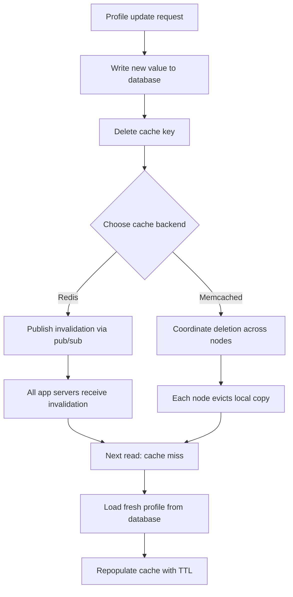

| Difficulty | Channel | Tags |
|---|---|---|
| beginner | backend | redis, memcached, cache-invalidation |

Picture this: a user changes their Twitter username, refreshes, and it sticks — then a week later, it silently snaps back to the old one. For several months in 2011, that exact nightmare played out for real, with usernames, screen names, and passwords reverting across Twitter's user base [1]. The culprit was not a bug in the update code but a subtle cache invalidation failure that turned stale copies into a slow-motion data corruption event. This is the story of what went wrong, and how you can keep your own profile service from becoming the next cautionary tale.

---

> ### Real-World Case — Twitter
>
> For several months in 2011, user-initiated changes like usernames, screen names, and passwords would silently revert about a week later. Each Rails worker independently routed keys to memcached shards, so after transient errors caused a client to eject a node, the same profile ended up cached on multiple shards and stale copies were written back to MySQL.
>
> | | |
> |---|---|
> | **Challenge** | Cache invalidation in a distributed look-aside cache with no single authority over which shard held a key: deleting or updating one copy left stale replicas, and concurrent reads could repopulate both cache and database with pre-update profile data. |
> | **Solution** | They instrumented cache inconsistency, stopped writing stale cached values back to the database, retried before ejecting hosts, and spread IRQ handling across CPU cores. The root cause was a BIOS/BMC firmware bug that ran an expensive health check every 20h40m and dropped packets; they staggered reboots, then rolled out fixed firmware. Long term they redesigned the cache to tolerate partitions without diverging. Twitter standardized mostly on a memcached fork; a Redis fork had worse average/tail performance and higher operational burden at scale, limiting its use. |
> | **Outcome** | Instrumentation found ~0.2% of users out of sync with the database, and of 150 popular users checked, most were cached on at least two shards and some on six (expected: at most one). Debugging and mitigation took ~2 months; a premature fix briefly took the site down, and the architectural fix took ~2 years. Over a decade Twitter logged 6 SEV-0 and 6 SEV-1 cache-attributed incidents. |
> | **Lesson** | Delete-on-update invalidation is insufficient when clients independently route keys: one logical profile can live in several shards, so invalidation must be authoritative and partition-tolerant. At scale, the memcached-vs-Redis choice is dominated by tail latency and operational burden, not features — and firmware-level packet loss can masquerade as a caching logic bug. |

---

## Hook — When your cache quietly rewrites history

That Twitter incident is not some exotic footnote; it is a masterclass in how a cache can slowly poison the truth [1]. Picture the on-call engineer staring at a support ticket that reads, 'my password changed back again.' The profile update succeeded. The database held the new value. Yet a week later, an old copy rose from the dead and overwrote it. Sound familiar? Many developers discover caching only when it breaks, and by then the damage is already spreading. The stakes are simple: a cache is a promise that old data will not outlive its welcome, and when that promise breaks, users lose trust faster than any latency graph can justify.

## Problem — The two-hard-things problem

This leads to the uncomfortable truth at the heart of caching: invalidation is the part nobody puts in the flowchart. There are only two hard things in computer science, and cache invalidation is the one that shows up in production at 2am. When a user updates a profile, your service now holds two copies of the truth — one in the database and one (or several) in cache — and something has to keep them in agreement. Caching is a performance technique with well-defined semantics [6], but those semantics collapse the moment copies drift apart.

Here is what you need to know about the problem space:
- **Stale reads:** A cached profile can survive long after the user changed it, so the UI displays yesterday's data.
- **Thundering herds:** When a hot key expires, every request can stampede the database at once.
- **Distributed drift:** In a multi-node setup, one server can invalidate while another keeps serving the old value.

You might think simply writing the new value everywhere solves this. Actually, the moment a transient error interrupts that write, you have created a second source of truth — and that is exactly the trap Twitter fell into [1]. So when would you actually use this? Reach for a cache on read-heavy profiles where a few minutes of staleness is acceptable, and treat invalidation as a first-class design problem, not an afterthought.

## Real-World Case — Twitter

Building on that trap, Twitter's 2011 incident shows what happens when a design assumption quietly stops holding [1]. Each Rails worker independently routed cache keys to memcached shards, which works beautifully until a transient error makes a client eject a node. Once that happens, the same profile can land on multiple shards, and stale copies get written back to MySQL — turning the cache from a performance tool into a data-corruption machine.

**⚠️ Watch Out:** The scariest part was not the initial error but the recovery. Instrumentation found roughly 0.2% of users out of sync with the database. Of 150 popular users checked, most were cached on at least two shards and some on six, where the architecture expected at most one.

The human cost was just as real. Debugging and mitigation took about two months, a premature fix briefly took the site down, and the architectural fix took roughly two years. Over a decade, Twitter logged 6 SEV-0 and 6 SEV-1 cache-attributed incidents [1]. If that feels overwhelming, developers have all been there — this is a class of bug that humbles senior teams, not just beginners.

## Deep Dive — Write-through, TTL, and the Redis vs Memcached showdown

However, the Twitter story does not mean caching is dangerous; it means the invalidation strategy matters more than the cache itself. Two patterns dominate. In **cache-aside**, reads check the cache first and load from the database on a miss. In **write-through**, an update writes to both the database and the cache, so the two move together. Both rely on the same caching principles that underpin systems from CPUs to the web [2].

Here is the plot twist: deleting the key on update is often safer than overwriting it. If you write a new value and a concurrent stale write lands afterward, the cache keeps the wrong data. Delete instead, and the next read repopulates from the authoritative database. Pair that with a TTL of roughly 5–30 minutes for profiles, and even a missed invalidation heals itself — a bounded-staleness idea closely related to HTTP cache freshness rules [8].

**💡 Insight:** TTL is your safety net, not your strategy. It bounds how long a stale copy can live, but relying on expiry alone means users still see old data for minutes.

Now, the showdown you came for — Redis versus Memcached:

| Option | What it gives you | The real trade-off |
|--------|-------------------|--------------------|
| Redis | Pub/sub for distributed invalidation, persistence, rich data structures [3] | Higher memory overhead, more moving parts |
| Memcached | Simpler architecture, faster for pure key-value caching, lower overhead [4] | No persistence, manual coordination across nodes |

Use Redis when you need automatic distributed invalidation or durability; use Memcached when you want a lean, fast cache and can handle coordination yourself. After debugging this pattern many times, here is what works: measure cache hit rate and invalidation latency before choosing, because the 'faster' option is only faster if it is also correct.

## Workflow — From update to invalidation in six steps

This leads naturally to a concrete workflow you can copy into your own service. The Mermaid diagram in the 'Cache Invalidation Flow' below tells the visual story from a profile edit to a fresh read.

1. A user submits a profile update through the API.
2. The service writes the new value to the database, the authoritative source.
3. The service **deletes** the cache key rather than overwriting it.
4. With Redis, the service publishes the key to a pub/sub channel for automatic fan-out [9]; with Memcached, it coordinates deletion across nodes manually.
5. Every app server evicts its local copy when it receives the invalidation message.
6. The next read misses, loads the fresh profile from the database, and repopulates the cache with a TTL.

**🔥 Hot Take:** If your invalidation path has more steps than your happy path, you have built a system that fails in interesting ways. Keep it boring. Track hit rate and invalidation latency as first-class metrics — a cache you cannot observe is a cache you cannot trust [5].

## Code Example — A production-shaped profile cache

With the workflow in place, here is a production-shaped implementation that combines cache-aside reads, write-through deletion, TTL, and Redis pub/sub invalidation.

```python
import json
import redis

redis_client = redis.Redis(host="localhost", port=6379, db=0)
INVALIDATION_CHANNEL = "profile:invalidate"
TTL_SECONDS = 900  # 15 minutes bounds how long stale data can survive

def profile_key(user_id):
    # One canonical key format avoids drift between callers
    return f"profile:{user_id}"

def get_profile(user_id, db):
    key = profile_key(user_id)
    cached = redis_client.get(key)
    if cached:
        return json.loads(cached)          # Cache hit: return fast
    profile = db.fetch_profile(user_id)    # Cache miss: read from source of truth
    redis_client.setex(key, TTL_SECONDS, json.dumps(profile))
    return profile

def update_profile(user_id, updates, db):
    profile = db.update_profile(user_id, updates)  # Database wins first
    key = profile_key(user_id)
    redis_client.delete(key)                       # Delete, never overwrite
    redis_client.publish(INVALIDATION_CHANNEL, key)  # Fan out to all servers
    return profile

def listen_for_invalidations():
    pubsub = redis_client.pubsub()
    pubsub.subscribe(INVALIDATION_CHANNEL)
    for message in pubsub.listen():
        if message["type"] == "message":
            redis_client.delete(message["data"].decode())  # Evict local copy
```

The walkthrough is deliberately short. `get_profile` follows cache-aside: check the cache, fall back to the database, then repopulate with `setex` so a TTL always applies [7]. `update_profile` writes to the database before deleting the key, which means a failed delete still heals within the TTL window. Publishing to the channel lets every server evict its copy, and `listen_for_invalidations` is the subscriber that makes distributed invalidation automatic — consistent key hashing, as in hashing libraries [10], keeps those keys stable across processes. The key design decision is deletion over overwrite: it trades a brief cache miss for correctness, which is exactly what the Twitter case demanded [1].

## Lessons Learned — Battle scars and the road ahead

Building on the implementation above, the real lesson is that correctness beats cleverness every single time. Here are the battle scars worth memorizing:

- **Battle scar #1:** Overwriting cache values instead of deleting them invites stale writes to win. Delete, then let reads repopulate [5].
- **Battle scar #2:** Trusting a single-shard assumption is how Twitter ended up with profiles cached on six shards [1].
- **Battle scar #3:** Skipping TTL means a missed invalidation never heals on its own.

**🎯 Key Point:** Your cache should be a performance optimization that fails safe, not a second database that fails silently.

So what should you do differently tomorrow? Audit one cache key in your service, trace every write path that touches it, and add a TTL even if you believe invalidation is perfect. Monitor hit rate and invalidation latency, and rehearse the failure where a node drops out — because that is the scenario that bit Twitter. If this feels like a lot, start small: one key, one delete-on-update, one TTL. That is how a fragile cache becomes a boring, reliable one.

---

## Cache Invalidation Flow



<details>
<summary><strong>Original Interview Question</strong></summary>

**Q:** You're building a user profile service that caches frequently accessed profiles. How would you implement cache invalidation when a user updates their profile, and what trade-offs would you consider between Redis and Memcached?

**A:** Implement write-through caching with TTL-based expiration. On profile update, invalidate the cache by deleting the key and writing new data to both the database and cache. Redis offers pub/sub for automatic distributed invalidation, while Memcached requires manual coordination across nodes.

</details>

## Conclusion

The username that came back was never a mystery — it was a cache doing exactly what a badly coordinated cache does. The journey from Twitter's 2011 reverts to a clean invalidation flow comes down to a few unglamorous choices: write to the database first, delete the key instead of overwriting it, fan the invalidation out across servers, and always attach a TTL as a safety net [1]. Redis makes distributed invalidation natural with pub/sub, while Memcached keeps things lean but hands coordination back to you. The one insight worth sharing with your team tomorrow: treat the cache as a performance layer that fails safe, never as a second database that fails silently. Do that, and your users' profiles will stay exactly where they left them.

---

## References

1. [Twitter incident report](https://danluu.com/cache-incidents/) — article
2. [HTTP caching - MDN Web Docs](https://developer.mozilla.org/en-US/docs/Web/HTTP/Caching) — documentation
3. [Redis - Wikipedia](https://en.wikipedia.org/wiki/Redis) — documentation
4. [Memcached - Wikipedia](https://en.wikipedia.org/wiki/Memcached) — documentation
5. [Amazon ElastiCache User Guide - AWS Documentation](https://docs.aws.amazon.com/elasticache/latest/red-ug/) — documentation
6. [Cache (computing) - Wikipedia](https://en.wikipedia.org/wiki/Cache_(computing)) — documentation
7. [How To Install and Secure Redis on Ubuntu 20.04 - DigitalOcean](https://www.digitalocean.com/community/tutorials/how-to-install-and-secure-redis-on-ubuntu-20-04) — blog
8. [RFC 7234: Hypertext Transfer Protocol (HTTP/1.1): Caching](https://datatracker.ietf.org/doc/html/rfc7234) — documentation
9. [redis/redis - GitHub Repository](https://github.com/redis/redis) — documentation
10. [hashlib - Secure hashes and message digests - Python Documentation](https://docs.python.org/3/library/hashlib.html) — documentation

---

**Author:** Satishkumar Dhule — [GitHub](https://github.com/satishkumar-dhule) · [LinkedIn](https://linkedin.com/in/satishkumar-dhule) · [Website](https://satishkumar-dhule.github.io)
