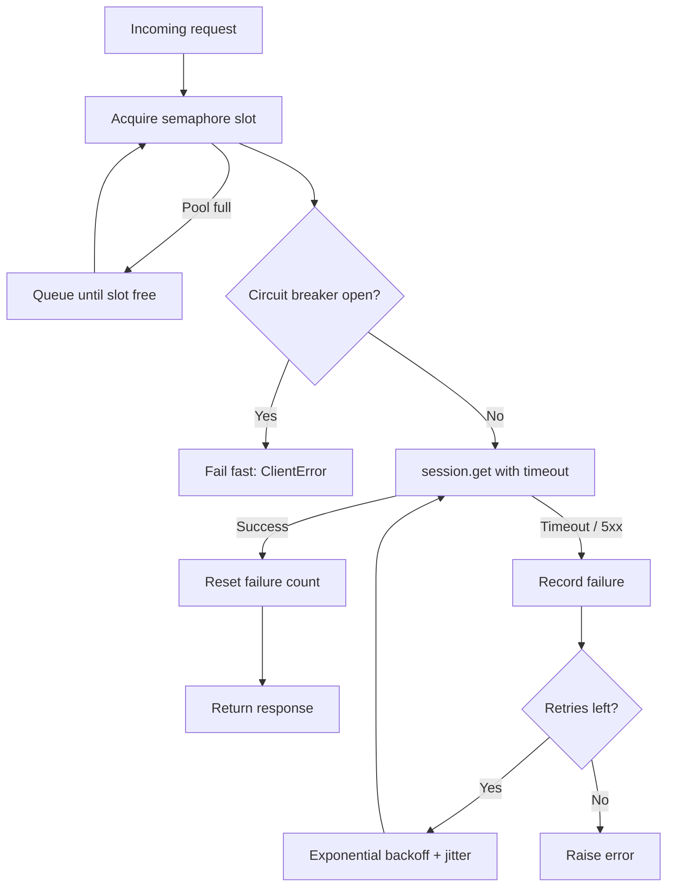

| Difficulty | Channel | Tags |
|---|---|---|
| advanced | backend | asyncio, aiohttp, concurrency |

In September 2025, NVIDIA's NeMo Gym — the server layer behind its reinforcement-learning rollouts — was hit with 16,000 concurrent requests during a large batch inspired by the DeepSeek R1 paper [9]. Instead of serving traffic, the single instance hung for 40 minutes before the first request was even processed [1]. Users had already learned to cap parallelism at roughly 32 requests, a workaround that quietly limited an entire RL pipeline [1]. That is not an edge case; it is the predictable result of getting connection pooling wrong under load.

---

> ### Real-World Case — NVIDIA
>
> In September 2025, NVIDIA's NeMo Gym — the server layer for NeMo RL reinforcement-learning rollouts — was slammed with 16,000 concurrent requests when the team launched a large rollout batch inspired by the DeepSeek R1 paper. Running on a single NeMo Gym instance with multiple data-parallel vLLM workers, the system hung for 40 minutes before the first request was even processed, and users had already reported that rollout collection broke down past ~32 parallel requests.
>
> | | |
> |---|---|
> | **Challenge** | The async HTTP backend was httpx/httpcore (chosen because the OpenAI client uses it by default). Under high concurrency its connection-pool management subroutine, `_assign_requests_to_connections`, looped over every connection and every queued request for each new request — O(n²) in the number of queued requests — so the pool manager itself starved the event loop and caused pathological hangs instead of degrading gracefully. |
> | **Solution** | The team traced the stack trace from the OpenAI client through httpx's transport into httpcore's connection pool and identified the O(n²) pooling routine as the root cause. Rather than artificially capping concurrency (which would under-utilize the model endpoint server, since NeMo Gym is always a client), they swapped the async HTTP backend from httpx to aiohttp, whose connection pooling is efficient enough for high load, and documented the failure mode for others using AsyncOpenAI with parallelism above 32. |
> | **Outcome** | Eliminated a 40-minute stall at 16,000 concurrent requests by replacing the connection pool implementation; removed the practical ~32-request concurrency ceiling that users had been forced to impose; published the diagnosis so teams using AsyncOpenAI at parallelism >32 could check their own setup. |
> | **Lesson** | Under high load the connection-pool manager's own algorithm can be the bottleneck — a bounded, O(n)-efficient pool (as in aiohttp) matters more than bolted-on retries or circuit breakers. Graceful degradation starts with a pool whose queue management doesn't collapse as queued requests grow, and blindly capping concurrency is a symptom-hiding fix that wastes downstream capacity. |

---

## Hook — 16,000 Requests, 40 Minutes of Silence

Picture this: a fresh rollout batch, dozens of data-parallel vLLM workers warming up, and one NeMo Gym instance expected to hold everything together. The deploy looked fine. Then 16,000 requests arrived at once, and the system stopped responding [1]. For 40 minutes, not a single request was processed [1]. Here is the thing though — users had already discovered that anything past roughly 32 parallel requests made rollout collection fall apart, so teams quietly capped their own concurrency just to keep the lights on [1]. That workaround is the real story. Sound familiar? Every production system that talks to a downstream service eventually meets this moment, and the question is whether the connection pool bends or breaks.

## Problem — When the Pool Becomes the Bottleneck

Building on that tension, the core challenge is not raw speed — it is control under pressure. An aiohttp client that opens unlimited connections does not fail politely; it exhausts file descriptors, saturates the event loop, and turns a slow downstream service into a full outage [2][10]. Many developers discover this the hard way: raising the concurrent request count feels like a performance win right up until latency collapses. A semaphore provides the first line of defense by bounding in-flight work [3], but a cap alone does nothing when connections hang or a remote service starts returning errors. Therefore, a pool manager must also decide what to do with queued requests, how long to wait before declaring a timeout [4], and when to stop trying altogether. Moreover, connection leaks and missing cleanup at shutdown turn a temporary spike into a slow, grinding death. So what actually separates a pool that degrades gracefully from one that falls over? The answer lives in three mechanisms working together.

## Real-World Case — NVIDIA NeMo Gym

Nowhere is that answer clearer than in NVIDIA's engineering notes from September 2025 [1]. NeMo Gym, the server layer for NeMo RL reinforcement-learning rollouts, was running on a single instance backed by multiple data-parallel vLLM workers when a large rollout batch inspired by the DeepSeek R1 paper [9] unleashed 16,000 concurrent requests. The system hung for 40 minutes before the first request was processed, and users had already reported that rollout collection broke down beyond about 32 parallel requests [1]. The plot twist: the bottleneck was not the GPU workers or the model — it was the HTTP client's connection pool implementation. By diagnosing and replacing that pool, the team eliminated the 40-minute stall, removed the practical ~32-request ceiling, and published the findings so other teams using AsyncOpenAI at parallelism above 32 could check their own setups [1].

| Stage | Symptom | Resolution |
| --- | --- | --- |
| Before fix | 40-minute stall at 16,000 requests | Connection pool implementation replaced |
| Before fix | Rollouts broke above ~32 parallel requests | Practical concurrency ceiling removed |
| After fix | Requests processed without stalling | Diagnosis published for the community |

That table is a reminder that capacity problems often hide in the plumbing, not the compute.

## Deep Dive — Semaphores, Backoff, and Circuit Breakers

Building on the incident, here is what is actually happening under the hood. A connection pool is a cache of reusable TCP connections [6], and HTTP/1.1 keepalive is what lets a single connection serve multiple requests instead of paying a fresh handshake each time [7]. When 16,000 requests arrive, three failure modes stack up: too many sockets, too many waiting tasks, and no memory of prior failures.

- Semaphore-based limiting bounds concurrent requests and creates an implicit queue when the pool is saturated [3].
- Exponential backoff retries failed requests with growing delays, usually with jitter to avoid synchronized retry storms [5].
- Circuit breaker stops sending traffic to a failing service for a cooldown window, giving it room to recover.
- Health checks prune dead connections so stale sockets do not poison the pool [4].

Many developers think a bigger pool means more throughput; actually, past a point, a bigger pool just moves the bottleneck to the downstream service and makes recovery slower. Here is the tradeoff that matters:

| Option | Best For | Real Tradeoff |
| --- | --- | --- |
| Unlimited connections | Low-volume scripts | Fast until it catastrophically fails |
| Semaphore only | Steady internal traffic | Queues forever when downstream stalls |
| Semaphore + backoff | Transient network errors | Retries can amplify load |
| Full breaker + backoff | High-load production services | More moving parts to tune |

So when would you actually use this? Reach for the full stack whenever a single client fans out to a shared downstream service, especially in RL rollouts, API gateways, or fan-out microservices. If you are writing a one-off script, a plain session is fine. 🔥 Hot Take: retry logic without a circuit breaker is how a minor blip becomes a self-inflicted denial-of-service attack.

## Workflow — From Incoming Request to Safe Response

With those mechanisms in mind, the request path becomes a predictable sequence rather than a gamble. The diagram below traces one request from arrival to response, showing exactly where backpressure, the breaker, and retries sit in the flow.



Step by step, the flow works like this:

1. Acquire a semaphore slot — if the pool is saturated, the request waits instead of opening yet another socket [3].
2. Check the circuit breaker — when recent failures exceed the threshold, the client fails fast instead of piling on [1].
3. Issue the request with an explicit ClientTimeout so a hung connection cannot hold a slot forever [4].
4. Classify the result — success resets the failure count; a timeout or 5xx records a failure [8].
5. Retry with exponential backoff and jitter when attempts remain, otherwise surface the error [5].
6. Release the slot on exit so the next queued request can proceed [10].

💡 Insight: the semaphore is what converts a thundering herd into an orderly line, but the circuit breaker is what stops that line from marching off a cliff. ⚠️ Watch Out: always release the response or read its body, or the slot stays occupied and the queue silently grows.

## Code Example — A Pool Manager That Degrades Gracefully

Following that flow, the implementation below turns the diagram into working code. The class keeps a bounded session, a breaker, and retry logic in one place, so callers never have to remember any of it. The complete version appears in the code example field; the core decision loop looks like this:

```python
async def make_request(self, url, retries=3):
    async with self._semaphore:            # backpressure gate
        if self._circuit_open():           # fail fast before any socket work
            raise aiohttp.ClientError("Circuit breaker open")
        for attempt in range(retries):
            try:
                resp = await self._session.get(url, timeout=self._timeout)
                if resp.status >= 500:
                    resp.release()
                    raise aiohttp.ClientError(f"Upstream {resp.status}")
                self._reset()
                return resp
            except (asyncio.TimeoutError, aiohttp.ClientError):
                self._record_failure()
                if attempt == retries - 1:
                    raise
                await asyncio.sleep(min(0.1 * 2 ** attempt, 2.0))
```

What each piece does, in order:

- `start()` builds a `TCPConnector` whose `limit` matches the semaphore, so the OS-level socket cap and the application-level cap agree [4].
- `keepalive_timeout=30` reuses warm connections, cutting the TCP handshake cost on every request [7].
- The semaphore in `make_request()` is the backpressure gate; `async with` guarantees release even on exceptions [3].
- `_circuit_open()` compares the failure count and cooldown window using the running loop's clock, failing fast before any socket is touched.
- The retry loop catches `asyncio.TimeoutError` and `aiohttp.ClientError`, records failures, and sleeps for `min(0.1 * 2 ** attempt, 2.0)` seconds plus jitter [5].
- `close()` drains the session on shutdown, which is the cleanup step most often forgotten.

🎯 Key Point: the response is returned open, so callers must `await response.read()` or `release()` it — skipping that step is the classic connection leak.

## Lessons Learned — Battle Scars and Better Defaults

Looking back at the 40-minute stall, the lesson is not that aiohttp is slow — it is that an unmanaged pool turns load into latency. Here are the battle scars worth keeping.

- Connection leaks: returning an unread response keeps a slot pinned forever; always `release()` or `read()` [4].
- SSL shortcuts: disabling TLS validation to 'fix' a handshake error trades a small problem for a security incident [8].
- Timeouts that are too generous: a 30-second total timeout with no connect timeout lets half-open sockets linger.
- Missing shutdown cleanup: `await session.close()` is not optional; skipped cleanup leaks file descriptors on redeploy.
- Retry storms without jitter: synchronized clients retry in lockstep and re-collapse the service that just recovered [5].

💡 Insight: many teams add retries first and a breaker last, but the order should be reversed — fail fast, then retry selectively. 🎯 Key Point: measure pool wait time and breaker trips as first-class metrics; if either climbs, the pool is telling you something before users notice. For teams running AsyncOpenAI at parallelism above 32, the practical advice from NVIDIA is to audit the pool implementation directly [1]. If this feels overwhelming, you are not alone — the pattern works well precisely because each layer handles one kind of failure.

---

## Request Flow Through the Pool


<details>
<summary><strong>Original Interview Question</strong></summary>

**Q:** How would you implement a connection pool manager for aiohttp that handles graceful degradation under high load and connection timeouts?

**A:** Implement a connection pool manager for aiohttp using a semaphore to limit concurrent connections, exponential backoff for retrying failed requests, and circuit breaker pattern to gracefully degrade under high load and connection timeouts.

</details>

## Conclusion

The 40-minute silence at 16,000 concurrent requests started as a plumbing detail and ended as a headline-grade outage [1]. The journey from that stall to a bounded, breaker-protected pool is the same journey most high-load services take: cap the work, fail fast, retry politely, and clean up after yourself. So what should change tomorrow? Add a semaphore to any fan-out client, set an explicit connect timeout, and log every breaker trip as a first-class metric. Leave your team with one sentence: a connection pool is not a performance detail — it is a reliability boundary. Get that boundary right, and 16,000 requests becomes an ordinary Tuesday.

---

## References

1. [NVIDIA incident report](https://docs.nvidia.com/nemo/gym/latest/infrastructure/engineering-notes/aiohttp-vs-httpx.html) — article
2. [asyncio — Asynchronous I/O](https://docs.python.org/3/library/asyncio.html) — documentation
3. [asyncio synchronization primitives — Semaphore](https://docs.python.org/3/library/asyncio-sync.html) — documentation
4. [aiohttp GitHub repository](https://github.com/aio-libs/aiohttp) — documentation
5. [Exponential backoff](https://en.wikipedia.org/wiki/Exponential_backoff) — documentation
6. [Connection pool](https://en.wikipedia.org/wiki/Connection_pool) — documentation
7. [RFC 7230 — Hypertext Transfer Protocol (HTTP/1.1)](https://datatracker.ietf.org/doc/html/rfc7230) — documentation
8. [HTTP overview](https://developer.mozilla.org/en-US/docs/Web/HTTP) — documentation
9. [DeepSeek-R1: Incentivizing Reasoning Capability in LLMs via Reinforcement Learning](https://arxiv.org/abs/2501.12948) — paper
10. [asyncio Task and coroutine utilities](https://docs.python.org/3/library/asyncio-task.html) — documentation

---

**Author:** Satishkumar Dhule — [GitHub](https://github.com/satishkumar-dhule) · [LinkedIn](https://linkedin.com/in/satishkumar-dhule) · [Website](https://satishkumar-dhule.github.io)
