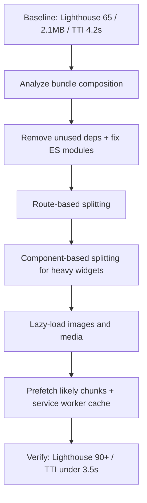

| Difficulty | Channel | Tags |
|---|---|---|
| intermediate | frontend | lighthouse, bundle, lazy-loading |

Picture this: a page that is mostly static HTML with a handful of simple interactions, yet it takes about seven seconds to become usable on a throttled 3G connection. That was Netflix's logged-out desktop homepage — the sign-up and sign-in front door for millions of new users — where roughly 300kB of JavaScript from React, Lodash, and hydration data was dominating Time to Interactive [1]. Chrome DevTools and Lighthouse told a brutal story: the bottleneck was not the content, it was the code pretending to be content. Netflix removed more than 200kB of JavaScript and cut loading and TTI by over 50%, with desktop TTI under 3.5 seconds in Lighthouse and prefetch shaving another ~30% off the next page [1].

---

> ### Real-World Case — Netflix
>
> Netflix's logged-out desktop homepage — the sign-up/sign-in entry point for millions of new users, many on mobile and poor 3G connections — was shipping ~300kB of JavaScript (React, Lodash, hydration data) and took ~7 seconds to load on throttled 3G. Chrome DevTools and Lighthouse showed the client-side JS cost was dominating Time-to-Interactive on a page that was mostly static HTML with a handful of simple interactions.
>
> | | |
> |---|---|
> | **Challenge** | Cut the JavaScript payload and TTI of a critical acquisition page whose heavy client-side React app was mostly unnecessary overhead, without degrading the developer experience or breaking the subsequent React-based sign-up SPA flow. |
> | **Solution** | Instead of adding code splitting, Netflix questioned whether React belonged on the critical path at all. They kept React for server-side rendering the HTML but removed client-side React, Lodash and associated app code entirely, rewriting the six remaining interactions (tabs, language switcher, cookie banner, analytics/performance logging, ad pixel bootstrap) in under 300 lines of vanilla JS. They then prefetched the full React/Redux signup bundle during the user's time on the landing page using both `` and XHR prefetching (95% cache-hit success), so the heavy SPA was ready for the next step. |
> | **Outcome** | JavaScript dropped by over 200kB; loading and Time-to-Interactive fell by more than 50% (desktop TTI under 3.5s in Lighthouse); prefetching cut TTI a further ~30% for the next page; field data showed fast First Input Delay for 97% of desktop users, and users clicked the sign-up button at a higher rate. |
> | **Lesson** | The most powerful bundle optimization is often not splitting code but removing the framework from the initial load entirely: server-render the first interaction with minimal vanilla JS, then defer or prefetch the heavy client bundle for later flows. Ship only what the first interaction needs, and question dependencies (Lodash, React) before optimizing them. |

---

## Hook — The Seven-Second Front Door

Building on those numbers, the unsettling detail is what that page actually did. It was the entry point for new users, many arriving on mobile devices and poor 3G connections, and yet visitors waited around seven seconds before the interface responded [1]. Every kilobyte of React, Lodash, and hydration payload had to be downloaded, parsed, compiled, and executed before a sign-up button felt alive. ⚠️ Watch Out — a shiny Lighthouse score is not the goal; Time to Interactive is where users actually feel the tax, and first-input responsiveness turns that tax into abandoned sign-ups [10]. If that feels familiar, you are not alone. Many developers discover the hard way that the culprit is not the server, it is the bundle. So what does the fix look like when the page barely needs JavaScript at all?

## Problem — Why 2.1MB and 4.2s TTI Are Not Abstract Numbers

This leads directly to the core challenge: a 2.1MB bundle and a 4.2-second Time to Interactive do not fail dramatically — they fail quietly, one impatient tap at a time. Web performance spans both objective measurements and perceived experience, so lab numbers only tell half the story [2]. Research in this field has long argued that roughly 80% of the time needed to view a website is controlled by the front end [9]. For a developer with about three years of experience, the trap is treating the score as the assignment. Lighthouse is a diagnostic instrument, not a finish line; the real question is which code deserves to run before the first interaction and which code can wait. ⚠️ Watch Out — the default in many single-page applications is to ship the framework, the app code, and the CSS in one initial load [8]. That default is convenient until a sign-up funnel depends on it. When would this actually matter? Any route with a business-critical action — sign-up, checkout, search — where latency shows up in conversions rather than dashboards. The next section shows that even a team with Netflix's resources had to learn this the expensive way.

## Real-World Case — Netflix

However, theory only gets a team so far, and Netflix's logged-out desktop homepage is the clearest proof [1]. The page was the sign-up and sign-in gateway for millions of new users, many on mobile and poor 3G connections. Chrome DevTools and Lighthouse showed that client-side JavaScript — React, Lodash, and hydration data — was dominating TTI on a page that was mostly static HTML with a few simple interactions. 🔥 Hot Take: the biggest win came from questioning whether that JavaScript belonged on the page at all, not from making it slightly smaller. The result was dramatic: JavaScript dropped by over 200kB, loading and TTI fell by more than 50% (desktop TTI under 3.5s in Lighthouse), prefetching cut TTI for the next page by another ~30%, and field data showed fast First Input Delay for 97% of desktop users [1][10]. Users also clicked the sign-up button at a higher rate. 💡 Insight — performance work that removes work beats performance work that merely reorganizes it. But how does a team turn that insight into a repeatable process?

## Deep Dive — The Anatomy of a Bundle Weight-Loss Plan

Building on the Netflix result, the technical lesson is that a bundle is a budget, and most teams are overdrawn. First comes visibility: webpack-bundle-analyzer turns minified output into an interactive treemap so the largest modules stop hiding inside an aggregate number [6]. Once the offenders are named, four levers matter.

Tree shaking removes dead exports, but only when code stays in ES module form — static import and export structure is what allows bundlers to do dead code elimination [5]. ⚠️ Watch Out — CommonJS imports, barrel files that re-export everything, and side effects at module scope can quietly disable it.

Dynamic import() is the scalpel: it returns a promise for a module namespace and evaluates the module only when needed [4]. React.lazy() wraps that promise in a component boundary, while Suspense supplies the fallback while the chunk is in flight [13]. Lazy loading carries the same idea to images and iframes through the loading attribute, and to arbitrary elements through Intersection Observer [12][3][11]. Service workers add a caching layer that intercepts requests and serves chunks from cache, which helps repeat navigation more than first paint [7].

| Option | Best for | Real tradeoff |
| --- | --- | --- |
| Route-based splitting | Distinct pages such as /dashboard and /analytics | User pays on navigation; prefetch hides it |
| Component-based splitting | Heavy, below-the-fold widgets like charts | More boundaries, more loading states |
| Tree shaking alone | Removing unused exports | No effect on genuinely large libraries |

🔥 Hot Take — lazy loading everything is a great way to trade a fast first paint for a slow second click. Prefetching is part of the design, not an afterthought. Which brings up the practical question: in what order should these moves happen?

## Workflow — From Lighthouse 65 to 90+ in Seven Moves

This leads to a sequence that should run in a deliberate order; the diagram titled 'Bundle Optimization Flow' maps the whole journey end to end. Step 1, Measure: capture the baseline (Lighthouse 65, 2.1MB, TTI 4.2s) and pair lab numbers with field metrics [2][10]. Step 2, Analyze: generate a static report with webpack-bundle-analyzer and rank modules by parsed and gzipped size [6]. Step 3, Delete: remove unused dependencies and replace barrel imports with direct paths so tree shaking can actually work [5]. Step 4, Split: add route-based boundaries first, then component-based boundaries for heavy widgets [4][13]. Step 5, Defer: add native lazy loading to offscreen media with explicit width and height to avoid layout shift [12][3]. Step 6, Warm: prefetch likely chunks and cache them through a service worker [7]. Step 7, Verify: re-run Lighthouse targeting 90+ and confirm field data instead of trusting the lab alone [2]. 🎯 Key Point — every step removes work from the path to interactivity; the score simply follows. Sound familiar? The code next makes steps 3 and 4 concrete.

## Code Example — A Production-Shaped Lazy Loading Setup

Building on the workflow, the snippet below is the version that survives contact with production: route-level lazy components, a Suspense boundary, an error boundary, prefetching, and lazy media. First, each React.lazy() call wraps a dynamic import(), so Dashboard, Analytics, and HeavyChart become separately fetched chunks [13][4]. Second, the shared Suspense fallback keeps loading UI consistent, while the ChunkBoundary class catches a failed chunk so one bad deployment does not blank the page. Third, prefetchRoute() warms the likely next route on hover — that is how the prefetch half of the Netflix result becomes practical [1]. Fourth, HeavyChart is split at component level because it is large and rarely needed on first render [3]. Fifth, the image uses native lazy loading with explicit dimensions so deferred loading never causes a layout shift [12]. ⚠️ Watch Out — split on real usage data, not intuition; a boundary around a tiny component is just an extra request. When would this run in production? Any authenticated app shell with distinct sections and at least one heavy visualization.

## Lessons Learned — Keep the Weight Off

However, the journey only counts if the habits survive the next sprint. Here is what your team needs to know:

- Delete before you split. Unused dependencies and barrel exports are free kilobytes once removed, and tree shaking only works with clean ES modules [5].
- Analyze before you optimize. A treemap beats guesswork every single time [6].
- Every lazy boundary needs a prefetch story, otherwise the second click inherits the latency you just removed from the first [1][7].
- Set a performance budget so regressions get caught in CI instead of in a customer support ticket [2].
- Suspense is not an error boundary, and first-input delay has since been replaced by Interaction to Next Paint as a Core Web Vital [10].

💡 Insight — teams that win at this treat bundle size as a design constraint, not a cleanup chore. The transformation is complete: the seven-second front door became a sub-3.5-second one, and a higher sign-up click rate proved that speed is a product feature [1]. Tomorrow, open the analyzer before the next refactor, choose one route, and make it earn every kilobyte it ships.

---

## Bundle Optimization Flow

<strong>Original Interview Question</strong>

**Q:** You're tasked with improving a React app's Lighthouse performance score from 65 to 90+. The bundle size is 2.1MB and Time to Interactive is 4.2s. What specific steps would you take to optimize the bundle and implement lazy loading?

**A:** Implement code splitting with React.lazy() and Suspense, analyze bundle composition with webpack-bundle-analyzer to identify largest chunks, remove unused dependencies and optimize imports, add dynamic imports for heavy components and third-party libraries, implement route-based splitting for better initial load times, and utilize tree shaking with proper ES module configuration.

## Conclusion

The journey began with a seven-second front door at Netflix [1], moved through the struggle of a 2.1MB bundle and a 4.2-second TTI, and ended with a repeatable path: analyze, delete, split, defer, prefetch, verify. The transformation was not magic — it was a sequence of small decisions that removed work from the critical path, and the higher sign-up click rate proved the business value [1]. Tomorrow, open the analyzer before the next refactor, choose one route, and make it earn every kilobyte it ships. Leave your team with this: a bundle is a budget, not a warehouse — the fastest code is the code that never ships.

---

## References

1. [Netflix incident report](https://medium.com/dev-channel/a-netflix-web-performance-case-study-c0bcde26a9d9) — article
2. [Web performance - MDN](https://developer.mozilla.org/en-US/docs/Web/Performance) — documentation
3. [Lazy loading - MDN](https://developer.mozilla.org/en-US/docs/Web/Performance/Guides/Lazy_loading) — documentation
4. [import() - JavaScript | MDN](https://developer.mozilla.org/en-US/docs/Web/JavaScript/Reference/Operators/import) — documentation
5. [JavaScript modules - MDN](https://developer.mozilla.org/en-US/docs/Web/JavaScript/Guide/Modules) — documentation
6. [webpack-bundle-analyzer - GitHub](https://github.com/webpack/webpack-bundle-analyzer) — documentation
7. [Service Worker API - MDN](https://developer.mozilla.org/en-US/docs/Web/API/Service_Worker_API) — documentation
8. [Single-page application - Wikipedia](https://en.wikipedia.org/wiki/Single-page_application) — documentation
9. [Web performance - Wikipedia](https://en.wikipedia.org/wiki/Web_performance) — documentation
10. [First Input Delay (FID) - MDN](https://developer.mozilla.org/en-US/docs/Glossary/First_input_delay) — documentation
11. [Intersection Observer API - MDN](https://developer.mozilla.org/en-US/docs/Web/API/Intersection_Observer_API) — documentation
12. [ HTML image embed element - MDN](https://developer.mozilla.org/en-US/docs/Web/HTML/Element/img) — documentation

---

**Author:** Satishkumar Dhule — [GitHub](https://github.com/satishkumar-dhule) · [LinkedIn](https://linkedin.com/in/satishkumar-dhule) · [Website](https://satishkumar-dhule.github.io)
