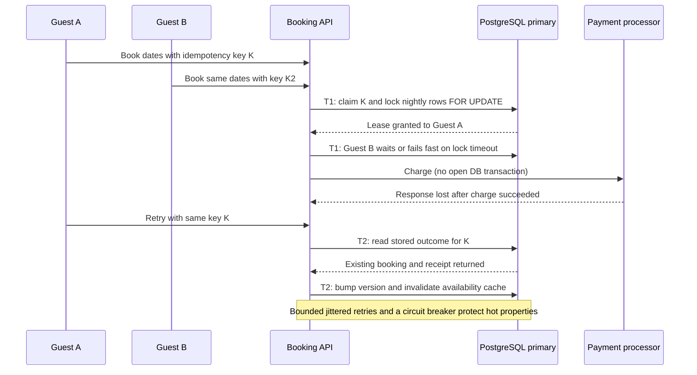

| Difficulty | Channel | Tags |
|---|---|---|
| intermediate | database | acid, isolation-levels, mvcc |

One click on 'Book' should mean one reservation and one charge. During Airbnb's move to a service-oriented architecture, that click fanned out across payment services and external processors, where lost responses, client timeouts, and double-clicks could charge a guest twice or pay a host twice [1]. There was no neat two-phase commit to wave at the problem. The fix was a design philosophy: make every step retryable, idempotent, and short enough that a race never turns into a receipt.

---

> ### Real-World Case — Airbnb
>
> As Airbnb migrated its monolith to a service-oriented architecture, a single 'Book' click fanned out into multiple payments services and external processors. Lost responses, client timeouts, and guests double-clicking 'Book' created race conditions that could charge a guest twice or pay a host twice — with no 2PC-style distributed transaction to fall back on.
>
> | | |
> |---|---|
> | **Challenge** | Guaranteeing exactly-once effects for payment and reservation-related writes across independent services, while keeping latency low and making aggressive client retries safe. Any stale read of 'did this request already succeed?' could turn a legitimate retry into a duplicate charge. |
> | **Solution** | Airbnb built 'Orpheus', a general-purpose idempotency library: every request carries a unique idempotency key, acquires a database row-level lock on that key as an expiring lease, and is split into Pre-RPC, RPC, and Post-RPC phases. Pre/Post-RPC database commits are combined into single ACID transactions via Java lambdas, with no network calls inside transactions and errors classified as retryable or non-retryable. Critically, idempotency state is read and written only on the master, deliberately avoiding replicas because a few seconds of MySQL replica lag would make a retry look like a new request; the tables are sharded by the high-cardinality idempotency key to scale, and clients retry with exponential backoff plus jitter. |
> | **Outcome** | Airbnb reported achieving five nines (99.999%) consistency for payments after Orpheus launched, while annual payment volume simultaneously doubled. |
> | **Lesson** | For critical state, replicas are a correctness trap: a stale idempotency read converts a correct retry into a double charge. Serialize duplicate requests with short-lived row-level locks on the authoritative primary, keep RPCs outside DB transactions, and scale by sharding the hot state instead of serving it from lagging copies. |

---

## Hook — The deploy looked fine. Then the double charges started

The deploy looked fine. Then the support queue filled with guests holding two charges for one stay.

Picture the moment: a guest clicks 'Book' twice because the spinner froze, the first processor call succeeds but its response dies in transit, and the client times out. Retry logic kicks in, and the system confidently performs the same charge a second time. Airbnb hit exactly this class of race as its monolith broke into services, and the outcome could be a double-charged guest or a double-paid host [1].

Every developer has been there, staring at a 500 error at 2am while the logs insist nothing is wrong. The scary part is that nothing is broken in the usual sense; each service is doing what it was told. The real question is who owns correctness when no single transaction spans the whole journey.

## Problem — When two guests want the same weekend

Building on that race, the booking version looks almost polite: two guests reserve the same property for the same dates at the same millisecond. Both read 'available', both write a reservation, and the database happily accepts two conflicting facts. A transaction is meant to be a coherent unit of work with ACID guarantees [5], but the guarantee only holds inside its boundary. Once the flow crosses services, caches, and processors, that boundary disappears.

However, the hard part is not writing a lock; it is choosing where correctness lives. Isolation is the ACID property that decides which concurrent effects are visible, and stronger isolation buys safety at the cost of blocking [2]. Many developers think 'READ COMMITTED plus an if-check' is enough, until two requests both pass the check and the property is booked twice.

Consequently, the stakes are money and trust. An overbooked guest needs rehoming at 11pm, a host needs an apology, and finance needs to reconcile duplicate payouts. High availability makes the tension worse: the natural instinct is to add read replicas, but replicas are asynchronous copies that can lag behind the primary [11]. A stale 'available' answer is a very expensive lie.

## Real-World Case — Airbnb

This leads directly to Airbnb's payments migration. As the monolith became services, one payment request turned into a chain of internal calls and external processors, each able to time out, lose a response, or be retried. Orpheus, Airbnb's idempotency framework, split each workflow into pre-RPC, RPC, and post-RPC phases, with retryable and non-retryable outcomes recorded centrally [1].

The counterintuitive detail is that Airbnb deliberately kept idempotency state on the master database and sharded it by idempotency key instead of reading from replicas for lower latency [1]. A few seconds of replica lag could turn a perfectly correct retry into a duplicate charge. That is the plot twist: the 'high availability' read path was the dangerous one.

The result was five nines of payment consistency, 99.999%, while annual payment volume doubled [1]. HTTP already encodes a similar idea: RFC 9110 defines idempotent methods [7], conditional requests use validators such as ETags to stop lost updates [8][9], and the same spirit applies inside a distributed payments platform. Airbnb turned retries from a hazard into the recovery mechanism.

## Deep Dive — Locks, snapshots, and the version column that saves the day

Building on Airbnb's lesson, the first decision is where to place the consistency boundary. SERIALIZABLE is the strongest SQL isolation level: concurrent transactions behave as if they ran one after another, even though the database may interleave them internally [2]. In PostgreSQL that can mean serialization failures, which is why retry logic is not optional decoration.

💡 Insight: A SERIALIZABLE transaction that aborts is not a bug; it is the database refusing to guess. Treat serialization failures as a normal control-flow path.

However, running every availability read at SERIALIZABLE would turn a busy listing into a queue. Here is the split that works in practice: use MVCC snapshot reads for fast calendar browsing, because MVCC gives each reader a point-in-time view without blocking writers [4]. Then, at the moment of commitment, switch the critical path to a short transaction that locks only the relevant date rows with SELECT FOR UPDATE [6].

🔥 Hot Take: 'Optimistic concurrency control' does not mean 'no locks ever'. It means 'assume peace, verify before commit, and retry when the assumption breaks' [3]. The verification step is exactly where a version column or a serializable check earns its keep.

| Option | What it feels like | Real tradeoff |
| --- | --- | --- |
| Pessimistic row locks (SELECT FOR UPDATE) | Predictable winner, simple reasoning | Held locks hurt throughput on hot properties; deadlocks and timeouts need handling |
| Optimistic version column | High throughput, no waiting on reads | Conflicts surface late; retries must be safe and bounded [3] |
| Full SERIALIZABLE everywhere | Strongest correctness story | Abort rate rises with contention; p99 latency becomes a budget exercise [2] |
| Read replicas for availability | Cheap horizontal read scaling | Stale snapshots can approve a booking that no longer exists [11] |

Specifically, the durable pattern combines four pieces: a date-spine availability table with one row per property per night, a version column bumped on every successful booking, an idempotency key unique per guest-and-date intent, and a cache entry tagged with that version. Two-phase locking explains why long lock lifetimes increase blocking [10]; short transactions are the antidote.

When would each pattern actually be used? Use row locks when two writers truly want the same nightly row. Use optimistic versions when conflicts are rare and reads dominate. Use replicas for browsy calendar views, never for the final 'is this still available?' decision. Use caching when the availability payload is stable enough to be wrong for milliseconds, and invalidate by version on commit.

🎯 Key Point: Correctness is a property of the whole request path, not of one SQL statement.

## Workflow — From click to committed booking

With those tradeoffs in mind, the workflow matters as much as the SQL. The 'Booking Consistency Sequence' diagram below traces the two guests from the opening race through the idempotent retry that saves the second request.

1. Generate an idempotency key from guest, property, and date range before any write. A double-click reuses the same key, so the system can recognize its own past work.
2. In a short primary-database transaction, claim the key and lock the nightly availability rows for the requested range with SELECT FOR UPDATE [6]. A duplicate request either waits briefly or fails fast on a lock timeout.
3. Validate the full range inside that transaction, insert the booking, bump the availability version, and mark the key as done. Commit; never leave a half-finished reservation behind.
4. Call the payment processor outside the database transaction, then record the outcome in another short transaction under the same key. This mirrors the pre-RPC / RPC / post-RPC split that kept Airbnb's connection pools healthy [1].
5. On timeout, retry with the same key and exponential backoff plus jitter. The stored outcome is replayed instead of charging again; HTTP conditional requests show the same lost-update thinking at the protocol layer [8].
6. Invalidate the availability cache using the new version and trip a circuit breaker if lock timeouts on one property cross a threshold.

⚠️ Watch Out: SELECT FOR UPDATE locks rows that exist. If the date-spine row is missing, there is nothing to lock; create nightly rows up front or add a database constraint that rejects overlapping bookings.

## Code Example — A booking transaction that expects to retry

The Python sketch below turns that workflow into a production-shaped pattern. It keeps database work short, makes conflict an expected exception, and uses a version column so stale readers can be rejected. The explanation walks through each block.

1. The transaction starts SERIALIZABLE, so a concurrent writer that invalidates the read set causes a serialization failure rather than a silent double booking [2].
2. The idempotency row is checked and claimed first; ON CONFLICT DO NOTHING makes duplicate clicks fight over one key, not two bookings.
3. SELECT FOR UPDATE locks only the nights in the requested range, and a 150 ms lock timeout keeps a hot property from holding a connection hostage [6].
4. The booking insert, version bump, and key completion share one transaction, so the state is all-or-nothing [5].
5. The except block rolls back, then retries with exponential backoff and jitter, the same anti-thundering-herd logic optimistic concurrency relies on [3].

## Lessons Learned — Battle scars and the tomorrow test

Consequently, the biggest lesson is that retries are part of the design, not an error handler bolted on at the end. Airbnb's five nines did not come from finding a magical distributed transaction; it came from making each step safe to repeat [1].

Battle scars worth memorizing:

- Reading availability from a replica and writing to the primary. Replica lag [11] makes 'available' stale; route final checks to the primary.
- Holding a database transaction open across the payment RPC. Network calls inside transactions drain connection pools and stretch lock lifetime; split pre-RPC and post-RPC into short transactions.
- Locking the whole property. Nightly row locks plus a lock timeout of roughly 100-200 ms let unrelated dates book in parallel; tune from measurements, not folklore.
- Retrying in lockstep. Three to five attempts with a 20-50 ms base and jitter usually beats a tight loop; cap it and surface a clear 'try again'.
- Forgetting that locks only cover existing rows. Pair SELECT FOR UPDATE with a uniqueness or exclusion constraint so a missing row cannot become a loophole.

💡 Insight: Observability is part of correctness. Track serialization failures, lock wait time, cache version mismatches, and duplicate-key hits per property; those four metrics tell the story before support does.

Sound familiar? If this feels overwhelming, start small: add the idempotency key, shorten the transaction, and measure contention. The rest of the architecture can grow around those two habits.

---

## Booking Consistency Sequence

<strong>Original Interview Question</strong>

**Q:** You're building a booking system for Airbnb where multiple users can reserve the same property simultaneously. How would you design the transaction handling to prevent double bookings while maintaining high availability?

**A:** Use SERIALIZABLE isolation with optimistic concurrency control. Implement row-level locks on property availability tables, use MVCC snapshot reads for checking availability, and apply application-level validation to ensure atomic booking operations.

## Conclusion

The journey started with a single click that could charge twice and ended with a set of unglamorous habits: idempotency keys, short serializable transactions, versioned cache entries, and bounded jittered retries. Airbnb's Orpheus story shows the payoff, 99.999% payment consistency while volume doubled [1]. Tomorrow, pick one write path in your system and ask a blunt question: if the response is lost after the work succeeds, does a retry create a second fact? If the answer is yes, add a key, shrink the transaction, and make the retry boring. The one insight worth sharing with your team is simple: correctness is what remains when the network misbehaves.

---

## References

1. [Airbnb incident report](https://medium.com/airbnb-engineering/avoiding-double-payments-in-a-distributed-payments-system-2981f6b070bb) — article
2. [Isolation (database systems) - Wikipedia](https://en.wikipedia.org/wiki/Isolation_(database_systems)) — documentation
3. [Optimistic concurrency control - Wikipedia](https://en.wikipedia.org/wiki/Optimistic_concurrency_control) — documentation
4. [Multiversion concurrency control - Wikipedia](https://en.wikipedia.org/wiki/Multiversion_concurrency_control) — documentation
5. [Database transaction - Wikipedia](https://en.wikipedia.org/wiki/Database_transaction) — documentation
6. [PostgreSQL source code mirror - GitHub](https://github.com/postgres/postgres) — documentation
7. [RFC 9110: HTTP Semantics](https://datatracker.ietf.org/doc/html/rfc9110) — documentation
8. [RFC 7232: Conditional Requests](https://datatracker.ietf.org/doc/html/rfc7232) — documentation
9. [HTTP conditional requests - MDN](https://developer.mozilla.org/en-US/docs/Web/HTTP/Conditional_requests) — documentation
10. [Two-phase locking - Wikipedia](https://en.wikipedia.org/wiki/Two-phase_locking) — documentation
11. [Working with DB instance read replicas - AWS](https://docs.aws.amazon.com/AmazonRDS/latest/UserGuide/USER_ReadRepl.html) — documentation

---

**Author:** Satishkumar Dhule — [GitHub](https://github.com/satishkumar-dhule) · [LinkedIn](https://linkedin.com/in/satishkumar-dhule) · [Website](https://satishkumar-dhule.github.io)
