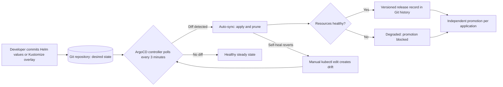

| Difficulty | Channel | Tags |
|---|---|---|
| beginner | devops | argocd, flux, declarative |

A one-line Helm values change at Meta once took more than four hours to reach a verified, healthy release across roughly 100 Kubernetes clusters [1]. Teams watched config generation, internal builds, Terraform plans, shared test rollouts, and promotions stack up like toll booths on the highway to production. The culprit was not Kubernetes — it was a monolithic Terraform workflow where one stalled rollout could hold dozens of unrelated releases hostage. That story is the entire argument for GitOps in one paragraph, and it is where your ArgoCD journey begins.

---

> ### Real-World Case — Meta
>
> Meta's Cloud Foundation team of 15+ engineers supports roughly 100 Kubernetes clusters across multiple clouds and AI accelerator types. Application deployments rode on top of a monolithic Terraform workflow: even a one-line Helm values change required config generation, internal builds, a Terraform plan, shared test rollouts and promotion — over four hours, with shared Terraform workspaces meaning one stalled rollout delayed dozens of unrelated releases.
>
> | | |
> |---|---|
> | **Challenge** | Terraform was doing two incompatible jobs — provisioning infrastructure and deploying applications — with no per-app health validation or independent promotion. Worse, release settings were updated directly in live Argo CD configuration, so Git did not contain enough information to reconstruct a complete release and recovery depended on live state plus retained history. |
> | **Solution** | They built a GitOps platform on Argo CD plus Kargo: developers write a short application definition, a config compiler generates Helm values and manifests, and everything — including a complete versioned record of each desired release per app and target cluster — is committed to a dedicated Git repo. Argo CD continuously reconciles clusters against that Git state, and they moved from per-cluster Argo CD instances to a centrally managed shared service. |
> | **Outcome** | Routine updates that took over four hours now reach a verified, healthy release in minutes across ~100 clusters; each application gets its own promotion process, health checks and versioned Git release records, cutting cross-release dependencies while a 15+ engineer team runs the whole platform. |
> | **Lesson** | GitOps only delivers its benefits if Git is truly the complete source of truth: when Kargo initially mutated live Argo CD config imperatively, Git couldn't reconstruct releases and disaster recovery depended on live state — the exact anti-pattern GitOps is meant to eliminate. The fix was to write every desired release back to Git and let Argo CD reconcile against it. |

---

## Hook — One line changed, four hours lost

The story starts with a tiny, almost boring change: a single line in a Helm values file. Sound familiar? A small config tweak sits in a pull request while a pipeline grinds through unrelated work, and by the time it ships, nobody remembers why the change mattered. That was the scene for Meta's Cloud Foundation team: 15+ engineers supporting roughly 100 clusters across multiple clouds and AI accelerator types, all funneled through one Terraform workflow [1]. ⚠️ Watch Out: the danger was not slowness alone — shared Terraform workspaces meant one stalled rollout delayed dozens of unrelated releases [1]. Here is the thing though: the cluster was healthy. The process was not. If a machine can declare what "healthy" looks like, why does a human still have to shepherd every release? That question sets up the real problem.

## Problem — When the cluster drifts, truth drifts with it

Building on that bottleneck, the deeper issue is not speed — it is trust. With imperative management, a `kubectl apply` or `kubectl edit` changes live state immediately, and the Git repository slowly becomes a museum of what the system used to look like [3]. Many developers discover this the hard way: the dashboard says green, the manifest says something else, and the only reliable documentation is whoever last touched the jump box. 🔥 Hot Take: an undocumented `kubectl scale` is not a quick fix — it is an untracked commit to production that nobody can review. Here is what you need to know:
- **Imperative commands** tell Kubernetes *how* to change state right now; they are fast, conversational, and genuinely useful during incident triage [7].
- **Declarative manifests** describe the state you want, and the controller works out the steps to get there [3].
- **Drift** is the gap between those two worlds, and it compounds quietly across environments.
- **Auditability** disappears the moment a change never lands in a commit, which is why repeatable, observable changes are treated as an operational-excellence pillar, not a nice-to-have [9].
Consequently, every manual change is a tiny tax on future debugging. So what does a system look like where Git is the only door into the cluster?

## Real-World Case — Meta

This leads directly to Meta's war story, which is less an outage and more a slow-motion traffic jam. Meta's Cloud Foundation team of 15+ engineers supports roughly 100 Kubernetes clusters spanning multiple clouds and several AI accelerator types [1]. Application deployments rode on top of a monolithic Terraform workflow: config generation, internal builds, a Terraform plan, shared test rollouts, and promotion — even for a one-line Helm values change, over four hours end to end [1]. ⚠️ Watch Out: shared Terraform workspaces created hidden coupling — one stalled rollout delayed dozens of unrelated releases, so teams waited on work that had nothing to do with their change [1]. The plot twist is that nothing was technically broken; the architecture was simply optimized for infrastructure provisioning, not application release velocity. After moving to a GitOps model with per-application promotion, health checks, and versioned Git release records, routine updates that took hours reached a verified, healthy release in minutes across roughly 100 clusters [1]. 💡 Insight: the fix was not "more automation" in general — it was giving each application its own release lane so dependencies stopped multiplying. When would that matter for you? The moment two unrelated teams share a pipeline and one bad deploy becomes everybody's problem.

## Deep Dive — Declarative and imperative, without the religion

Building on Meta's separation of release lanes, the technical heart of GitOps is a control loop, not a magic deploy button. GitOps formalizes the idea that Git holds the desired state and an agent continuously reconciles the live cluster toward it [4]. ArgoCD implements that agent as a Kubernetes custom resource — the `Application` CRD — which points at a repository path, a target cluster, and a sync policy [2][8]. 💡 Insight: the repo is not a backup; it is the control plane. Here is the comparison that actually matters:

| Option | How state changes | Speed | Auditability | Best when |
|---|---|---|---|---|
| Declarative (ArgoCD + manifests) | Commit to Git, controller reconciles | Minutes | Every change is a reviewable commit | You run many clusters and need repeatability [3] |
| Imperative (`kubectl apply`/`edit`) | Direct API call | Seconds | Relies on shell history and hope | You are debugging a live incident and need immediacy [7] |

Specifically, declarative management means the desired state lives in YAML, Helm charts, or Kustomize overlays, and Kubernetes works out the delta [3][6]. Imperative management issues commands straight at the API server, which is exactly how drift appears [7]. 🔥 Hot Take: auto-sync is the boring part; **self-healing** is the plot twist. Auto-sync pulls new commits in, but self-healing reverts a manual `kubectl edit` back to the Git-declared state — that turns Git into a single source of truth instead of a suggestion [2]. Many teams assume a three-minute health check interval is "too slow," then discover that a three-minute reconciliation window beats a four-hour human coordination window by roughly 80x [1][2]. ⚠️ Watch Out: common battle scars include (1) pointing an Application at a moving branch instead of a pinned tag, so "latest" becomes a moving target; (2) forgetting `prune`, which leaves orphaned resources behind after a manifest is deleted; and (3) enabling self-healing in namespaces where developers still debug with `kubectl edit`, creating a tug-of-war that looks like random flapping [8]. Use declarative when the change must survive audits and scale across clusters; keep imperative in your back pocket for triage, then commit the fix. But knowing the theory is one thing — how does the loop actually run?

## Workflow — From commit to healthy cluster in three minutes

This leads to the practical loop that replaced the four-hour march. The GitOps reconciliation flow below shows the whole path from a developer's commit to a healthy pod, with ArgoCD sitting between Git and the clusters.

- **Step 1 — Commit:** A developer changes a Helm values file or Kustomize overlay and pushes it; that commit becomes the release record [6].
- **Step 2 — Detect:** The ArgoCD controller polls the repository at the configured interval, commonly every three minutes, and compares declared state with live state [2].
- **Step 3 — Diff and sync:** When a difference appears, auto-sync applies the manifests, and `prune` removes resources that no longer exist in Git [8].
- **Step 4 — Health check:** ArgoCD reads resource health and marks the app healthy only when Kubernetes agrees; self-healing reverses out-of-band edits [2].
- **Step 5 — Promote:** Per-application promotion gates keep one team's rollout from blocking another's — the structural change behind Meta's speedup [1].
🎯 Key Point: the loop is boring by design, and boring is what makes it repeatable across roughly 100 clusters. When would this be overkill? A single hobby cluster with one developer, where `kubectl apply` is a perfectly reasonable shortcut. For everyone else, the next question is what this looks like in code.

## Code Example — An Application that heals itself

Building on that workflow, here is the pattern that turns the diagram into something runnable. The script writes an ArgoCD `Application` CRD, enables `prune` and `selfHeal`, then blocks until the app reports healthy.

```bash
#!/usr/bin/env bash
# Declare the Git-backed Application ArgoCD reconciles every 3 minutes.
set -euo pipefail

REPO_URL="https://github.com/acme/platform-manifests.git" # Single source of truth
APP_NAME="payments-api"
NAMESPACE="argocd"

cat <<EOF | kubectl apply -f -
apiVersion: argoproj.io/v1alpha1
kind: Application
metadata:
  name: ${APP_NAME}
  namespace: ${NAMESPACE}
spec:
  project: default
  source:
    repoURL: ${REPO_URL}
    targetRevision: main          # Pin a tag when releases need strict approval
    path: apps/${APP_NAME}/prod   # Kustomize overlay for production
  destination:
    server: https://kubernetes.default.svc
    namespace: ${APP_NAME}
  syncPolicy:
    automated:
      prune: true                 # Delete resources removed from Git
      selfHeal: true              # Revert manual kubectl edits
    syncOptions:
      - CreateNamespace=true
  revisionHistoryLimit: 5         # Keep versioned release records
EOF

argocd app sync "${APP_NAME}" --prune      # Reconcile now, not after the poll
argocd app wait "${APP_NAME}" --health --sync --timeout 300 # Fail if unhealthy
```

Line by line: `set -euo pipefail` makes the script fail fast, which matters when a deploy script silently half-succeeds. `source.repoURL` and `source.path` define where desired state lives, and `targetRevision: main` keeps the demo simple, though pinned tags are safer for audited releases. `path: apps/payments-api/prod` points at a Kustomize overlay, the technique Kubernetes documents for environment-specific config [6]. `syncPolicy.automated.prune` removes resources deleted from Git, while `selfHeal` reverts a manual `kubectl edit` back to the declared state — the mechanism behind Git as one source of truth [8]. `revisionHistoryLimit: 5` preserves versioned release records, and `argocd app wait --health --sync` fails the pipeline if the rollout never becomes healthy [2]. 💡 Insight: the wait step is the unsung hero — without it, "sync attempted" gets reported as "deploy succeeded."

## Lessons Learned — The one memorable insight

Building on that Application manifest, the lessons are less about tooling and more about discipline. Here is what you need to know:
- **Git is the control plane, not a folder of backups.** If a change never lands in a commit, it does not exist [4].
- **Automate the boring reconciliation.** Self-healing is what converts "teams have manifests" into "the team has a source of truth" [2].
- **Isolate release lanes.** The biggest win was not faster Terraform; it was removing cross-release dependencies across roughly 100 clusters [1].
- **Keep imperative commands for incidents, then commit the fix.** Speed is legitimate during triage; drift is not legitimate afterward [7].
- **Treat repeatability as a pillar.** Observable, consistent changes are core operational practice, not extra polish [9].
⚠️ Watch Out: do not switch on `selfHeal` in a namespace where teammates live in `kubectl edit` — that is how a three-minute argument breaks out between two automation systems. 💡 Insight: if a manual change survives longer than a coffee break, the process has already lost the plot. Tomorrow, pick one service, write its Application CRD, enable `prune` and `selfHeal`, and watch what happens when someone tries to "just fix it live."

---

## GitOps Reconciliation Flow



<details>
<summary><strong>Original Interview Question</strong></summary>

**Q:** You're setting up GitOps for a microservices deployment. How would you configure ArgoCD to automatically sync changes from your Git repository to Kubernetes, and what's the difference between declarative and imperative approaches in this context?

**A:** I'd configure ArgoCD by setting up a Git repository containing Kubernetes manifests or Helm charts, creating an Application CRD that points to the Git repository, enabling auto-sync with a health check interval of 3 minutes, and implementing self-healing to automatically revert any manual changes. The declarative approach involves defining the desired state in Git through YAML manifests, Helm charts, or Kustomize configurations, where ArgoCD continuously reconciles the actual state with the desired state. In contrast, the imperative approach uses kubectl commands to make direct changes to the cluster, bypassing the Git repository as the single source of truth.

</details>

## Conclusion

A one-line Helm change used to cost Meta more than four hours [1]. The journey from imperative edits to a reconciled, Git-declared state is not about tooling purity — it is about making the boring path the fastest path. Commit the change, let the controller reconcile every three minutes, prune what Git no longer describes, and heal whatever someone tries to patch live. Do that, and the next "quick fix" quietly becomes a reviewable commit instead of another war story.

---

## References

1. [Meta incident report](https://www.cncf.io/case-studies/meta/) — article
2. [Argo CD — Declarative GitOps CD for Kubernetes](https://github.com/argoproj/argo-cd) — documentation
3. [Kubernetes: Declarative Management of Kubernetes Objects](https://kubernetes.io/docs/concepts/overview/working-with-objects/management/) — documentation
4. [GitOps — Wikipedia](https://en.wikipedia.org/wiki/GitOps) — documentation
5. [Flux CD — GitOps Toolkit for Kubernetes](https://github.com/fluxcd/flux2) — documentation
6. [Kubernetes: Kustomization](https://kubernetes.io/docs/tasks/manage-kubernetes-objects/kustomization/) — documentation
7. [Kubernetes: Deploy an Application](https://kubernetes.io/docs/tutorials/kubernetes-basics/deploy-app/deploy-intro/) — documentation
8. [Argo CD: Declarative Setup Guide](https://github.com/argoproj/argo-cd/blob/master/docs/operator-manual/declarative-setup.md) — documentation
9. [AWS Well-Architected Framework: Operational Excellence Pillar](https://docs.aws.amazon.com/wellarchitected/latest/operational-excellence-pillar/) — documentation

---

**Author:** Satishkumar Dhule — [GitHub](https://github.com/satishkumar-dhule) · [LinkedIn](https://linkedin.com/in/satishkumar-dhule) · [Website](https://satishkumar-dhule.github.io)
