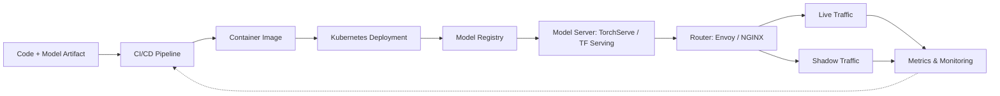

| Difficulty | Channel | Tags |
|---|---|---|
| beginner | devops | mlops, deployment |

By 2024, Uber's Michelangelo platform was running more than 5,000 production models and serving 10 million real-time predictions every second at peak, powering everything from maps ETA to Eats homefeed ranking [1]. That is not a deployment story; it is a serving story, and the difference between the two is exactly where most ML systems either scale gracefully or fall over at 3am. Many developers discover that distinction only after their first latency spike. So what actually separates deployment from serving when the stakes are this high?

---

> ### Real-World Case — Uber
>
> As Uber's ML usage expanded from simple tree models to deep learning and generative AI, its Michelangelo platform had to standardize the full ML lifecycle for hundreds of teams while reliably running thousands of production models for latency-sensitive products like ETA prediction and Eats homefeed ranking.
>
> | | |
> |---|---|
> | **Challenge** | Uber needed to separate and scale two distinct problems: deploying models safely and repeatably into production, and serving real-time inference at massive scale with low latency across different ML frameworks. |
> | **Solution** | Michelangelo evolved into an end-to-end platform covering both deployment and serving. On the deployment side, it standardized workflows for training, managing, and deploying models to production (running 20K+ training jobs monthly across ~400 active ML projects). On the serving side, Uber moved from custom serving containers and the deprecated Neuropod engine to NVIDIA Triton in its Online Prediction Service to support TensorFlow/PyTorch models with GPU-optimized, low-latency inference for tier-1 use cases. |
> | **Outcome** | By 2024, Uber reported 5,000+ models in production serving 10 million real-time predictions per second at peak on Michelangelo, powering critical systems such as maps ETA and Eats homefeed ranking. |
> | **Lesson** | At production scale, model deployment and model serving require different architectures and optimizations: deployment focuses on standardized lifecycle management and rollout, while serving must be engineered for runtime latency, framework compatibility, and extreme throughput. |

---

## Hook — The 3am Pager Test

The deploy looked perfect. Green checks, clean logs, a shiny new model version sitting in production. Then the pager fired at 3am: p99 latency had jumped from 80ms to 900ms, and the ETA on every ride in the app was stuck. Sound familiar? Teams have all been there, staring at a 500 error while trying to remember which of the two systems actually broke. Here is the uncomfortable truth: the model was deployed correctly and still failed at serving. Those are two different jobs, and confusing them is one of the most expensive mistakes in modern ML systems.

## Problem — When 'Ship It' Means Two Different Things

However, that 3am confusion was not bad luck. Ask a room of developers what 'deploying a model' means and you will get two answers. One group talks about pipelines, containers, and rollbacks. The other talks about inference endpoints, request queues, and GPU memory. Both are right, and that is precisely the problem.

Here is what you need to know:
- **Deployment** is the journey from code and data to a running, observable system: CI/CD, infrastructure as code, artifact tracking, monitoring, and rollback [2][6].
- **Serving** is what happens on every request: routing, model loading, batching, version selection, and response optimization.
- **The seam between them** is where latency budgets get decided, and it is where most teams under-invest.

The stakes are real. Research on technical debt in ML systems shows that only a small fraction of real-world ML code is the model itself; the rest is plumbing around it [8]. Moreover, a 50ms latency budget is just as brutal at 500 QPS as it is at 10,000 QPS. The difference is only how many users notice at once.

You might think this only matters at Uber scale. Actually, it does not. When deployment and serving blur into one system, that plumbing becomes a single giant failure domain. So where does the split actually live?

## Real-World Case — Uber

That ambiguity stops being theoretical the moment a company operates at scale. When Uber's ML usage grew from simple tree models into deep learning and generative AI, the company faced a problem that would make any platform team sweat: hundreds of teams needed one standardized way to build, deploy, and run models, while thousands of production models had to stay fast enough for latency-sensitive products [1].

The challenge was not training models. It was running them reliably at a scale where a single slow endpoint could ripple through maps ETA and Eats homefeed ranking. By 2024, Michelangelo was serving more than 5,000 models in production and hitting 10 million real-time predictions per second at peak [1].

⚠️ **Watch Out:** The plot twist is that the hard part was not the models. It was standardizing the full lifecycle around them. Michelangelo had to make deployment reproducible and serving predictable at the same time, for hundreds of teams with very different needs.

💡 **Insight:** Notice the two-layer shape of the solution: one layer makes shipping safe, the other makes inference fast. Uber's numbers are famous, but the architecture pattern is the real lesson, and that pattern is exactly what the next section pulls apart.

## Deep Dive — Two Systems, Two Sets of Rules

Building on the two-layer pattern Uber exposed, the cleanest way to separate the concepts is by asking a simple question: does this happen once per release, or once per request?

**Deployment happens once per release.** It covers CI/CD, infrastructure provisioning, container builds, model registry tracking, monitoring hooks, and rollback strategy. Tools like Kubernetes, Terraform, MLflow, and SageMaker live here [2][5][7].

**Serving happens once per request.** It covers the runtime inference API: request routing, model loading, batching, version selection, and response serialization. TensorFlow Serving, TorchServe, BentoML, FastAPI, and gRPC endpoints live here [3][4].

Here is the comparison that matters:

| Question | Deployment | Serving |
|---|---|---|
| Frequency | Once per release | Every request |
| Primary metric | Deploy success rate, rollback time | p99 latency, QPS, error rate |
| Typical tools | Kubernetes, Terraform, MLflow [2][7] | TorchServe, TF Serving, Envoy [3][9] |
| Failure mode | Bad image reaches prod | Slow or wrong response |
| Scaling lever | Replica count, cluster size | Batching, GPU memory, caching |

🔥 **Hot Take:** Most 'ML outages' are not model bugs. They are serving bugs wearing a model costume.

Now the trade-offs. Latency versus throughput is the classic fight. Specifically, real-time products like ETA prediction often target under 100ms, while batch pipelines can tolerate a second or more. Batching improves throughput but adds waiting time; therefore, a 10ms batch window can quietly become your entire latency budget.

Cold starts are the other silent killer. Loading a large deep learning model into GPU memory can take seconds, and autoscaling from zero means every new replica pays that tax [2]. Consequently, teams keep a warm minimum replica count even when traffic looks sleepy.

🎯 **Key Point:** Use real-time serving when a human is waiting. Use batch when the result can land in a dashboard five minutes later. Use a warm pool when cold starts exceed your latency budget.

But knowing the rules is not the same as running the play. How does a request actually travel from a git push to a prediction?

## Workflow — From Git Push to Prediction

This leads to the workflow that ties both systems together. The Deployment to Serving Flow diagram below shows the full path, and each numbered step maps to a specific boundary between deployment and serving.

1. **Commit and train.** Code and features go through CI; the model artifact is registered and versioned [7].
2. **Package.** The artifact and runtime dependencies are baked into a container image [2][10].
3. **Deploy.** Kubernetes rolls the image out with a canary or blue-green strategy, keeping the previous version ready for rollback [2].
4. **Serve.** A model server such as TorchServe or TensorFlow Serving loads the versioned model and exposes a gRPC or HTTP endpoint [3][4].
5. **Route.** Envoy or NGINX splits traffic between stable and canary versions, with shadow traffic for safe experiments [9].
6. **Observe.** Latency, error rate, and prediction drift flow back into monitoring, which can trigger the next deploy [5].

💡 **Insight:** Notice that step 3 is deployment and steps 4 and 5 are serving. One wrong assumption at that seam and your carefully canaried release still serves garbage.

⚠️ **Watch Out:** Battle scar: teams often skip shadow traffic because it 'doubles compute.' It does, temporarily. For example, a ranking model can run in shadow while the stable version keeps serving, catching regressions before they hit a homefeed.

If this feels overwhelming, you are not alone. The next section makes the serving half concrete with a small but real router.

## Code Example — A Router That Treats Versions as First-Class Citizens

Consequently, the serving layer is where those abstract trade-offs become real code. The Python snippet below implements a lightweight inference router: it picks a live model version by traffic weight, measures latency, and runs shadow candidates without letting them touch the response.

Here is what each part does:
- `ModelVersion` captures the name, prediction function, traffic weight, and a shadow flag. Keeping version metadata in one structure makes rollouts auditable.
- `InferenceServer.__init__` normalizes live weights so probabilities sum to one, and stores shadow versions separately. Shadow models never affect users.
- `_pick_live` uses a single random roll and cumulative weights, which is the standard weighted-routing pattern.
- `predict` times the live call, then fires shadow calls and returns only the live result. That latency number is what your canary decision will be based on [11].

💡 **Insight:** This is the same idea behind large platforms, minus the fleet. Traffic splitting, shadow traffic, and latency measurement are serving concerns, not deployment concerns [3][4].

🔥 **Hot Take:** If your model versions are just filenames, you do not have versioning. You have hope.

🎯 **Key Point:** When would you actually use this? Any time two model versions need to coexist while you compare them on real traffic. For a single model with no experiments, a plain endpoint is fine.

So the router works. But what does all of this mean for the team shipping it tomorrow?

## Lessons Learned — The Line You Will Never Unsee

In the end, the journey from a 3am pager to a 10-million-predictions platform should feel less like magic and more like two well-defined jobs. Here are the battle scars worth keeping:

- **Name the boundary.** Write down which part of your system is deployment and which is serving. Ambiguity is the root of most 'whose bug is this?' meetings.
- **Budget latency before batching.** Measure cold starts, batch windows, and serialization overhead before blaming the model [3].
- **Keep the last good version warm.** Rollback is only fast if the old model is still loaded [2].
- **Treat shadow traffic as insurance, not waste.** It is the cheapest regression test you will ever run [9].
- **Watch the right metrics.** Deployment health is deploy frequency and rollback time; serving health is p99 latency, QPS, and error rate [5].

💡 **Insight:** The teams that scale gracefully are not the ones with the fanciest models. They are the ones that made the deployment/serving seam boring.

⚠️ **Watch Out:** The most common mistake is optimizing model accuracy while ignoring the 40ms your JSON serialization adds. The model is rarely the bottleneck.

And that brings the story full circle. Uber's 5,000 models and 10 million predictions per second were not achieved by training better trees alone [1]. They were achieved by making deployment repeatable and serving predictable, one routed request at a time.

---

## Deployment to Serving Flow

<strong>Original Interview Question</strong>

**Q:** Explain the key differences between model serving and model deployment in ML systems, including specific technologies, scaling considerations, and real-world implementation patterns?

**A:** Deployment encompasses CI/CD pipelines, infrastructure setup, and monitoring using tools like Kubernetes, MLflow, and SageMaker. Serving focuses on runtime inference APIs with frameworks like TensorFlow Serving, TorchServe, or BentoML, handling request routing, model versioning, and autoscaling. Key trade-offs include latency vs throughput, batch vs real-time inference, and cold start optimization.

## Conclusion

That 3am pager from the beginning did not fire because the model was wrong. It fired because nobody had agreed on where deployment ended and serving began. Tomorrow, draw that line on your own architecture: put CI/CD, infrastructure, and rollback on one side, and routing, versioning, and latency on the other. Then measure p99 before the next release, not after. The one insight to take to your team: deployment gets your model to production; serving decides whether production survives your model. Get that seam right, and 10 million predictions a second stops being a fantasy and starts being a Tuesday.

---

## References

1. [Uber incident report](https://www.uber.com/blog/from-predictive-to-generative-ai/) — article
2. [Kubernetes Deployments](https://kubernetes.io/docs/concepts/workloads/controllers/deployment/) — documentation
3. [TensorFlow Serving](https://github.com/tensorflow/serving) — documentation
4. [TorchServe](https://github.com/pytorch/serve) — documentation
5. [Amazon SageMaker Developer Guide](https://docs.aws.amazon.com/sagemaker/latest/dg/whatis.html) — documentation
6. [MLOps](https://en.wikipedia.org/wiki/MLOps) — documentation
7. [MLflow](https://github.com/mlflow/mlflow) — documentation
8. [Hidden Technical Debt in Machine Learning Systems](https://arxiv.org/abs/1504.08277) — paper
9. [Envoy Proxy](https://github.com/envoyproxy/envoy) — documentation
10. [An Introduction to Kubernetes](https://www.digitalocean.com/community/tutorials/an-introduction-to-kubernetes) — documentation
11. [concurrent.futures — Launching parallel tasks](https://docs.python.org/3/library/concurrent.futures.html) — documentation

---

**Author:** Satishkumar Dhule — [GitHub](https://github.com/satishkumar-dhule) · [LinkedIn](https://linkedin.com/in/satishkumar-dhule) · [Website](https://satishkumar-dhule.github.io)
