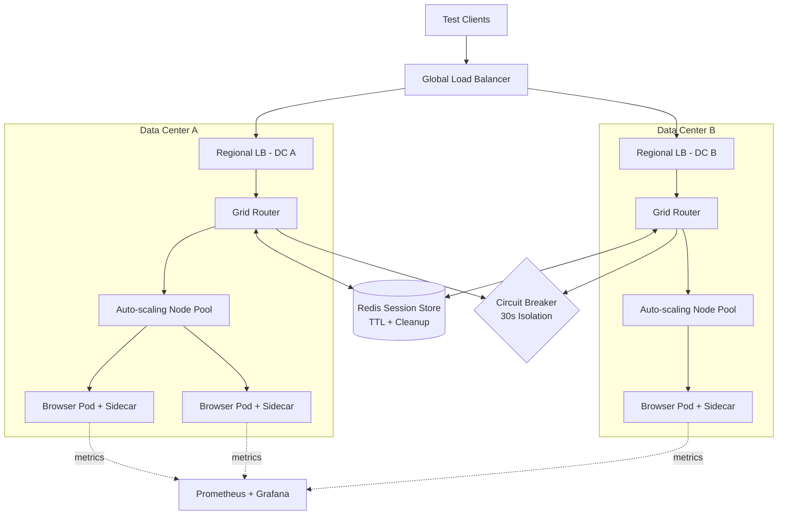

| Difficulty | Channel | Tags |
|---|---|---|
| advanced | system-design | selenium, webdriver, grid |

Picture this: at Yandex, millions of automated tests ran every day on a Selenium Grid that had to keep thousands of browsers available around the clock [1]. Under real load, a single hub could reliably manage only 20–30 nodes, and if that hub or its data center failed, every browser behind it disappeared instantly [1]. That breaking point forced a redesign for massive scale—one that ultimately supported more than 3,000 browsers across data centers. If your team is chasing 10,000 concurrent sessions with 99.9% uptime, this is the journey you need to understand.

---

> ### Real-World Case — Yandex
>
> Yandex ran millions of Selenium-based automated tests daily and needed thousands of browsers available 24/7. Their Selenium Grid hit a hard wall: under load a single hub could reliably handle only 20-30 nodes, and if the hub or its data center failed, every browser behind it became unreachable.
>
> | | |
> |---|---|
> | **Challenge** | Scale the grid to thousands of concurrent browser sessions across multiple data centers without the hub becoming a single point of failure or a throughput bottleneck, while adding per-team quotas and automatic failover when a region goes dark. |
> | **Solution** | Rather than scaling one giant hub, Yandex built 'gridrouter' — a stateless, JsonWire-protocol-compatible routing proxy behind a load balancer. It rewrites each browser's session ID to embed the originating hub's address, so any router instance can proxy subsequent requests to the correct hub with zero shared session state. Hubs were deployed one per VM with five localhost nodes (2 vCPU/4GB), quotas were defined per team in XML grouping hosts by region, and a failed browser acquisition in one data center immediately triggered a retry in another. The follow-on Selenograph tool added real-time session stats, a web UI, and Graphite metrics export. |
> | **Outcome** | Production grid of 3,000+ browsers serving roughly 3,000 peak concurrent sessions across data centers, supporting millions of tests per day. The system was open-sourced on GitHub and seeded the Aerokube Selenoid/Ggr ecosystem used widely beyond Yandex. |
> | **Lesson** | The scaling limit of Selenium Grid isn't browser capacity — it's the hub as a single point of failure plus shared session state. Embedding routing information in the session token lets the control plane scale horizontally with no shared store, and many small hubs beat one overloaded one. |

---

## Hook — The Night 3,000 Browsers Went Dark

Sound familiar? A test suite grows, CI queues back up, and suddenly the grid that felt rock-solid starts dropping sessions at the worst possible moment. For teams running browser automation at scale, the stakes are brutal: delayed releases, flaky pipelines, and engineers staring at timeouts instead of shipping features [2].

Here is the thing, though: scaling Selenium is not just about adding more machines. It is about surviving hub bottlenecks, memory leaks, and entire data center failures without losing every active session. The question is not whether the grid will be stressed—it is whether the architecture will bend or break when it is.

## Problem — Why Traditional Selenium Grid Hits a Ceiling

Building on that pressure, the core challenge becomes clear: a classic hub-and-node setup concentrates too much responsibility in one place. A single hub becomes a traffic cop, session registry, and failure domain all at once. When load spikes, routing slows down; when memory leaks accumulate, stability erodes; when the hub goes offline, the whole fleet becomes unreachable [2][3].

However, the math makes the problem impossible to ignore. Supporting 10,000 concurrent sessions at roughly 50 sessions per node requires at least 200 nodes. At 2 GB of RAM per node, that is 400 GB baseline—plus a 30% buffer, pushing cluster memory to about 520 GB. Moreover, teams still need p99 session startup under 2 seconds and 99.9% availability across regions. Consequently, session lifecycle management, observability, and graceful recovery are not nice-to-haves; they are survival requirements.

## Real-World Case — Yandex

This is exactly where Yandex hit the wall. The company ran millions of Selenium-based automated tests daily and needed thousands of browsers available 24/7 [1]. Their Selenium Grid could reliably handle only 20–30 nodes per hub under load, and a hub or data center failure made every browser behind it unreachable [1].

The impact was significant: Yandex operated a production grid of more than 3,000 browsers serving roughly 3,000 peak concurrent sessions across data centers, supporting millions of tests per day [1]. Rather than accepting that ceiling, engineers redesigned the system and open-sourced it on GitHub, seeding the Aerokube Selenoid/Ggr ecosystem used widely beyond Yandex [1]. The lesson for any team: centralized bottlenecks do not scale quietly—they fail loudly.

## Deep Dive — Architecture for 10,000 Sessions and 99.9% Uptime

So, what does a resilient alternative look like? The answer starts with distributing control and isolating failure domains. A Kubernetes-based hub-node pattern, with StatefulSets managing browser node pools across multiple availability zones, removes the single-hub dependency and enables controlled scaling [3][4].

**System architecture and NFRs**
- **Session management:** Store session metadata in a Redis cluster with TTL-based expiration, connection pooling, and automated cleanup to prevent orphaned sessions [1].
- **Resource allocation:** Enforce per-pod limits (for example, 1 CPU and 2 GB RAM) and use horizontal pod autoscaling driven by queue depth [5].
- **Capacity planning:** 10,000 sessions ÷ 50 sessions/node = 200 nodes minimum; 200 × 2 GB = 400 GB baseline + 30% buffer = ~520 GB.
- **Performance targets:** Keep p99 session initiation under 2 seconds with regional load balancing, and target 99.9% uptime through multi-AZ deployment and automatic failover [8].

**Memory management and observability**
To stop leaks from silently killing capacity, teams can combine weekly rolling restarts, memory alerts at 80%, and garbage collection tuning. Sidecars or init containers can remove stale artifacts, while Redis key expiration scans run frequently (for example, every 5 minutes). Prometheus and Grafana dashboards then expose memory trends and session-duration metrics so operators can act before users feel pain [6].

**Load balancing, health checks, and edge cases**
Weighted round-robin routing based on node capacity and response time keeps hot spots in check. Health checks against an HTTP `/status` endpoint every 10 seconds—and immediate removal after three consecutive failures—reduce blast radius. Circuit breakers can isolate failing nodes for 30-second recovery windows, a pattern that prevents cascading failures [7]. For edge cases, leader election mitigates split-brain during network partitions, Pod Disruption Budgets preserve at least 85% capacity during maintenance, and canary deployments with traffic splitting de-risk new node versions [4][5].

## Workflow — From Test Request to Clean Teardown

Building on this architecture, the request lifecycle becomes predictable instead of fragile. The diagram below maps the flow from client request to monitored teardown across data centers:

[Mermaid diagram: Scalable Selenium Grid Architecture]

1. **Request ingress:** Test clients hit a global load balancer, which routes traffic to the healthiest region using regional load balancers [8].
2. **Scheduling:** A grid router or hub selects a node from an auto-scaling pool using weighted capacity-aware routing.
3. **Session registration:** Session metadata is written to Redis with a TTL so abandoned sessions cannot linger indefinitely [1].
4. **Execution and monitoring:** Browser pods run tests while sidecars and exporters stream health and resource metrics to Prometheus and Grafana [6].
5. **Failure handling:** Failed health checks trigger node removal; circuit breakers isolate unhealthy components for a cooldown period to protect the rest of the grid [7].
6. **Cleanup:** When a session ends—or exceeds its allowed age—cleanup routines delete the session and release resources, keeping memory pressure under control.

This workflow turns reliability into a repeatable process rather than a late-night firefight.

## Code Example — Automating Session Lifecycle Cleanup

To make the workflow concrete, consider a lightweight cleanup worker that enforces a maximum session age. Even with Redis TTLs, an explicit sweeper adds a safety net: it can call back into nodes, handle stragglers, and keep the registry consistent. The pattern is simple but powerful—track creation time, delete expired sessions, and tolerate node failures without crashing the cleanup loop.

```python
import time
import redis
import requests

GRID_URL = "http://selenium-router:4444"
MAX_SESSION_AGE_SECONDS = 600  # 10-minute safety cap
SLEEP_INTERVAL_SECONDS = 30

redis_client = redis.Redis(host="redis", port=6379, decode_responses=True)

def cleanup_stale_sessions() -> None:
    """Enforce session lifecycle limits to prevent memory leaks."""
    for key in redis_client.scan_iter("session:*"):
        session_id = key.split(":", 1)[1]
        created_at = redis_client.hget(key, "created_at")
        node_url = redis_client.hget(key, "node_url")

        # Skip malformed records; a separate validator can handle repairs.
        if not created_at or not node_url:
            continue

        age_seconds = time.time() - float(created_at)
        if age_seconds <= MAX_SESSION_AGE_SECONDS:
            continue

        try:
            # Best-effort remote cleanup; grid health checks handle unreachable nodes.
            requests.delete(f"{node_url}/session/{session_id}", timeout=5)
        except requests.RequestException:
            pass
        finally:
            # Always remove registry entry to avoid orphaned session metadata.
            redis_client.delete(key)

if __name__ == "__main__":
    while True:
        cleanup_stale_sessions()
        time.sleep(SLEEP_INTERVAL_SECONDS)
```

**How it works:** the worker scans session keys, computes age from `created_at`, and removes anything past the safety cap. The `try/except` ensures a dead node does not halt cleanup, while the `finally` block guarantees registry hygiene. In production, this logic pairs well with Kubernetes sidecars, Prometheus alerts, and circuit breakers so cleanup, monitoring, and isolation reinforce each other [5][6][7].

## Lessons Learned — Building Grids That Survive the Unexpected

Tying it back to Yandex's wake-up call, the big insight is simple: scale is a reliability problem disguised as a capacity problem [1]. Adding nodes helps, but only if session state, routing, and cleanup are designed to survive failure.

**Key takeaways**
- **Eliminate single points of failure:** Distribute hubs/routers across zones and regions so one outage does not take the fleet with it [3][8].
- **Treat sessions as leased resources:** Use TTLs, explicit cleanup, and max-age enforcement to stop memory leaks before they snowball.
- **Observe what matters:** Track queue depth, session duration, memory pressure, and node health to catch degradation early [6].
- **Design for graceful degradation:** Circuit breakers, health-based eviction, and Pod Disruption Budgets keep partial failures from becoming total outages [4][7].

If this feels overwhelming, you are not alone—every large grid earns these lessons the hard way. The actionable next step? Audit your current grid for three things tomorrow: where session state lives, how stale sessions are cleaned up, and what happens when a hub disappears. Fix those, and 10,000 sessions stops sounding impossible.

---

## Scalable Selenium Grid Architecture



<details>
<summary><strong>Original Interview Question</strong></summary>

**Q:** Design a scalable Selenium Grid architecture to handle 10,000 concurrent test sessions with 99.9% uptime, ensuring zero memory leaks through automatic session lifecycle management, real-time monitoring, and graceful node failure recovery across multiple data centers?

**A:** Deploy Kubernetes cluster with auto-scaling node pools, Redis session store with TTL policies, Prometheus metrics for memory monitoring, circuit breakers for node isolation, and sidecar containers for session cleanup. Implement health checks, resource quotas, and rolling updates.

</details>

## Conclusion

Yandex's grid did not fail because of a lack of servers—it failed because control, state, and recovery were too centralized. The teams that win at scale treat browser sessions like leased infrastructure: distribute the load, externalize state, observe everything, and automate cleanup before leaks become outages. If one hub can take down 3,000 browsers, what is the smallest failure in your grid that could take down tomorrow's release?

---

## References

1. [Yandex incident report](https://habr.com/en/companies/yandex/articles/268309/) — article
2. [Selenium (software)](https://en.wikipedia.org/wiki/Selenium_(software)) — documentation
3. [Kubernetes Documentation](https://kubernetes.io/docs/home/) — documentation
4. [StatefulSets](https://kubernetes.io/docs/concepts/workloads/controllers/statefulset/) — documentation
5. [Horizontal Pod Autoscaling](https://kubernetes.io/docs/tasks/run-application/horizontal-pod-autoscale/) — documentation
6. [Prometheus Monitoring System](https://github.com/prometheus/prometheus) — documentation
7. [Circuit breaker design pattern](https://en.wikipedia.org/wiki/Circuit_breaker_design_pattern) — documentation
8. [How Elastic Load Balancing works](https://docs.aws.amazon.com/elasticloadbalancing/latest/userguide/how-elastic-load-balancing-works.html) — documentation

---

**Author:** Satishkumar Dhule — [GitHub](https://github.com/satishkumar-dhule) · [LinkedIn](https://linkedin.com/in/satishkumar-dhule) · [Website](https://satishkumar-dhule.github.io)
