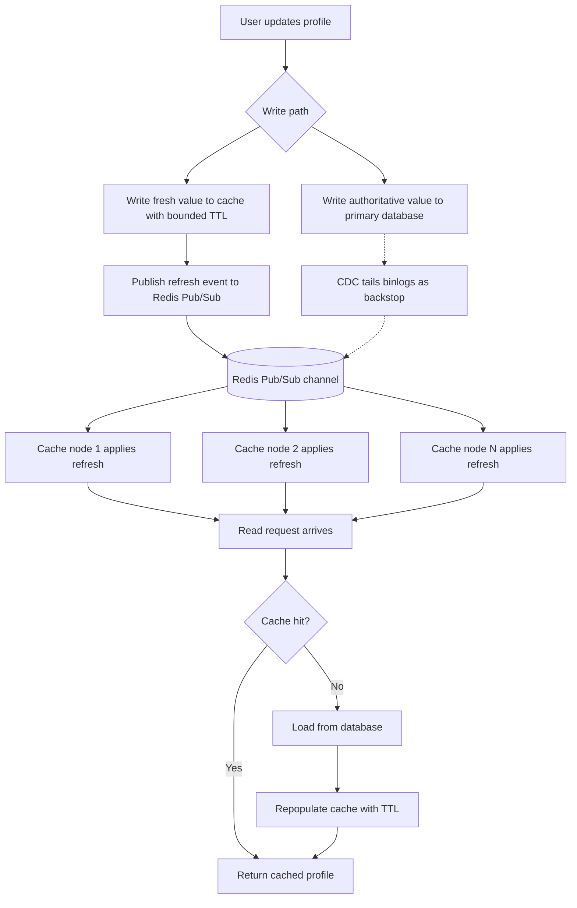

| Difficulty | Channel | Tags |
|---|---|---|
| beginner | backend | redis, memcached, cache-invalidation |

One missed invalidation. One one-year-old row. One full hour of wrong data served to a ride-booking fleet [1]. Inside Uber's Docstore, the CacheFront layer leaned on five-minute TTLs and an async CDC pipeline, and when read-own-writes broke, teams responded by raising TTLs — which only served staler data and tightened the vicious cycle [1]. The fix did not involve deleting more keys; it involved rethinking what a cache key even means [1].

---

> ### Real-World Case — Uber
>
> Uber's Docstore online storage serves its entire ride-booking fleet through CacheFront, a Redis-backed cache. Cache invalidation originally relied only on 5-minute TTLs plus an async CDC pipeline (Flux tailing MySQL binlogs), so read-own-writes broke and engineers responded by raising TTLs — which served staler data, creating a vicious cycle. Worse, a subtle failure mode meant a single missed invalidation could serve a one-year-old row for an entire hour.
>
> | | |
> |---|---|
> | **Challenge** | Invalidate cached rows immediately and correctly on writes — including conditional UPDATE/DELETE with WHERE clauses, where the query engine couldn't know which rows changed — while keeping hit rates high and avoiding stale cache fills racing fresh ones across distributed workers. |
> | **Solution** | Uber made all deletes soft (tombstones) and switched to strictly monotonic microsecond transaction timestamps, so the storage engine could identify exactly which rows a transaction touched and return their keys plus the commit timestamp to the query engine. Write-path callbacks then invalidate Redis entries with invalidation markers — synchronously for read-own-writes, async otherwise — while TTL and Flux CDC remain as backstops. Redis Lua scripts atomically deduplicate fills using row timestamps, and a 'Cache Inspector' CDC tailer with a 1-minute delay measures real staleness. The plot twist: Uber's earlier explicit-invalidation API generated fake timestamps from the wall clock, so legitimate cache fills were rejected as 'older' and hit rates plummeted until markers expired; using the database's real row timestamps fixed it. |
> | **Outcome** | CacheFront now serves over 150 million rows/second at peak (roughly 4x growth), with one table's TTL safely raised from 5 minutes to 24 hours and cache hit rate above 99.9% while staleness stayed negligible. A companion Uber post reports P75 latency down 75%, P99.9 down over 67%, and the same workload needing ~60,000 CPU cores from storage versus only ~3,000 Redis cores at 99.9% hits. |
> | **Lesson** | Cache invalidation isn't solved by picking a TTL — it's solved by making the database tell you exactly what changed and when. Version your cache entries with real database commit timestamps (not generated ones), write explicit invalidation markers instead of blind deletes, and measure staleness as a first-class metric so you can safely push TTLs up instead of trading consistency for hit rate. |

---

## Hook — One Missed Invalidation, One Year of Stale Data

It was not the kind of failure that screams at 3am. No pager storm, no glaring 500s — just a profile that quietly showed the wrong bio. Inside Uber's ride-booking fleet, that quiet failure had a nasty twist: a single missed cache invalidation could serve a one-year-old database row for an entire hour [1].

Sound familiar? Many developers discover this only after a support ticket asks why a rider saw an outdated name. The scary part is not the stale value itself; it is that the system looked perfectly healthy while serving it. If a cache can lie this convincingly, what else is it hiding?

## Problem — When Read-Your-Own-Writes Breaks

Picture a user profile service: reads far outnumber writes, so a cache sits in front of the database. Reads follow the cache-aside pattern — check the cache, fall back to the database, then repopulate [2]. The trouble starts the moment someone edits their bio.

⚠️ Watch Out: delete the key, update the database, and a concurrent read can slip in between and repopulate the cache with the old value. Teams have spent entire weekends chasing that race.

The classic answer is TTL-based expiration, where every entry expires after, say, 5 to 30 minutes [6]. But TTLs are a blunt instrument: shorter means fresher but more database load, longer means faster but staler. Choose wrong and read-own-writes breaks — a user updates a profile and immediately sees the old one.

So how does a team keep the speed without the lies?

## Real-World Case — Uber

Uber's Docstore is the online storage behind its entire ride-booking fleet, and CacheFront is its Redis-backed cache [1]. In the early design, invalidation leaned on two mechanisms: five-minute TTLs and an asynchronous change data capture (CDC) pipeline — Flux tailing MySQL binlogs [1][5].

Here is the plot twist. When read-own-writes broke, the intuitive move was to raise TTLs so values would stick around longer. That made staleness worse, which prompted more tuning — a vicious cycle [1]. And because of a subtle failure mode, one missed invalidation could surface a one-year-old row for a full hour [1].

🔥 Hot Take: raising a TTL is not a consistency fix; it is consistency debt with interest.

The resolution flipped the model. CacheFront now serves over 150 million rows per second at peak, roughly 4x growth, with one table's TTL safely lifted from five minutes to 24 hours while the cache hit rate climbed above 99.9% and staleness stayed negligible [1]. Companion metrics report P75 latency down 75%, P99.9 down over 67%, and the same workload needing roughly 60,000 CPU cores from storage versus about 3,000 Redis cores at 99.9% hits [1].

If Uber could make a 24-hour TTL safe, what exactly changed underneath?

## Deep Dive — Write-Through, TTLs, and the Redis vs Memcached Showdown

Building on that story, the lesson is that invalidation is an architecture problem, not a config flag. Two patterns dominate.

Write-through caching writes to the database and the cache together, so the cache is refreshed at write time. Cache-aside reads load on demand and rely on TTLs plus deletes to avoid drift. Most production systems blend both: write-through for freshness on critical entities, cache-aside everywhere else.

Here is the real tradeoff between the two workhorses:

| Dimension | Redis | Memcached |
|---|---|---|
| Invalidation fan-out | Built-in pub/sub for automatic distributed invalidation [3][9] | Manual coordination across nodes [4][10] |
| Persistence | Optional, so cached state can survive restarts [7] | None; pure in-memory cache [4] |
| Data structures | Strings, hashes, sets, sorted sets [3] | Simple key-value strings [4] |
| Raw caching speed | Very fast, slightly more overhead | Leaner and often faster for pure get/set [4] |
| Memory overhead | Higher per key | Lower, simpler architecture [4] |
| Horizontal scaling | Cluster and replication modes [7] | Straightforward client-side sharding [8] |

💡 Insight: Memcached is not 'Redis but worse.' It is a deliberate choice when the cache is disposable and simplicity is the feature.

When would you actually use each? Pick Redis when invalidation must propagate automatically, when durability matters, or when complex patterns need rich data structures [3][7]. Pick Memcached when the workload is pure key-value caching, memory efficiency is paramount, and a miss is harmless [4][8].

But even the right engine fails if the invalidation event never arrives — which leads to the workflow that keeps every node honest.

## Workflow — From Update Request to Every Node in Sync

This leads to a concrete sequence, visualized in the Cache Invalidation Flow diagram below. Each step exists to close one of the gaps exposed by the Uber story.

1. The update request hits the service, which writes the authoritative value to the primary database.
2. The service writes the fresh value to the cache with a bounded TTL — write-through freshness with a safety net [2].
3. The service publishes an invalidation or refresh event to a Redis pub/sub channel [3].
4. Every cache node subscribed to that channel evicts or overwrites its local copy, so distributed invalidation does not depend on manual node-by-node coordination [1][9].
5. Future reads follow cache-aside: a hit returns immediately, a miss reloads from the database and repopulates with a TTL [6].
6. As a backstop, CDC tails database logs to catch writes that bypassed the application path [5].

⚠️ Watch Out: step 3 is where most homegrown designs stumble. If the publisher also subscribes, it can overwrite or delete the very value it just wrote. Version the payload or make the refresh idempotent.

With the flow mapped, the next question is what this actually looks like in code.

## Code Example — Write-Through Refresh with Redis Pub/Sub

The implementation below is the Python sketch behind that flow, using redis-py. The full snippet lives in the codeExample field; the walkthrough here explains why each piece exists.

- profile_key keeps keys namespaced, so a profile never collides with another entity.
- get_profile is cache-aside: it returns a hit immediately and only touches the database on a miss, then repopulates with setex so the entry self-heals even after a missed invalidation.
- update_profile writes the database first (the source of truth), then refreshes the cache with the same TTL, then publishes the new value.
- publish_refresh and subscribe_to_refreshes push the authoritative value to every node, which avoids the self-delete race described earlier.
- load_profile_from_db and save_profile_to_db are the seams where a real ORM or SQL layer plugs in.

💡 Insight: publishing the fresh value rather than a bare 'delete this key' command is what turns a race into a repeatable refresh.

Production hardening means adding a connection pool, TLS, retry with backoff, and metrics on hit rate — because a cache nobody measures is a cache nobody trusts.

## Lessons Learned — Battle Scars and the Road Ahead

What began as a stale-bio bug ends with a set of portable lessons.

- TTLs are a safety net, not a consistency strategy. Uber only dared raise a TTL to 24 hours after rebuilding invalidation around it [1].
- Write-through plus pub/sub closes the window that plain cache-aside leaves open [3].
- Redis buys automatic distributed invalidation and durable structures; Memcached buys simplicity and lower overhead [4][7].
- Async CDC is a backstop, not the primary path — it catches writes that skip the application [5].
- Measure hit rate and latency. At 99.9% hits, Uber's workload needed roughly 3,000 Redis cores instead of 60,000 storage cores [1].

🎯 Key Point: the most dangerous cache bug is the one that looks healthy. If staleness is not explicitly monitored, users will discover it first.

Battle scars worth avoiding: never publish a bare delete without versioning, never assume a TTL alone fixes read-own-writes, and never pick Memcached just to save a few milliseconds if manual invalidation will cost more in incidents [4].

---

## Cache Invalidation Flow

<strong>Original Interview Question</strong>

**Q:** You're building a user profile service that caches frequently accessed profiles. How would you implement cache invalidation when a user updates their profile, and what trade-offs would you consider between Redis and Memcached?

**A:** Implement write-through caching with TTL-based expiration. On profile update, invalidate the cache by deleting the key and writing new data to both the database and cache. Redis offers pub/sub for automatic distributed invalidation, while Memcached requires manual coordination across nodes.

## Conclusion

The one-year-old row from the opening is the whole story in miniature: a cache that looked healthy was quietly lying. Uber's answer was not to delete harder but to make invalidation explicit, distributed, and measurable — and that unlocked over 150 million reads per second at peak [1]. Tomorrow, audit one cache key in your own service: trace what happens on update, confirm every node hears about it, and check whether a missed event would self-heal. The memorable insight to share with your team is simple: a TTL is a seatbelt, not a steering wheel.

---

## References

1. [Uber incident report](https://www.uber.com/gb/en/blog/how-uber-serves-over-150-million-reads/) — article
2. [Cache (computing) — Wikipedia](https://en.wikipedia.org/wiki/Cache_(computing)) — documentation
3. [Redis — Wikipedia](https://en.wikipedia.org/wiki/Redis) — documentation
4. [Memcached — Wikipedia](https://en.wikipedia.org/wiki/Memcached) — documentation
5. [Change data capture — Wikipedia](https://en.wikipedia.org/wiki/Change_data_capture) — documentation
6. [HTTP caching — MDN Web Docs](https://developer.mozilla.org/en-US/docs/Web/HTTP/Caching) — documentation
7. [Amazon ElastiCache for Redis User Guide](https://docs.aws.amazon.com/elasticache/latest/red-ug/index.html) — documentation
8. [Amazon ElastiCache for Memcached User Guide](https://docs.aws.amazon.com/elasticache/latest/memcachedug/index.html) — documentation
9. [redis/redis — GitHub](https://github.com/redis/redis) — documentation
10. [memcached/memcached — GitHub](https://github.com/memcached/memcached) — documentation

---

**Author:** Satishkumar Dhule — [GitHub](https://github.com/satishkumar-dhule) · [LinkedIn](https://linkedin.com/in/satishkumar-dhule) · [Website](https://satishkumar-dhule.github.io)
