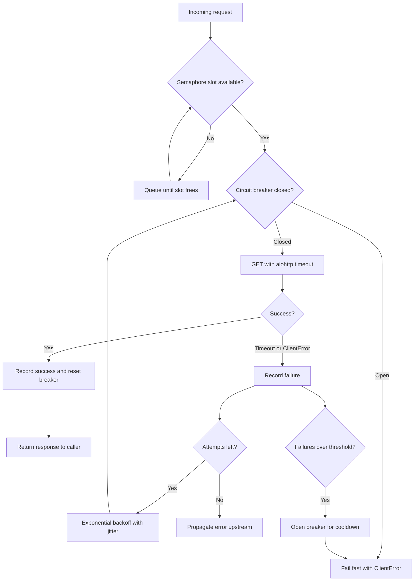

| Difficulty | Channel | Tags |
|---|---|---|
| advanced | backend | asyncio, aiohttp, concurrency |

On November 18, 2025, a single core entity service sitting more than five levels deep in Uber's request chain started returning errors, and the retries came pouring in [1]. What could have become a textbook retry storm was contained: a protective mechanism stopped an estimated 9.5 million spurious requests across the mesh and kept a projected 46%-135% traffic spike away from the already struggling service [1]. For developers building async Python services with aiohttp, that story is more than a headline - it is a reminder that a connection pool without graceful degradation is just a very efficient way to amplify an outage. The real question is not whether your pool can open connections, but whether it knows when to stop.

---

> ### Real-World Case — Uber
>
> On November 18, 2025, Uber suffered a major outage when a core entity service more than five levels deep in its request chain began returning a high error rate due to an underlying infrastructure issue. Errors propagated upstream through deep dependency chains, triggering widespread retries that risked amplifying load on the already degraded service.
>
> | | |
> |---|---|
> | **Challenge** | How to prevent retry storms and cascading failures during partial outages in a large microservice mesh, where naive or uniformly applied retries and timeouts can exhaust resources and multiply traffic to a struggling dependency. |
> | **Solution** | Uber implemented context-aware "error ownership" in shared service-mesh infrastructure (retry middleware and a Service Dependency Analysis solution). The service where a failure originates can permit its direct caller to retry, while upstream services that merely propagate the error mark it as already handled and suppress further retries. This confines retries to the boundary where recovery is possible and enforces at-least-once retry behavior without cross-service amplification. |
> | **Outcome** | During the November 18, 2025 incident, the mechanism avoided a projected 46%-135% traffic increase to the degraded service, stopped up to 200,000 additional requests from some immediate callers, and prevented an estimated 9.5 million spurious requests across the mesh. Across user-facing APIs, Uber reduced the maximum retry-storm radius from 25 to 3 and the average from 20 to 2. |
> | **Lesson** | Graceful degradation under load requires controlling where retries and failure handling occur, not just how many attempts are made; context-aware circuit-breaking/retry suppression at the right boundary prevents localized timeouts from cascading into system-wide overload. |

---

## Hook — The Moment the Pager Screams 'Retry'

That Uber scene is the perfect opening frame. The deploy looked fine. Then one deep dependency started timing out, and every layer above it politely tried again - and again. Within seconds, a small infrastructure hiccup had grown teeth.

Many developers discover this the hard way: retries are supposed to be the safety net, but under load they behave more like an amplifier turned up to eleven. Staring at a 500 error at 2am is bad enough; realizing your own retry logic helped write the incident report is worse. Sound familiar?

The stakes are simple. A pool that cannot degrade gracefully will happily turn a flicker into an outage, and your users will be the ones refreshing a blank screen while the status page updates. That tension is exactly what the rest of this story unpacks.

## Problem — When 'Just Add Retries' Becomes the Bug

Building on that tension, the real challenge is that an aiohttp client does not fail in isolation - it fails in a chain. A semaphore can cap concurrency [2], but a naive limit only moves the bottleneck; it does not decide what happens when the downstream service is slow, broken, or simply too busy to answer. Therefore, three failure modes tend to collide at once: connection timeouts that leave requests hanging, unbounded retries that multiply traffic, and connections that are never released back to the pool. Moreover, each one makes the others worse.

Here is what you need to know:
- **Timeout misconfiguration is silent torture.** A total timeout of 30 seconds with no connect timeout means callers wait for a socket that was never going to open [3].
- **Retries without jitter synchronize.** Thousands of clients backing off on the same 1s, 2s, 4s schedule create a thundering herd instead of relief [4].
- **Returning a closed response is a classic trap.** With async with session.get(...), the response is released when the block exits, so handing it back yields a corpse, not a connection [3].
- **Shutdown is part of the pool.** Forgetting await session.close() leaks sockets and leaves the event loop holding resources it no longer needs [2].

Consequently, the question shifts from how many connections can be opened to how the pool behaves when everything is going wrong. That is the difference between a pool that survives an incident and one that writes the sequel to it.

## Real-World Case — Uber

This is exactly where the Uber story stops being abstract. On November 18, 2025, a core entity service more than five levels deep in the request chain began returning a high error rate because of an underlying infrastructure problem [1]. Errors propagated upstream through those deep dependencies, and retries started piling onto a service that was already struggling - the classic shape of a cascade failure. However, a built-in protection mechanism changed the ending.

The numbers are worth staring at:
- It avoided a projected **46%-135% traffic increase** to the degraded service [1].
- It stopped up to **200,000 additional requests** from some immediate callers [1].
- It prevented an estimated **9.5 million spurious requests** across the service mesh [1].
- Across user-facing APIs, the maximum retry-storm radius dropped from **25 to 3**, and the average from **20 to 2** [1].

🔥 **Hot Take:** The hero of this story was not a faster service - it was a mechanism that knew when *not* to send traffic. In HTTP terms, those cascading 5xx responses are the server shouting slow down, and a well-designed client listens [6]. For a developer building an aiohttp pool, the lesson is blunt: backoff and breaker logic are not nice-to-haves. They are the difference between a contained blip and a company-wide status page update.

## Deep Dive — Semaphores, Breakers, and the Art of Backing Off

Having seen what amplification looks like in production, the machinery that stops it becomes much more interesting. A robust aiohttp pool is really four small state machines wearing one coat.

**Semaphore-based limiting.** An asyncio.Semaphore is the bouncer at the door: only N requests get in, and the rest wait [2]. Use this when the downstream has a hard concurrency ceiling - a database connection cap, a third-party rate limit, or a fragile legacy service. 💡 **Insight:** A semaphore protects the downstream, but it does not protect callers from slow responses; a long queue is still a latency bomb.

**Exponential backoff with jitter.** Retry delays grow as 2^attempt, then get randomized so clients do not wake up in lockstep [4]. AWS recommends a similar full-jitter approach for its own APIs [7]. Use this for transient failures - a 429 or a 503 that might clear in a second. ⚠️ **Watch Out:** Never retry non-idempotent POSTs blindly; duplicate orders are a creative way to ruin a Tuesday.

**Circuit breaker.** Think of it as a fuse box. After a threshold of failures, the breaker opens and future calls fail fast instead of hammering the dependency [5]. Use this when a downstream is clearly down and a cached response beats waiting 30 seconds to discover the obvious. The counterintuitive twist: failing fast is a feature. Users get a quick error, and the struggling service gets room to breathe.

**Layered timeouts.** A total timeout of 30s is a start, but connect and sock-read timeouts catch different failure modes [3]. Python's asyncio.TimeoutError is what actually surfaces when a wait expires [8]. Use this especially when connections reach hosts that resolve but never answer.

| Mechanism | Protects Against | Cost | Best For |
| --- | --- | --- | --- |
| Semaphore | Too many concurrent sockets | Queued latency | Hard concurrency caps |
| Exponential backoff | Transient blips | Added delay per retry | 429/503, network flakes |
| Circuit breaker | Sustained downstream failure | Cold start after cooldown | Cascading outages |
| Layered timeouts | Hanging sockets | False positives on slow links | Unresponsive hosts |

Consequently, these pieces are not alternatives - they are layers. A semaphore without a breaker still sends traffic into a wall; a breaker without a semaphore can be overwhelmed before it trips. The magic happens in the stacking, which leads directly to how requests actually flow.

## Workflow — Following a Request Through the Pool

Building on the layered design, here is how a single request actually moves through the system. The Request Flow Through the Pool diagram traces the whole journey - admission, validation, execution, and recovery.

1. **Admission.** The caller requests a slot from the semaphore; if none is free, the request waits rather than opening yet another socket [2].
2. **Breaker check.** Before any network call, the pool asks the circuit breaker whether the dependency is healthy; an open breaker produces an immediate ClientError [5].
3. **Guarded execution.** The GET runs through the shared ClientSession with layered timeouts, so a hung socket cannot hold the slot forever [3].
4. **Success path.** A healthy response records a success and resets the failure streak; the body is read while the response context is still open.
5. **Failure path.** A timeout or client error records a failure, applies exponential backoff with jitter, and retries only while attempts remain [4].
6. **Tripping.** Once failures cross the threshold, the breaker opens for a cooldown window, giving the downstream room to recover [5].

💡 **Insight:** Notice that the breaker check happens inside the semaphore. That ordering means a storm of requests cannot even inspect the breaker concurrently - they are throttled before they reach it. This mirrors the stop up to 200,000 additional requests behavior Uber described, just at a smaller scale [1]. When would this ordering be used? Any time a dependency is shared across many callers and the cheapest possible rejection is the goal.

## Code Example — A Pool That Knows When to Quit

With the flow mapped out, the implementation is where the ideas become real. The snippet below is deliberately small but production-shaped: it wires a semaphore, a breaker, layered timeouts, and jittered retries into one manager. Read it top to bottom, then use the walkthrough that follows.

- CircuitBreaker keeps three pieces of state - a failure count, a timestamp, and an opened flag - and uses the event loop clock so time comparisons stay consistent [8].
- allows_request() implements the half-open trick: after the cooldown expires, one probe request is allowed through to test the water [5].
- start() builds a TCPConnector with keepalive and a DNS cache, cutting TCP handshake overhead on repeat calls to the same host [3].
- close() is the cleanup crew teams forget; always await it during shutdown so sockets are released.
- make_request() acquires the semaphore first, then loops through attempts with backoff, and reads the body inside async with so the response is never returned already released [3].

⚠️ **Watch Out:** The original interview-style answer returned a response from inside an async with block. That returns a closed response - a bug that only shows up in production when someone tries to read it. The version here returns (status, body) instead, which is boring, correct, and exactly what is wanted.

🔥 **Hot Take:** If a pool has no close() path, it is not a pool - it is a socket leak with extra steps.

## Lessons Learned — Battle Scars and Tomorrow's Move

Everything above circles back to that November morning in Uber's stack: the outage did not become a catastrophe because the system knew when to stop asking. Here are the battle scars worth keeping.

**Battle scars - mistakes that look fine until they are not:**
- **Leaking connections.** Returning a response without releasing it, or skipping session.close(), turns a healthy pool into a resource graveyard.
- **Ignoring SSL context.** Disabling verification to make it work quietly removes the protection users assume exists [9].
- **One timeout to rule them all.** A single 30s total with no connect or read timeout means failures surface as mystery hangs rather than clear errors [3].
- **Retrying everything.** Idempotency matters; retry a GET, but think twice before retrying a POST that charges a credit card.
- **Missing error propagation.** Swallowing asyncio.TimeoutError somewhere in the async stack hides the very signal a breaker needs [8].

🎯 **Key Point:** Graceful degradation is not about handling success beautifully - anyone can do that. It is about deciding, in advance, exactly how a service will misbehave when the world goes sideways.

So what changes tomorrow? Add one layered timeout, one jittered retry loop, and one circuit breaker to the next aiohttp client you touch - then measure how many requests you did not send. Teams that track requests suppressed as a first-class metric tend to sleep better during incidents. The single insight to take to the next design review: **the best request is sometimes the one your pool refuses to make.** Uber stopped an estimated 9.5 million of them [1]; your service may only need to stop a few thousand, but the principle is identical.

---

## Request Flow Through the Pool

<strong>Original Interview Question</strong>

**Q:** How would you implement a connection pool manager for aiohttp that handles graceful degradation under high load and connection timeouts?

**A:** Implement a connection pool manager for aiohttp using a semaphore to limit concurrent connections, exponential backoff for retrying failed requests, and circuit breaker pattern to gracefully degrade under high load and connection timeouts.

## Conclusion

The next time a dependency wobbles, the pool will face the same choice Uber's mesh faced on November 18, 2025: amplify the noise or absorb it [1]. The journey from a simple semaphore to a layered breaker is really a journey in humility - admitting that failure is normal and designing for it on purpose. Start tomorrow by adding one layered timeout, one jittered retry, and one breaker to the next aiohttp client you touch, then watch the requests you did not send. That suppressed-request count is the quiet metric that separates resilient teams from busy ones. Remember one line in the next design review: the best request is sometimes the one your pool refuses to make.

---

## References

1. [Uber incident report](https://www.uber.com/blog/protecting-against-retry-storms/) — article
2. [asyncio synchronization primitives](https://docs.python.org/3/library/asyncio-sync.html) — documentation
3. [aiohttp GitHub repository](https://github.com/aio-libs/aiohttp) — documentation
4. [Exponential backoff](https://en.wikipedia.org/wiki/Exponential_backoff) — documentation
5. [Circuit breaker design pattern](https://en.wikipedia.org/wiki/Circuit_breaker_design_pattern) — documentation
6. [RFC 7231: HTTP/1.1 Semantics and Content](https://datatracker.ietf.org/doc/html/rfc7231) — documentation
7. [AWS API retries and error handling](https://docs.aws.amazon.com/general/latest/gr/api-retries.html) — documentation
8. [asyncio exceptions](https://docs.python.org/3/library/asyncio-exceptions.html) — documentation
9. [MDN Web Docs: HTTP](https://developer.mozilla.org/en-US/docs/Web/HTTP) — documentation

---

**Author:** Satishkumar Dhule — [GitHub](https://github.com/satishkumar-dhule) · [LinkedIn](https://linkedin.com/in/satishkumar-dhule) · [Website](https://satishkumar-dhule.github.io)
