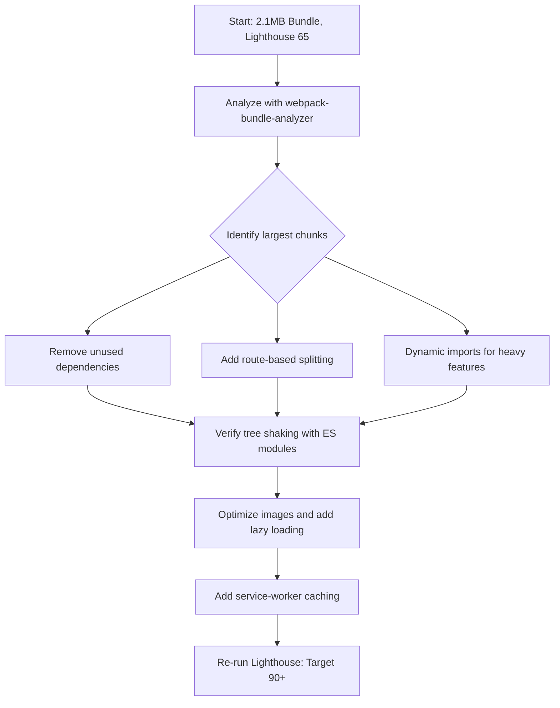

| Difficulty | Channel | Tags |
|---|---|---|
| intermediate | frontend | lighthouse, bundle, lazy-loading |

In 2017, Pinterest faced a digital emergency that threatened its entire international growth strategy. The old mobile website shipped over 2.5MB of JavaScript, leaving users waiting 23 seconds before any UI became usable, and only 1% of unauthenticated mobile-web visitors ever converted to a sign-up, login, or app install [1]. Teams watching those numbers must have felt the ground shifting beneath them. What happens when a product's speed becomes its single biggest liability, and how can a monolithic bundle be dismantled without breaking the experience users actually came for?

---

> ### Real-World Case — Pinterest
>
> In 2017 Pinterest's old mobile website was a monolith shipping over 2.5MB of JavaScript (a ~1.5MB main bundle plus ~1MB lazy-loaded), and users often waited 23 seconds before any UI was usable. Only 1% of unauthenticated mobile-web visitors converted to a sign-up, login, or app install, putting the company's international growth strategy at risk.
>
> | | |
> |---|---|
> | **Challenge** | Rebuild the React/Redux/webpack mobile web experience so it would load and become interactive quickly on average Android hardware over slow 3G, without cutting product features — essentially the same 2MB-bundle / multi-second-TTI problem at far larger scale. |
> | **Solution** | Pinterest rebuilt the site as a PWA in about three months using route-based code splitting into a vendor chunk (~73KB), an entry chunk (~72KB), and per-route async chunks (~13–18KB) via React Router and CommonsChunkPlugin. Webpack Bundle Analyzer exposed duplicate code across the async chunks, so they made the counterintuitive call to MOVE that duplicated code back into the main chunk (growing it ~20%) while shrinking every lazily loaded chunk by up to 90%. They trimmed transpilation with babel-preset-env, lazy-loaded below-the-fold content via a virtualized Masonry grid with progressive JPEGs, and used Workbox service workers with cache-first precaching of the app shell plus per-locale chunks. |
> | **Outcome** | Core JS bundle dropped from 650KB to 150KB, First Meaningful Paint fell from 4.2s to 1.8s, and Time to Interactive plunged from 23s to 5.6s — down further to 3.9s on repeat visits thanks to service-worker caching. The full home-feed experience cost ~150KB gzipped versus 9.6MB for the Android app and 56MB for iOS. Business metrics followed: time spent up 40%, user-generated ad revenue up 44%, and core engagements up 60%. |
> | **Lesson** | Code splitting is not one-directional: centralizing duplicated code into the initial bundle can shrink the total lazy-loaded payload far more than splitting further, and only bundle analysis reveals it. The biggest wins come from combining route/component splitting with tree-shaking, image lazy loading, and service-worker caching — not from any single trick. |

---

## Hook — Twenty-Three Seconds Is an Eternity

Twenty-three seconds. That is how long Pinterest's mobile-web users once waited for their screens to become interactive [1]. In internet time, that is roughly three geological eras. Picture a user on a spotty 3G connection tapping a link, watching a spinner perform its hypnotic dance, and then quietly opening a competing app. Consequently, the business bled opportunity with every abandoned session. Sound familiar? If a Lighthouse score of 65 and a Time to Interactive of 4.2s looks like the number staring back from the dashboard, this story is already familiar territory. The real question is not whether the bundle is too big, but which 2.1MB of JavaScript is actually earning its keep.

## Problem — Why a 2.1MB Bundle Feels Like a Digital Anchor

A large bundle is rarely one giant mistake; instead, it is a thousand small conveniences that accumulated while nobody was watching. Modern React apps inherit dependencies, polyfills, and utility libraries that quietly inflate the initial payload. Therefore, the browser must download, parse, compile, and execute every byte before the UI responds to a tap. Research from Google has repeatedly shown that page speed directly correlates with conversion rates and user retention [4]. Moreover, slower devices on emerging markets amplify the pain: a flag desktop experience becomes a slideshow on a mid-range phone. Many developers discover this only after a Lighthouse audit delivers a brutal score. The stakes are concrete. A 4.2s TTI means users can see content but cannot interact with it, creating the dreaded 'uncanny valley' of web performance. Although the fix sounds simple — ship less JavaScript — the execution demands a systematic approach that balances speed with functionality.

## Real-World Case — Pinterest's Great Mobile Rebuild

Pinterest's 2017 mobile website was a textbook monolith: a ~1.5MB main JavaScript bundle plus roughly 1MB of lazy-loaded code, totaling over 2.5MB [1]. Users often waited 23 seconds for usable UI, and only 1% of unauthenticated mobile-web visitors converted. Consequently, the company's international growth strategy was at serious risk. The response was a radical rebuild centered on progressive web app principles [6]. Teams rebuilt the mobile experience around three pillars: route-based code splitting, service-worker caching, and aggressive removal of unused dependencies. Specifically, the core JS bundle dropped from 650KB to 150KB, First Meaningful Paint fell from 4.2s to 1.8s, and Time to Interactive plunged from 23s to 5.6s — reaching 3.9s on repeat visits thanks to service-worker caching [1]. The full home-feed experience cost approximately 150KB gzipped, versus 9.6MB for the Android app and 56MB for iOS. Business metrics followed the technical wins: time spent rose 40%, user-generated ad revenue jumped 44%, and core engagements climbed 60% [1]. Here is the thing though — none of those gains came from a single magical fix. They came from measuring, chopping, and caching with relentless discipline.

## Deep Dive — Code Splitting, Tree Shaking, and the Art of Loading Less

Building on Pinterest's results, the technical toolkit becomes clearer. Modern bundlers like Webpack [9] support ES module syntax that enables tree shaking — the process of eliminating dead code at build time [4]. However, tree shaking only works when modules use static `import` and `export` statements; CommonJS patterns silently defeat it. Dynamic imports take this further by splitting code at logical boundaries [2]. React's `lazy()` and `Suspense` wrap these imports into components that load on demand [7]. The critical decision is where to place those split points. Route-based splitting divides the app by URL, which works brilliantly when sections are mutually exclusive. Component-based splitting targets heavy widgets like charts or editors that may never appear on screen. Here is the real tradeoff:

| Strategy | Best For | Tradeoff |
|---|---|---|
| Route-based splitting | Distinct pages with separate purposes | Extra round-trip on navigation |
| Component-based splitting | Heavy modals, charts, editors | More Suspense boundaries to manage |
| Tree shaking | Removing unused library exports | Requires ES modules throughout |
| Service worker caching | Repeat visits and offline access | Adds cache-invalidation complexity |

💡 Insight: Pinterest's 650KB-to-150KB win came largely from route-based splitting and pruning unused code — not from minification tricks [1]. ⚠️ Watch Out: splitting too aggressively creates a waterfall of tiny requests that can hurt more than a single moderate chunk. 🔥 Hot Take: a slightly larger initial bundle that avoids three follow-up requests often beats a hyper-split app on real networks. When would this actually matter? Any app where 40%+ of users bounce before visiting a second route should prioritize route splitting first [3].

## Workflow — From Bundle Analyzer to Deploy

This leads to the practical pipeline that turns theory into measurable gains. The journey follows a repeatable sequence, visualized in the diagram below. First, measure the baseline with webpack-bundle-analyzer to see which dependencies dominate the payload [3]. Second, prune unused packages and replace broad imports like `import _ from 'lodash'` with targeted ones such as `import debounce from 'lodash/debounce'`. Third, establish route-level split points with `React.lazy()` [7]. Fourth, wrap lazy components in `Suspense` boundaries and add error boundaries so a failed chunk does not crash the app [2]. Fifth, verify tree shaking is active by checking that the build uses ES modules [4]. Sixth, add service-worker caching for repeat visits [5]. Seventh, re-run Lighthouse and compare TTI and bundle size against the baseline [10]. Each step builds on the previous one, and skipping measurement is the fastest way to optimize the wrong thing. The diagram below maps this path from a 2.1MB monolith to a 90+ score.



## Code Example — Route-Based Splitting in Production

The theory becomes concrete with a production-style implementation. The snippet below mirrors the route-based pattern that powers modern React apps and reflects the approach Pinterest popularized [1]. It loads heavy views only when users navigate to them, while keeping the initial bundle lean.

```javascript
// Route-based code splitting with React.lazy and Suspense
import React, { Suspense, lazy } from 'react';
import { BrowserRouter, Routes, Route } from 'react-router-dom';

// Lazy components fetch their chunks only when rendered
const Dashboard = lazy(() => import('./Dashboard'));
const Analytics = lazy(() => import('./Analytics'));
const HeavyChart = lazy(() => import('./HeavyChart'));

// Fallback shown while the chunk downloads
function LoadingSpinner() {
  return <div className="spinner">Loading...</div>;
}

function App() {
  return (
    <BrowserRouter>
      {/* One Suspense boundary covers all lazy routes */}
      <Suspense fallback={<LoadingSpinner />}>
        <Routes>
          <Route path="/dashboard" element={<Dashboard />} />
          <Route path="/analytics" element={<Analytics />} />
          <Route path="/reports" element={<HeavyChart />} />
        </Routes>
      </Suspense>
    </BrowserRouter>
  );
}

export default App;
```

Step by step: the `lazy()` calls create components that trigger a dynamic `import()` when first rendered, so their code lives in separate chunks [2]. `Suspense` provides a fallback UI during the download, preventing a blank screen. Placing a single boundary around all routes keeps the implementation simple, though a separate boundary per route allows more granular loading states. BrowserRouter and Routes handle navigation without pulling in the heavy chart code until someone visits `/reports` [7]. Pro tip: pair each lazy component with an error boundary in production, because a failed network request for a chunk should degrade gracefully rather than white-screen the app. 🎯 Key Point: the goal is not zero JavaScript, but delivering the right JavaScript at the right moment.

## Lessons Learned — Battle Scars and the Road to 90+

Every optimization journey leaves a few scars, and acknowledging them prevents repeats. Common mistake number one: splitting without measuring, which produces aFragmented mess of chunks and no real improvement. Common mistake number two: ignoring tree-shaking configuration, so unused exports remain in the bundle despite a modular codebase [4]. Common mistake number three: forgetting image optimization, even though unoptimized images often outweigh JavaScript on mobile connections [8]. Common mistake number four: shipping service workers without a cache-invalidation strategy, which leaves users stuck with stale assets [5]. If this feels overwhelming, take comfort in the fact that even Pinterest's engineers did not get it right on the first attempt [1]. The practical path forward is unglamorous but effective: measure first, split at route boundaries, prune dependencies, enable tree shaking, optimize images, then cache aggressively for repeat visits [10]. Moreover, set performance budgets in CI so regressions get caught before they reach production. Teams that treat performance as a continuous practice rather than a one-time project are the ones who sustain 90+ scores.

---

## Bundle Optimization Pipeline


<details>
<summary><strong>Original Interview Question</strong></summary>

**Q:** You're tasked with improving a React app's Lighthouse performance score from 65 to 90+. The bundle size is 2.1MB and Time to Interactive is 4.2s. What specific steps would you take to optimize the bundle and implement lazy loading?

**A:** Implement code splitting with React.lazy() and Suspense, analyze bundle composition with webpack-bundle-analyzer to identify largest chunks, remove unused dependencies and optimize imports, add dynamic imports for heavy components and third-party libraries, implement route-based splitting for better initial load times, and utilize tree shaking with proper ES module configuration.

</details>

## Conclusion

Pinterest's journey from a 23-second wait to a 3.9s Time to Interactive was not magic — it was measurement, route-based splitting, tree shaking, and caching applied with discipline [1]. The same playbook applies to any React app staring at a Lighthouse score of 65. Tomorrow, open webpack-bundle-analyzer, find the largest chunk, and ask whether it truly belongs in the initial load. Then split one route, measure the difference, and let the data guide the next move. Leave your team with this memorable line: performance is not the absence of code, but the art of shipping the right code at the right time. The 90+ score is not a destination; it is a habit.

---

## References

1. [Pinterest incident report](https://medium.com/dev-channel/a-pinterest-progressive-web-app-performance-case-study-3bd6ed2e6154) — article
2. [JavaScript dynamic import operator - MDN Web Docs](https://developer.mozilla.org/en-US/docs/Web/JavaScript/Reference/Operators/import) — documentation
3. [webpack-bundle-analyzer GitHub repository](https://github.com/webpack-contrib/webpack-bundle-analyzer) — documentation
4. [Tree shaking - MDN Web Docs Glossary](https://developer.mozilla.org/en-US/docs/Glossary/Tree_shaking) — documentation
5. [Service Worker API - MDN Web Docs](https://developer.mozilla.org/en-US/docs/Web/API/Service_Worker_API) — documentation
6. [Progressive web app - Wikipedia](https://en.wikipedia.org/wiki/Progressive_web_app) — documentation
7. [React GitHub repository](https://github.com/facebook/react) — documentation
8. [ES modules guide - MDN Web Docs](https://developer.mozilla.org/en-US/docs/Web/JavaScript/Guide/Modules) — documentation
9. [Webpack GitHub repository](https://github.com/webpack/webpack) — documentation
10. [Performance API - MDN Web Docs](https://developer.mozilla.org/en-US/docs/Web/API/Performance) — documentation

---

**Author:** Satishkumar Dhule — [GitHub](https://github.com/satishkumar-dhule) · [LinkedIn](https://linkedin.com/in/satishkumar-dhule) · [Website](https://satishkumar-dhule.github.io)
