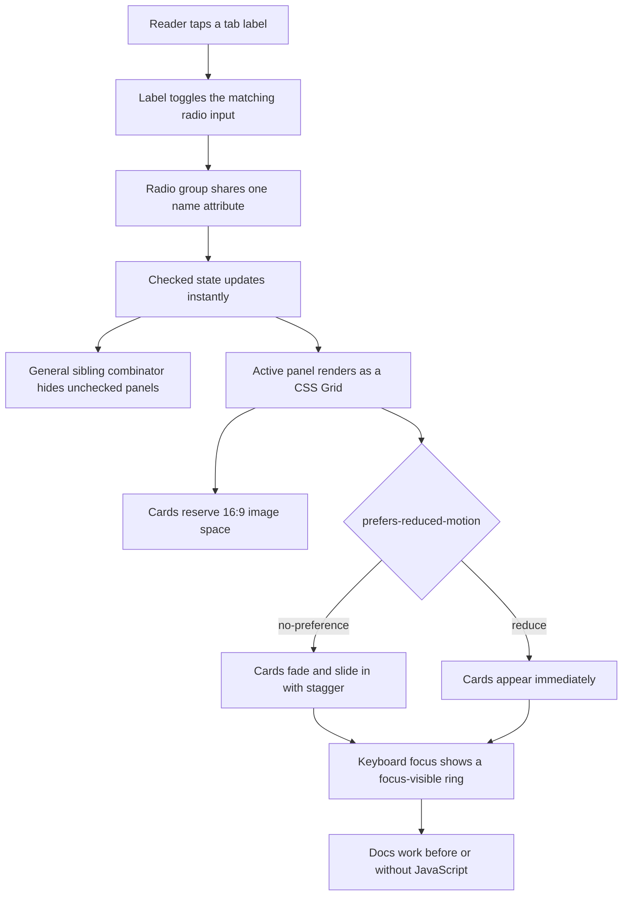

| Difficulty | Channel | Tags |
|---|---|---|
| beginner | frontend | css, flexbox, grid, animations |

On a site that serves hundreds of millions of page views a day, a design system that only works after JavaScript loads is a design system that quietly fails for a slice of the world. That was the situation with Wikimedia Foundation's Codex: originally Vue-only, its components rendered on the client, so on old browsers, slow connections, or with JavaScript disabled, the interface simply did not appear [1]. By April 2023, CSS-only versions of most Codex components had shipped, cutting roughly 70% of the data on the wire [1]. The lesson is bigger than one design system, and it starts with a tiny pattern most developers overlook: a radio button, a label, and a few sibling selectors.

---

> ### Real-World Case — Wikimedia Foundation (Wikipedia)
>
> Wikipedia's Codex design system was originally Vue-only, so its components could not render on the server and simply did not appear for users on old browsers, slow connections, or with JavaScript disabled. With UI appearing on essentially every one of Wikimedia's hundreds of millions of daily page views, the team needed a version of the design system that worked before (or without) any JavaScript.
>
> | | |
> |---|---|
> | **Challenge** | Deliver design-system components that were visually identical to their Vue counterparts, worked in server-rendered/no-JS environments, stayed accessible via native semantics and keyboard behavior, and added as little transferred weight as possible to every article page. |
> | **Solution** | They built a parallel set of CSS-only Codex components: shared `cdx-` class styles applied to plain server-generated markup, using native controls such as radio inputs with labels (arrow-key selection and `:checked` state come free from the browser) rather than JS state machines. ResourceLoader's `codexStyleOnly`/style-only modules then ship just the CSS for the components a feature uses, with no Vue runtime. |
> | **Outcome** | The full Codex module costs 156 KB of JS+CSS (32.2 KB compressed), while the CSS-only `codex-styles` module is 68.8 KB of CSS (9.6 KB compressed) — roughly 70% less data on the wire. A search-specific build cut page-load CSS to 29.4 KB (4.5 KB compressed) and deferred 36.7 KB of JS until the user interacted; CSS-only versions of most Codex components shipped by April 2023. |
> | **Lesson** | For simple stateful widgets, let the browser own state and keyboard interaction (`:checked`, shared-name radio groups, focus-visible) and ship CSS instead of a framework. At Wikipedia's scale that is both an accessibility win and a measurable bandwidth win — but CSS-only widgets still cannot express true ARIA tab semantics, so know where the pattern stops. |

---

## Hook — The Interface That Never Showed Up

Picture a reader on a train, three bars of signal, opening a design-system docs page. The headings load. The prose loads. The tab panel — the thing that organizes everything — is just empty space. No spinner, no error, no polite fallback. Just silence. Multiply that by hundreds of millions of daily page views and a quiet bug becomes a very loud problem [1]. Sound familiar? Many teams discover this only after a support ticket or an analytics dip. Here is the thing though: the fix does not require a faster framework, a service worker, or a heroic bundle-splitting sprint. It requires asking an uncomfortable question — what if the browser could do this before JavaScript ever arrives? That question leads straight into the problem.

## Problem — When the Docs Are the Product

However, that empty panel is only the symptom. Design-system docs are not a side project; for many teams they are the front door to the entire component library. If the tabs that organize those docs depend on hydration, then every reader on a flaky connection, every crawler, and every user with scripting disabled gets a half-finished page. Progressive enhancement — the idea that a baseline experience works first and extras layer on top — exists precisely for this gap [9]. Specifically, the challenge here has five moving parts. First, tabs must switch with zero runtime JavaScript. Second, the active panel must show a 2×2 card grid on desktop and collapse to a single column on mobile. Third, each card needs a locked 16:9 image area so the layout never jumps. Fourth, the entrance needs a subtle stagger that respects motion sensitivity. Fifth, keyboard users still need a visible focus ring. Miss any one of those and the pattern either breaks, jitters, or quietly excludes someone. So what does an air-safe version actually look like? To answer that, it helps to look at a team that had to solve it at planetary scale.

## Real-World Case — Wikimedia Foundation (Wikipedia)

Building on that tension, Wikimedia's Codex started life as a Vue-only system, which meant its components rendered on the client and simply did not appear until JavaScript ran [1]. When the UI sits on essentially every one of Wikimedia's hundreds of millions of daily page views, that tradeoff is not academic [1]. The team's discovery was counterintuitive: the answer was not to optimize the JavaScript, but to build a parallel CSS-only track called `codex-styles`, now visible in the project's public repository [8]. The numbers tell the story better than any adjective.

| Option | What ships | Full size | Compressed | Real tradeoff |
|---|---|---|---|---|
| Full Codex module | Vue runtime + components + CSS | 156 KB JS+CSS | 32.2 KB | Rich interactivity, but nothing renders until JS runs |
| CSS-only `codex-styles` | Styles + native HTML behavior | 68.8 KB CSS | 9.6 KB | Roughly 70% less data; works before or without JS |
| Search-specific build | Scoped styles + deferred JS | 29.4 KB CSS | 4.5 KB | 36.7 KB of JS deferred until interaction |

Moreover, a search-specific build trimmed page-load CSS to 29.4 KB (4.5 KB compressed) while deferring 36.7 KB of JavaScript until the moment a user actually interacted [1]. Consequently, CSS-only versions of most Codex components shipped by April 2023 [1]. The implication for your docs page is hard to ignore: if a design system at this scale can treat CSS as a first-class rendering path, your tab panel has no excuse to need a framework.

🎯 Key Point: Progressive enhancement is not a downgrade — on Wikimedia's traffic it was a 70% bandwidth win. But how does the pattern actually work under the hood? That leads to the deep dive.

## Deep Dive — Radio Inputs, Sibling Selectors, and Motion That Behaves

Building on the scale argument, the mechanism itself is almost comically small. A group of radio inputs shares one `name`, which makes them mutually exclusive at the browser level [7]. Each `` points at an input with `for`, so clicking the tab toggles the radio without a single line of script. Then the magic line: `.tabs input:not(:checked) ~ .panel { display: none; }` uses the general sibling combinator to hide every inactive panel that follows its input [2][10]. You might think `~` is a typo for `+`, but `+` only reaches the immediately adjacent sibling, while `~` reaches all following siblings — and in this layout each panel follows all of the inputs.

🔥 Hot Take: this CSS-only trick is also an accessibility upgrade. Because radios are a native single-select control, arrow keys move between tabs out of the box [7]. Many developers reach for `role="tablist"` and a pile of ARIA before realizing the browser already solved their problem. The most underrated accessibility feature in a tab UI is the humble radio button.

Layout comes next. `grid-template-columns: repeat(2, 1fr)` gives the 2×2 desktop card grid [3], and a single `max-width: 768px` media query collapses it to one column — no breakpoints labyrinth. Each card's image uses `aspect-ratio: 16 / 9`, which reserves space before any image loads, so cumulative layout shift never gets a chance to ruin the reading experience [4]. When would this matter? Any docs page whose cards are screenshots, thumbnails, or diagrams.

Motion is where good intentions often go wrong. The stagger uses `nth-child` delays of 0.1s, 0.2s, and 0.3s, but it is wrapped in `@media (prefers-reduced-motion: no-preference)` so readers who ask for calm get an instant, still-correct layout [6].

⚠️ Watch Out: animating a panel with `display: none` means there is no transition to animate — the panel appears in its final state, which is fine for a fade-in but a trap if exit animations are expected. And never pair `outline: none` with a hidden replacement; `:focus-visible { outline: 2px solid currentColor; }` keeps the keyboard ring exactly where it is needed [5].

Battle scars worth memorizing:

- **Forgetting the shared `name`.** Every radio needs the same `name`, or arrows will not group them and multiple tabs can appear active [7].
- **Reversing the DOM order.** Inputs must precede panels; sibling combinators cannot travel backwards [10].
- **Hiding the checked panel.** A stray `display: none` on `.panel` rather than on unchecked ones makes the whole thing look broken.
- **Staggering everything.** Long delays on a docs grid feel sluggish; keep the total under roughly 0.4s.
- **Skipping the reduced-motion branch.** It is a two-line media query and a real user preference [6].

If this feels overwhelming, you are not alone — the pattern is tiny, but the details are where accessibility lives. Ready to assemble it in order?

## Workflow — From Radio to Rendered Grid

Consequently, implementation is less about writing clever CSS and more about following a sequence that keeps the DOM and the selector logic in agreement. As the Mermaid diagram below shows, every step removes a failure mode rather than adding a feature.

1. Lay out four radio inputs at the top of `.tabs`, all with `name="tabs"`, first one `checked` [7].
2. Add a `` per input and style the labels as the tab strip.
3. Place one `` per tab immediately after the inputs.
4. Hide inactive panels with `input:not(:checked) ~ .panel` [2][10].
5. Turn the visible panel into a `repeat(2, 1fr)` grid with `gap: 1.5rem`, then one column at ≤768px [3].
6. Give each card a `16 / 9` image block, a title, and a short meta line [4].
7. Gate the staggered `@keyframes` behind `prefers-reduced-motion: no-preference` [6].
8. Add `:focus-visible` outlines, then test with JavaScript disabled [5].

🎯 Key Point: DOM order is the architecture. Inputs first, labels second, panels last — change that and the selector chain collapses.

Step eight is the one teams skip, and it is the one that catches the most bugs: open DevTools, disable JavaScript, reload. If the tabs still switch, the pattern is honest. That verification habit is what turns a neat demo into a docs component with a backbone.

## Code Example — The Whole Pattern in One Pass

Therefore, the theory becomes something you can paste into a docs page. The markup below is deliberately boring — boring is a feature when JavaScript is absent.

```html
<div class="tabs">
  <input type="radio" id="tab-overview" name="tabs" checked>
  <input type="radio" id="tab-components" name="tabs">
  <label for="tab-overview">Overview</label>
  <label for="tab-components">Components</label>
  <section class="panel">
    <article class="card">
      <div class="card__image"></div>
      <h3 class="card__title">Card Title</h3>
      <p class="card__meta">Meta information</p>
    </article>
  </section>
  <section class="panel">
    <article class="card">
      <div class="card__image"></div>
      <h3 class="card__title">Card Title</h3>
      <p class="card__meta">Meta information</p>
    </article>
  </section>
</div>
```

And the styles doing the heavy lifting:

```css
.tabs .panel {
  display: grid;
  grid-template-columns: repeat(2, 1fr);
  gap: 1.5rem;
}

@media (max-width: 768px) {
  .tabs .panel { grid-template-columns: 1fr; }
}

.tabs input:not(:checked) ~ .panel { display: none; }

.card__image { aspect-ratio: 16 / 9; background: #eee; }

@media (prefers-reduced-motion: no-preference) {
  .card { animation: fadeSlideIn 0.3s ease-out backwards; }
  .card:nth-child(2) { animation-delay: 0.1s; }
  .card:nth-child(3) { animation-delay: 0.2s; }
  .card:nth-child(4) { animation-delay: 0.3s; }
}

@keyframes fadeSlideIn {
  from { opacity: 0; transform: translateY(10px); }
  to   { opacity: 1; transform: translateY(0); }
}

:focus-visible { outline: 2px solid currentColor; }
```

Step by step: (1) the inputs sit above the labels and panels so the sibling selector can reach forward; (2) the shared `name` makes them one mutually exclusive group [7]; (3) `input:not(:checked) ~ .panel` hides every inactive panel [2][10]; (4) `repeat(2, 1fr)` builds the desktop grid and the media query collapses it on small screens [3]; (5) `aspect-ratio: 16 / 9` locks each image box before any asset loads [4]; (6) the `@media (prefers-reduced-motion: no-preference)` wrapper makes animation opt-in [6]; (7) `:focus-visible` preserves the keyboard ring [5].

The `codeExample` field contains a small build-time script that generates this exact markup for any number of tabs, including the stagger delays. It runs during the build — the shipped page still carries zero runtime JavaScript.

## Lessons Learned — What to Do Tomorrow Morning

Building on the case and the code, the takeaway is not "avoid JavaScript forever." It is "make the baseline free." Here is what deserves a place in your next code review:

- **Start with the no-JS render.** If the page makes sense with scripting off, every enhancement after that is a bonus, not a dependency.
- **Reach for native controls first.** Radios and anchors solve more UI problems than teams expect [7].
- **Reserve space before content arrives.** `aspect-ratio` is a two-line insurance policy against layout shift [4].
- **Treat motion as opt-in.** Gate animation behind `prefers-reduced-motion` and keep focus rings visible [5][6].
- **Measure the bytes.** Wikimedia's 156 KB to 68.8 KB drop shows that architectural choices show up directly in the network tab [1].

The so-what is simple: tomorrow, open your component library's docs, switch off JavaScript, and click through the tabs. Anything that disappears is a candidate for the CSS-only treatment. And the one insight worth sharing with your team? The fastest JavaScript is the code you never needed to ship — a lesson Wikipedia learned in front of hundreds of millions of readers [1].

---

## CSS-Only Tab Interaction Flow



<details>
<summary><strong>Original Interview Question</strong></summary>

**Q:** Build a CSS-only tab panel for a design-system docs page. Use radio inputs to switch tabs (no JavaScript). Desktop: a 2x2 grid of cards under each tab; mobile: single column. Each card has a fixed 16:9 image area, a title, and a short meta line. Add a subtle entrance animation with a stagger and keep focus-visible outlines; ensure prefers-reduced-motion is respected?

**A:** Use a set of radio inputs with a shared `name` attribute and corresponding `` elements for each tab section. The `:checked` state of each radio controls visibility of its associated panel via adjacent sibling selectors. Each panel renders a 2×2 card grid on desktop and collapses to a single column on mobile. Cards use `aspect-ratio: 16/9` for fixed image containers, with a title and meta line below.

</details>

## Conclusion

The journey started with an empty tab panel on a slow connection and ended with a design system that saves roughly 70% of its transfer size [1]. CSS-only tabs — radios, labels, sibling selectors, a responsive grid, aspect-ratio, gated stagger, and :focus-visible — prove that the browser already contains most of the interactivity teams reach for a framework to build [2][5][6]. You do not need to rewrite your design system tomorrow. Pick one panel, rebuild it so it works with JavaScript switched off, and watch how much simpler the rest of the page becomes. That is the kind of small change that scales to hundreds of millions of page views.

---

## References

1. [Wikimedia Foundation (Wikipedia) incident report](https://doc.wikimedia.org/codex/latest/using-codex/adrs/05-adr-css-components.html) — article
2. [MDN: :checked CSS pseudo-class](https://developer.mozilla.org/en-US/docs/Web/CSS/:checked) — documentation
3. [MDN: CSS Grid Layout](https://developer.mozilla.org/en-US/docs/Web/CSS/CSS_grid_layout) — documentation
4. [MDN: aspect-ratio CSS property](https://developer.mozilla.org/en-US/docs/Web/CSS/aspect-ratio) — documentation
5. [MDN: :focus-visible CSS pseudo-class](https://developer.mozilla.org/en-US/docs/Web/CSS/:focus-visible) — documentation
6. [MDN: prefers-reduced-motion media feature](https://developer.mozilla.org/en-US/docs/Web/CSS/@media/prefers-reduced-motion) — documentation
7. [MDN: the radio input type](https://developer.mozilla.org/en-US/docs/Web/HTML/Element/input/radio) — documentation
8. [GitHub: wikimedia/design-codex repository](https://github.com/wikimedia/design-codex) — documentation
9. [Wikipedia: Progressive enhancement](https://en.wikipedia.org/wiki/Progressive_enhancement) — documentation
10. [MDN: subsequent-sibling combinator](https://developer.mozilla.org/en-US/docs/Web/CSS/Subsequent-sibling_combinator) — documentation

---

**Author:** Satishkumar Dhule — [GitHub](https://github.com/satishkumar-dhule) · [LinkedIn](https://linkedin.com/in/satishkumar-dhule) · [Website](https://satishkumar-dhule.github.io)
