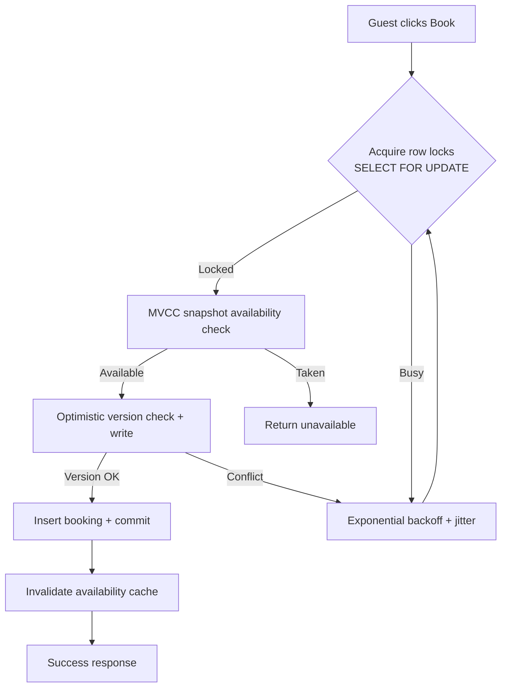

| Difficulty | Channel | Tags |
|---|---|---|
| intermediate | database | acid, isolation-levels, mvcc |

Picture this: a guest taps 'Book,' and behind that single click a chain of payment calls fans out across services, gateways, and acquiring banks. As Airbnb migrated payments to a service-oriented architecture, dropped responses, timeouts, and double-clicks meant the same charge or payout could execute twice with no single transaction to roll the whole chain back [1]. The fix did more than patch a bug — it delivered five nines (99.999%) payment consistency while annual volume doubled. That is the stakes of concurrency control, and it is exactly where this story begins.

---

> ### Real-World Case — Airbnb
>
> As Airbnb migrated payments to a service-oriented architecture, one 'Book' click fanned out into a chain of distributed calls across payment services, gateways, and acquiring banks. Dropped responses, timeouts, and users clicking 'Book' twice meant the same charge or payout could be executed twice, with no single transaction to roll the whole chain back.
>
> | | |
> |---|---|
> | **Challenge** | Guarantee at-most-once execution and safe automatic retries across many services without a slow central coordinator, and without letting database replication lag turn a legitimate retry into a duplicate financial transaction. |
> | **Solution** | Built 'Orpheus', a general-purpose idempotency library used across payments services. Each request carries a unique key; the first request acquires a row-level database lock on that key, granting an expiring lease (set longer than the RPC timeout) so duplicate clicks or retries cannot race. Each call is split into Pre-RPC, RPC, and Post-RPC phases so no network calls occur inside DB transactions and no DB calls occur during the RPC; exceptions are classified retryable vs non-retryable. Idempotency tables are read and written only on a sharded MySQL master — deliberately no replicas or caches. |
> | **Outcome** | Achieved five nines (99.999%) consistency for payments since launch while annual payment volume simultaneously doubled. |
> | **Lesson** | For correctness-critical operations, deliberately give up read replicas and caching: just a few seconds of replica lag can turn a correct idempotent retry into a duplicate charge. Keep the idempotency check and the write in the same master transaction, and make locks expiring so a crashed caller cannot block forever. |

---

## Hook — The deploy looked fine. Then the tickets arrived.

The deploy looked clean. Green checks, passing tests, a quiet dashboard. Then the support tickets arrived: two confirmation emails for one reservation, two charges on one card, and a guest who wanted an explanation. Sound familiar?

Many developers meet concurrency bugs this way — not in a code review, but through a customer complaint. Under light traffic everything behaves. The moment traffic spikes, two requests interleave and the database happily accepts both. 💡 Insight: race conditions are not rare edge cases. If two calls can overlap, some schedule will overlap them, and at scale that schedule shows up every day.

So the real question is not 'could this happen?' It is 'when it happens, what actually stops it?' That question turns a routine booking button into an engineering thriller.

## Problem — Two guests, one property, zero coordination

Building on that unease, the challenge is easy to state and brutal to solve. Two travelers want the same cottage for the same weekend, and both clicks land within milliseconds. Both reads see 'available,' both writes commit, and suddenly one tiny cabin has two families. This is the classic lost-update race, and it breaks a core ACID guarantee [5].

Now add payments. A reservation is not one row; it is a chain of services, gateways, and banks. Without a single transaction spanning that chain, a timeout after a successful charge can look exactly like a failure, and a retry can duplicate money movement [8]. ⚠️ Watch Out: a network timeout does not mean the operation did not happen — it means the answer got lost.

Consequently, the stakes jump from 'annoying bug' to 'regulatory headache.' Availability must stay high, yet correctness cannot bend. How does a system stay both open and exact?

## Real-World Case — Airbnb

However, theory becomes vivid when a real team faces it. As Airbnb moved payments into a service-oriented architecture, a single 'Book' click fanned out into distributed calls across payment services, gateways, and acquiring banks. Dropped responses, timeouts, and users clicking 'Book' twice meant the same charge or payout could be executed twice, with no single transaction to roll the whole chain back [1].

🔥 Hot Take: wrapping one database in a transaction does not make a distributed chain atomic. The hard part starts at the service boundary.

The result is worth staring at. The payments platform reached five nines — 99.999% — consistency from launch, while annual payment volume doubled over the same stretch [1]. That is the bar: correctness that does not collapse under growth. Teams achieved it by treating idempotency, durable state, and reconciliation as first-class design concerns rather than cleanup tasks.

## Deep Dive — Locks, versions, and snapshots

This leads naturally to the toolbox. The first instinct is often 'just use transactions,' but the isolation level chosen decides which anomalies survive. SERIALIZABLE makes concurrent transactions behave as if they ran one after another, which is the strongest guarantee and the most expensive [2]. Many developers think READ COMMITTED is 'good enough' until a phantom availability row appears during a holiday rush.

Building on isolation, locking decides who waits. PostgreSQL's SELECT FOR UPDATE grabs row-level locks on the exact availability rows for the requested dates, so a second buyer blocks instead of blindly writing [6][10]. Optimistic concurrency control takes the opposite bet: read freely, then verify a version column before committing, retrying if the version moved [3].

Meanwhile, MVCC snapshot reads let availability checks see a consistent view without blocking writers [4]. Read replicas can serve those checks, and a write-through cache with invalidation on success keeps the hot path fast [9]. 🎯 Key Point: reads can be optimistic and cheap; writes must be serialized and guarded.

Here is the real tradeoff, stripped of jargon:

| Strategy | How it works | Best for | Cost |
|---|---|---|---|
| Pessimistic lock (FOR UPDATE) | Lock rows before reading | Hot, contended listings | Blocks writers, adds latency |
| Optimistic version check | Verify version at commit | Low-contention inventory | Retries under contention |
| SERIALIZABLE | DB orders work as sequential | Money-critical operations | Aborts need retry logic |
| MVCC snapshot | Read a consistent snapshot | Availability on replicas | Snapshot can be stale |

⚠️ Watch Out: retries without jitter create a thundering herd — every client backs off for the same 50ms and collides again. Add randomness, and cap attempts with a circuit breaker for hot properties [7].

## Workflow — From click to committed booking

Consequently, the pieces snap into a repeatable sequence. The diagram below, 'Booking Transaction Flow,' shows the path a single reservation takes, including the loop that makes contention survivable.

1. The request opens a SERIALIZABLE transaction and sets a short statement timeout.
2. SELECT ... FOR UPDATE locks only the availability rows for the booked dates.
3. An MVCC snapshot read confirms those rows are still free [4].
4. An optimistic UPDATE checks the version; a zero row count means someone won the race.
5. On success, the booking row is inserted, the transaction commits, and the cache entry is invalidated.
6. On conflict, exponential backoff with jitter sends the request around again, up to a hard cap [7].

💡 Insight: the retry loop is not a bug workaround — it is the design. Under SERIALIZABLE, some transactions are supposed to abort, so retrying is the normal path, not the exception [2].

## Code Example — The guarded booking transaction

Here is the core pattern in Python (the complete, runnable version follows in the code block):

```python
with transaction(conn) as cur:
    rows = acquire_availability(cur, property_id, check_in, check_out)
    version = rows[0][2]
    cur.execute('''UPDATE availability SET booked = TRUE,
        version = version + 1 WHERE version = %s''', (version,))
    if cur.rowcount == 0:
        raise BookingConflict('Version changed during booking')
```

Now the line-by-line logic:

1. transaction() wraps the work in a commit-or-rollback boundary, and the connection runs at SERIALIZABLE.
2. acquire_availability() issues SELECT ... FOR UPDATE so only one request holds those date rows.
3. rows[0][2] captures the version read under that lock.
4. The UPDATE only writes when the version still matches; rowcount == 0 signals a lost race.
5. The INSERT records the reservation, and the retry loop applies backoff with jitter before trying again.

⚠️ Watch Out: never cache an 'available' response without invalidating it on commit, or guests will keep booking phantom nights.

## Lessons Learned — Battle scars and a better tomorrow

Building on the code, a few scars are worth naming. First, idempotency keys turn 'Book' double-clicks into one logical operation — the same idea Airbnb leaned on to avoid duplicate charges [1]. Second, locks must be narrow; locking an entire property table for one weekend is a throughput killer. Third, monitor lock contention and watch the retry rate, because a rising retry curve is the earliest warning that a listing has become hot.

Many developers think adding more replicas fixes contention. Actually replicas help reads; they do nothing for write conflicts, which must be resolved at the source [9]. 🔥 Hot Take: 'high availability' and 'strong consistency' are not opposites, but assuming a replica can arbitrate a booking is how teams learn the difference the hard way.

🎯 Key Point: serialize the write, optimize the read, and make every retry safe.

So what changes tomorrow? Audit the one endpoint where two users can claim the same resource. Add a version column, wrap the critical section in a narrow lock, and give retries a capped, jittered backoff. If this feels overwhelming, start with a single table and one integration test that fires two bookings at the same instant — that test will teach more than a dozen diagrams.

---

## Booking Transaction Flow



<details>
<summary><strong>Original Interview Question</strong></summary>

**Q:** You're building a booking system for Airbnb where multiple users can reserve the same property simultaneously. How would you design the transaction handling to prevent double bookings while maintaining high availability?

**A:** Use SERIALIZABLE isolation with optimistic concurrency control. Implement row-level locks on property availability tables, use MVCC snapshot reads for checking availability, and apply application-level validation to ensure atomic booking operations.

</details>

## Conclusion

The guest who clicked 'Book' twice never saw the storm behind that button — but Airbnb's engineers did, and the fix turned a five-nines promise into a doubling of volume [1]. The journey ran from a lost-update race, through locks and versions and snapshots, to a retry loop that treats conflict as routine. Here is the one-line insight worth taking to the next design review: serialize the write, optimize the read, and make every retry safe. Start tomorrow by finding the single resource two users can claim at once, then write the test that fires both claims together. That test is where the real story begins.

---

## References

1. [Airbnb incident report](https://medium.com/airbnb-engineering/avoiding-double-payments-in-a-distributed-payments-system-2981f6b070bb) — blog
2. [Isolation (database systems)](https://en.wikipedia.org/wiki/Isolation_(database_systems)) — documentation
3. [Optimistic concurrency control](https://en.wikipedia.org/wiki/Optimistic_concurrency_control) — documentation
4. [Multiversion concurrency control](https://en.wikipedia.org/wiki/Multiversion_concurrency_control) — documentation
5. [ACID](https://en.wikipedia.org/wiki/ACID) — documentation
6. [Lock (database)](https://en.wikipedia.org/wiki/Lock_(database)) — documentation
7. [Exponential backoff](https://en.wikipedia.org/wiki/Exponential_backoff) — documentation
8. [Distributed transaction](https://en.wikipedia.org/wiki/Distributed_transaction) — documentation
9. [Amazon RDS for PostgreSQL](https://docs.aws.amazon.com/AmazonRDS/latest/UserGuide/CHAP_PostgreSQL.html) — documentation
10. [PostgreSQL source repository](https://github.com/postgres/postgres) — documentation

---

**Author:** Satishkumar Dhule — [GitHub](https://github.com/satishkumar-dhule) · [LinkedIn](https://linkedin.com/in/satishkumar-dhule) · [Website](https://satishkumar-dhule.github.io)
